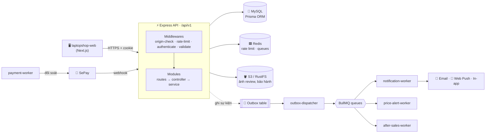
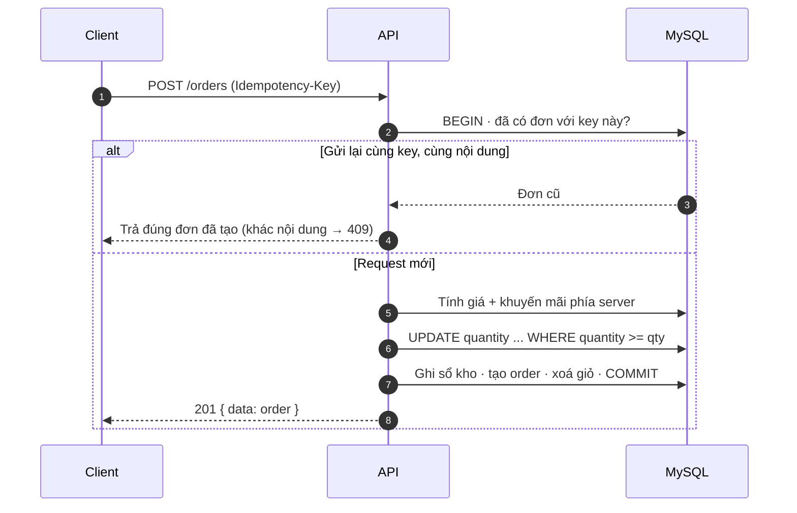
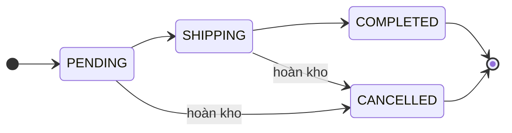

<div align="center">

# 💻 Laptop Shop API

**Backend REST API cho nền tảng thương mại điện tử bán laptop, từ catalog, giỏ hàng, thanh toán QR đến bảo hành sau bán và tư vấn bằng AI.**

<br/>

[](https://nodejs.org/)
[](https://www.typescriptlang.org/)
[](https://expressjs.com/)
[](https://www.prisma.io/)
[](https://www.mysql.com/)
[](https://redis.io/)
[](https://bullmq.io/)
[](https://www.docker.com/)
[](https://github.com/QuocDuy21-10/laptopshop-api/actions/workflows/ci.yml)
[](https://quocduy21-10.github.io/laptopshop-api/)

<br/>

[📚 Tài liệu chi tiết](https://quocduy21-10.github.io/laptopshop-api/) •
[✨ Tính năng](#-tính-năng-nổi-bật) •
[🏗️ Kiến trúc](#️-kiến-trúc) •
[🛠️ Công nghệ](#️-công-nghệ) •
[🚀 Bắt đầu nhanh](#-bắt-đầu-nhanh) •
[⚙️ Workers](#️-workers--tác-vụ-nền) •
[🚢 Production](#-triển-khai-production)

</div>

---

## 📖 Giới thiệu

**Laptop Shop API** là backend JSON REST (`/api/v1`) phục vụ cả storefront lẫn trang quản trị của một cửa hàng laptop. Giao diện người dùng nằm ở repo riêng [**laptopshop-web**](https://github.com/QuocDuy21-10/laptopshop-web) (Next.js).

Dự án không dừng ở CRUD cơ bản mà xử lý các bài toán thực tế của một hệ thống bán hàng: **đặt hàng idempotent** chống trừ kho hai lần, **thanh toán chuyển khoản QR có đối soát tự động**, **flash sale và coupon chịu được truy cập đồng thời**, **sổ kho (stock ledger)**, **quy trình bảo hành/sửa chữa** và **thông báo đa kênh qua Outbox Pattern**.

> [!TIP]
> 📚 **Tài liệu chi tiết:** Xem website tài liệu kỹ thuật đầy đủ của dự án (tổng quan, kiến trúc C4, data dictionary của 52 model database, quy tắc nghiệp vụ và ADR) tại 👉 [**https://quocduy21-10.github.io/laptopshop-api/**](https://quocduy21-10.github.io/laptopshop-api/) (hoặc xem trực tiếp trong thư mục [`docs/`](docs/README.md)).

<div align="center">

| 🧩 22 module nghiệp vụ | 🗄️ 52 Prisma model | 🔄 49 migration | 🧪 158 file unit test | ⚙️ 6 worker nền |
| :--------------------: | :----------------: | :-------------: | :-------------------: | :-------------: |

</div>

---

## ✨ Tính năng nổi bật

<table>
<tr>
<td width="50%" valign="top">

### 🛍️ Catalog & giá

- Danh sách, chi tiết, **so sánh** sản phẩm
- Bộ lọc động (`/filters`, `/facets`) theo hãng, giá, CPU/GPU, RAM, màn hình, pin, cân nặng, đánh giá
- Sắp xếp theo bán chạy, lọc sản phẩm **đang flash sale**
- **Promotions**: coupon, flash sale, nhân bản chương trình
- Lịch giá (price windows) tính sẵn cho catalog

</td>
<td width="50%" valign="top">

### 🛒 Mua hàng & thanh toán

- Giỏ hàng gắn với tài khoản, kiểm tra tồn kho
- Checkout **idempotent** (`Idempotency-Key`), giá tính ở server
- Trừ kho bằng `updateMany` có điều kiện trong một transaction
- **Thanh toán QR chuyển khoản qua SePay**: webhook, đối soát định kỳ, hàng chờ admin duyệt
- Huỷ đơn và hoàn kho tự động

</td>
</tr>
<tr>
<td valign="top">

### 🛠️ Sau bán hàng

- Yêu cầu **bảo hành** và **hỗ trợ kỹ thuật** cho thiết bị đã mua
- Tra cứu điều kiện bảo hành, báo giá sửa chữa, trao đổi tin nhắn
- Ảnh đính kèm lưu trên S3 private (presigned URL)
- **Đánh giá sản phẩm** kèm ảnh, bình chọn "hữu ích", kiểm duyệt

</td>
<td valign="top">

### 🤖 Tương tác khách hàng

- **AI Laptop Advisor**: gợi ý máy theo nhu cầu (Groq LLM), tự rơi về chấm điểm rule-based khi AI lỗi hoặc hết quota
- **Price alerts**: báo khi sản phẩm giảm giá
- Wishlist, newsletter (xác nhận 2 bước, export CSV)
- Thông báo **in-app, email (SMTP), Web Push** kèm tuỳ chọn nhận

</td>
</tr>
<tr>
<td valign="top">

### 📊 Quản trị

- Dashboard doanh thu theo khoảng thời gian
- CRUD sản phẩm, người dùng, vai trò, đơn hàng
- **Nhập kho** và sổ kho có script kiểm tra toàn vẹn
- Banner trang chủ, kiểm duyệt review, theo dõi và gửi lại thông báo lỗi

</td>
<td valign="top">

### 🔐 Bảo mật

- JWT access token trong cookie **HttpOnly** và **refresh token xoay vòng** (chỉ lưu hash, dùng lại token cũ thì thu hồi cả family)
- Quên/đặt lại mật khẩu, xác minh email bằng OTP
- Phân quyền `ADMIN` / `USER`, kiểm tra `Origin` chống CSRF
- Rate limit qua Redis, `helmet`, `hpp`, mật khẩu `bcrypt`

</td>
</tr>
</table>

---

## 🏗️ Kiến trúc



### Luồng đặt hàng



### Vòng đời đơn hàng



### Cấu trúc thư mục

```text
src/
├── server.ts            # khởi động, Redis, graceful shutdown
├── app.ts               # createApp(deps), không side effect, test gọi trực tiếp
├── config/env.ts        # toàn bộ biến môi trường, validate bằng Zod
├── routes/index.ts      # ráp mọi router dưới /api/v1 và /api/v1/admin
├── middlewares/         # authenticate, validate, rate-limit, origin-check, error
├── modules/<feature>/   # *.routes → *.controller → *.service → Prisma
│                        # + *.schema (Zod) + *.mapper (DTO, không lộ password)
├── workers/             # tiến trình nền chạy riêng
├── queues/              # định nghĩa BullMQ queue
├── docs/openapi.ts      # tài liệu OpenAPI sinh từ schema Zod
└── scripts/             # audit, verify, reconcile dùng cho vận hành
```

> [!NOTE]
> **Quy ước response:** thành công trả `{ data, meta? }`, lỗi trả `{ error: { code, message, details? } }`.

---

## 🛠️ Công nghệ

| Nhóm | Công nghệ |
| :--- | :--- |
| 🌐 **Runtime & framework** | Node.js 22, Express 5, TypeScript |
| 🗄️ **Database** | MySQL 8.4, Prisma ORM 6 |
| ⚡ **Cache & hàng đợi** | Redis 7, BullMQ, `rate-limit-redis` |
| 📋 **Validation & docs** | Zod 3, `zod-to-openapi`, Swagger UI |
| 🔑 **Xác thực** | `jsonwebtoken` (HS256), `bcrypt` |
| 🪣 **Lưu trữ file** | AWS SDK S3 (RustFS local, S3/R2 production), Multer, Sharp |
| 📬 **Thông báo** | Nodemailer (SMTP), `web-push` |
| 🤖 **AI** | Groq LLM (structured output) |
| 🛡️ **Bảo mật** | Helmet, HPP, CORS, rate limiting |
| 📊 **Quan sát** | Pino logger, Sentry |
| 🧪 **Chất lượng** | Jest, Supertest, ESLint, Prettier, Husky, lint-staged |
| 🐳 **Hạ tầng** | Docker Compose, GitHub Actions |

---

## 🚀 Bắt đầu nhanh

**Yêu cầu:** Node.js 22, pnpm, Docker.

```bash
# 1. Cấu hình
cp .env.example .env          # điền DATABASE_URL, JWT_SECRET

# 2. Cài đặt
pnpm install
pnpm exec prisma generate

# 3. Hạ tầng local: MySQL, Redis, Mailpit, RustFS
docker compose up -d mysql redis mailpit rustfs rustfs-init

# 4. Database
pnpm exec prisma migrate dev
pnpm run seed                 # roles, admin, sản phẩm mẫu (chỉ chèn vào bảng trống)

# 5. Chạy
pnpm run dev                  # http://localhost:8080
```

| Dịch vụ | Địa chỉ |
| :--- | :--- |
| API | `http://localhost:8080/api/v1` |
| Swagger UI (`ENABLE_DOCS=true`) | `http://localhost:8080/api-docs` |
| Health / Ready | `/healthz` · `/readyz` |
| Mailpit (xem email thử) | `http://localhost:8025` |
| RustFS console | `http://localhost:9001` |

### Lệnh thường dùng

| Lệnh | Mục đích |
| :--- | :--- |
| `pnpm run dev` | Chạy dev với nodemon |
| `pnpm run start:debug` | Dev kèm debugger `--inspect=9229` |
| `pnpm test` / `pnpm run test:cov` | Unit test / kèm coverage |
| `pnpm run lint` · `pnpm run typecheck` · `pnpm run format` | Kiểm tra chất lượng code |
| `pnpm run build` → `pnpm start` | Build sang `dist/` rồi chạy |

### Biến môi trường

Danh sách đầy đủ nằm trong [`.env.example`](.env.example), mọi biến được validate trong `src/config/env.ts` và app dừng ngay khi khởi động nếu cấu hình sai.

> [!IMPORTANT]
> - **Bắt buộc:** `DATABASE_URL`, `JWT_SECRET` (>= 16 ký tự), `REDIS_URL`, cùng `ADMIN_PASSWORD` (>= 12 ký tự) khi `NODE_ENV=production`.
> - **Feature flag** (mặc định tắt, chỉ bật khi đã cấu hình xong phần tương ứng):

| Flag | Bật tính năng |
| :--- | :--- |
| `ENABLE_DOCS` | Swagger UI tại `/api-docs` |
| `EMAIL_ENABLED` | Gửi email qua SMTP |
| `WEB_PUSH_ENABLED` | Web Push (cần `VAPID_*`) |
| `NOTIFICATION_OUTBOX_ENABLED` · `NOTIFICATION_WORKER_ENABLED` | Outbox dispatcher và worker gửi thông báo |
| `BANK_TRANSFER_ENABLED` | Thanh toán QR (`PAYMENT_PROVIDER=fake` hoặc SePay) |
| `ADVISOR_AI_ENABLED` | AI Advisor qua Groq (cần `GROQ_API_KEY`, `GROQ_MODEL`) |
| `REVIEW_IMAGES_ENABLED` · `AFTER_SALES_IMAGES_ENABLED` | Upload ảnh review, ảnh bảo hành lên S3 |
| `AFTER_SALES_WORKER_ENABLED` | Worker xử lý mốc bảo hành và dọn ảnh |
| `FLASH_SALE_PRICE_ALERT_ENABLED` | Báo giá giảm cho cả flash sale |

---

## ⚙️ Workers & tác vụ nền

Mỗi worker là một tiến trình riêng (service riêng trong `docker-compose.yml`) và ghi heartbeat vào database.

| Worker | Nhiệm vụ |
| :--- | :--- |
| `payment-worker` | Hết hạn thanh toán, đối soát giao dịch với SePay, dọn dữ liệu cũ |
| `outbox-dispatcher` | Đọc bảng outbox, đẩy sự kiện vào các BullMQ queue |
| `notification-worker` | Gửi thông báo qua email, Web Push, in-app có retry |
| `notification-maintenance-worker` | Áp dụng chính sách lưu trữ thông báo |
| `price-alert-worker` | Quét và đánh giá price alert, gửi thông báo giảm giá |
| `after-sales-worker` | Xử lý mốc thời gian yêu cầu bảo hành, xoá ảnh đính kèm |

<br/>

<details>
<summary><b>🧰 Script vận hành</b> (bấm để mở)</summary>

<br/>

| Lệnh | Mục đích |
| :--- | :--- |
| `pnpm run inventory:verify-ledger` | Kiểm tra sổ kho khớp tồn kho |
| `pnpm run catalog-pricing:rebuild` / `:audit` | Dựng lại hoặc kiểm tra price windows của catalog |
| `pnpm run promotions:verify-flash-sale` | Kiểm tra dữ liệu flash sale |
| `pnpm run price-alerts:run-once` | Chạy một lượt quét price alert |
| `pnpm run review-images:reconcile` | Đối soát ảnh review với object storage |
| `pnpm run after-sales:reconcile-attachments` | Đối soát ảnh đính kèm bảo hành |
| `pnpm run products:audit-facets` / `:audit-rating` | Kiểm tra truy vấn facet và rating |
| `pnpm run products:benchmark-catalog` | Benchmark truy vấn catalog |

<br/>

> [!NOTE]
> `review-images:reconcile` chỉ xoá object của row `PENDING`/`DELETING` đã đủ điều kiện. Row `READY` bị mất object chỉ được báo cáo để vận hành xử lý, không tự xoá dữ liệu database.

</details>

<details>
<summary><b>🪣 Object storage cho ảnh</b> (bấm để mở)</summary>

<br/>

Ở local, ảnh review và ảnh bảo hành dùng RustFS (`http://localhost:9000`, bucket private như `laptopshop-review-images`). API không mount volume upload cho các ảnh này. Production dùng AWS S3, Cloudflare R2 hoặc storage tương thích S3 với cùng adapter, kèm credentials và policy riêng.

</details>

---

## 🧪 Kiểm thử & CI

- **Chỉ unit test** (Jest + Supertest): Prisma được mock qua `tests/helpers/prisma.ts`, không cần MySQL, Redis hay storage thật.
- Chạy một test: `pnpm exec jest tests/path/file.test.ts -t "tên test"`.
- **GitHub Actions** ([`ci.yml`](.github/workflows/ci.yml)) chạy `lint → typecheck → test → build` rồi build Docker image cho mỗi push lên `main` và mỗi pull request.
- Husky + lint-staged tự chạy ESLint khi commit.

---

## 🚢 Triển khai production

```bash
cp .env.example .env   # NODE_ENV, secrets, ADMIN_PASSWORD, CORS_ORIGINS, COOKIE_DOMAIN, MYSQL_*
docker compose up -d --build
```

> [!WARNING]
> - Container tự chạy `prisma migrate deploy` rồi seed (chỉ chèn vào bảng trống) khi khởi động. **Nên backup database trước khi deploy migration `cleanup_legacy`** (xoá bảng `Session`, cột `cart.sum` và `cart_detail.price`).
> - Cookie đăng nhập có cờ `Secure` ở production và app đặt `trust proxy = 1`, nên reverse proxy phải chạy HTTPS và gửi header `X-Forwarded-Proto`.
> - Frontend và API phải **cùng site** (ví dụ `shop.com` + `api.shop.com`): thêm origin của frontend vào `CORS_ORIGINS`, đặt `COOKIE_DOMAIN` khi frontend cần đọc cookie.

- `GET /healthz` dùng cho liveness, `GET /readyz` kiểm tra MySQL và Redis.
- `SENTRY_DSN` không bắt buộc, không đặt thì Sentry tắt. `ENABLE_DOCS` mặc định tắt.

---

<div align="center">

Made with ❤️ by [QuocDuy21-10](https://github.com/QuocDuy21-10) · [Tài liệu chi tiết](https://quocduy21-10.github.io/laptopshop-api/) · Frontend: [laptopshop-web](https://github.com/QuocDuy21-10/laptopshop-web)

</div>
