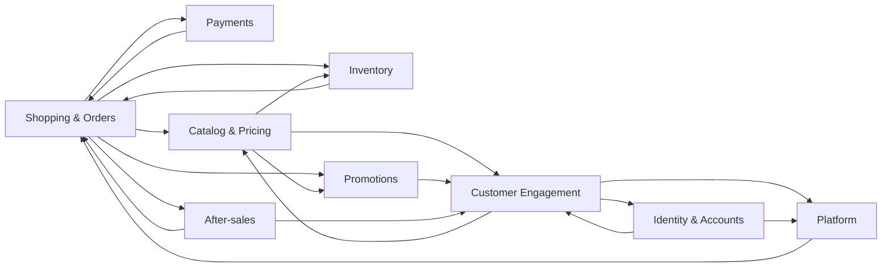

# Các nhóm nghiệp vụ

Tài liệu này trả lời: hệ thống chia thành những nhóm nghiệp vụ (bounded context) nào, mỗi nhóm gồm module nào và chúng phụ thuộc nhau ra sao.

> Đối chiếu code: main @ 794f0a1 (2026-11-01)

Có 22 thư mục trong `src/modules/`.

## Bảng nhóm nghiệp vụ

Mỗi module trong `src/modules/` thuộc đúng một nhóm.

| Nhóm | Module | Vai trò |
| --- | --- | --- |
| Identity & Accounts | `auth`, `users`, `email-verification` | Đăng ký, đăng nhập, phiên làm việc, hồ sơ, xác minh email |
| Catalog & Pricing | `products`, `pricing`, `reviews`, `home-banners`, `store-info` | Danh mục sản phẩm, giá hiệu lực, đánh giá, banner trang chủ, thông tin cửa hàng |
| Shopping & Orders | `cart`, `orders` | Giỏ hàng, đặt hàng idempotent, vòng đời đơn |
| Payments | `payments` | Thanh toán chuyển khoản QR, webhook, đối soát, ca cần admin xem xét |
| Inventory | `inventory` | Phiếu nhập kho và sổ kho |
| Promotions | `promotions` | Coupon, khuyến mãi tự động, flash sale có quota |
| Customer Engagement | `wishlist`, `price-alerts`, `notifications`, `newsletter`, `advisor` | Yêu thích, cảnh báo giá, thông báo, bản tin, tư vấn AI |
| After-sales | `after-sales` | Yêu cầu bảo hành và sửa chữa, ảnh đính kèm |
| Platform | `outbox`, `workers`, `dashboard` | Outbox sự kiện, heartbeat của worker, số liệu quản trị |

## Phụ thuộc giữa các nhóm

Mũi tên `A --> B` nghĩa là code của nhóm A import code của nhóm B. Sơ đồ chỉ vẽ các cạnh chính, tổng hợp từ các câu lệnh `import` giữa các module.

Một số điểm đáng chú ý:

- `orders` là điểm hội tụ của checkout: nó gọi `cart`, `products`, `promotions`, `inventory`, `payments` và `after-sales`.
- `payments` và `orders` import lẫn nhau, vì thanh toán gắn với đơn và đơn cần trạng thái thanh toán.
- `outbox` là cầu nối bất đồng bộ: `auth`, `price-alerts`, `notifications` và `email-verification` ghi sự kiện vào outbox thay vì gọi trực tiếp worker. Xem [background-jobs.md](../02-architecture/background-jobs.md).

> **Suy luận:** vì `pricing` phục vụ cả catalog, wishlist và price alert, giá hiệu lực được tách thành module riêng để mọi nơi hiển thị giá dùng chung một cách tính.

## Nguồn

- [src/modules/](https://github.com/QuocDuy21-10/laptopshop-api/tree/main/src/modules): cấu trúc thư mục từng module
- [src/routes/index.ts](https://github.com/QuocDuy21-10/laptopshop-api/blob/main/src/routes/index.ts): `createApiV1Router`
- [prisma/schema.prisma](https://github.com/QuocDuy21-10/laptopshop-api/blob/main/prisma/schema.prisma)
