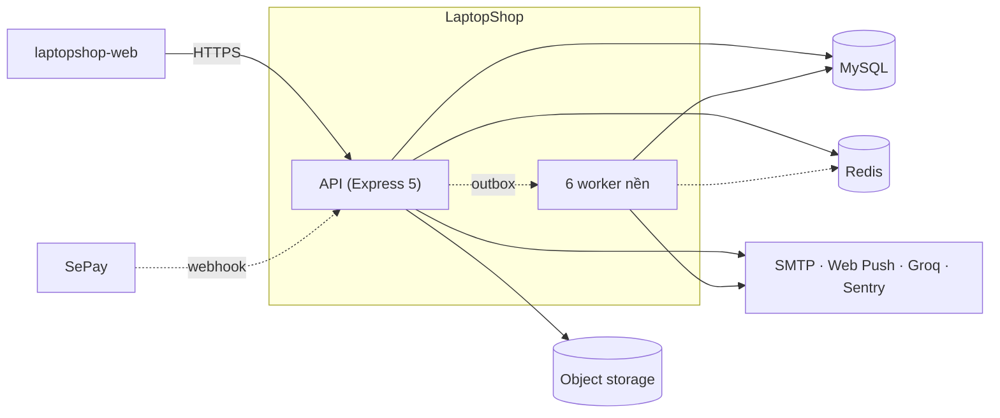

# Tổng quan kiến trúc

Tài liệu này trả lời: kiến trúc tổng thể của LaptopShop API trông như thế nào và đọc tiếp tài liệu nào để đi sâu.

> Đối chiếu code: main @ 794f0a1 (2026-11-01)

## Cách tiếp cận: mô hình C4

Kiến trúc được mô tả theo bốn mức C4, từ tổng quan đến chi tiết:

| Mức | Tài liệu | Nội dung |
| --- | --- | --- |
| C1 Context | [system-context.md](system-context.md) | Người dùng và hệ thống ngoài |
| C2 Container | [container-diagram.md](container-diagram.md) | Tiến trình và kho dữ liệu |
| C3 Component | [component-diagram.md](component-diagram.md) | Mẫu phân tầng bên trong API |
| C4 Code | Sẽ có trong tài liệu từng module (giai đoạn sau) | Chỉ cho phần phức tạp |

## Bức tranh tổng

Sơ đồ gộp C1 và C2. Nét liền là đồng bộ, nét đứt là bất đồng bộ.

Sơ đồ này đơn giản hoá: API không gọi trực tiếp worker. API ghi sự kiện vào bảng outbox trong MySQL, `outbox-dispatcher` đọc bảng này và đẩy vào các queue BullMQ, rồi các worker tiêu thụ. Chi tiết ở [background-jobs.md](background-jobs.md).

## Nguyên tắc kiến trúc

- **Một API, nhiều worker:** API chỉ phục vụ request; việc nền chạy ở các tiến trình riêng.
- **`createApp` không có side effect:** `src/app.ts` nhận phụ thuộc qua tham số, nên test gọi nó mà không cần database hay Redis.
- **Cấu hình tập trung:** mọi biến môi trường đi qua `src/config/env.ts`, kiểm tra bằng Zod và dừng ngay khi khởi động nếu sai.
- **Phân tầng cố định:** `routes → controller → service → Prisma`, kèm `schema` và `mapper` ([component-diagram.md](component-diagram.md)).
- **Sự kiện qua outbox:** thông báo và việc nền được ghi cùng transaction rồi phát đi sau, thay vì gọi trực tiếp.

> **Suy luận:** tách worker thành tiến trình riêng và dùng outbox giúp request không phải chờ việc chậm như gửi email, đồng thời không mất sự kiện nếu tiến trình chết giữa chừng.

## Đọc tiếp

| Muốn hiểu | Đọc |
| --- | --- |
| Request đi qua những bước nào | [request-lifecycle.md](request-lifecycle.md) |
| Worker, queue, outbox, script vận hành | [background-jobs.md](background-jobs.md) |
| Tích hợp ngoài và hành vi khi lỗi | [integration-architecture.md](integration-architecture.md) |
| Vì sao chọn công nghệ này | [decisions/README.md](decisions/README.md) |

## Nguồn

- [src/app.ts](https://github.com/QuocDuy21-10/laptopshop-api/blob/main/src/app.ts): `createApp`
- [src/server.ts](https://github.com/QuocDuy21-10/laptopshop-api/blob/main/src/server.ts)
- [src/config/env.ts](https://github.com/QuocDuy21-10/laptopshop-api/blob/main/src/config/env.ts): `env`
- [docker-compose.yml](https://github.com/QuocDuy21-10/laptopshop-api/blob/main/docker-compose.yml)
