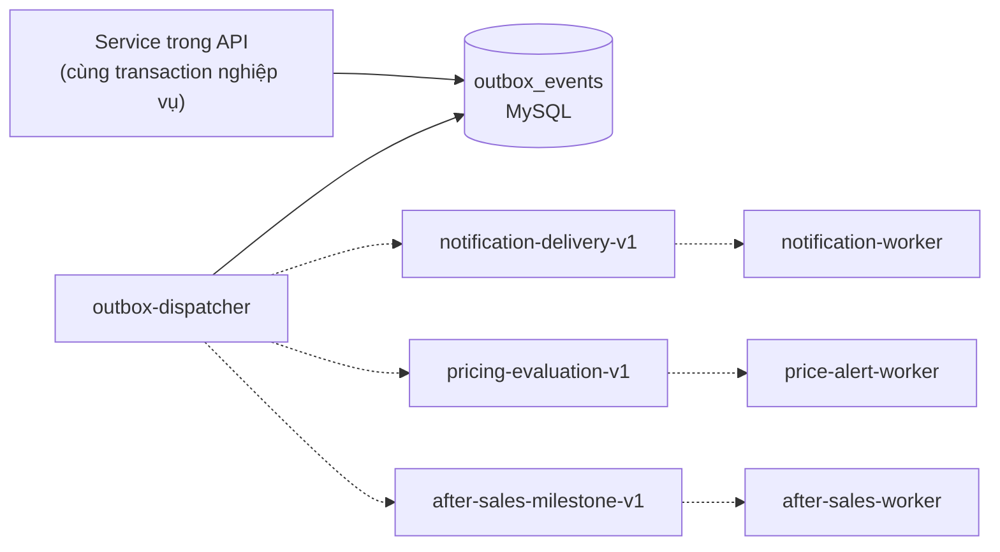

# Worker, hàng đợi và script vận hành

Tài liệu này trả lời: các việc nền chạy ở đâu, theo cơ chế nào, sự kiện đi từ API đến worker ra sao và có những script vận hành nào.

> Đối chiếu code: main @ 794f0a1 (2026-11-01)

Có 6 worker và 3 queue.

## Sáu worker

Mỗi worker có file điểm vào riêng trong `src/workers/` và là một service riêng trong `docker-compose.yml`.

| Worker | Cơ chế | Queue | Việc làm | Công tắc bật/tắt |
| --- | --- | --- | --- | --- |
| `payment-worker` | Các `setInterval` trong tiến trình | Không dùng queue | Bảo trì thanh toán mỗi 30 giây (hết hạn thanh toán), đối soát theo `PAYMENT_RECONCILIATION_INTERVAL_MS`, xoá payload thanh toán đã mã hoá mỗi 24 giờ | Không có công tắc riêng trong worker |
| `outbox-dispatcher` | Vòng lặp, nghỉ 1 giây giữa các lượt | Ghi vào cả 3 queue | Thuê một lô sự kiện outbox rồi đẩy vào queue phù hợp | `NOTIFICATION_OUTBOX_ENABLED` (mặc định `false`; tắt thì tiến trình thoát ngay) |
| `notification-worker` | Consumer BullMQ, `concurrency` 10 | `notification-delivery-v1` | Gửi thông báo qua email (SMTP) và Web Push theo từng delivery, có retry | `NOTIFICATION_WORKER_ENABLED` (mặc định `false`) |
| `notification-maintenance-worker` | Vòng lặp mỗi 60 giây | Không dùng queue | Áp dụng chính sách lưu trữ thông báo (`applyNotificationRetention`) | `NOTIFICATION_WORKER_ENABLED` |
| `price-alert-worker` | Vòng lặp theo `PRICE_ALERT_INTERVAL_MS`, cộng consumer BullMQ | `pricing-evaluation-v1` | Quét và đánh giá cảnh báo giá có khoá phân tán trên Redis; xử lý sự kiện đánh giá lại giá | Consumer BullMQ chỉ chạy khi `NOTIFICATION_OUTBOX_ENABLED` bật; vòng quét luôn chạy |
| `after-sales-worker` | Consumer BullMQ | `after-sales-milestone-v1` | Xử lý mốc thời gian của yêu cầu bảo hành và xoá ảnh đính kèm | `AFTER_SALES_WORKER_ENABLED` (mặc định `false`) |

Các queue được tạo bằng `createQueue` và `createWorker` trong `src/queues/queue.factory.ts`. Tiền tố queue lấy từ `NOTIFICATION_QUEUE_PREFIX` (queue notification và pricing) và `AFTER_SALES_QUEUE_PREFIX` (queue after-sales).

## Outbox đến hàng đợi

API không đẩy job trực tiếp vào BullMQ. Nó ghi một dòng vào bảng `outbox_events` trong cùng transaction với thay đổi dữ liệu. `outbox-dispatcher` đọc bảng này và chuyển thành job.

Dispatcher chọn queue theo `eventType`:

| `eventType` | Queue |
| --- | --- |
| `NOTIFICATION_DELIVERY_REQUESTED` | `notification-delivery-v1` |
| `AFTER_SALES_MILESTONE_REQUESTED`, `AFTER_SALES_ATTACHMENT_DELETE_REQUESTED` | `after-sales-milestone-v1` |
| `PRICE_REEVALUATION_REQUESTED` | `pricing-evaluation-v1` |

Cơ chế an toàn khi chạy nhiều tiến trình:

- **Lease:** dispatcher "thuê" một lô tối đa `OUTBOX_BATCH_SIZE` (mặc định 100) dòng trong `OUTBOX_LEASE_MS` (mặc định 60 giây) bằng `leaseOwner` và `leaseExpiresAt`, nên hai dispatcher không xử lý cùng một dòng.
- **Chống trùng:** mỗi sự kiện có `dedupeKey` duy nhất.
- **Đánh dấu kết quả:** thành công thì `markOutboxPublished`, lỗi thì `markOutboxFailed` (tăng `publishAttempts`, ghi `lastErrorCode` và nhả lease để dòng được thử lại).

Retry của BullMQ dùng `defaultJobOptions` trong `queue.factory.ts`: tối đa 5 lần (`attempts: 5`), backoff luỹ thừa bắt đầu từ 1 giây, giữ job hoàn thành 7 ngày và job lỗi 30 ngày. Riêng việc gửi thông báo còn bị chặn bởi `DELIVERY_MAX_ATTEMPTS` (mặc định 5).

> **Suy luận:** dùng outbox thay vì enqueue trực tiếp giúp sự kiện và thay đổi dữ liệu cùng thành công hoặc cùng thất bại: nếu API chết ngay sau khi commit, dòng outbox vẫn còn trong MySQL để dispatcher xử lý. Quyết định này sẽ có ADR riêng ở giai đoạn tài liệu nghiệp vụ.

## Heartbeat

`recordWorkerHeartbeat` ghi trạng thái worker vào bảng `WorkerHeartbeat` theo cặp (`workerName`, `instanceId`). Hiện chỉ ba worker gọi hàm này:

| Worker | Ghi heartbeat |
| --- | --- |
| `after-sales-worker` | Khi khởi động, mỗi job, mỗi 60 giây và khi dừng (`STOPPING`) |
| `notification-maintenance-worker` | Mỗi lượt bảo trì |
| `price-alert-worker` | Mỗi 60 giây và mỗi lượt quét, qua một bộ ghi tuần tự |

`payment-worker`, `outbox-dispatcher` và `notification-worker` hiện không ghi heartbeat vào bảng này.

## Script vận hành

Các script nằm trong `src/scripts/` và chạy thủ công khi cần kiểm tra hoặc sửa dữ liệu. Chúng không phải tiến trình thường trực.

| Script | Lệnh | Mục đích |
| --- | --- | --- |
| `verify-stock-ledger.ts` | `pnpm run inventory:verify-ledger` | Kiểm tra sổ kho khớp tồn kho |
| `verify-flash-sale.ts` | `pnpm run promotions:verify-flash-sale` | Kiểm tra dữ liệu flash sale |
| `rebuild-catalog-price-windows.ts` | `pnpm run catalog-pricing:rebuild` | Dựng lại price window của catalog |
| `audit-catalog-price-windows.ts` | `pnpm run catalog-pricing:audit` | Kiểm tra price window |
| `run-price-alert-sweep.ts` | `pnpm run price-alerts:run-once` | Chạy một lượt quét cảnh báo giá |
| `reconcile-review-images.ts` | `pnpm run review-images:reconcile` | Đối soát ảnh review với object storage |
| `reconcile-after-sales-attachments.ts` | `pnpm run after-sales:reconcile-attachments` | Đối soát ảnh đính kèm bảo hành |
| `audit-product-facets.ts` | `pnpm run products:audit-facets` | Kiểm tra truy vấn facet |
| `audit-product-rating-query.ts` | `pnpm run products:audit-rating` | Kiểm tra truy vấn rating |

## Nguồn

- [docker-compose.yml](../../docker-compose.yml)
- [src/workers/](../../src/workers/)
- [src/queues/queue.factory.ts](../../src/queues/queue.factory.ts): `createQueue`, `createWorker`, `defaultJobOptions`
- [src/queues/notification.queue.ts](../../src/queues/notification.queue.ts)
- [src/queues/pricing.queue.ts](../../src/queues/pricing.queue.ts)
- [src/queues/after-sales.queue.ts](../../src/queues/after-sales.queue.ts)
- [src/modules/outbox/](../../src/modules/outbox/): `claimOutboxBatch`, `dispatchOutboxBatch`, `markOutboxPublished`, `markOutboxFailed`
- [src/modules/workers/worker-heartbeat.service.ts](../../src/modules/workers/worker-heartbeat.service.ts): `recordWorkerHeartbeat`
- [src/modules/payments/reconciliation.service.ts](../../src/modules/payments/reconciliation.service.ts): `startPaymentWorker`
- [src/scripts/](../../src/scripts/)
- [package.json](../../package.json): `scripts`
- [prisma/schema.prisma](../../prisma/schema.prisma): `OutboxEvent`, `WorkerHeartbeat`
