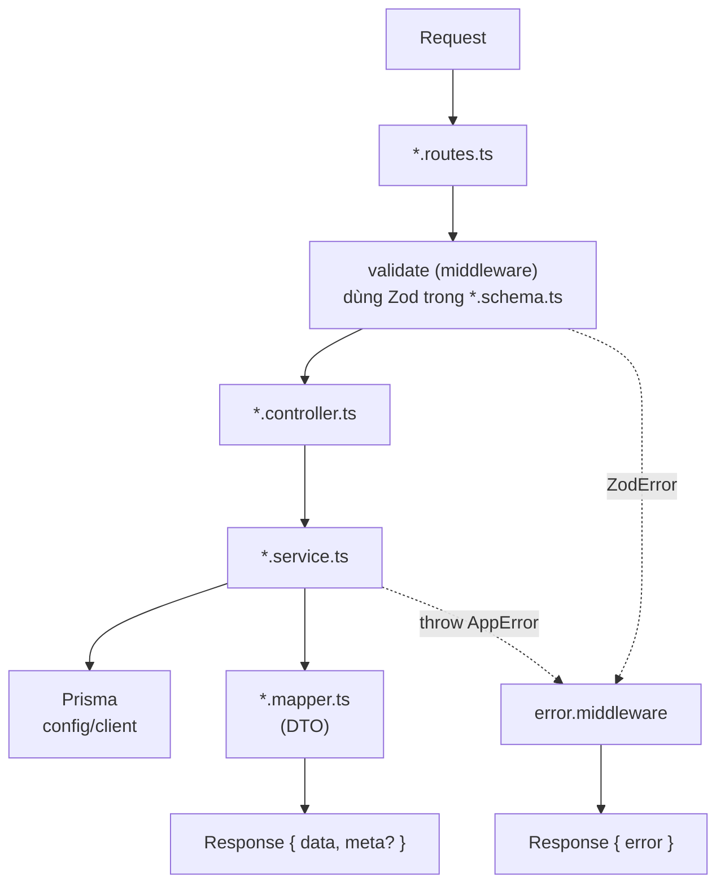

# Thành phần bên trong API (C3)

Tài liệu này trả lời: một module trong API được tổ chức theo mẫu nào và có những phần dùng chung nào.

> Đối chiếu code: main @ 794f0a1 (2026-11-01)

Tài liệu chỉ mô tả mẫu phân tầng chung của mọi module. Chi tiết riêng từng module sẽ có ở giai đoạn tài liệu sau.

## Mẫu phân tầng của một module

Mỗi module trong `src/modules/<feature>/` có các file theo vai trò:

| Tầng | File | Trách nhiệm |
| --- | --- | --- |
| Routes | `*.routes.ts` | Khai báo đường dẫn, gắn middleware (`authenticate`, `validate`, limiter) và handler |
| Schema | `*.schema.ts` | Schema Zod cho body, query, params; cũng là nguồn để sinh OpenAPI |
| Controller | `*.controller.ts` | Nhận request đã validate, gọi service, trả `{ data, meta? }` |
| Service | `*.service.ts` | Logic nghiệp vụ và truy cập Prisma |
| Mapper | `*.mapper.ts` | Chuyển dữ liệu Prisma thành DTO trả về client |

Ví dụ thực tế trong `src/modules/products/`: `products.routes.ts`, `products.schema.ts`, `products.controller.ts`, `products.service.ts`, `products.mapper.ts`. Module này có thêm các file chuyên biệt như `products.catalog.repository.ts`, `products.facets.service.ts` và `products.filter.ts`, nên không phải module nào cũng chỉ có đúng năm file trên.

Kết quả parse của `validate` được lưu ở `res.locals.params` và `res.locals.query` (do Express 5 chỉ cho đọc `req.query`); body đã parse thay thế `req.body`.

## Quy tắc xuyên suốt

- Không trả row Prisma trực tiếp và không bao giờ lộ `password`: luôn qua mapper.
- Mọi truy vấn giỏ hàng và đơn hàng được scope theo `req.auth.id`.
- Lỗi nghiệp vụ ném `AppError(message, status, code, details?)`; `error.middleware` biến nó (cùng `ZodError`, lỗi multer, lỗi body-parser) thành `{ error: { code, message, details? } }`.
- Import dùng path alias trong `tsconfig.json` (`config/*`, `middlewares/*`, `routes/*`, `lib/*`, `docs/*`, `modules/*`, `queues/*`, `scripts/*`), không dùng đường dẫn tương đối giữa các thư mục gốc.
- Cấu hình chỉ được đọc qua `env` trong `src/config/env.ts`; ngoại lệ duy nhất là cờ `JEST_WORKER_ID` trong `src/workers/price-alert-worker.ts`, dùng để không tự khởi động worker khi chạy test.

## Phần dùng chung

| Vị trí | Nội dung |
| --- | --- |
| `src/middlewares/` | `authenticate` (cũng có `optionalAuthenticate`), `require-role`, `validate`, `origin-check`, `rate-limit`, `security`, `multer`, `error.middleware` |
| `src/lib/` | `errors` (`AppError`), `http` (phân trang), `logger` (pino), `idempotency`, `password`, `cookies`, `actor`, `csv`, `prisma-retry`, `shop-time`, thư mục `images/` và `storage/` |
| `src/queues/` | Định nghĩa 3 queue BullMQ và `queue.factory` |
| `src/config/` | `env` (Zod, fail-fast), `client` (Prisma), `redis`, `constant`, dữ liệu seed |
| `src/routes/` | `index.ts` ráp mọi router dưới `/api/v1`, `health.ts` |
| `src/workers/` | Điểm vào của 6 worker (không thuộc tiến trình API) |

## Nguồn

- [src/modules/products/](../../src/modules/products/): ví dụ module
- [src/middlewares/validate.ts](../../src/middlewares/validate.ts): `validate`
- [src/middlewares/error.middleware.ts](../../src/middlewares/error.middleware.ts): `errorHandler`, `notFoundHandler`
- [src/lib/errors.ts](../../src/lib/errors.ts): `AppError`
- [src/lib/http.ts](../../src/lib/http.ts)
- [src/routes/index.ts](../../src/routes/index.ts): `createApiV1Router`
- [tsconfig.json](../../tsconfig.json): `paths`
