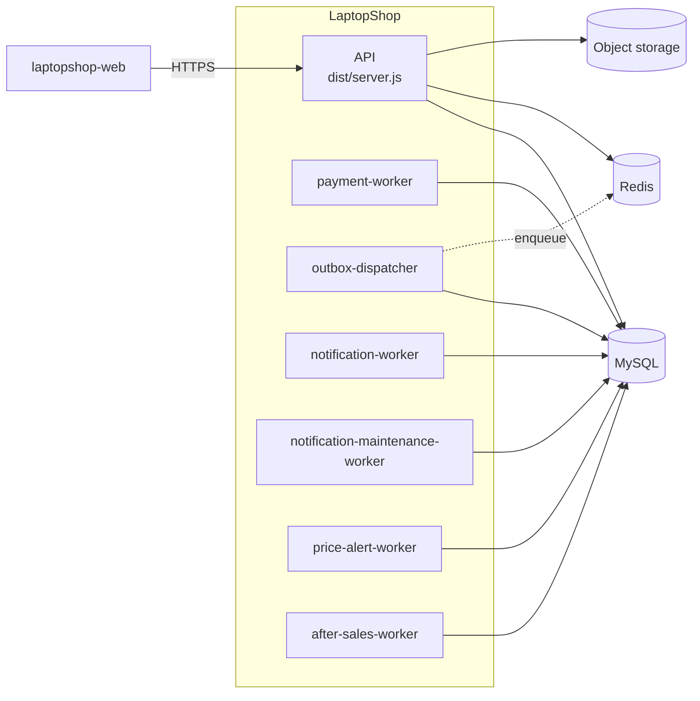
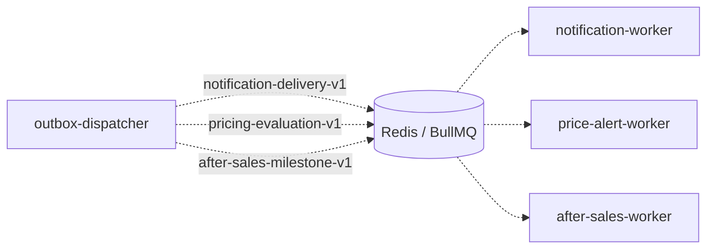

# Các thành phần triển khai (C2)

Tài liệu này trả lời: hệ thống gồm những tiến trình và kho dữ liệu nào, và chúng nối với nhau ra sao.

> Đối chiếu code: main @ 794f0a1 (2026-11-01)

## Tiến trình và kho dữ liệu

Một lần triển khai gồm 1 API, 6 worker (mỗi worker là một service riêng trong `docker-compose.yml`), MySQL, Redis và object storage. Nét liền là truy cập đồng bộ, nét đứt là luồng bất đồng bộ qua hàng đợi.

Luồng hàng đợi giữa dispatcher và các worker tiêu thụ được vẽ riêng để sơ đồ không quá dày:

## Bảng container

| Container | Lệnh chạy | Trách nhiệm | Phụ thuộc |
| --- | --- | --- | --- |
| API | `dist/server.js` | Phục vụ `/api/v1`, `/healthz`, `/readyz`, file tĩnh trong `public/` | MySQL, Redis, object storage |
| `payment-worker` | `node dist/workers/payment-worker.js` | Hết hạn và đối soát thanh toán, dọn dữ liệu cũ | MySQL, SePay |
| `outbox-dispatcher` | `node dist/workers/outbox-dispatcher.js` | Đọc bảng outbox và đẩy sự kiện vào 3 queue | MySQL, Redis |
| `notification-worker` | `node dist/workers/notification-worker.js` | Gửi thông báo email, Web Push, trong ứng dụng | MySQL, Redis, SMTP |
| `notification-maintenance-worker` | `node dist/workers/notification-maintenance-worker.js` | Áp dụng chính sách lưu trữ thông báo | MySQL |
| `price-alert-worker` | `node dist/workers/price-alert-worker.js` | Quét và đánh giá cảnh báo giá | MySQL, Redis |
| `after-sales-worker` | `node dist/workers/after-sales-worker.js` | Xử lý mốc thời gian yêu cầu bảo hành, dọn ảnh đính kèm | MySQL, Redis, object storage |

`payment-worker` không dùng BullMQ: nó chạy vòng lặp theo chu kỳ trong tiến trình (`startPaymentWorker`). `notification-worker`, `price-alert-worker` và `after-sales-worker` tiêu thụ queue bằng BullMQ; `outbox-dispatcher` là bên đẩy job vào queue; `notification-maintenance-worker` chỉ làm việc với MySQL.

Redis trong tiến trình API chỉ lưu trạng thái rate limit (các tiền tố `rl:*`) và hạn mức của AI Advisor. Redis cũng là backend của BullMQ, dùng bởi dispatcher và các worker.

`/readyz` kiểm tra kết nối MySQL (`SELECT 1`) và Redis (`ping`). Môi trường local còn có Mailpit làm SMTP giả và RustFS làm object storage tương thích S3.

> **Suy luận:** worker chạy thành service riêng thay vì trong tiến trình API để job nền không tranh tài nguyên với request và có thể scale hoặc khởi động lại độc lập.

## Nguồn

- [docker-compose.yml](../../docker-compose.yml)
- [src/server.ts](../../src/server.ts): `createRedisLimitStore`, `readyChecks`
- [src/workers/](../../src/workers/)
- [src/queues/queue.factory.ts](../../src/queues/queue.factory.ts): `createQueue`, `createWorker`
- [src/modules/payments/reconciliation.service.ts](../../src/modules/payments/reconciliation.service.ts): `startPaymentWorker`
