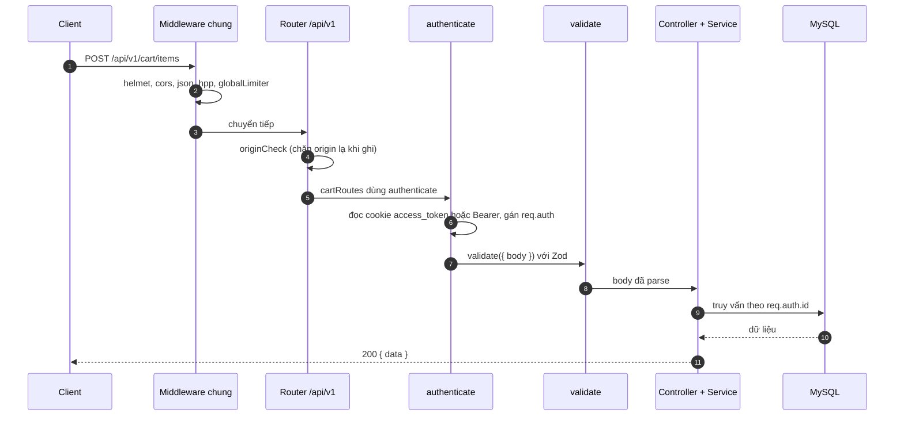
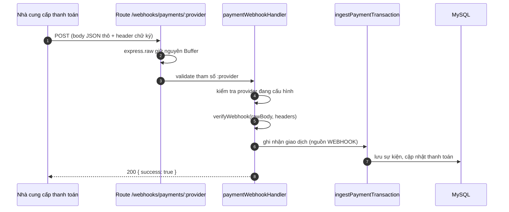

# Vòng đời một request

Tài liệu này trả lời: một request đi qua những middleware nào, theo thứ tự nào, vì sao thứ tự đó quan trọng và lỗi được định dạng ra sao.

> Đối chiếu code: main @ 794f0a1 (2026-11-01)

## Thứ tự xử lý

Thứ tự dưới đây là thứ tự đăng ký trong `createApp` ([src/app.ts](https://github.com/QuocDuy21-10/laptopshop-api/blob/main/src/app.ts)). Express chạy chúng từ trên xuống dưới.

| # | Bước | Vì sao ở vị trí này |
| --- | --- | --- |
| 1 | `trust proxy = 1` | Tin tưởng một lớp proxy phía trước khi xác định IP client |
| 2 | `pino-http` (không log `/healthz`) | Ghi log mọi request từ đầu; bỏ `/healthz` để tránh nhiễu |
| 3 | `applySecurity` | `helmet` (CSP chặt vì API chỉ trả JSON), tắt `x-powered-by`, `compression` |
| 4 | `cors` | Cho phép origin trong `CORS_ORIGINS`, kèm `credentials` để cookie đi theo |
| 5 | `/healthz`, `/readyz` | Đặt trước limiter để health check không đụng Redis |
| 6 | `express.static("public")` | File tĩnh (ảnh upload) cũng đặt trước limiter |
| 7 | `/api/v1/webhooks/payments` | Phải trước `express.json()`, xem bên dưới |
| 8 | `express.json` (100kb), `express.urlencoded` (100kb) | Parse body cho mọi route phía sau |
| 9 | `hpp` | Chống HTTP parameter pollution (tham số lặp lại) |
| 10 | `globalLimiter` | Giới hạn tần suất chung cho mọi route còn lại |
| 11 | `authLimiter` | Giới hạn chặt hơn cho POST `/auth/login`, `/auth/register`, `/auth/forgot-password`, `/auth/reset-password` |
| 12 | `newsletterLimiter` | Giới hạn POST `/newsletter/subscribe` |
| 13 | Router `/api/v1` | `originCheck` chạy đầu tiên, sau đó là route theo module |
| 14 | `registerExtras` | Tính năng tuỳ chọn, ví dụ Swagger tại `/api-docs` khi `ENABLE_DOCS=true` |
| 15 | `notFoundHandler` | Không route nào khớp thì trả 404 |
| 16 | `errorHandler` | Bắt mọi lỗi và chuẩn hoá thành JSON |

Các limiter chuyên biệt khác (`advisorLimiter`, `reviewImagesLimiter`, `reviewHelpfulLimiter`, `reviewMutationLimiter`, `afterSalesImagesLimiter`) được `createApp` truyền vào router `/api/v1` và gắn lên từng route cụ thể. Tất cả dùng store Redis do `src/server.ts` tạo (`createRedisLimitStore`, tiền tố `rl:*`).

## Một request thông thường

Ví dụ `POST /api/v1/cart/items` của khách hàng đã đăng nhập.

Nếu `authenticate` không thấy token thì trả `401 UNAUTHENTICATED`. Nếu `validate` thấy dữ liệu sai thì `ZodError` được `errorHandler` biến thành `400 VALIDATION_ERROR`. Route admin còn đi qua `requireRole("ADMIN")` và trả `403 FORBIDDEN` nếu không đủ quyền.

## Webhook thanh toán

Nhà cung cấp ký chữ ký trên byte thô của body. Nếu `express.json()` parse trước rồi serialize lại, byte sẽ thay đổi và chữ ký không còn khớp. Vì vậy route webhook dùng `express.raw` và được mount trước bộ parse JSON.

Do route này đứng trước các bước 8 đến 13, nó không đi qua JSON parser, `globalLimiter` và `originCheck`; xác thực dựa hoàn toàn vào chữ ký. Provider `fake` bị từ chối ở production.

## Định dạng response

- Thành công: `{ "data": ..., "meta": ... }`, `meta` chỉ có khi cần (ví dụ phân trang).
- Lỗi: `{ "error": { "code", "message", "details?" } }`.

`errorHandler` chuẩn hoá các nguồn lỗi sau về cùng định dạng:

| Nguồn | Kết quả |
| --- | --- |
| `AppError` | Dùng đúng `status`, `code`, `message`, `details` của nó |
| `ZodError` | `400 VALIDATION_ERROR`, `details` là danh sách `{ path, message }` |
| Lỗi multer | `400 UPLOAD_ERROR`, hoặc mã riêng cho ảnh review quá lớn (`413`) hay quá số lượng (`409`) |
| Lỗi body-parser (JSON sai, body quá lớn) | Status 4xx của chính lỗi đó |
| Lỗi không nhận diện | `500 INTERNAL_ERROR`; ở production message được thay bằng "Internal Server Error", ở môi trường khác có thêm `stack` |

Lỗi 5xx được ghi log bằng pino.

API contract chi tiết (endpoint, request, response) nằm ở OpenAPI: [src/docs/openapi.ts](https://github.com/QuocDuy21-10/laptopshop-api/blob/main/src/docs/openapi.ts).

## Nguồn

- [src/app.ts](https://github.com/QuocDuy21-10/laptopshop-api/blob/main/src/app.ts): `createApp`
- [src/server.ts](https://github.com/QuocDuy21-10/laptopshop-api/blob/main/src/server.ts): `createRedisLimitStore`, `registerExtras`
- [src/routes/index.ts](https://github.com/QuocDuy21-10/laptopshop-api/blob/main/src/routes/index.ts): `createApiV1Router`
- [src/routes/health.ts](https://github.com/QuocDuy21-10/laptopshop-api/blob/main/src/routes/health.ts): `registerHealthRoutes`
- [src/middlewares/security.ts](https://github.com/QuocDuy21-10/laptopshop-api/blob/main/src/middlewares/security.ts): `applySecurity`
- [src/middlewares/rate-limit.ts](https://github.com/QuocDuy21-10/laptopshop-api/blob/main/src/middlewares/rate-limit.ts): `createLimiters`
- [src/middlewares/origin-check.ts](https://github.com/QuocDuy21-10/laptopshop-api/blob/main/src/middlewares/origin-check.ts): `originCheck`
- [src/middlewares/authenticate.ts](https://github.com/QuocDuy21-10/laptopshop-api/blob/main/src/middlewares/authenticate.ts): `authenticate`
- [src/middlewares/require-role.ts](https://github.com/QuocDuy21-10/laptopshop-api/blob/main/src/middlewares/require-role.ts): `requireRole`
- [src/middlewares/validate.ts](https://github.com/QuocDuy21-10/laptopshop-api/blob/main/src/middlewares/validate.ts): `validate`
- [src/middlewares/error.middleware.ts](https://github.com/QuocDuy21-10/laptopshop-api/blob/main/src/middlewares/error.middleware.ts): `errorHandler`, `notFoundHandler`
- [src/modules/payments/payments.routes.ts](https://github.com/QuocDuy21-10/laptopshop-api/blob/main/src/modules/payments/payments.routes.ts): `paymentWebhookRoutes`
- [src/modules/payments/payments.controller.ts](https://github.com/QuocDuy21-10/laptopshop-api/blob/main/src/modules/payments/payments.controller.ts): `paymentWebhookHandler`
- [src/lib/errors.ts](https://github.com/QuocDuy21-10/laptopshop-api/blob/main/src/lib/errors.ts): `AppError`
