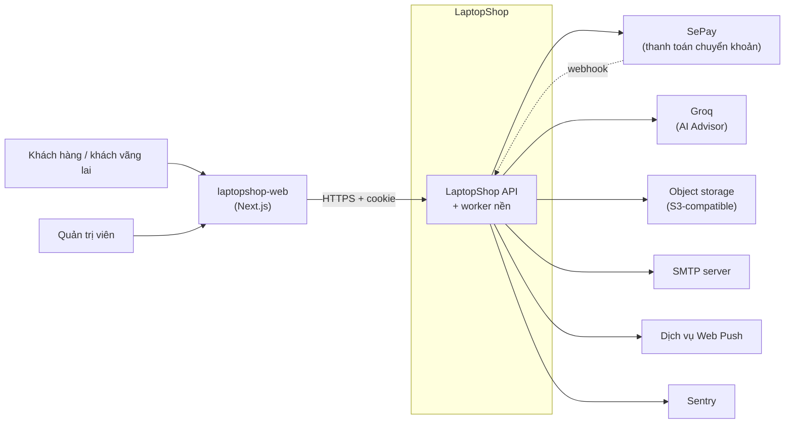

# Bối cảnh hệ thống (C1)

Tài liệu này trả lời: LaptopShop API tương tác với ai và với những dịch vụ bên ngoài nào.

> Đối chiếu code: main @ 794f0a1 (2026-11-01)

## Sơ đồ

Nét liền là lời gọi đồng bộ. Nét đứt là luồng bất đồng bộ (webhook).

## Hệ thống ngoài

| Hệ thống | Dùng cho | Hướng | Chi tiết |
| --- | --- | --- | --- |
| `laptopshop-web` | Giao diện storefront và quản trị | Web gọi API | Repo riêng, không thuộc tài liệu này |
| SePay | Nhận thông tin giao dịch chuyển khoản, đối soát | Vào (webhook) và ra (API đối soát) | [integration-architecture.md](integration-architecture.md) |
| Groq | Tạo gợi ý và giải thích cho AI Advisor | Ra | [integration-architecture.md](integration-architecture.md) |
| Object storage S3-compatible | Lưu ảnh đánh giá và ảnh đính kèm bảo hành | Ra | [integration-architecture.md](integration-architecture.md) |
| SMTP server | Gửi email (xác minh, thông báo) | Ra | [integration-architecture.md](integration-architecture.md) |
| Dịch vụ Web Push | Gửi thông báo đẩy tới trình duyệt | Ra | [integration-architecture.md](integration-architecture.md) |
| Sentry | Báo lỗi | Ra | [integration-architecture.md](integration-architecture.md) |

Mỗi tích hợp ngoài đều được cấu hình qua biến môi trường trong `src/config/env.ts`. Các tích hợp tuỳ chọn có công tắc bật/tắt; khi tắt, tính năng tương ứng không hoạt động nhưng phần còn lại của API vẫn chạy.

## Nguồn

- [src/config/env.ts](https://github.com/QuocDuy21-10/laptopshop-api/blob/main/src/config/env.ts): `env`
- [src/instrument.ts](https://github.com/QuocDuy21-10/laptopshop-api/blob/main/src/instrument.ts)
- [src/modules/payments/payments.routes.ts](https://github.com/QuocDuy21-10/laptopshop-api/blob/main/src/modules/payments/payments.routes.ts): `paymentWebhookRoutes`
- [src/modules/payments/payment-provider.factory.ts](https://github.com/QuocDuy21-10/laptopshop-api/blob/main/src/modules/payments/payment-provider.factory.ts)
- [src/modules/advisor/providers/groq-advisor.provider.ts](https://github.com/QuocDuy21-10/laptopshop-api/blob/main/src/modules/advisor/providers/groq-advisor.provider.ts): `GroqAdvisorProvider`
- [src/lib/storage/s3-object-storage.ts](https://github.com/QuocDuy21-10/laptopshop-api/blob/main/src/lib/storage/s3-object-storage.ts): `createS3ObjectStorage`
- [src/modules/notifications/web-push.controller.ts](https://github.com/QuocDuy21-10/laptopshop-api/blob/main/src/modules/notifications/web-push.controller.ts)
