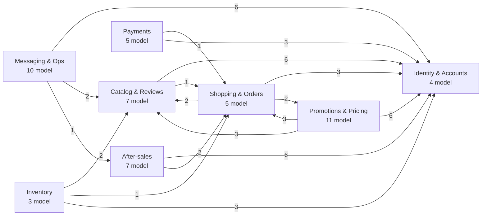

# Database

Tài liệu này trả lời: dữ liệu của LaptopShop gồm những bảng nào, thuộc nhóm nào, đọc tài liệu mô tả chúng ở đâu và đọc thế nào.

> Đối chiếu code: main @ 0f1eab2 (2026-11-04)

Schema có **52 model**, **30 enum** và **93 khoá ngoại**, dùng MySQL 8.4 qua Prisma 6.3.0, với 48 migration. Nguồn sự thật của cấu trúc là [prisma/schema.prisma](../../prisma/schema.prisma) và [prisma/migrations/](../../prisma/migrations/); tài liệu này giải thích ý nghĩa và cách dùng, không thay thế chúng. Bối cảnh kỹ thuật (kết nối, timeout, migration lúc deploy) nằm ở [database-architecture.md](../02-architecture/database-architecture.md) và [ADR-0002](../02-architecture/decisions/0002-prisma-mysql.md).

## Bản đồ các nhóm

52 model được chia thành 8 nhóm theo nghiệp vụ. Mũi tên `A --> B` kèm số `n` nghĩa là bảng của nhóm A giữ `n` khoá ngoại trỏ tới bảng của nhóm B. `Identity & Accounts` (bảng `User`) là điểm mà hầu hết nhóm khác trỏ tới.

Chi tiết từng khoá ngoại và hành vi `onDelete` ở [relationships.md](relationships.md).

## Cách đọc data dictionary

Mỗi nhóm có một file trong [contexts/](contexts/), gồm ERD của nhóm và bảng mô tả từng model.

- **ERD của nhóm** chỉ vẽ khoá ngoại đi ra từ các model của nhóm; bảng nằm ngoài nhóm xuất hiện ở dạng rút gọn.
- **Đầu mỗi model:** *Mục đích*, *Nhãn* (xem dưới), *Ghi/đọc chính* (module ghi và đọc), và *Bất biến* khi có.
- **Bảng cột:** các cột `Cột`, `Kiểu Prisma`, `Kiểu DB`, `Null`, `Mặc định`, `Khoá` lấy trực tiếp từ schema; `Ý nghĩa` và `Ghi/đọc bởi` viết tay từ code. Ô `Ghi/đọc bởi` ghi `Chung` khi cột được ghi và đọc ở cùng nơi với dòng *Ghi/đọc chính* của model.
- **Khoá:** `PK` khoá chính, `FK → X` khoá ngoại tới bảng `X`, `UQ` unique. Khoá ghép và index nằm dưới mỗi bảng.
- **Tên:** dùng tên model Prisma (`StockMovement`); tên bảng thật trong MySQL (`stock_movements`) ghi ngay ở tiêu đề mỗi model.
- Nội dung bắt đầu bằng `Suy luận:` là phần chưa xác nhận trực tiếp từ code.

### Ý nghĩa của nhãn

| Nhãn | Nghĩa | Hệ quả khi sửa dữ liệu |
| --- | --- | --- |
| nguồn sự thật | Bảng là nơi duy nhất giữ thông tin đó | Sửa trực tiếp làm đổi sự thật; chỉ sửa qua code của module sở hữu |
| tổng hợp | Giá trị tính ra từ bảng khác, giữ lại để đọc nhanh hoặc kiểm tra giới hạn | Có thể dựng lại hoặc đối chiếu với nguồn; không sửa tay |
| snapshot | Giá trị chụp tại một thời điểm và giữ nguyên dù nguồn gốc đổi sau đó | Không cập nhật theo nguồn; phản ánh trạng thái lúc xảy ra sự kiện |

Các bảng không phải "nguồn sự thật" thuần tuý:

- **snapshot:** `OrderDetail` (giá, khuyến mãi và bảo hành tại lúc mua).
- **tổng hợp:** `CatalogPriceWindow` (giá hiệu lực, dựng lại từ `Product.price` và khuyến mãi), `PromotionUserUsage`, `FlashSaleProductQuota`, `FlashSaleUserUsage` (bộ đếm lượt dùng và suất).
- Một số bảng "nguồn sự thật" có cột tổng hợp hoặc snapshot bên trong, đã ghi ở mục *Bất biến* của model: `Product.quantity` và `Product.sold` (tổng hợp từ sổ kho), `ServiceRequest.status` (tổng hợp từ trạng thái thiết bị), `Order.paymentStatus` (bản sao của `Payment.status` với chuyển khoản), `Payment.bankCode` / `accountNumber` / `accountName` (chụp từ cấu hình lúc tạo).

## Danh sách model

| Nhóm | Model | Bảng MySQL | Số cột | Nhãn |
| --- | --- | --- | --- | --- |
| [Identity & Accounts](contexts/identity-accounts.md) | `User` | `users` | 10 | nguồn sự thật |
| [Identity & Accounts](contexts/identity-accounts.md) | `Role` | `roles` | 3 | nguồn sự thật |
| [Identity & Accounts](contexts/identity-accounts.md) | `RefreshToken` | `refresh_tokens` | 9 | nguồn sự thật |
| [Identity & Accounts](contexts/identity-accounts.md) | `EmailVerificationChallenge` | `email_verification_challenges` | 16 | nguồn sự thật |
| [Catalog & Reviews](contexts/catalog-reviews.md) | `Product` | `products` | 26 | nguồn sự thật |
| [Catalog & Reviews](contexts/catalog-reviews.md) | `Review` | `reviews` | 17 | nguồn sự thật |
| [Catalog & Reviews](contexts/catalog-reviews.md) | `ReviewImage` | `review_images` | 16 | nguồn sự thật |
| [Catalog & Reviews](contexts/catalog-reviews.md) | `ReviewImageSyncOperation` | `review_image_sync_operations` | 18 | nguồn sự thật |
| [Catalog & Reviews](contexts/catalog-reviews.md) | `ReviewHelpful` | `review_helpful` | 3 | nguồn sự thật |
| [Catalog & Reviews](contexts/catalog-reviews.md) | `ReviewReply` | `review_replies` | 8 | nguồn sự thật |
| [Catalog & Reviews](contexts/catalog-reviews.md) | `HomeBanner` | `home_banners` | 19 | nguồn sự thật |
| [Shopping & Orders](contexts/shopping-orders.md) | `Cart` | `cart` | 2 | nguồn sự thật |
| [Shopping & Orders](contexts/shopping-orders.md) | `CartDetail` | `cart_detail` | 4 | nguồn sự thật |
| [Shopping & Orders](contexts/shopping-orders.md) | `Order` | `orders` | 21 | nguồn sự thật |
| [Shopping & Orders](contexts/shopping-orders.md) | `OrderDetail` | `order_detail` | 13 | snapshot |
| [Shopping & Orders](contexts/shopping-orders.md) | `OrderStatusHistory` | `order_status_history` | 7 | nguồn sự thật |
| [Payments](contexts/payments.md) | `Payment` | `payments` | 19 | nguồn sự thật |
| [Payments](contexts/payments.md) | `PaymentWebhookEvent` | `payment_webhook_events` | 24 | nguồn sự thật |
| [Payments](contexts/payments.md) | `PaymentProviderCheckpoint` | `payment_provider_checkpoints` | 17 | nguồn sự thật |
| [Payments](contexts/payments.md) | `PaymentReviewCase` | `payment_review_cases` | 10 | nguồn sự thật |
| [Payments](contexts/payments.md) | `PaymentReviewAction` | `payment_review_actions` | 7 | nguồn sự thật |
| [Inventory](contexts/inventory.md) | `StockMovement` | `stock_movements` | 13 | nguồn sự thật |
| [Inventory](contexts/inventory.md) | `StockReceipt` | `stock_receipts` | 10 | nguồn sự thật |
| [Inventory](contexts/inventory.md) | `StockReceiptItem` | `stock_receipt_items` | 5 | nguồn sự thật |
| [Promotions & Pricing](contexts/promotions-pricing.md) | `Promotion` | `promotions` | 15 | nguồn sự thật |
| [Promotions & Pricing](contexts/promotions-pricing.md) | `CatalogPriceWindow` | `catalog_price_windows` | 11 | tổng hợp |
| [Promotions & Pricing](contexts/promotions-pricing.md) | `CouponPolicy` | `coupon_policies` | 9 | nguồn sự thật |
| [Promotions & Pricing](contexts/promotions-pricing.md) | `AutomaticPromotionPolicy` | `automatic_promotion_policies` | 3 | nguồn sự thật |
| [Promotions & Pricing](contexts/promotions-pricing.md) | `PromotionProduct` | `promotion_products` | 2 | nguồn sự thật |
| [Promotions & Pricing](contexts/promotions-pricing.md) | `PromotionUserUsage` | `promotion_user_usages` | 3 | tổng hợp |
| [Promotions & Pricing](contexts/promotions-pricing.md) | `PromotionRedemption` | `promotion_redemptions` | 9 | nguồn sự thật |
| [Promotions & Pricing](contexts/promotions-pricing.md) | `FlashSalePolicy` | `flash_sale_policies` | 4 | nguồn sự thật |
| [Promotions & Pricing](contexts/promotions-pricing.md) | `FlashSaleProductQuota` | `flash_sale_product_quotas` | 7 | tổng hợp |
| [Promotions & Pricing](contexts/promotions-pricing.md) | `FlashSaleUserUsage` | `flash_sale_user_usages` | 4 | tổng hợp |
| [Promotions & Pricing](contexts/promotions-pricing.md) | `FlashSaleAllocation` | `flash_sale_allocations` | 12 | nguồn sự thật |
| [After-sales](contexts/after-sales.md) | `ServiceRequest` | `service_requests` | 14 | nguồn sự thật |
| [After-sales](contexts/after-sales.md) | `ServiceRequestItem` | `service_request_items` | 21 | nguồn sự thật |
| [After-sales](contexts/after-sales.md) | `WarrantyVerification` | `warranty_verifications` | 9 | nguồn sự thật |
| [After-sales](contexts/after-sales.md) | `ServiceRequestEvent` | `service_request_events` | 11 | nguồn sự thật |
| [After-sales](contexts/after-sales.md) | `ServiceRequestAttachment` | `service_request_attachments` | 19 | nguồn sự thật |
| [After-sales](contexts/after-sales.md) | `ServiceQuote` | `service_quotes` | 12 | nguồn sự thật |
| [After-sales](contexts/after-sales.md) | `ServiceQuoteLine` | `service_quote_lines` | 7 | nguồn sự thật |
| [Messaging & Ops](contexts/messaging-ops.md) | `Notification` | `notifications` | 16 | nguồn sự thật |
| [Messaging & Ops](contexts/messaging-ops.md) | `NotificationPreference` | `notification_preferences` | 8 | nguồn sự thật |
| [Messaging & Ops](contexts/messaging-ops.md) | `PushSubscription` | `push_subscriptions` | 11 | nguồn sự thật |
| [Messaging & Ops](contexts/messaging-ops.md) | `NotificationDelivery` | `notification_deliveries` | 20 | nguồn sự thật |
| [Messaging & Ops](contexts/messaging-ops.md) | `NotificationDeliveryAudit` | `notification_delivery_audits` | 6 | nguồn sự thật |
| [Messaging & Ops](contexts/messaging-ops.md) | `OutboxEvent` | `outbox_events` | 14 | nguồn sự thật |
| [Messaging & Ops](contexts/messaging-ops.md) | `WorkerHeartbeat` | `worker_heartbeats` | 8 | nguồn sự thật |
| [Messaging & Ops](contexts/messaging-ops.md) | `WorkerCheckpoint` | `worker_checkpoints` | 14 | nguồn sự thật |
| [Messaging & Ops](contexts/messaging-ops.md) | `WishlistItem` | `wishlist_items` | 13 | nguồn sự thật |
| [Messaging & Ops](contexts/messaging-ops.md) | `NewsletterSubscriber` | `newsletter_subscribers` | 10 | nguồn sự thật |

## Tài liệu liên quan

| File | Nội dung |
| --- | --- |
| [enums.md](enums.md) | 30 enum, giá trị và ý nghĩa; các trạng thái lưu bằng `VARCHAR` |
| [relationships.md](relationships.md) | Khoá ngoại, `onDelete`, quan hệ giữa các nhóm |
| [constraints-and-indexes.md](constraints-and-indexes.md) | Unique, khoá chính ghép, index, ràng buộc chỉ có trong migration |
| [transactions-and-locking.md](transactions-and-locking.md) | Cơ chế bảo vệ nhất quán dữ liệu |
| [migrations.md](migrations.md) | Cách chạy migration và 48 migration theo chủ đề |
| [ADR-0006](../02-architecture/decisions/0006-stock-ledger.md) | Vì sao có sổ kho |

## Nguồn

- [prisma/schema.prisma](../../prisma/schema.prisma)
- [prisma/migrations/](../../prisma/migrations/)
- [src/modules/](../../src/modules/): nơi ghi và đọc dữ liệu của từng model
