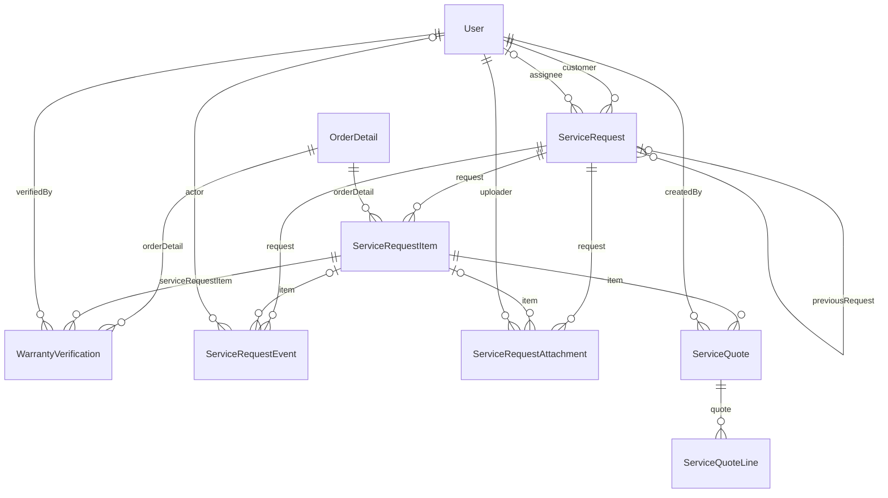

# Nhóm After-sales

Tài liệu này trả lời: yêu cầu bảo hành và hỗ trợ kỹ thuật được lưu thế nào, trạng thái nằm ở bảng nào và ảnh đính kèm, báo giá, xác minh bảo hành được ghi ra sao.

> Đối chiếu code: main @ 0f1eab2 (2026-11-04)

Nhóm gồm 7 model. `ServiceRequest` là một yêu cầu của khách và có thể chứa nhiều thiết bị; mỗi thiết bị là một `ServiceRequestItem`, gắn với một dòng đơn hàng đã mua (`OrderDetail`). Các bảng còn lại bám vào yêu cầu hoặc thiết bị: `ServiceRequestEvent` (nhật ký), `ServiceRequestAttachment` (ảnh), `ServiceQuote` và `ServiceQuoteLine` (báo giá), `WarrantyVerification` (kết luận bảo hành của admin).

Điểm cần nhớ khi đọc dữ liệu:

- **Trạng thái nằm ở thiết bị.** `ServiceRequestItem.status` (enum `ServiceRequestItemStatus`, 14 giá trị) là nguồn sự thật. `ServiceRequest.status` (enum `ServiceRequestStatus`) là dữ liệu tổng hợp, được tính lại từ trạng thái các thiết bị bởi `deriveRequestStatus` trong `src/modules/after-sales/after-sales.aggregate.ts`.
- **Bảo hành là một dòng dữ liệu có thể đổi.** `effectiveCoverage` trong `src/modules/after-sales/after-sales.eligibility.ts` quyết định tình trạng bảo hành: nếu admin đã ghi `WarrantyVerification` thì lấy lần mới nhất, nếu không thì dùng snapshot trên `OrderDetail`. `ServiceRequestItem.coverageAtCreation` chụp lại kết quả tại lúc tạo yêu cầu.
- Mọi khoá ngoại về `User`, `OrderDetail` và yêu cầu là `Restrict` hoặc `SetNull`: dữ liệu bảo hành được giữ lại khi người dùng hoặc đơn hàng liên quan thay đổi.

## ERD

## Data dictionary

### `ServiceRequest` (`service_requests`)

- **Mục đích:** Một yêu cầu bảo hành hoặc hỗ trợ kỹ thuật của khách, gom một hoặc nhiều thiết bị.
- **Nhãn:** nguồn sự thật cho yêu cầu, riêng `status` là tổng hợp tính từ trạng thái các thiết bị.
- **Ghi/đọc chính:** tạo bởi `createServiceRequest` trong `src/modules/after-sales/after-sales.service.ts`; `status` được tính lại bởi `deriveRequestStatus` khi trạng thái thiết bị đổi (xem `src/modules/after-sales/after-sales.actions.ts`); đọc bởi `src/modules/after-sales/after-sales.repository.ts`.
- **Bất biến:** `code` duy nhất, dạng `AS-<thời gian>-<8 ký tự ngẫu nhiên>`. Duy nhất theo `(userId, idempotencyKey)` để gửi lại không tạo yêu cầu thứ hai; `requestHash` bắt dùng lại khoá với nội dung khác. `version` dùng cho khoá lạc quan. Một yêu cầu có từ 1 đến 50 thiết bị.
- **Loại yêu cầu:** enum `ServiceRequestType` (`WARRANTY`, `TECHNICAL_SUPPORT`). **Trạng thái tổng hợp:** enum `ServiceRequestStatus` (`SUBMITTED`, `REVIEWING`, `IN_PROGRESS`, `AWAITING_CUSTOMER`, `PARTIALLY_COMPLETED`, `CLOSED`).
- **Yêu cầu tiếp nối:** `previousRequestId` chỉ được trỏ tới một yêu cầu `CLOSED` của cùng khách.

| Cột | Kiểu Prisma | Kiểu DB | Null | Mặc định | Khoá | Ý nghĩa | Ghi/đọc bởi |
| --- | --- | --- | --- | --- | --- | --- | --- |
| `id` | `Int` | `INT` | Không | `autoincrement()` | PK | Khoá chính. | Chung |
| `code` | `String` | `VARCHAR(32)` | Không | — | UQ | Mã yêu cầu để khách và nhân viên tra cứu, duy nhất. | `src/modules/after-sales/after-sales.service.ts` |
| `userId` | `Int` | `INT` | Không | — | FK → User | Khách tạo yêu cầu; `Restrict` khi xoá người dùng. | Chung |
| `type` | `ServiceRequestType` | `ENUM` | Không | — | — | Loại: `WARRANTY` hoặc `TECHNICAL_SUPPORT`. | Chung |
| `status` | `ServiceRequestStatus` | `ENUM` | Không | `SUBMITTED` | — | Trạng thái tổng hợp (xem ghi chú ở trên). Mặc định `SUBMITTED`. | `src/modules/after-sales/after-sales.actions.ts`; `src/modules/after-sales/after-sales.aggregate.ts` |
| `subject` | `String` | `VARCHAR(200)` | Không | — | — | Tiêu đề yêu cầu, tối đa 200 ký tự. | Chung |
| `assignedToId` | `Int?` | `INT` | Có | — | FK → User | Nhân viên được giao xử lý (tuỳ chọn). `SetNull` khi xoá người dùng. | `src/modules/after-sales/after-sales.actions.ts` |
| `previousRequestId` | `Int?` | `INT` | Có | — | FK → ServiceRequest | Yêu cầu đã đóng mà yêu cầu này tiếp nối (tuỳ chọn). `SetNull` khi xoá yêu cầu cũ. | `src/modules/after-sales/after-sales.service.ts` |
| `idempotencyKey` | `String` | `VARCHAR(64)` | Không | — | — | Khoá chống lặp client gửi, tối đa 64 ký tự, duy nhất theo từng khách. | `src/modules/after-sales/after-sales.service.ts` |
| `requestHash` | `String` | `CHAR(64)` | Không | — | — | SHA-256 nội dung yêu cầu, để phát hiện dùng lại khoá với nội dung khác. | `src/modules/after-sales/after-sales.service.ts` |
| `version` | `Int` | `INT` | Không | `1` | — | Số phiên bản dùng cho khoá lạc quan, bắt đầu từ 1. | `src/modules/after-sales/after-sales.actions.ts` |
| `createdAt` | `DateTime` | `DATETIME(3)` | Không | `now()` | — | Thời điểm tạo dòng. | Chung |
| `updatedAt` | `DateTime` | `DATETIME(3)` | Không | `@updatedAt` | — | Thời điểm cập nhật dòng gần nhất (Prisma `@updatedAt`). | Chung |
| `closedAt` | `DateTime?` | `DATETIME(3)` | Có | — | — | Thời điểm yêu cầu chuyển sang `CLOSED`; rỗng khi còn mở. | `src/modules/after-sales/after-sales.actions.ts` |

**Quan hệ:**

- `customer` → `User` qua `userId`, onDelete: Restrict
- `assignee` → `User` qua `assignedToId`, onDelete: SetNull
- `previousRequest` → `ServiceRequest` qua `previousRequestId`, onDelete: SetNull
- Được tham chiếu bởi: `ServiceRequest`, `ServiceRequestItem`, `ServiceRequestEvent`, `ServiceRequestAttachment`, `Notification`

**Khoá ghép và index:**

- Unique ghép: `userId, idempotencyKey`
- Index: `userId, createdAt`
- Index: `status, createdAt`
- Index: `assignedToId, status`
- Index: `previousRequestId`

### `ServiceRequestItem` (`service_request_items`)

- **Mục đích:** Một thiết bị trong yêu cầu: mô tả lỗi, tình trạng bảo hành tại lúc tạo và toàn bộ vòng đời xử lý của thiết bị đó.
- **Nhãn:** nguồn sự thật cho trạng thái xử lý. `productNameSnapshot` và `coverageAtCreation` là snapshot tại lúc tạo yêu cầu.
- **Ghi/đọc chính:** tạo cùng yêu cầu bởi `src/modules/after-sales/after-sales.service.ts`; trạng thái đổi bởi `src/modules/after-sales/after-sales.actions.ts`, `src/modules/after-sales/after-sales.quotes.ts` và `src/modules/after-sales/after-sales.warranty-verifications.ts`; hạn xác nhận được quét bởi `src/modules/after-sales/after-sales-maintenance.ts`.
- **Bất biến:** mỗi thiết bị có `position` riêng trong yêu cầu (unique `serviceRequestId, position`). `version` tăng mỗi lần đổi trạng thái và các thao tác đều so `version` để tránh ghi đè.
- **Trạng thái:** enum `ServiceRequestItemStatus`: `SUBMITTED`, `REVIEWING`, `APPROVED`, `AWAITING_ITEM`, `RECEIVED`, `DIAGNOSING`, `AWAITING_QUOTE_DECISION`, `IN_SERVICE`, `READY_FOR_RETURN`, `RETURNED`, `RESOLVED`, `CLOSED`, `REJECTED`, `CANCELLED`. Ba trạng thái cuối là trạng thái kết thúc (`TERMINAL_ITEM_STATUSES`: `CLOSED`, `REJECTED`, `CANCELLED`); `AWAITING_QUOTE_DECISION`, `RETURNED`, `RESOLVED` là các trạng thái chờ khách thao tác (`CUSTOMER_ACTION_ITEM_STATUSES`).
- **Tự đóng:** khi chuyển sang `RESOLVED` hoặc `RETURNED`, `confirmationDueAt` được đặt sau 168 giờ (7 ngày); quá hạn mà khách không phản hồi thì đóng với `closeReason = CUSTOMER_CONFIRMATION_TIMEOUT`.
- **Lý do đóng:** enum `ServiceItemCloseReason`: `CUSTOMER_CONFIRMED`, `CUSTOMER_CONFIRMATION_TIMEOUT`, `ADMINISTRATIVE`, `REJECTED`, `CUSTOMER_CANCELLED`.

| Cột | Kiểu Prisma | Kiểu DB | Null | Mặc định | Khoá | Ý nghĩa | Ghi/đọc bởi |
| --- | --- | --- | --- | --- | --- | --- | --- |
| `id` | `Int` | `INT` | Không | `autoincrement()` | PK | Khoá chính. | Chung |
| `serviceRequestId` | `Int` | `INT` | Không | — | FK → ServiceRequest | Yêu cầu chứa thiết bị; `Restrict`. | Chung |
| `orderDetailId` | `Int` | `INT` | Không | — | FK → OrderDetail | Dòng đơn hàng chứng minh việc đã mua thiết bị này; `Restrict`. | `src/modules/after-sales/after-sales.service.ts` |
| `position` | `Int` | `UNSIGNEDSMALLINT` | Không | — | — | Thứ tự thiết bị trong yêu cầu, bắt đầu từ 0. | `src/modules/after-sales/after-sales.service.ts` |
| `productNameSnapshot` | `String` | `VARCHAR(255)` | Không | — | — | Tên sản phẩm chụp tại lúc tạo yêu cầu. | `src/modules/after-sales/after-sales.service.ts` |
| `deviceLabel` | `String` | `VARCHAR(100)` | Không | — | — | Nhãn do khách đặt để phân biệt thiết bị, tối đa 100 ký tự. | `src/modules/after-sales/after-sales.service.ts` |
| `serialNumber` | `String?` | `VARCHAR(100)` | Có | — | — | Số serial khách nhập (tuỳ chọn). | `src/modules/after-sales/after-sales.service.ts` |
| `serialNumberNormalized` | `String?` | `VARCHAR(100)` | Có | — | — | Serial đã cắt khoảng trắng và đổi thành chữ thường, dùng để phát hiện trùng thiết bị trong cùng yêu cầu. | `src/modules/after-sales/after-sales.service.ts` |
| `issueDescription` | `String` | `TEXT` | Không | — | — | Mô tả lỗi của khách, tối đa 5000 ký tự. | `src/modules/after-sales/after-sales.service.ts` |
| `coverageAtCreation` | `WarrantyCoverage` | `ENUM` | Không | — | — | Tình trạng bảo hành tại lúc tạo yêu cầu: enum `WarrantyCoverage` (`IN_WARRANTY`, `OUT_OF_WARRANTY`, `NO_WARRANTY`, `REQUIRES_VERIFICATION`), tính bởi `effectiveCoverage`. | `src/modules/after-sales/after-sales.service.ts`; `src/modules/after-sales/after-sales.eligibility.ts` |
| `status` | `ServiceRequestItemStatus` | `ENUM` | Không | `SUBMITTED` | — | Trạng thái của thiết bị (xem danh sách ở trên). Mặc định `SUBMITTED`. | `src/modules/after-sales/after-sales.actions.ts`; `src/modules/after-sales/after-sales.quotes.ts`; `src/modules/after-sales/after-sales.warranty-verifications.ts` |
| `resolution` | `String?` | `TEXT` | Có | — | — | Kết quả xử lý do nhân viên ghi; bắt buộc khi chuyển sang `RESOLVED`. | `src/modules/after-sales/after-sales.actions.ts` |
| `version` | `Int` | `INT` | Không | `1` | — | Số phiên bản dùng cho khoá lạc quan, bắt đầu từ 1. | `src/modules/after-sales/after-sales.actions.ts` |
| `resolvedAt` | `DateTime?` | `DATETIME(3)` | Có | — | — | Thời điểm chuyển sang `RESOLVED`. | `src/modules/after-sales/after-sales.actions.ts` |
| `returnedAt` | `DateTime?` | `DATETIME(3)` | Có | — | — | Thời điểm chuyển sang `RETURNED` (đã trả máy). | `src/modules/after-sales/after-sales.actions.ts` |
| `confirmationDueAt` | `DateTime?` | `DATETIME(3)` | Có | — | — | Hạn khách xác nhận hoàn tất; quá hạn thì tự đóng. | `src/modules/after-sales/after-sales.actions.ts`; `src/modules/after-sales/after-sales-maintenance.ts` |
| `customerConfirmedAt` | `DateTime?` | `DATETIME(3)` | Có | — | — | Thời điểm khách xác nhận hoàn tất. | `src/modules/after-sales/after-sales.actions.ts` |
| `closedAt` | `DateTime?` | `DATETIME(3)` | Có | — | — | Thời điểm thiết bị chuyển sang trạng thái kết thúc. | `src/modules/after-sales/after-sales.actions.ts`; `src/modules/after-sales/after-sales-maintenance.ts` |
| `closeReason` | `ServiceItemCloseReason?` | `ENUM` | Có | — | — | Lý do đóng (enum `ServiceItemCloseReason`); rỗng khi chưa đóng. | `src/modules/after-sales/after-sales.actions.ts`; `src/modules/after-sales/after-sales-maintenance.ts` |
| `createdAt` | `DateTime` | `DATETIME(3)` | Không | `now()` | — | Thời điểm tạo dòng. | Chung |
| `updatedAt` | `DateTime` | `DATETIME(3)` | Không | `@updatedAt` | — | Thời điểm cập nhật dòng gần nhất (Prisma `@updatedAt`). | Chung |

**Quan hệ:**

- `request` → `ServiceRequest` qua `serviceRequestId`, onDelete: Restrict
- `orderDetail` → `OrderDetail` qua `orderDetailId`, onDelete: Restrict
- Được tham chiếu bởi: `ServiceRequestEvent`, `ServiceRequestAttachment`, `ServiceQuote`, `WarrantyVerification`

**Khoá ghép và index:**

- Unique ghép: `serviceRequestId, position`
- Index: `orderDetailId, status`
- Index: `serviceRequestId, status`
- Index: `confirmationDueAt, status`

### `WarrantyVerification` (`warranty_verifications`)

- **Mục đích:** Kết luận về bảo hành của admin cho một thiết bị khi snapshot lúc mua chưa đủ để kết luận.
- **Nhãn:** nguồn sự thật cho kết luận bảo hành, chỉ thêm không sửa. Lần mới nhất thắng.
- **Ghi/đọc chính:** ghi bởi `src/modules/after-sales/after-sales.warranty-verifications.ts`; đọc bởi `effectiveCoverage` trong `src/modules/after-sales/after-sales.eligibility.ts`.
- **Quyết định:** enum `WarrantyVerificationDecision` (`IN_WARRANTY`, `OUT_OF_WARRANTY`, `NO_WARRANTY`, `UNVERIFIABLE`). Một dòng mới ghi đè hiệu lực của dòng cũ về mặt tính toán; dòng cũ vẫn được giữ làm lịch sử.

| Cột | Kiểu Prisma | Kiểu DB | Null | Mặc định | Khoá | Ý nghĩa | Ghi/đọc bởi |
| --- | --- | --- | --- | --- | --- | --- | --- |
| `id` | `Int` | `INT` | Không | `autoincrement()` | PK | Khoá chính. | Chung |
| `orderDetailId` | `Int` | `INT` | Không | — | FK → OrderDetail | Dòng đơn hàng được kết luận. | `src/modules/after-sales/after-sales.warranty-verifications.ts` |
| `serviceRequestItemId` | `Int` | `INT` | Không | — | FK → ServiceRequestItem | Thiết bị trong yêu cầu mà admin kết luận. | `src/modules/after-sales/after-sales.warranty-verifications.ts` |
| `decision` | `WarrantyVerificationDecision` | `ENUM` | Không | — | — | Kết luận của admin. | `src/modules/after-sales/after-sales.warranty-verifications.ts` |
| `warrantyStartAt` | `DateTime?` | `DATETIME(3)` | Có | — | — | Ngày bắt đầu bảo hành do admin xác định (tuỳ chọn). | `src/modules/after-sales/after-sales.warranty-verifications.ts` |
| `warrantyEndAt` | `DateTime?` | `DATETIME(3)` | Có | — | — | Ngày hết hạn bảo hành do admin xác định (tuỳ chọn); quá ngày này thì `IN_WARRANTY` được tính thành `OUT_OF_WARRANTY`. | `src/modules/after-sales/after-sales.warranty-verifications.ts`; `src/modules/after-sales/after-sales.eligibility.ts` |
| `verifiedById` | `Int` | `INT` | Không | — | FK → User | Admin xác minh; `Restrict`. | `src/modules/after-sales/after-sales.warranty-verifications.ts` |
| `internalNote` | `String?` | `TEXT` | Có | — | — | Ghi chú nội bộ, không hiển thị cho khách (tuỳ chọn). | `src/modules/after-sales/after-sales.warranty-verifications.ts` |
| `createdAt` | `DateTime` | `DATETIME(3)` | Không | `now()` | — | Thời điểm tạo dòng. | Chung |

**Quan hệ:**

- `orderDetail` → `OrderDetail` qua `orderDetailId`, onDelete: Restrict
- `serviceRequestItem` → `ServiceRequestItem` qua `serviceRequestItemId`, onDelete: Restrict
- `verifiedBy` → `User` qua `verifiedById`, onDelete: Restrict

**Khoá ghép và index:**

- Index: `orderDetailId, createdAt, id`
- Index: `serviceRequestItemId, createdAt, id`

### `ServiceRequestEvent` (`service_request_events`)

- **Mục đích:** Nhật ký của yêu cầu: tạo, đổi trạng thái, tin nhắn, ghi chú nội bộ, giao việc, báo giá, đóng.
- **Nhãn:** nguồn sự thật cho lịch sử yêu cầu, chỉ thêm không sửa.
- **Ghi/đọc chính:** ghi bởi `src/modules/after-sales/after-sales.events.ts`, `src/modules/after-sales/after-sales.actions.ts`, `src/modules/after-sales/after-sales.quotes.ts` và `src/modules/after-sales/after-sales.warranty-verifications.ts`.
- **Loại sự kiện:** enum `ServiceEventKind`: `REQUEST_CREATED`, `STATUS_CHANGED`, `PUBLIC_MESSAGE`, `INTERNAL_NOTE`, `ASSIGNED`, `QUOTE_SENT`, `QUOTE_DECIDED`, `DEVICE_RETURNED`, `CUSTOMER_CONFIRMED`, `COMPLETION_DISPUTED`, `AUTO_CLOSED`, `ADMIN_CLOSED`, `FOLLOW_UP_CREATED`, `WARRANTY_VERIFIED`.
- **Hiển thị:** enum `ServiceEventVisibility` (`PUBLIC`, `INTERNAL`). Sự kiện `INTERNAL` chỉ nhân viên thấy; `PUBLIC` khách cũng thấy.

| Cột | Kiểu Prisma | Kiểu DB | Null | Mặc định | Khoá | Ý nghĩa | Ghi/đọc bởi |
| --- | --- | --- | --- | --- | --- | --- | --- |
| `id` | `Int` | `INT` | Không | `autoincrement()` | PK | Khoá chính. | Chung |
| `serviceRequestId` | `Int` | `INT` | Không | — | FK → ServiceRequest | Yêu cầu chứa sự kiện; `Restrict`. | Chung |
| `serviceRequestItemId` | `Int?` | `INT` | Có | — | FK → ServiceRequestItem | Thiết bị liên quan nếu sự kiện thuộc một thiết bị cụ thể. `SetNull`. | Chung |
| `actorId` | `Int?` | `INT` | Có | — | FK → User | Người thực hiện (khách hoặc nhân viên); rỗng với sự kiện hệ thống như tự đóng. `SetNull`. | Chung |
| `kind` | `ServiceEventKind` | `ENUM` | Không | — | — | Loại sự kiện (xem danh sách ở trên). | Chung |
| `visibility` | `ServiceEventVisibility` | `ENUM` | Không | `PUBLIC` | — | `PUBLIC` hoặc `INTERNAL`. Mặc định `PUBLIC`. | Chung |
| `fromStatus` | `ServiceRequestItemStatus?` | `ENUM` | Có | — | — | Trạng thái thiết bị trước khi đổi, với sự kiện đổi trạng thái. | Chung |
| `toStatus` | `ServiceRequestItemStatus?` | `ENUM` | Có | — | — | Trạng thái thiết bị sau khi đổi, với sự kiện đổi trạng thái. | Chung |
| `body` | `String?` | `TEXT` | Có | — | — | Nội dung tin nhắn hoặc ghi chú (tuỳ chọn). | Chung |
| `metadata` | `Json?` | `JSON` | Có | — | — | Dữ liệu bổ sung tuỳ loại sự kiện (JSON, tuỳ chọn). | Chung |
| `createdAt` | `DateTime` | `DATETIME(3)` | Không | `now()` | — | Thời điểm tạo dòng. | Chung |

**Quan hệ:**

- `request` → `ServiceRequest` qua `serviceRequestId`, onDelete: Restrict
- `item` → `ServiceRequestItem` qua `serviceRequestItemId`, onDelete: SetNull
- `actor` → `User` qua `actorId`, onDelete: SetNull

**Khoá ghép và index:**

- Index: `serviceRequestId, createdAt, id`
- Index: `serviceRequestItemId, createdAt, id`

### `ServiceRequestAttachment` (`service_request_attachments`)

- **Mục đích:** Ảnh đính kèm của yêu cầu hoặc của một thiết bị, lưu trên object storage.
- **Nhãn:** nguồn sự thật cho metadata ảnh. File thật nằm ở object storage.
- **Ghi/đọc chính:** ghi và đọc bởi `src/modules/after-sales/after-sales.attachments.ts`; dọn bởi `src/modules/after-sales/after-sales-attachment-cleanup.ts` và `after-sales-worker`; đối soát với storage bởi `src/scripts/reconcile-after-sales-attachments.ts`.
- **Bất biến:** `objectKey` duy nhất. Tải lên idempotent theo `(serviceRequestItemId, uploadKey, uploadPosition)`; `uploadHash` phát hiện dùng lại cùng khoá với file khác. Tối đa 15 ảnh đang hoạt động (`MAX_ACTIVE_ATTACHMENTS`); URL đọc là URL ký có hạn 900 giây.
- **Vòng đời `status`:** enum `ServiceAttachmentStatus` (`PENDING` → `READY` → `DELETING`); khi xoá, `deletedAt` được đặt rồi file bị xoá khỏi storage và `storageDeletedAt` được ghi.

| Cột | Kiểu Prisma | Kiểu DB | Null | Mặc định | Khoá | Ý nghĩa | Ghi/đọc bởi |
| --- | --- | --- | --- | --- | --- | --- | --- |
| `id` | `Int` | `INT` | Không | `autoincrement()` | PK | Khoá chính. | Chung |
| `serviceRequestId` | `Int` | `INT` | Không | — | FK → ServiceRequest | Yêu cầu chứa ảnh; `Restrict`. | Chung |
| `serviceRequestItemId` | `Int?` | `INT` | Có | — | FK → ServiceRequestItem | Thiết bị chứa ảnh (tuỳ chọn). `SetNull`. | Chung |
| `eventId` | `Int?` | `INT` | Có | — | — | Sự kiện (tin nhắn) mà ảnh đính kèm theo, nếu có. | `src/modules/after-sales/after-sales.attachments.ts` |
| `uploadedById` | `Int` | `INT` | Không | — | FK → User | Người tải ảnh lên (khách hoặc nhân viên); `Restrict`. | Chung |
| `objectKey` | `String` | `VARCHAR(512)` | Không | — | UQ | Khoá file trong object storage, duy nhất. | Chung |
| `uploadKey` | `String?` | `VARCHAR(64)` | Có | — | — | Khoá tải lên do client gửi (header `Upload-Key`), tối đa 64 ký tự thuộc `[A-Za-z0-9_-]`. | `src/modules/after-sales/after-sales.attachments.ts` |
| `uploadHash` | `String?` | `CHAR(64)` | Có | — | — | SHA-256 nội dung file đã tải, để phát hiện dùng lại `uploadKey` với file khác. | `src/modules/after-sales/after-sales.attachments.ts` |
| `uploadPosition` | `Int?` | `UNSIGNEDSMALLINT` | Có | — | — | Vị trí của ảnh trong lượt tải cùng `uploadKey`. | `src/modules/after-sales/after-sales.attachments.ts` |
| `mimeType` | `String` | `VARCHAR(50)` | Không | — | — | Kiểu MIME của ảnh. | Chung |
| `byteSize` | `Int` | `INT` | Không | — | — | Kích thước file, byte. | Chung |
| `width` | `Int` | `INT` | Không | — | — | Chiều rộng ảnh, pixel. | Chung |
| `height` | `Int` | `INT` | Không | — | — | Chiều cao ảnh, pixel. | Chung |
| `visibility` | `ServiceEventVisibility` | `ENUM` | Không | `PUBLIC` | — | `PUBLIC` hoặc `INTERNAL`: ảnh nội bộ không hiển thị cho khách. | Chung |
| `status` | `ServiceAttachmentStatus` | `ENUM` | Không | `PENDING` | — | `PENDING`, `READY` hoặc `DELETING`. Mặc định `PENDING`. | `src/modules/after-sales/after-sales.attachments.ts`; `src/modules/after-sales/after-sales-attachment-cleanup.ts` |
| `createdAt` | `DateTime` | `DATETIME(3)` | Không | `now()` | — | Thời điểm tạo dòng. | Chung |
| `updatedAt` | `DateTime` | `DATETIME(3)` | Không | `@updatedAt` | — | Thời điểm cập nhật dòng gần nhất (Prisma `@updatedAt`). | Chung |
| `deletedAt` | `DateTime?` | `DATETIME(3)` | Có | — | — | Thời điểm đánh dấu xoá. | `src/modules/after-sales/after-sales.attachments.ts` |
| `storageDeletedAt` | `DateTime?` | `DATETIME(3)` | Có | — | — | Thời điểm file đã bị xoá khỏi storage; rỗng nghĩa là file có thể còn. | `src/modules/after-sales/after-sales-attachment-cleanup.ts` |

**Quan hệ:**

- `request` → `ServiceRequest` qua `serviceRequestId`, onDelete: Restrict
- `item` → `ServiceRequestItem` qua `serviceRequestItemId`, onDelete: SetNull
- `uploader` → `User` qua `uploadedById`, onDelete: Restrict

**Khoá ghép và index:**

- Unique ghép: `serviceRequestItemId, uploadKey, uploadPosition`
- Index: `serviceRequestId, createdAt`
- Index: `serviceRequestItemId, status, createdAt`
- Index: `status, updatedAt`

### `ServiceQuote` (`service_quotes`)

- **Mục đích:** Báo giá sửa chữa gửi cho khách cho một thiết bị; khách chấp nhận hoặc từ chối.
- **Nhãn:** nguồn sự thật cho báo giá. Gửi báo giá mới sẽ thay thế báo giá đang chờ.
- **Ghi/đọc chính:** ghi bởi `src/modules/after-sales/after-sales.quotes.ts`.
- **Bất biến:** mỗi thiết bị có các báo giá đánh số `version` tăng dần (unique `serviceRequestItemId, version`). Khi gửi báo giá mới, báo giá `SENT` cũ chuyển `SUPERSEDED`. Báo giá `SENT` quá `validUntil` được coi là `EXPIRED` khi đọc.
- **Trạng thái:** enum `ServiceQuoteStatus` (`SENT`, `ACCEPTED`, `DECLINED`, `EXPIRED`, `SUPERSEDED`).

| Cột | Kiểu Prisma | Kiểu DB | Null | Mặc định | Khoá | Ý nghĩa | Ghi/đọc bởi |
| --- | --- | --- | --- | --- | --- | --- | --- |
| `id` | `Int` | `INT` | Không | `autoincrement()` | PK | Khoá chính. | Chung |
| `serviceRequestItemId` | `Int` | `INT` | Không | — | FK → ServiceRequestItem | Thiết bị được báo giá; `Restrict`. | Chung |
| `version` | `Int` | `INT` | Không | — | — | Số thứ tự báo giá của thiết bị, bắt đầu từ 1. | `src/modules/after-sales/after-sales.quotes.ts` |
| `status` | `ServiceQuoteStatus` | `ENUM` | Không | `SENT` | — | Trạng thái báo giá. Mặc định `SENT`. | `src/modules/after-sales/after-sales.quotes.ts` |
| `currency` | `String` | `CHAR(3)` | Không | `VND` | — | Mã tiền tệ, mặc định `VND`. | Chung |
| `subtotal` | `Int` | `INT` | Không | — | — | Tổng tiền các dòng báo giá. | `src/modules/after-sales/after-sales.quotes.ts` |
| `total` | `Int` | `INT` | Không | — | — | Tổng tiền khách phải trả theo báo giá. | `src/modules/after-sales/after-sales.quotes.ts` |
| `note` | `String?` | `VARCHAR(1000)` | Có | — | — | Ghi chú kèm báo giá, tối đa 1000 ký tự (tuỳ chọn). | Chung |
| `validUntil` | `DateTime` | `DATETIME(3)` | Không | — | — | Hạn hiệu lực của báo giá; quá hạn thì không chấp nhận được. | `src/modules/after-sales/after-sales.quotes.ts` |
| `createdById` | `Int` | `INT` | Không | — | FK → User | Nhân viên gửi báo giá; `Restrict`. | Chung |
| `respondedAt` | `DateTime?` | `DATETIME(3)` | Có | — | — | Thời điểm khách chấp nhận hoặc từ chối; rỗng khi chưa phản hồi. | `src/modules/after-sales/after-sales.quotes.ts` |
| `createdAt` | `DateTime` | `DATETIME(3)` | Không | `now()` | — | Thời điểm tạo dòng. | Chung |

**Quan hệ:**

- `item` → `ServiceRequestItem` qua `serviceRequestItemId`, onDelete: Restrict
- `createdBy` → `User` qua `createdById`, onDelete: Restrict
- Được tham chiếu bởi: `ServiceQuoteLine`

**Khoá ghép và index:**

- Unique ghép: `serviceRequestItemId, version`
- Index: `serviceRequestItemId, status`
- Index: `validUntil, status`

### `ServiceQuoteLine` (`service_quote_lines`)

- **Mục đích:** Một dòng của báo giá: hạng mục, số lượng, đơn giá.
- **Nhãn:** nguồn sự thật cho nội dung báo giá. Không sửa sau khi gửi.
- **Ghi/đọc chính:** ghi cùng báo giá bởi `src/modules/after-sales/after-sales.quotes.ts`.
- **Bất biến:** mỗi dòng có `position` riêng trong báo giá (unique `quoteId, position`). Xoá báo giá thì xoá các dòng (`Cascade`).

| Cột | Kiểu Prisma | Kiểu DB | Null | Mặc định | Khoá | Ý nghĩa | Ghi/đọc bởi |
| --- | --- | --- | --- | --- | --- | --- | --- |
| `id` | `Int` | `INT` | Không | `autoincrement()` | PK | Khoá chính. | Chung |
| `quoteId` | `Int` | `INT` | Không | — | FK → ServiceQuote | Báo giá chứa dòng này. | Chung |
| `description` | `String` | `VARCHAR(255)` | Không | — | — | Mô tả hạng mục, tối đa 255 ký tự. | Chung |
| `quantity` | `Int` | `INT` | Không | — | — | Số lượng. | Chung |
| `unitPrice` | `Int` | `INT` | Không | — | — | Đơn giá một đơn vị. | Chung |
| `lineTotal` | `Int` | `INT` | Không | — | — | Thành tiền của dòng, bằng `quantity` × `unitPrice`. | `src/modules/after-sales/after-sales.quotes.ts` |
| `position` | `Int` | `UNSIGNEDSMALLINT` | Không | — | — | Thứ tự dòng trong báo giá, bắt đầu từ 0. | Chung |

**Quan hệ:**

- `quote` → `ServiceQuote` qua `quoteId`, onDelete: Cascade

**Khoá ghép và index:**

- Unique ghép: `quoteId, position`

## Nguồn

- [prisma/schema.prisma](../../../prisma/schema.prisma): `ServiceRequest`, `ServiceRequestItem`, `WarrantyVerification`, `ServiceRequestEvent`, `ServiceRequestAttachment`, `ServiceQuote`, `ServiceQuoteLine`
- [src/modules/after-sales/after-sales.service.ts](../../../src/modules/after-sales/after-sales.service.ts)
- [src/modules/after-sales/after-sales.aggregate.ts](../../../src/modules/after-sales/after-sales.aggregate.ts): `deriveRequestStatus`
- [src/modules/after-sales/after-sales.types.ts](../../../src/modules/after-sales/after-sales.types.ts)
- [src/modules/after-sales/after-sales.eligibility.ts](../../../src/modules/after-sales/after-sales.eligibility.ts): `effectiveCoverage`
- [src/modules/after-sales/after-sales.actions.ts](../../../src/modules/after-sales/after-sales.actions.ts)
- [src/modules/after-sales/after-sales.quotes.ts](../../../src/modules/after-sales/after-sales.quotes.ts)
- [src/modules/after-sales/after-sales.warranty-verifications.ts](../../../src/modules/after-sales/after-sales.warranty-verifications.ts)
- [src/modules/after-sales/after-sales.attachments.ts](../../../src/modules/after-sales/after-sales.attachments.ts)
- [src/modules/after-sales/after-sales-maintenance.ts](../../../src/modules/after-sales/after-sales-maintenance.ts)
