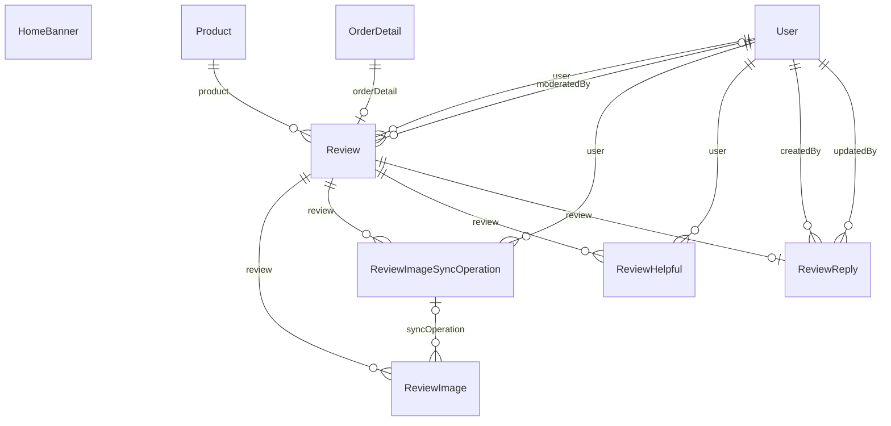

# Nhóm Catalog & Reviews

Tài liệu này trả lời: sản phẩm, đánh giá của khách và banner trang chủ được lưu thế nào, và cột nào là dữ liệu tổng hợp hoặc suy ra.

> Đối chiếu code: main @ 0f1eab2 (2026-11-04)

Nhóm gồm 7 model: `Product` (sản phẩm), `Review`, `ReviewImage`, `ReviewImageSyncOperation`, `ReviewHelpful`, `ReviewReply` (đánh giá và các phần phụ thuộc) và `HomeBanner` (banner trang chủ).

Điểm cần nhớ khi đọc dữ liệu:

- `Product.price` là **giá niêm yết**, không mặc định là giá bán cuối cùng. Giá hiệu lực (sau khuyến mãi tự động) nằm ở `CatalogPriceWindow` (xem [promotions-pricing.md](promotions-pricing.md)).
- `Product.quantity` là tồn kho hiện tại và chỉ đổi qua sổ kho (xem [inventory.md](inventory.md)).
- Điểm đánh giá trung bình và số lượt đánh giá **không** được lưu thành cột. `src/modules/products/products.review-stats.repository.ts` tính bằng `groupBy` trên `Review` mỗi lần cần.
- Đánh giá bị xoá mềm bằng `deletedAt`, không xoá dòng.

## ERD

## Data dictionary

### `Product` (`products`)

- **Mục đích:** Sản phẩm laptop bán trong cửa hàng: thông tin mô tả, giá niêm yết, tồn kho và thông số kỹ thuật dùng để lọc.
- **Nhãn:** nguồn sự thật cho thông tin sản phẩm và giá niêm yết. `quantity` và `sold` là dữ liệu tổng hợp do `moveStock` cập nhật; `cpuBrand`, `gpuBrand`, `gpuType`, `resolutionTier` là dữ liệu suy ra từ cột văn bản tương ứng.
- **Ghi/đọc chính:** tạo, sửa, xoá bởi `src/modules/products/products.service.ts`; `quantity` và `sold` chỉ đổi qua `moveStock` trong `src/modules/inventory/inventory.service.ts`; đọc bởi `src/modules/products/products.catalog.repository.ts` và hầu hết module nghiệp vụ.
- **Bất biến:** `quantity` bằng tổng `StockMovement.delta` của sản phẩm (xem [inventory.md](inventory.md)). `sold` tăng khi có biến động `ORDER` và giảm khi có `ORDER_CANCEL`.
- **Xoá:** `deleteProduct` từ chối với `PRODUCT_IN_USE` nếu sản phẩm đã có chi tiết đơn, biến động kho hoặc dòng phiếu nhập; khi đó phải ẩn sản phẩm bằng `isActive = false`.
- **Thông số kỹ thuật:** các cột `cpu` đến `warrantyMonths` đều tuỳ chọn. Các cột phân loại (`cpuBrand`, `gpuBrand`, `gpuType`, `resolutionTier`, `panelType`) được suy ra hoặc chuẩn hoá bởi `src/modules/products/products.normalization.ts` để phục vụ bộ lọc facet.

| Cột | Kiểu Prisma | Kiểu DB | Null | Mặc định | Khoá | Ý nghĩa | Ghi/đọc bởi |
| --- | --- | --- | --- | --- | --- | --- | --- |
| `id` | `Int` | `INT` | Không | `autoincrement()` | PK | Khoá chính. | Chung |
| `name` | `String` | `VARCHAR(255)` | Không | — | — | Tên sản phẩm. | Chung |
| `price` | `Int` | `INT` | Không | — | — | Giá niêm yết, đơn vị đồng. Không phải giá cuối cùng khi có khuyến mãi. | Chung |
| `image` | `String?` | `VARCHAR(255)` | Có | — | — | Đường dẫn ảnh sản phẩm trong `public/images`. | `src/modules/products/products.service.ts` |
| `detailDesc` | `String?` | `MEDIUMTEXT` | Có | — | — | Mô tả chi tiết (`MEDIUMTEXT`). | Chung |
| `shortDesc` | `String?` | `VARCHAR(255)` | Có | — | — | Mô tả ngắn. | Chung |
| `quantity` | `Int` | `INT` | Không | — | — | Tồn kho hiện tại. Chỉ đổi qua `moveStock`, cùng một dòng sổ kho trong cùng transaction. | `src/modules/inventory/inventory.service.ts` |
| `sold` | `Int?` | `INT` | Có | `0` | — | Số lượng đã bán (dữ liệu tổng hợp), dùng để sắp xếp `sold_desc`. Tăng khi đặt hàng, giảm khi huỷ đơn. | `src/modules/inventory/inventory.service.ts`; sắp xếp bởi `src/modules/products/products.service.ts` |
| `factory` | `String?` | `VARCHAR(255)` | Có | — | — | Hãng sản xuất (văn bản tự do). | Chung |
| `target` | `String?` | `VARCHAR(255)` | Có | — | — | Nhóm đối tượng sử dụng (văn bản tự do, ví dụ gaming, văn phòng). | Chung |
| `isActive` | `Boolean` | `BOOLEAN` | Không | `true` | — | Có đang bán hay không. Sản phẩm không hoạt động thì không đặt hàng được và không ghi sổ phiếu nhập được (hai nơi gọi `moveStock` với `onlyActive`). | Chung |
| `cpu` | `String?` | `VARCHAR(255)` | Có | — | — | Tên CPU, văn bản tự do. | Chung |
| `gpu` | `String?` | `VARCHAR(255)` | Có | — | — | Tên GPU, văn bản tự do. | Chung |
| `cpuBrand` | `String?` | `VARCHAR(20)` | Có | — | — | Hãng CPU đã chuẩn hoá (`INTEL`, `AMD`, `APPLE`, `QUALCOMM`), suy ra từ `cpu`. | `src/modules/products/products.normalization.ts` |
| `gpuBrand` | `String?` | `VARCHAR(20)` | Có | — | — | Hãng GPU đã chuẩn hoá (`NVIDIA`, `AMD`, `INTEL`, `APPLE`, `QUALCOMM`), suy ra từ `gpu`. | `src/modules/products/products.normalization.ts` |
| `gpuType` | `String?` | `VARCHAR(20)` | Có | — | — | Loại GPU đã chuẩn hoá: `INTEGRATED` hoặc `DEDICATED`, suy ra từ `gpu`. | `src/modules/products/products.normalization.ts` |
| `ramGb` | `Int?` | `INT` | Có | — | — | Dung lượng RAM, gigabyte. | Chung |
| `storageGb` | `Int?` | `INT` | Có | — | — | Dung lượng lưu trữ, gigabyte. | Chung |
| `screenSizeInch` | `Float?` | `DOUBLE` | Có | — | — | Kích thước màn hình, inch; giá trị hợp lệ từ 10 đến 20. | Chung |
| `screenResolution` | `String?` | `VARCHAR(50)` | Có | — | — | Độ phân giải màn hình, văn bản tự do. | Chung |
| `resolutionTier` | `String?` | `VARCHAR(20)` | Có | — | — | Bậc độ phân giải đã chuẩn hoá (`HD`, `FHD`, `QHD`, `UHD`), suy ra từ `screenResolution`. | `src/modules/products/products.normalization.ts` |
| `panelType` | `String?` | `VARCHAR(20)` | Có | — | — | Loại tấm nền đã chuẩn hoá (`IPS`, `OLED`, `MINI_LED`, `TN`, `VA`). | `src/modules/products/products.normalization.ts` |
| `refreshRateHz` | `Int?` | `INT` | Có | — | — | Tần số quét, Hz. | Chung |
| `batteryWh` | `Int?` | `INT` | Có | — | — | Dung lượng pin, Wh. | Chung |
| `weightGrams` | `Int?` | `INT` | Có | — | — | Khối lượng, gram. | Chung |
| `warrantyMonths` | `Int?` | `INT` | Có | — | — | Số tháng bảo hành hiện hành, từ 0 đến 120. Khi đặt hàng, giá trị này được chụp sang `OrderDetail.warrantyMonthsSnapshot`. | `src/modules/orders/orders.service.ts` |

**Quan hệ:**

- Được tham chiếu bởi: `CartDetail`, `OrderDetail`, `StockMovement`, `StockReceiptItem`, `PromotionProduct`, `FlashSaleProductQuota`, `Review`, `WishlistItem`, `Notification`, `CatalogPriceWindow`

### `Review` (`reviews`)

- **Mục đích:** Đánh giá của khách về một sản phẩm đã mua: điểm sao, nội dung, trạng thái kiểm duyệt.
- **Nhãn:** nguồn sự thật cho đánh giá.
- **Ghi/đọc chính:** ghi và đọc bởi `src/modules/reviews/reviews.service.ts`; ảnh của đánh giá do `src/modules/reviews/review-images.service.ts` và `src/modules/reviews/review-image-sync.service.ts` quản lý.
- **Bất biến:** mỗi người dùng chỉ có một đánh giá cho mỗi sản phẩm (unique `userId, productId`), và mỗi chi tiết đơn chỉ gắn một đánh giá (`orderDetailId` duy nhất). Chỉ khách có đơn `COMPLETED` và `PAYMENT_SUCCESS` chứa sản phẩm đó mới đánh giá được. Điểm `rating` giới hạn 1 đến 5 bằng ràng buộc CHECK `reviews_rating_check` trong migration `add_product_reviews`, không có trong `schema.prisma`.
- **Xoá mềm:** đặt `deletedAt`. Khách đánh giá lại sản phẩm đó thì dòng cũ được hồi sinh (đặt `deletedAt = NULL` và ghi đè nội dung) thay vì tạo dòng mới.
- **Trạng thái:** enum `ReviewStatus` (`PUBLISHED`, `HIDDEN`).

| Cột | Kiểu Prisma | Kiểu DB | Null | Mặc định | Khoá | Ý nghĩa | Ghi/đọc bởi |
| --- | --- | --- | --- | --- | --- | --- | --- |
| `id` | `Int` | `INT` | Không | `autoincrement()` | PK | Khoá chính. | Chung |
| `userId` | `Int` | `INT` | Không | — | FK → User | Khách viết đánh giá. | Chung |
| `productId` | `Int` | `INT` | Không | — | FK → Product | Sản phẩm được đánh giá. | Chung |
| `orderDetailId` | `Int` | `INT` | Không | — | FK → OrderDetail, UQ | Chi tiết đơn chứng minh việc đã mua, duy nhất. | `src/modules/reviews/reviews.service.ts` |
| `rating` | `Int` | `UNSIGNEDTINYINT` | Không | — | — | Điểm sao từ 1 đến 5 (`UNSIGNED TINYINT`, có ràng buộc CHECK). | Chung |
| `title` | `String?` | `VARCHAR(150)` | Có | — | — | Tiêu đề (tuỳ chọn, tối đa 150 ký tự). | Chung |
| `content` | `String` | `VARCHAR(1500)` | Không | — | — | Nội dung, tối đa 1500 ký tự. | Chung |
| `isAnonymous` | `Boolean` | `BOOLEAN` | Không | — | — | Đánh giá ẩn danh hay không. Khi `false` (hiển thị tên), người dùng phải có `fullName`, nếu không bị từ chối với `REVIEW_FULL_NAME_REQUIRED`. | `src/modules/reviews/reviews.service.ts` |
| `status` | `ReviewStatus` | `ENUM` | Không | `PUBLISHED` | — | `PUBLISHED` hoặc `HIDDEN` (do admin ẩn). Mặc định `PUBLISHED`. | `src/modules/reviews/reviews.service.ts` |
| `deletedAt` | `DateTime?` | `DATETIME(3)` | Có | — | — | Thời điểm xoá mềm; rỗng nghĩa là còn hiệu lực. | `src/modules/reviews/reviews.service.ts` |
| `createdAt` | `DateTime` | `DATETIME(3)` | Không | `now()` | — | Thời điểm tạo dòng. | Chung |
| `contentUpdatedAt` | `DateTime` | `DATETIME(3)` | Không | `now()` | — | Lần cuối khách sửa nội dung hoặc điểm, không tính thay đổi do kiểm duyệt. | `src/modules/reviews/reviews.service.ts` |
| `updatedAt` | `DateTime` | `DATETIME(3)` | Không | `@updatedAt` | — | Thời điểm cập nhật dòng gần nhất (Prisma `@updatedAt`). | Chung |
| `hiddenReason` | `String?` | `VARCHAR(500)` | Có | — | — | Lý do admin ẩn đánh giá; rỗng khi đang `PUBLISHED`. | `src/modules/reviews/reviews.service.ts` |
| `moderatedAt` | `DateTime?` | `DATETIME(3)` | Có | — | — | Thời điểm admin kiểm duyệt gần nhất. | `src/modules/reviews/reviews.service.ts` |
| `moderatedById` | `Int?` | `INT` | Có | — | FK → User | Admin kiểm duyệt gần nhất. `SetNull` khi xoá người dùng. | `src/modules/reviews/reviews.service.ts` |
| `imageVersion` | `Int` | `INT` | Không | `0` | — | Phiên bản tập ảnh của đánh giá, tăng 1 mỗi lần tập ảnh đổi; dùng làm khoá lạc quan khi đồng bộ ảnh (`expectedVersion`). | `src/modules/reviews/review-images.service.ts`; `src/modules/reviews/review-image-sync.service.ts` |

**Quan hệ:**

- `user` → `User` qua `userId`, onDelete: Restrict
- `product` → `Product` qua `productId`, onDelete: Restrict
- `orderDetail` → `OrderDetail` qua `orderDetailId`, onDelete: Restrict
- `moderatedBy` → `User` qua `moderatedById`, onDelete: SetNull
- Được tham chiếu bởi: `ReviewImage`, `ReviewImageSyncOperation`, `ReviewHelpful`, `ReviewReply`

**Khoá ghép và index:**

- Unique ghép: `userId, productId`
- Index: `productId, status, deletedAt, createdAt`
- Index: `status, deletedAt, createdAt`

### `ReviewImage` (`review_images`)

- **Mục đích:** Ảnh đính kèm của một đánh giá, lưu trên object storage, mỗi ảnh một dòng.
- **Nhãn:** nguồn sự thật cho metadata ảnh. File thật nằm ở object storage; dòng này chỉ giữ khoá và thông tin.
- **Ghi/đọc chính:** ghi và đọc bởi `src/modules/reviews/review-images.service.ts` và `src/modules/reviews/review-image-sync.service.ts`; đối soát với storage bởi `src/scripts/reconcile-review-images.ts`.
- **Bất biến:** một đánh giá có tối đa 3 ảnh (`MAX_REVIEW_IMAGES`). `objectKey` duy nhất.
- **Vòng đời `status`:** `PENDING` (đã tạo dòng, chưa chắc file đã lên storage) → `READY` (file đã lên) → `DELETING` (đã đánh dấu xoá, `deletedAt` được đặt, file bị xoá sau đó và `storageDeletedAt` được ghi). Dòng `DELETING` còn có `purgeAfter`.

| Cột | Kiểu Prisma | Kiểu DB | Null | Mặc định | Khoá | Ý nghĩa | Ghi/đọc bởi |
| --- | --- | --- | --- | --- | --- | --- | --- |
| `id` | `Int` | `INT` | Không | `autoincrement()` | PK | Khoá chính. | Chung |
| `reviewId` | `Int` | `INT` | Không | — | FK → Review | Đánh giá chứa ảnh. | Chung |
| `objectKey` | `String` | `VARCHAR(512)` | Không | — | UQ | Khoá của file trong object storage, duy nhất. | Chung |
| `mimeType` | `String` | `VARCHAR(50)` | Không | — | — | Kiểu MIME của ảnh. | Chung |
| `byteSize` | `Int` | `INT` | Không | — | — | Kích thước file, byte. | Chung |
| `width` | `Int` | `INT` | Không | — | — | Chiều rộng ảnh, pixel. | Chung |
| `height` | `Int` | `INT` | Không | — | — | Chiều cao ảnh, pixel. | Chung |
| `position` | `Int` | `UNSIGNEDTINYINT` | Không | — | — | Thứ tự hiển thị trong đánh giá, bắt đầu từ 0. | `src/modules/reviews/review-images.service.ts` |
| `status` | `ReviewImageStatus` | `ENUM` | Không | `PENDING` | — | `PENDING`, `READY` hoặc `DELETING` (enum `ReviewImageStatus`). Mặc định `PENDING`. | `src/modules/reviews/review-images.service.ts`; `src/modules/reviews/review-image-sync.service.ts` |
| `createdAt` | `DateTime` | `DATETIME(3)` | Không | `now()` | — | Thời điểm tạo dòng. | Chung |
| `updatedAt` | `DateTime` | `DATETIME(3)` | Không | `@updatedAt` | — | Thời điểm cập nhật dòng gần nhất (Prisma `@updatedAt`). | Chung |
| `deletedAt` | `DateTime?` | `DATETIME(3)` | Có | — | — | Thời điểm đánh dấu xoá. | `src/modules/reviews/review-images.service.ts`; `src/modules/reviews/review-image-sync.state.ts` |
| `storageDeletedAt` | `DateTime?` | `DATETIME(3)` | Có | — | — | Thời điểm file đã bị xoá khỏi storage; rỗng nghĩa là file có thể còn. | `src/modules/reviews/review-images.service.ts`; `src/modules/reviews/reviews.service.ts` |
| `syncOperationId` | `Int?` | `INT` | Có | — | FK → ReviewImageSyncOperation | Lần đồng bộ ảnh đã tạo ra ảnh này (nếu có). | `src/modules/reviews/review-image-sync.service.ts` |
| `syncClientId` | `String?` | `VARCHAR(64)` | Có | — | — | Mã do client đặt cho ảnh trong lần đồng bộ, duy nhất theo `syncOperationId`. | `src/modules/reviews/review-image-sync.service.ts` |
| `purgeAfter` | `DateTime?` | `DATETIME(3)` | Có | — | — | Mốc sau đó dòng và file mồ côi có thể được dọn, dùng cho ảnh `DELETING`. | `src/modules/reviews/review-image-sync.service.ts`; `src/scripts/reconcile-review-images.ts` |

**Quan hệ:**

- `review` → `Review` qua `reviewId`, onDelete: Restrict
- `syncOperation` → `ReviewImageSyncOperation` qua `syncOperationId`, onDelete: SetNull

**Khoá ghép và index:**

- Unique ghép: `syncOperationId, syncClientId`
- Index: `reviewId, status, position`
- Index: `status, updatedAt`

### `ReviewImageSyncOperation` (`review_image_sync_operations`)

- **Mục đích:** Một lần đồng bộ trọn bộ ảnh của đánh giá theo manifest do client gửi, chạy idempotent và có thể thử lại.
- **Nhãn:** nguồn sự thật cho trạng thái từng lần đồng bộ ảnh.
- **Ghi/đọc chính:** ghi và đọc bởi `src/modules/reviews/review-image-sync.service.ts` và `src/modules/reviews/review-image-sync.state.ts`.
- **Bất biến:** duy nhất theo `(userId, reviewId, idempotencyKey)`. `requestFingerprint` là SHA-256 của nội dung yêu cầu; cùng khoá mà khác nội dung bị từ chối. Chỉ tiến trình giữ lease (`leaseOwner`, `leaseExpiresAt`) mới được xử lý.
- **Vòng đời `status`:** enum `ReviewImageSyncStatus`: `PROCESSING`, `WAITING_RETRY`, `SUCCEEDED`, `FAILED`.

| Cột | Kiểu Prisma | Kiểu DB | Null | Mặc định | Khoá | Ý nghĩa | Ghi/đọc bởi |
| --- | --- | --- | --- | --- | --- | --- | --- |
| `id` | `Int` | `INT` | Không | `autoincrement()` | PK | Khoá chính. | Chung |
| `userId` | `Int` | `INT` | Không | — | FK → User | Khách thực hiện đồng bộ. | Chung |
| `reviewId` | `Int` | `INT` | Không | — | FK → Review | Đánh giá được đồng bộ ảnh. | Chung |
| `idempotencyKey` | `String` | `VARCHAR(64)` | Không | — | — | Khoá chống lặp client gửi, tối đa 64 ký tự. | `src/modules/reviews/review-image-sync.service.ts` |
| `requestFingerprint` | `String` | `CHAR(64)` | Không | — | — | SHA-256 nội dung yêu cầu, để phát hiện dùng lại khoá với nội dung khác. | `src/modules/reviews/review-image-sync.service.ts` |
| `expectedVersion` | `Int` | `INT` | Không | — | — | `Review.imageVersion` mà client kỳ vọng; lệch thì lần đồng bộ bị từ chối. | `src/modules/reviews/review-image-sync.service.ts` |
| `status` | `ReviewImageSyncStatus` | `ENUM` | Không | `PROCESSING` | — | Trạng thái lần đồng bộ (xem vòng đời ở trên). Mặc định `PROCESSING`. | `src/modules/reviews/review-image-sync.service.ts`; `src/modules/reviews/review-image-sync.state.ts` |
| `manifest` | `Json` | `JSON` | Không | — | — | Danh sách ảnh client muốn có sau đồng bộ (JSON). | `src/modules/reviews/review-image-sync.service.ts` |
| `result` | `Json?` | `JSON` | Có | — | — | Kết quả khi thành công (JSON), trả lại nguyên văn khi client gửi lại. | `src/modules/reviews/review-image-sync.service.ts` |
| `errorCode` | `String?` | `VARCHAR(80)` | Có | — | — | Mã lỗi khi thất bại. | `src/modules/reviews/review-image-sync.service.ts` |
| `errorDetails` | `Json?` | `JSON` | Có | — | — | Chi tiết lỗi (JSON). | `src/modules/reviews/review-image-sync.service.ts` |
| `leaseOwner` | `String?` | `VARCHAR(64)` | Có | — | — | Mã tiến trình đang xử lý; rỗng khi rảnh. | `src/modules/reviews/review-image-sync.state.ts` |
| `leaseExpiresAt` | `DateTime?` | `DATETIME(3)` | Có | — | — | Hạn của lease; hết hạn thì tiến trình khác được tiếp quản. | `src/modules/reviews/review-image-sync.state.ts` |
| `attemptCount` | `Int` | `INT` | Không | `0` | — | Số lần đã thử xử lý. | Chung |
| `createdAt` | `DateTime` | `DATETIME(3)` | Không | `now()` | — | Thời điểm tạo dòng. | Chung |
| `updatedAt` | `DateTime` | `DATETIME(3)` | Không | `@updatedAt` | — | Thời điểm cập nhật dòng gần nhất (Prisma `@updatedAt`). | Chung |
| `completedAt` | `DateTime?` | `DATETIME(3)` | Có | — | — | Thời điểm kết thúc (thành công hoặc thất bại). | `src/modules/reviews/review-image-sync.state.ts` |
| `expiresAt` | `DateTime?` | `DATETIME(3)` | Có | — | — | Mốc hết hạn lưu kết quả idempotent (cấu hình `REVIEW_IMAGE_IDEMPOTENCY_RETENTION_MS`), sau đó có thể dọn. | `src/modules/reviews/review-image-sync.state.ts` |

**Quan hệ:**

- `user` → `User` qua `userId`, onDelete: Restrict
- `review` → `Review` qua `reviewId`, onDelete: Restrict
- Được tham chiếu bởi: `ReviewImage`

**Khoá ghép và index:**

- Unique ghép: `userId, reviewId, idempotencyKey`
- Index: `status, leaseExpiresAt`
- Index: `expiresAt`

### `ReviewHelpful` (`review_helpful`)

- **Mục đích:** Lượt bình chọn "hữu ích" của một người dùng cho một đánh giá.
- **Nhãn:** nguồn sự thật cho lượt bình chọn. Số lượt hữu ích được đếm từ bảng này khi cần, không lưu thành cột.
- **Ghi/đọc chính:** ghi và đọc bởi `src/modules/reviews/review-helpful.service.ts`.
- **Bất biến:** khoá chính ghép `(reviewId, userId)`, nên mỗi người dùng chỉ bình chọn một lần cho mỗi đánh giá.

| Cột | Kiểu Prisma | Kiểu DB | Null | Mặc định | Khoá | Ý nghĩa | Ghi/đọc bởi |
| --- | --- | --- | --- | --- | --- | --- | --- |
| `reviewId` | `Int` | `INT` | Không | — | PK, FK → Review | Đánh giá được bình chọn. | Chung |
| `userId` | `Int` | `INT` | Không | — | PK, FK → User | Người bình chọn. | Chung |
| `createdAt` | `DateTime` | `DATETIME(3)` | Không | `now()` | — | Thời điểm tạo dòng. | Chung |

**Quan hệ:**

- `review` → `Review` qua `reviewId`, onDelete: Restrict
- `user` → `User` qua `userId`, onDelete: Restrict

**Khoá ghép và index:**

- PK ghép: `reviewId, userId`
- Index: `userId, createdAt`

### `ReviewReply` (`review_replies`)

- **Mục đích:** Phản hồi chính thức của cửa hàng cho một đánh giá.
- **Nhãn:** nguồn sự thật cho phản hồi.
- **Ghi/đọc chính:** ghi và đọc bởi `src/modules/reviews/reviews.service.ts`.
- **Bất biến:** mỗi đánh giá có tối đa một phản hồi (`reviewId` duy nhất). Xoá phản hồi là xoá mềm bằng `deletedAt`.

| Cột | Kiểu Prisma | Kiểu DB | Null | Mặc định | Khoá | Ý nghĩa | Ghi/đọc bởi |
| --- | --- | --- | --- | --- | --- | --- | --- |
| `id` | `Int` | `INT` | Không | `autoincrement()` | PK | Khoá chính. | Chung |
| `reviewId` | `Int` | `INT` | Không | — | FK → Review, UQ | Đánh giá được phản hồi, duy nhất. | Chung |
| `content` | `String` | `VARCHAR(1000)` | Không | — | — | Nội dung phản hồi, tối đa 1000 ký tự. | Chung |
| `createdById` | `Int` | `INT` | Không | — | FK → User | Admin tạo phản hồi. | Chung |
| `updatedById` | `Int` | `INT` | Không | — | FK → User | Admin sửa phản hồi gần nhất. | Chung |
| `createdAt` | `DateTime` | `DATETIME(3)` | Không | `now()` | — | Thời điểm tạo dòng. | Chung |
| `updatedAt` | `DateTime` | `DATETIME(3)` | Không | `@updatedAt` | — | Thời điểm cập nhật dòng gần nhất (Prisma `@updatedAt`). | Chung |
| `deletedAt` | `DateTime?` | `DATETIME(3)` | Có | — | — | Thời điểm xoá mềm; rỗng nghĩa là còn hiệu lực. | Chung |

**Quan hệ:**

- `review` → `Review` qua `reviewId`, onDelete: Restrict
- `createdBy` → `User` qua `createdById`, onDelete: Restrict
- `updatedBy` → `User` qua `updatedById`, onDelete: Restrict

**Khoá ghép và index:**

- Index: `deletedAt, updatedAt`

### `HomeBanner` (`home_banners`)

- **Mục đích:** Banner hiển thị ở trang chủ storefront, do admin cấu hình.
- **Nhãn:** nguồn sự thật cho nội dung banner.
- **Ghi/đọc chính:** ghi bởi admin qua `src/modules/home-banners/home-banners.service.ts`; đọc công khai cùng file đó.
- **Hiển thị công khai:** banner chỉ được trả cho storefront khi `isActive` bật và thời điểm hiện tại nằm trong `[startsAt, endsAt)` (hai mốc này tuỳ chọn; rỗng nghĩa là không giới hạn). Banner mới mặc định chưa hoạt động (`isActive = false`).
- **Vị trí:** enum `HomeBannerPlacement` (`HERO`, `SIDE`). Banner `SIDE` không được có `ctaText`, `secondaryCtaText`, `secondaryLinkUrl` và `badges`; có ảnh thì bắt buộc có `imageAlt`; `endsAt` phải sau `startsAt` (`bannerShapeIssues` trong `home-banners.schema.ts`).

| Cột | Kiểu Prisma | Kiểu DB | Null | Mặc định | Khoá | Ý nghĩa | Ghi/đọc bởi |
| --- | --- | --- | --- | --- | --- | --- | --- |
| `id` | `Int` | `INT` | Không | `autoincrement()` | PK | Khoá chính. | Chung |
| `placement` | `HomeBannerPlacement` | `ENUM` | Không | — | — | Vị trí hiển thị: `HERO` hoặc `SIDE`. | Chung |
| `eyebrow` | `String?` | `VARCHAR(60)` | Có | — | — | Dòng chữ nhỏ phía trên tiêu đề (tuỳ chọn). | Chung |
| `title` | `String` | `VARCHAR(80)` | Không | — | — | Tiêu đề chính. | Chung |
| `highlight` | `String?` | `VARCHAR(80)` | Có | — | — | Cụm từ nhấn mạnh trong tiêu đề (tuỳ chọn). | Chung |
| `description` | `String?` | `VARCHAR(200)` | Có | — | — | Mô tả ngắn (tuỳ chọn). | Chung |
| `ctaText` | `String?` | `VARCHAR(30)` | Có | — | — | Chữ trên nút kêu gọi hành động chính (tuỳ chọn). | Chung |
| `linkUrl` | `String?` | `VARCHAR(255)` | Có | — | — | Liên kết của nút chính (tuỳ chọn). | Chung |
| `secondaryCtaText` | `String?` | `VARCHAR(30)` | Có | — | — | Chữ trên nút phụ (tuỳ chọn). | Chung |
| `secondaryLinkUrl` | `String?` | `VARCHAR(255)` | Có | — | — | Liên kết của nút phụ (tuỳ chọn). | Chung |
| `badges` | `Json` | `JSON` | Không | — | — | Danh sách nhãn nhỏ hiển thị kèm (JSON). | Chung |
| `imagePath` | `String?` | `VARCHAR(255)` | Có | — | — | Đường dẫn ảnh banner (tuỳ chọn). | `src/modules/home-banners/home-banners.service.ts`; `src/modules/home-banners/home-banners.files.ts` |
| `imageAlt` | `String?` | `VARCHAR(120)` | Có | — | — | Văn bản thay thế cho ảnh (tuỳ chọn). | Chung |
| `position` | `Int` | `INT` | Không | `0` | — | Thứ tự sắp xếp trong cùng vị trí, nhỏ hiển thị trước. | Chung |
| `isActive` | `Boolean` | `BOOLEAN` | Không | `false` | — | Bật hiển thị công khai. Mặc định tắt. | Chung |
| `startsAt` | `DateTime?` | `DATETIME(3)` | Có | — | — | Thời điểm bắt đầu hiển thị (tuỳ chọn). | Chung |
| `endsAt` | `DateTime?` | `DATETIME(3)` | Có | — | — | Thời điểm kết thúc hiển thị (tuỳ chọn, loại trừ). | Chung |
| `createdAt` | `DateTime` | `DATETIME(3)` | Không | `now()` | — | Thời điểm tạo dòng. | Chung |
| `updatedAt` | `DateTime` | `DATETIME(3)` | Không | `@updatedAt` | — | Thời điểm cập nhật dòng gần nhất (Prisma `@updatedAt`). | Chung |

**Khoá ghép và index:**

- Index: `placement, isActive, position`

## Nguồn

- [prisma/schema.prisma](https://github.com/QuocDuy21-10/laptopshop-api/blob/main/prisma/schema.prisma): `Product`, `Review`, `ReviewImage`, `ReviewImageSyncOperation`, `ReviewHelpful`, `ReviewReply`, `HomeBanner`
- [src/modules/products/products.service.ts](https://github.com/QuocDuy21-10/laptopshop-api/blob/main/src/modules/products/products.service.ts): `deleteProduct`
- [src/modules/products/products.normalization.ts](https://github.com/QuocDuy21-10/laptopshop-api/blob/main/src/modules/products/products.normalization.ts): `inferCpuBrand`
- [src/modules/products/products.review-stats.repository.ts](https://github.com/QuocDuy21-10/laptopshop-api/blob/main/src/modules/products/products.review-stats.repository.ts)
- [src/modules/inventory/inventory.service.ts](https://github.com/QuocDuy21-10/laptopshop-api/blob/main/src/modules/inventory/inventory.service.ts): `moveStock`
- [src/modules/reviews/reviews.service.ts](https://github.com/QuocDuy21-10/laptopshop-api/blob/main/src/modules/reviews/reviews.service.ts): `createReview`
- [src/modules/reviews/review-images.service.ts](https://github.com/QuocDuy21-10/laptopshop-api/blob/main/src/modules/reviews/review-images.service.ts)
- [src/modules/reviews/review-image-sync.service.ts](https://github.com/QuocDuy21-10/laptopshop-api/blob/main/src/modules/reviews/review-image-sync.service.ts)
- [src/modules/reviews/review-image-sync.state.ts](https://github.com/QuocDuy21-10/laptopshop-api/blob/main/src/modules/reviews/review-image-sync.state.ts)
- [src/modules/reviews/review-helpful.service.ts](https://github.com/QuocDuy21-10/laptopshop-api/blob/main/src/modules/reviews/review-helpful.service.ts)
- [src/modules/home-banners/home-banners.service.ts](https://github.com/QuocDuy21-10/laptopshop-api/blob/main/src/modules/home-banners/home-banners.service.ts)
