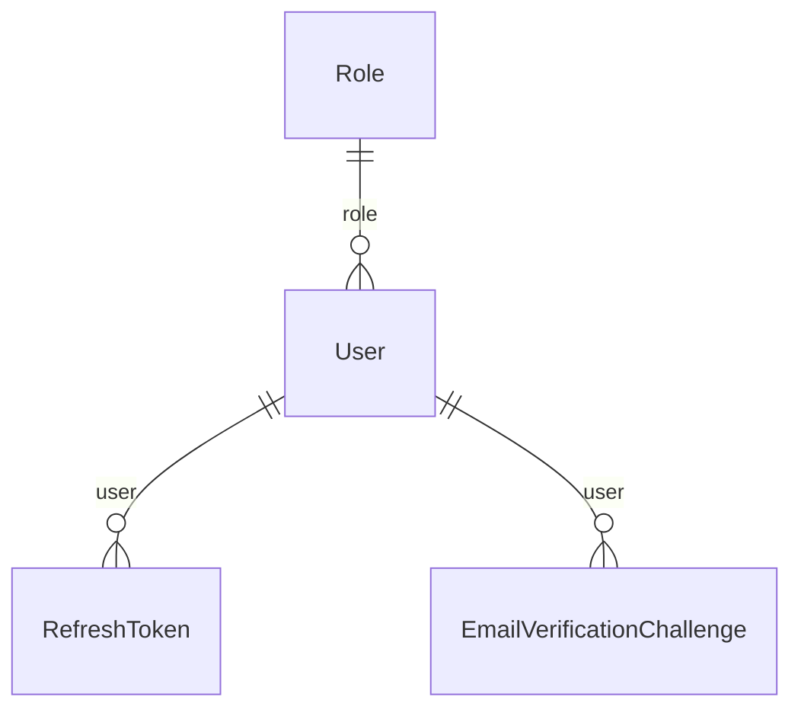

# Nhóm Identity & Accounts

Tài liệu này trả lời: tài khoản, vai trò, phiên đăng nhập và mã xác minh email được lưu thế nào, và những cột nào không bao giờ ra khỏi API.

> Đối chiếu code: main @ 0f1eab2 (2026-11-04)

Nhóm gồm 4 model: `User`, `Role`, `RefreshToken` và `EmailVerificationChallenge`. `User` là bảng được tham chiếu nhiều nhất của cả schema (xem mục "Được tham chiếu bởi" của `User`).

Hai quy tắc ảnh hưởng tới cách đọc dữ liệu: cột `password` chỉ chứa hash bcrypt và `src/modules/users/users.mapper.ts` (`userSelect`) không chọn cột này nên nó không đi vào DTO; còn `RefreshToken` chỉ lưu hash SHA-256 của token, token gốc chỉ nằm trong cookie của client.

## ERD

## Data dictionary

### `User` (`users`)

- **Mục đích:** Tài khoản người dùng, gồm khách hàng và quản trị viên; mỗi tài khoản có đúng một vai trò.
- **Nhãn:** nguồn sự thật cho danh tính và hồ sơ.
- **Ghi/đọc chính:** tạo bởi `src/modules/auth/auth.service.ts` (đăng ký, role `USER`) và `src/modules/users/users.service.ts` (admin tạo); đọc rộng rãi vì hầu hết bảng nghiệp vụ tham chiếu `User`.
- **Bất biến:** `username` là email đăng nhập (đăng ký và quên mật khẩu đều validate email), duy nhất toàn hệ thống. `password` luôn là hash bcrypt (`hashPassword`), không bao giờ trả ra API.

| Cột | Kiểu Prisma | Kiểu DB | Null | Mặc định | Khoá | Ý nghĩa | Ghi/đọc bởi |
| --- | --- | --- | --- | --- | --- | --- | --- |
| `id` | `Int` | `INT` | Không | `autoincrement()` | PK | Khoá chính. | Chung |
| `username` | `String` | `VARCHAR(255)` | Không | — | UQ | Email đăng nhập, duy nhất; đồng thời là địa chỉ nhận email xác minh và quên mật khẩu. | `src/modules/auth/auth.service.ts`; `src/modules/users/users.service.ts` |
| `password` | `String` | `VARCHAR(255)` | Không | — | — | Hash bcrypt của mật khẩu (cost 10). Không nằm trong `userSelect` nên không đi vào DTO. | `src/modules/auth/auth.service.ts`; `src/modules/auth/password-reset.service.ts`; `src/lib/password.ts` |
| `fullName` | `String?` | `VARCHAR(255)` | Có | — | — | Họ tên hiển thị (tuỳ chọn). | `src/modules/users/users.service.ts` |
| `address` | `String?` | `VARCHAR(255)` | Có | — | — | Địa chỉ liên hệ (tuỳ chọn). | `src/modules/users/users.service.ts` |
| `phone` | `String?` | `VARCHAR(255)` | Có | — | — | Số điện thoại (tuỳ chọn). | `src/modules/users/users.service.ts` |
| `accountType` | `String?` | `VARCHAR(50)` | Có | — | — | Nguồn tạo tài khoản, giá trị trong `ACCOUNT_TYPE`: `SYSTEM`, `GOOGLE`, `GITHUB`. Code hiện chỉ ghi `SYSTEM`. Lưu bằng `VARCHAR(50)`, không phải enum. | `src/modules/auth/auth.service.ts` |
| `avatar` | `String?` | `VARCHAR(255)` | Có | — | — | Đường dẫn ảnh đại diện trong `public/images` (tuỳ chọn). | `src/modules/users/users.service.ts` |
| `emailVerifiedAt` | `DateTime?` | `DATETIME(3)` | Có | — | — | Thời điểm email được xác minh bằng mã OTP; rỗng nghĩa là chưa xác minh. | `src/modules/email-verification/email-verification.service.ts` |
| `roleId` | `Int` | `INT` | Không | — | FK → Role | Vai trò của tài khoản; không xoá được vai trò khi còn người dùng (`Restrict`). | `src/modules/auth/auth.service.ts`; `src/modules/users/users.service.ts` |

**Quan hệ:**

- `role` → `Role` qua `roleId`, onDelete: Restrict (mặc định)
- Được tham chiếu bởi: `Cart`, `Order`, `RefreshToken`, `OrderStatusHistory`, `StockMovement`, `PaymentWebhookEvent`, `PaymentReviewCase`, `PaymentReviewAction`, `StockReceipt`, `Review`, `ReviewImageSyncOperation`, `ReviewHelpful`, `ReviewReply`, `FlashSaleUserUsage`, `FlashSaleAllocation`, `Promotion`, `PromotionUserUsage`, `PromotionRedemption`, `WishlistItem`, `Notification`, `NotificationPreference`, `EmailVerificationChallenge`, `PushSubscription`, `NotificationDeliveryAudit`, `ServiceRequest`, `ServiceRequestEvent`, `ServiceRequestAttachment`, `ServiceQuote`, `WarrantyVerification`

### `Role` (`roles`)

- **Mục đích:** Danh mục vai trò. Hệ thống dùng hai vai trò `ADMIN` và `USER`.
- **Nhãn:** nguồn sự thật cho danh sách vai trò; dữ liệu tham chiếu hầu như không đổi.
- **Ghi/đọc chính:** đọc bởi `src/modules/auth/auth.service.ts` (tìm role `USER` khi đăng ký) và `src/modules/users/users.service.ts`; tạo ban đầu bởi `src/config/seed.ts`.
- **Bất biến:** `name` duy nhất. Quyền truy cập admin được kiểm tra qua `requireRole("ADMIN")` theo tên vai trò đưa vào JWT.

| Cột | Kiểu Prisma | Kiểu DB | Null | Mặc định | Khoá | Ý nghĩa | Ghi/đọc bởi |
| --- | --- | --- | --- | --- | --- | --- | --- |
| `id` | `Int` | `INT` | Không | `autoincrement()` | PK | Khoá chính. | Chung |
| `name` | `String` | `VARCHAR(100)` | Không | — | UQ | Tên vai trò, duy nhất (`ADMIN`, `USER`). | Chung |
| `description` | `String?` | `VARCHAR(255)` | Có | — | — | Mô tả vai trò (tuỳ chọn). | Chung |

**Quan hệ:**

- Được tham chiếu bởi: `User`

### `RefreshToken` (`refresh_tokens`)

- **Mục đích:** Phiên đăng nhập dài hạn: mỗi dòng là một refresh token đã phát hành, dùng một lần rồi xoay vòng.
- **Nhãn:** nguồn sự thật cho phiên đăng nhập. Token gốc không được lưu.
- **Ghi/đọc chính:** ghi và đọc bởi `src/modules/auth/token.service.ts` (`issueRefreshToken`, `rotateRefreshToken`, `revokeFamily`, `revokeByToken`); `src/modules/auth/password-reset.service.ts` thu hồi mọi token của người dùng khi đặt lại mật khẩu.
- **Bất biến:** chỉ lưu `tokenHash` (SHA-256 của token). Mỗi lần refresh thu hồi token cũ rồi phát token mới cùng `familyId`. Token đã thu hồi mà bị dùng lại thì thu hồi cả họ (`familyId`), coi là bị đánh cắp.

| Cột | Kiểu Prisma | Kiểu DB | Null | Mặc định | Khoá | Ý nghĩa | Ghi/đọc bởi |
| --- | --- | --- | --- | --- | --- | --- | --- |
| `id` | `Int` | `INT` | Không | `autoincrement()` | PK | Khoá chính. | Chung |
| `tokenHash` | `String` | `CHAR(64)` | Không | — | UQ | SHA-256 (hex) của token gốc, duy nhất. Dùng để tra cứu khi client gửi cookie `refresh_token`. | `src/modules/auth/token.service.ts` |
| `familyId` | `String` | `CHAR(36)` | Không | — | — | UUID nhóm các token xoay vòng từ cùng một lần đăng nhập, dùng để thu hồi cả họ. | `src/modules/auth/token.service.ts` |
| `expiresAt` | `DateTime` | `DATETIME(3)` | Không | — | — | Thời điểm hết hạn, bằng thời điểm phát hành cộng `REFRESH_TTL_DAYS` ngày. | `src/modules/auth/token.service.ts` |
| `revokedAt` | `DateTime?` | `DATETIME(3)` | Có | — | — | Thời điểm thu hồi (do xoay vòng, đăng xuất, phát hiện dùng lại hoặc đặt lại mật khẩu); rỗng nghĩa là còn hiệu lực. | `src/modules/auth/token.service.ts`; `src/modules/auth/password-reset.service.ts` |
| `userAgent` | `String?` | `VARCHAR(255)` | Có | — | — | User-Agent của client lúc phát hành, cắt còn 255 ký tự (tuỳ chọn). | `src/modules/auth/token.service.ts` |
| `ip` | `String?` | `VARCHAR(64)` | Có | — | — | IP của client lúc phát hành, cắt còn 64 ký tự (tuỳ chọn). | `src/modules/auth/token.service.ts` |
| `createdAt` | `DateTime` | `DATETIME(3)` | Không | `now()` | — | Thời điểm tạo dòng. | Chung |
| `userId` | `Int` | `INT` | Không | — | FK → User | Chủ sở hữu token; xoá người dùng thì xoá token (`Cascade`). | Chung |

**Quan hệ:**

- `user` → `User` qua `userId`, onDelete: Cascade

**Khoá ghép và index:**

- Index: `familyId`

### `EmailVerificationChallenge` (`email_verification_challenges`)

- **Mục đích:** Mã OTP 6 chữ số gửi qua email, dùng cho hai mục đích: xác minh email và đặt lại mật khẩu.
- **Nhãn:** nguồn sự thật cho trạng thái từng mã. Mã gốc chỉ tồn tại ở dạng mã hoá và bị xoá sau khi dùng.
- **Ghi/đọc chính:** ghi và đọc bởi `src/modules/email-verification/email-verification.service.ts` (`EMAIL_VERIFICATION`) và `src/modules/auth/password-reset.service.ts` (`PASSWORD_RESET`); mã hoá bởi `src/modules/email-verification/email-otp.crypto.ts`.
- **Bất biến:** mã xác minh email có hiệu lực 10 phút, mã đặt lại mật khẩu 15 phút (`PASSWORD_RESET_TTL_MINUTES`); sai từ 5 lần thì không dùng được; gửi lại trong vòng 60 giây bị từ chối. Khi dùng thành công, `consumedAt` được đặt và `otpCiphertext`, `otpIv`, `otpTag` bị xoá trắng.

| Cột | Kiểu Prisma | Kiểu DB | Null | Mặc định | Khoá | Ý nghĩa | Ghi/đọc bởi |
| --- | --- | --- | --- | --- | --- | --- | --- |
| `id` | `Int` | `INT` | Không | `autoincrement()` | PK | Khoá chính. | Chung |
| `userId` | `Int` | `INT` | Không | — | FK → User | Người dùng nhận mã; xoá người dùng thì xoá mã (`Cascade`). | Chung |
| `purpose` | `EmailChallengePurpose` | `ENUM` | Không | `EMAIL_VERIFICATION` | — | Mục đích của mã: enum `EmailChallengePurpose` (`EMAIL_VERIFICATION`, `PASSWORD_RESET`). | Chung |
| `email` | `String` | `VARCHAR(255)` | Không | — | — | Địa chỉ email nhận mã tại thời điểm gửi. | Chung |
| `otpHash` | `String` | `VARCHAR(255)` | Không | — | — | SHA-256 (hex) của mã 6 chữ số, dùng để đối chiếu khi người dùng nhập (`verifyEmailOtp`, so sánh hằng thời gian). | `src/modules/email-verification/email-otp.crypto.ts` |
| `otpCiphertext` | `String` | `TEXT` | Không | — | — | Mã gốc được mã hoá AES-256-GCM (base64url) để tiến trình gửi thông báo giải mã khi gửi email (`notification-delivery.service.ts`); bị xoá trắng sau khi dùng. | `src/modules/email-verification/email-otp.crypto.ts` |
| `otpIv` | `String` | `VARCHAR(64)` | Không | — | — | Vector khởi tạo AES-GCM 12 byte (base64url) của lần mã hoá. | `src/modules/email-verification/email-otp.crypto.ts` |
| `otpTag` | `String` | `VARCHAR(64)` | Không | — | — | Thẻ xác thực AES-GCM (base64url). | `src/modules/email-verification/email-otp.crypto.ts` |
| `encryptionKeyVersion` | `String` | `VARCHAR(32)` | Không | — | — | Phiên bản khoá mã hoá đã dùng (cấu hình `EMAIL_OTP_KEY_VERSION`), để xoay khoá mà vẫn giải mã được mã cũ. | `src/modules/email-verification/email-otp.crypto.ts` |
| `expiresAt` | `DateTime` | `DATETIME(3)` | Không | — | — | Thời điểm hết hạn của mã. | Chung |
| `failedAttempts` | `Int` | `INT` | Không | `0` | — | Số lần nhập sai; từ 5 lần trở lên thì từ chối. | Chung |
| `sendCount` | `Int` | `INT` | Không | `0` | — | Số lần gửi của mã hiện tại. | Chung |
| `lastSentAt` | `DateTime?` | `DATETIME(3)` | Có | — | — | Thời điểm gửi gần nhất, dùng để chặn gửi lại quá nhanh. | Chung |
| `consumedAt` | `DateTime?` | `DATETIME(3)` | Có | — | — | Thời điểm mã được dùng thành công; rỗng nghĩa là chưa dùng. | Chung |
| `invalidatedAt` | `DateTime?` | `DATETIME(3)` | Có | — | — | Thời điểm mã bị vô hiệu hoá (ví dụ khi phát mã mới thay thế). | Chung |
| `createdAt` | `DateTime` | `DATETIME(3)` | Không | `now()` | — | Thời điểm tạo dòng. | Chung |

**Quan hệ:**

- `user` → `User` qua `userId`, onDelete: Cascade
- Được tham chiếu bởi: `NotificationDelivery`

**Khoá ghép và index:**

- Index: `userId, consumedAt, invalidatedAt, expiresAt`

## Nguồn

- [prisma/schema.prisma](../../../prisma/schema.prisma): `User`, `Role`, `RefreshToken`, `EmailVerificationChallenge`
- [src/modules/auth/auth.service.ts](../../../src/modules/auth/auth.service.ts): `registerUser`, `loginUser`
- [src/modules/auth/token.service.ts](../../../src/modules/auth/token.service.ts): `issueRefreshToken`, `rotateRefreshToken`, `revokeFamily`
- [src/modules/auth/password-reset.service.ts](../../../src/modules/auth/password-reset.service.ts)
- [src/modules/email-verification/email-verification.service.ts](../../../src/modules/email-verification/email-verification.service.ts)
- [src/modules/email-verification/email-otp.crypto.ts](../../../src/modules/email-verification/email-otp.crypto.ts): `createEmailOtp`, `verifyEmailOtp`
- [src/modules/users/users.mapper.ts](../../../src/modules/users/users.mapper.ts): `userSelect`
- [src/lib/password.ts](../../../src/lib/password.ts): `hashPassword`
- [src/config/constant.ts](../../../src/config/constant.ts): `ACCOUNT_TYPE`
