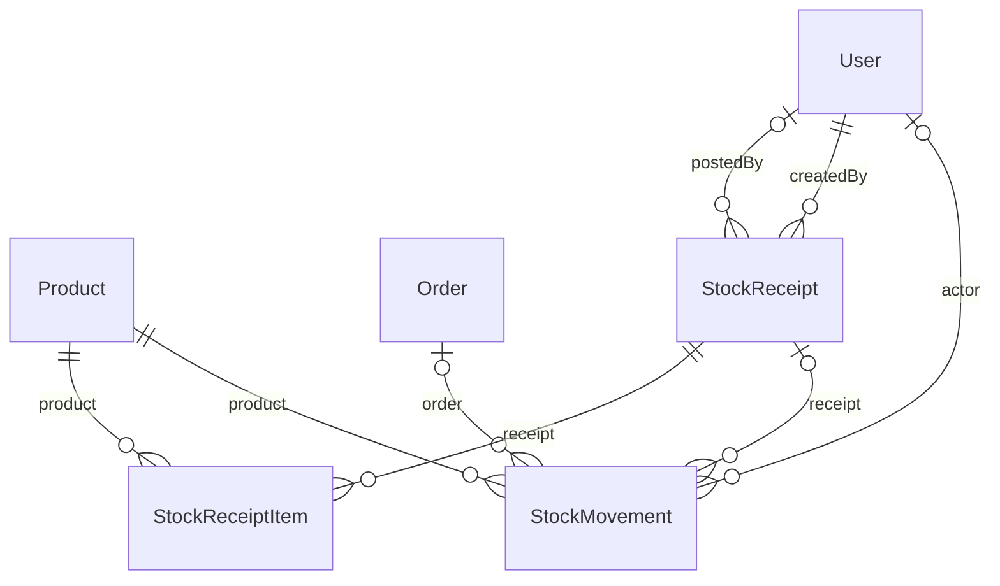

# Nhóm Inventory

Tài liệu này trả lời: tồn kho được lưu bằng những bảng nào, mỗi cột nghĩa là gì và ai ghi, ai đọc.

> Đối chiếu code: main @ 0f1eab2 (2026-11-04)

Nhóm gồm 3 model: sổ kho `StockMovement` và phiếu nhập `StockReceipt` cùng dòng chi tiết `StockReceiptItem`. Số lượng tồn hiện tại nằm ở `Product.quantity` (nhóm [Catalog & Reviews](catalog-reviews.md)).

Bất biến của cả nhóm: với mỗi sản phẩm, `Product.quantity` bằng tổng `StockMovement.delta` của sản phẩm đó. Hàm `moveStock` là cách duy nhất để thay đổi tồn kho và luôn chạy trong transaction của nơi gọi, nên `quantity` và dòng sổ thay đổi cùng nhau. Script `pnpm run inventory:verify-ledger` kiểm tra bất biến này (`findLedgerMismatches`).

## ERD

## Data dictionary

### `StockMovement` (`stock_movements`)

- **Mục đích:** Sổ kho: mỗi lần tồn kho của một sản phẩm thay đổi là một dòng, không bị sửa hay xoá khi vận hành bình thường (ngoại lệ duy nhất: `orderId` được gán ngay sau khi đơn hàng được tạo).
- **Nhãn:** nguồn sự thật cho lịch sử biến động. Cộng dồn `delta` phải bằng `Product.quantity`.
- **Ghi/đọc chính:** ghi bởi `moveStock` trong `src/modules/inventory/inventory.service.ts`, được gọi từ `src/modules/orders/orders.service.ts` (`ORDER`), `src/modules/orders/order-cancellation.service.ts` (`ORDER_CANCEL`), `src/modules/products/products.service.ts` (`INITIAL`) và `src/modules/inventory/inventory-receipts.service.ts` (`RESTOCK`); đọc bởi `src/modules/inventory/inventory.service.ts` và `src/modules/inventory/inventory.reconciliation.ts`.
- **Bất biến:** `balanceAfter = balanceBefore + delta`, và `Product.quantity = SUM(delta)` theo sản phẩm.
- **Giá trị `reason`:** `OPENING`, `INITIAL`, `ORDER`, `ORDER_CANCEL`, `RESTOCK`, `CORRECTION` (`STOCK_REASON` trong `src/modules/inventory/inventory.schema.ts`). `OPENING` chỉ do migration `stock_movements` và seed ghi; admin chỉ được tạo `RESTOCK` và `CORRECTION` qua `adjustStock`.

| Cột | Kiểu Prisma | Kiểu DB | Null | Mặc định | Khoá | Ý nghĩa | Ghi/đọc bởi |
| --- | --- | --- | --- | --- | --- | --- | --- |
| `id` | `Int` | `INT` | Không | `autoincrement()` | PK | Khoá chính. | Chung |
| `delta` | `Int` | `INT` | Không | — | — | Lượng thay đổi tồn kho: dương khi nhập, âm khi bán. Trong điều chỉnh của admin giới hạn trong khoảng ±10 000 và khác 0. | Chung |
| `reason` | `String` | `VARCHAR(20)` | Không | — | — | Lý do nghiệp vụ của biến động (xem danh sách giá trị ở trên). Lưu bằng `VARCHAR(20)`, không phải enum. | Chung |
| `note` | `String?` | `VARCHAR(500)` | Có | — | — | Ghi chú; bắt buộc với điều chỉnh của admin, với huỷ đơn là lý do huỷ. | `src/modules/inventory/inventory.service.ts`; `src/modules/orders/order-cancellation.service.ts` |
| `createdAt` | `DateTime` | `DATETIME(3)` | Không | `now()` | — | Thời điểm tạo dòng. | Chung |
| `balanceBefore` | `Int` | `INT` | Không | — | — | Tồn kho của sản phẩm ngay trước biến động, tính bằng `balanceAfter - delta`. | Chung |
| `balanceAfter` | `Int` | `INT` | Không | — | — | Tồn kho của sản phẩm ngay sau biến động, đọc lại từ `Product.quantity` trong cùng transaction. | Chung |
| `idempotencyKey` | `String?` | `VARCHAR(64)` | Có | — | — | Khoá chống lặp do admin gửi khi điều chỉnh tồn kho. Rỗng với các biến động sinh từ đơn hàng và phiếu nhập. | `src/modules/inventory/inventory.service.ts` |
| `requestHash` | `String?` | `CHAR(64)` | Có | — | — | SHA-256 của `productId, delta, reason, note`. Dùng so với lần gửi lại cùng khoá: khác nội dung thì trả `409 IDEMPOTENCY_KEY_REUSED`. | `src/modules/inventory/inventory.service.ts` |
| `productId` | `Int` | `INT` | Không | — | FK → Product | Sản phẩm bị tác động. | Chung |
| `orderId` | `Int?` | `INT` | Có | — | FK → Order | Đơn hàng sinh ra biến động. Với `ORDER`, được gán sau khi đơn được tạo vì lúc đó chưa có id; `SetNull` khi xoá đơn. | `src/modules/orders/orders.service.ts` |
| `actorId` | `Int?` | `INT` | Có | — | FK → User | Người thực hiện: khách hàng (đặt hàng), admin (điều chỉnh, nhập kho, huỷ đơn). `SetNull` khi xoá người dùng. | Chung |
| `receiptId` | `String?` | `CHAR(36)` | Có | — | FK → StockReceipt | Phiếu nhập sinh ra biến động `RESTOCK`; rỗng với các lý do khác. | `src/modules/inventory/inventory-receipts.service.ts` |

**Quan hệ:**

- `product` → `Product` qua `productId`, onDelete: Restrict (mặc định)
- `order` → `Order` qua `orderId`, onDelete: SetNull
- `actor` → `User` qua `actorId`, onDelete: SetNull
- `receipt` → `StockReceipt` qua `receiptId`, onDelete: Restrict

**Khoá ghép và index:**

- Unique ghép: `actorId, idempotencyKey`
- Index: `productId, createdAt`
- Index: `createdAt`
- Index: `receiptId`

### `StockReceipt` (`stock_receipts`)

- **Mục đích:** Phiếu nhập kho gồm nhiều dòng sản phẩm; chỉ khi được ghi sổ (`POSTED`) mới làm tăng tồn kho.
- **Nhãn:** nguồn sự thật cho phiếu nhập. Tồn kho thật chỉ đổi qua `StockMovement` do việc ghi sổ sinh ra.
- **Ghi/đọc chính:** ghi và đọc bởi `src/modules/inventory/inventory-receipts.service.ts`.
- **Bất biến:** `status` là `DRAFT` hoặc `POSTED` (`RECEIPT_STATUS`). Chỉ phiếu `DRAFT` được sửa; ghi sổ chuyển `DRAFT` sang `POSTED` bằng cập nhật có điều kiện theo `version`, rồi tạo một `StockMovement` `RESTOCK` cho mỗi dòng.

| Cột | Kiểu Prisma | Kiểu DB | Null | Mặc định | Khoá | Ý nghĩa | Ghi/đọc bởi |
| --- | --- | --- | --- | --- | --- | --- | --- |
| `id` | `String` | `CHAR(36)` | Không | `uuid()` | PK | Khoá chính. | Chung |
| `code` | `String` | `VARCHAR(40)` | Không | — | UQ | Mã phiếu để người dùng đọc và tìm kiếm, sinh bởi `generateReceiptCode`. | `src/modules/inventory/inventory-receipts.service.ts` |
| `supplierName` | `String?` | `VARCHAR(255)` | Có | — | — | Tên nhà cung cấp (tuỳ chọn). | `src/modules/inventory/inventory-receipts.service.ts` |
| `status` | `String` | `VARCHAR(20)` | Không | `DRAFT` | — | Trạng thái phiếu: `DRAFT` hoặc `POSTED`. Lưu bằng `VARCHAR(20)`, không phải enum. | `src/modules/inventory/inventory-receipts.service.ts` |
| `note` | `String?` | `VARCHAR(500)` | Có | — | — | Ghi chú của người lập phiếu. | Chung |
| `createdAt` | `DateTime` | `DATETIME(3)` | Không | `now()` | — | Thời điểm tạo dòng. | Chung |
| `postedAt` | `DateTime?` | `DATETIME(3)` | Có | — | — | Thời điểm ghi sổ; rỗng khi còn `DRAFT`. | `src/modules/inventory/inventory-receipts.service.ts` |
| `version` | `Int` | `INT` | Không | `0` | — | Số phiên bản dùng cho khoá lạc quan: sửa hoặc ghi sổ chỉ thành công nếu `version` client gửi còn khớp, và mỗi lần thành công tăng 1. | `src/modules/inventory/inventory-receipts.service.ts` |
| `createdById` | `Int` | `INT` | Không | — | FK → User | Admin lập phiếu. | Chung |
| `postedById` | `Int?` | `INT` | Có | — | FK → User | Admin ghi sổ phiếu; rỗng khi còn `DRAFT`. | `src/modules/inventory/inventory-receipts.service.ts` |

**Quan hệ:**

- `createdBy` → `User` qua `createdById`, onDelete: Restrict (mặc định)
- `postedBy` → `User` qua `postedById`, onDelete: SetNull (mặc định)
- Được tham chiếu bởi: `StockReceiptItem`, `StockMovement`

**Khoá ghép và index:**

- Index: `status, createdAt`
- Index: `createdById, createdAt`

### `StockReceiptItem` (`stock_receipt_items`)

- **Mục đích:** Một dòng của phiếu nhập: số lượng nhập của một sản phẩm.
- **Nhãn:** nguồn sự thật cho nội dung phiếu. Giá vốn `unitCost` là thông tin ghi nhận, không dùng để tính tồn kho.
- **Ghi/đọc chính:** ghi và đọc bởi `src/modules/inventory/inventory-receipts.service.ts`.
- **Bất biến:** mỗi sản phẩm xuất hiện tối đa một lần trong một phiếu (unique `receiptId, productId`); phiếu rỗng không ghi sổ được (`EMPTY_RECEIPT`).

| Cột | Kiểu Prisma | Kiểu DB | Null | Mặc định | Khoá | Ý nghĩa | Ghi/đọc bởi |
| --- | --- | --- | --- | --- | --- | --- | --- |
| `id` | `Int` | `INT` | Không | `autoincrement()` | PK | Khoá chính. | Chung |
| `receiptId` | `String` | `CHAR(36)` | Không | — | FK → StockReceipt | Phiếu chứa dòng này; xoá phiếu thì xoá luôn các dòng (`Cascade`). | Chung |
| `productId` | `Int` | `INT` | Không | — | FK → Product | Sản phẩm được nhập; không xoá được sản phẩm khi còn dòng tham chiếu (`Restrict`). | Chung |
| `quantity` | `Int` | `INT` | Không | — | — | Số lượng nhập, trở thành `delta` của dòng sổ `RESTOCK` khi ghi sổ. | Chung |
| `unitCost` | `Int?` | `INT` | Có | — | — | Giá vốn một đơn vị (tuỳ chọn); chỉ được lưu và trả về, không tham gia tính tồn kho. | Chung |

**Quan hệ:**

- `receipt` → `StockReceipt` qua `receiptId`, onDelete: Cascade
- `product` → `Product` qua `productId`, onDelete: Restrict

**Khoá ghép và index:**

- Unique ghép: `receiptId, productId`
- Index: `productId`

## Nguồn

- [prisma/schema.prisma](../../../prisma/schema.prisma): `StockMovement`, `StockReceipt`, `StockReceiptItem`
- [src/modules/inventory/inventory.service.ts](../../../src/modules/inventory/inventory.service.ts): `moveStock`, `adjustStock`
- [src/modules/inventory/inventory-receipts.service.ts](../../../src/modules/inventory/inventory-receipts.service.ts): `postReceipt`
- [src/modules/inventory/inventory.reconciliation.ts](../../../src/modules/inventory/inventory.reconciliation.ts): `findLedgerMismatches`
- [src/modules/inventory/inventory.schema.ts](../../../src/modules/inventory/inventory.schema.ts): `STOCK_REASON`
- [src/scripts/verify-stock-ledger.ts](../../../src/scripts/verify-stock-ledger.ts)
