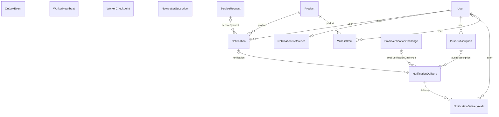

# Nhóm Messaging & Ops

Tài liệu này trả lời: thông báo, các lần gửi, sự kiện outbox, heartbeat của worker, wishlist kèm cảnh báo giá và bản tin được lưu thế nào, và dữ liệu nào bị dọn theo lịch.

> Đối chiếu code: main @ 0f1eab2 (2026-11-04)

Nhóm gồm 10 model, chia làm ba mảng:

- **Thông báo:** `Notification` (nội dung hiển thị trong ứng dụng), `NotificationDelivery` (mỗi lần gửi qua một kênh tới một đích), `NotificationDeliveryAudit` (thao tác của admin trên một lần gửi), `NotificationPreference` (lựa chọn của khách), `PushSubscription` (trình duyệt đã đăng ký Web Push).
- **Hạ tầng nền:** `OutboxEvent` (sự kiện chờ đẩy vào hàng đợi, xem [background-jobs.md](../../02-architecture/background-jobs.md)), `WorkerHeartbeat` (worker còn sống), `WorkerCheckpoint` (tiến độ quét của price-alert-worker).
- **Tương tác với khách:** `WishlistItem` (sản phẩm yêu thích, kèm cấu hình cảnh báo giá), `NewsletterSubscriber` (đăng ký bản tin).

Điểm cần nhớ khi đọc dữ liệu:

- Một `Notification` sinh ra tối đa một lần gửi email và một lần gửi Web Push cho mỗi trình duyệt đã đăng ký; mỗi lần gửi là một `NotificationDelivery`. Mã OTP email cũng đi qua `NotificationDelivery` (cột cha là `EmailVerificationChallenge`, xem [identity-accounts.md](identity-accounts.md)).
- Trạng thái lần gửi `NotificationDelivery.status` (enum `NotificationDeliveryStatus`): `PENDING`, `PROCESSING`, `DELIVERED`, `RETRYING`, `FAILED`, `DEAD`, `CANCELLED`, `SUPPRESSED`. Lỗi tạm thời được thử lại với độ trễ tăng gấp đôi, tối đa 1 giờ, đến `DELIVERY_MAX_ATTEMPTS` lần thì thành `DEAD`; lỗi không thể thử lại thành `FAILED`.
- Worker `notification-maintenance-worker` xoá dữ liệu cũ theo lịch bằng `applyNotificationRetention`: thông báo sau 180 ngày, lần gửi sau 90 ngày, sự kiện outbox đã phát sau 30 ngày, mã xác minh email sau 7 ngày, đăng ký push đã vô hiệu sau 30 ngày.

## ERD

## Data dictionary

### `Notification` (`notifications`)

- **Mục đích:** Một thông báo cho người dùng, hiển thị trong ứng dụng và là cha của các lần gửi qua email hoặc Web Push.
- **Nhãn:** nguồn sự thật cho nội dung thông báo. Giá và mốc hiệu lực là snapshot tại lúc phát thông báo.
- **Ghi/đọc chính:** tạo bởi `src/modules/notifications/notification-publish.service.ts` (từ cảnh báo giá và từ module after-sales); đọc bởi `src/modules/notifications/notifications.service.ts`; xoá bởi `src/modules/notifications/notification-retention.service.ts` sau 180 ngày.
- **Bất biến:** `dedupeKey` duy nhất, nên cùng một sự kiện không tạo hai thông báo. Với cảnh báo giá, khoá gồm `wishlistItemId`, `alertVersion`, chế độ, giá tham chiếu, giá hiện tại, nguồn giá và khuyến mãi.
- **Loại:** enum `NotificationType` (`PRICE_DROP`, `AFTER_SALES_MESSAGE`, `AFTER_SALES_STATUS_CHANGED`, `AFTER_SALES_QUOTE_SENT`, `AFTER_SALES_CONFIRMATION_REQUIRED`, `AFTER_SALES_AUTO_CLOSED`). **Nguồn giá:** enum `NotificationPriceSource` (`LIST_PRICE`, `AUTOMATIC`, `FLASH_SALE`).

| Cột | Kiểu Prisma | Kiểu DB | Null | Mặc định | Khoá | Ý nghĩa | Ghi/đọc bởi |
| --- | --- | --- | --- | --- | --- | --- | --- |
| `id` | `Int` | `INT` | Không | `autoincrement()` | PK | Khoá chính. | Chung |
| `userId` | `Int` | `INT` | Không | — | FK → User | Người nhận; xoá người dùng thì xoá thông báo (`Cascade`). | Chung |
| `productId` | `Int?` | `INT` | Có | — | FK → Product | Sản phẩm liên quan (thông báo giá); rỗng với thông báo bảo hành. `SetNull` khi xoá sản phẩm. | Chung |
| `serviceRequestId` | `Int?` | `INT` | Có | — | FK → ServiceRequest | Yêu cầu bảo hành liên quan; rỗng với thông báo giá. `SetNull`. | Chung |
| `type` | `NotificationType` | `ENUM` | Không | — | — | Loại thông báo (xem danh sách ở trên). | Chung |
| `title` | `String` | `VARCHAR(255)` | Không | — | — | Tiêu đề hiển thị. | Chung |
| `message` | `String` | `VARCHAR(500)` | Không | — | — | Nội dung hiển thị, tối đa 500 ký tự. | Chung |
| `oldPrice` | `Int?` | `INT` | Có | — | — | Giá trước khi giảm, với thông báo giá. | `src/modules/price-alerts/price-alert.service.ts` |
| `newPrice` | `Int?` | `INT` | Có | — | — | Giá sau khi giảm, với thông báo giá. | `src/modules/price-alerts/price-alert.service.ts` |
| `priceSource` | `NotificationPriceSource?` | `ENUM` | Có | — | — | Nguồn của giá mới: `LIST_PRICE`, `AUTOMATIC` hoặc `FLASH_SALE`. | `src/modules/price-alerts/price-alert.service.ts` |
| `promotionId` | `Int?` | `INT` | Có | — | — | Khuyến mãi tạo ra giá mới (nếu có); là số thường, không phải khoá ngoại. | `src/modules/price-alerts/price-alert.service.ts` |
| `pricingVersion` | `Int?` | `INT` | Có | — | — | `Promotion.pricingVersion` tại lúc phát thông báo. | `src/modules/price-alerts/price-alert.service.ts` |
| `validUntil` | `DateTime?` | `DATETIME(3)` | Có | — | — | Hạn của mức giá trong thông báo; quá hạn thì lần gửi bị huỷ với mã `PRICE_EXPIRED`. | `src/modules/price-alerts/price-alert.service.ts`; `src/modules/notifications/notification-delivery.service.ts` |
| `dedupeKey` | `String` | `VARCHAR(191)` | Không | — | UQ | Khoá chống tạo trùng thông báo, duy nhất. | `src/modules/notifications/notification-publish.service.ts`; `src/modules/price-alerts/price-alert.service.ts` |
| `readAt` | `DateTime?` | `DATETIME(3)` | Có | — | — | Thời điểm người dùng đọc; rỗng nghĩa là chưa đọc. | `src/modules/notifications/notifications.service.ts` |
| `createdAt` | `DateTime` | `DATETIME(3)` | Không | `now()` | — | Thời điểm tạo dòng. | Chung |

**Quan hệ:**

- `user` → `User` qua `userId`, onDelete: Cascade
- `product` → `Product` qua `productId`, onDelete: SetNull
- `serviceRequest` → `ServiceRequest` qua `serviceRequestId`, onDelete: SetNull
- Được tham chiếu bởi: `NotificationDelivery`

**Khoá ghép và index:**

- Index: `userId, readAt, createdAt`
- Index: `serviceRequestId, createdAt`

### `NotificationPreference` (`notification_preferences`)

- **Mục đích:** Lựa chọn nhận thông báo của một người dùng.
- **Nhãn:** nguồn sự thật cho lựa chọn của khách.
- **Ghi/đọc chính:** ghi và đọc bởi `src/modules/notifications/notification-preferences.service.ts`; đọc bởi `src/modules/notifications/notification-publish.service.ts` khi quyết định tạo lần gửi.
- **Bất biến:** mỗi người dùng tối đa một dòng (`userId` duy nhất). Mặc định tắt email và Web Push cho thông báo giá, bật cho thông báo bảo hành. Email chỉ được gửi khi người dùng đã xác minh email (`User.emailVerifiedAt`).

| Cột | Kiểu Prisma | Kiểu DB | Null | Mặc định | Khoá | Ý nghĩa | Ghi/đọc bởi |
| --- | --- | --- | --- | --- | --- | --- | --- |
| `id` | `Int` | `INT` | Không | `autoincrement()` | PK | Khoá chính. | Chung |
| `userId` | `Int` | `INT` | Không | — | FK → User, UQ | Chủ lựa chọn, duy nhất; xoá người dùng thì xoá dòng. | Chung |
| `emailEnabled` | `Boolean` | `BOOLEAN` | Không | `false` | — | Nhận email thông báo giá. Mặc định tắt. | `src/modules/notifications/notification-preferences.service.ts`; `src/modules/notifications/notification-publish.service.ts` |
| `webPushEnabled` | `Boolean` | `BOOLEAN` | Không | `false` | — | Nhận Web Push thông báo giá. Mặc định tắt. | `src/modules/notifications/notification-preferences.service.ts`; `src/modules/notifications/notification-publish.service.ts` |
| `afterSalesEmailEnabled` | `Boolean` | `BOOLEAN` | Không | `true` | — | Nhận email thông báo bảo hành. Mặc định bật; còn phụ thuộc `emailEnabled`. | `src/modules/notifications/notification-preferences.service.ts`; `src/modules/notifications/notification-publish.service.ts` |
| `afterSalesWebPushEnabled` | `Boolean` | `BOOLEAN` | Không | `true` | — | Nhận Web Push thông báo bảo hành. Mặc định bật; còn phụ thuộc `webPushEnabled`. | `src/modules/notifications/notification-preferences.service.ts`; `src/modules/notifications/notification-publish.service.ts` |
| `createdAt` | `DateTime` | `DATETIME(3)` | Không | `now()` | — | Thời điểm tạo dòng. | Chung |
| `updatedAt` | `DateTime` | `DATETIME(3)` | Không | `@updatedAt` | — | Thời điểm cập nhật dòng gần nhất (Prisma `@updatedAt`). | Chung |

**Quan hệ:**

- `user` → `User` qua `userId`, onDelete: Cascade

### `PushSubscription` (`push_subscriptions`)

- **Mục đích:** Một trình duyệt của người dùng đã đăng ký nhận Web Push.
- **Nhãn:** nguồn sự thật cho đăng ký push. Chứa khoá công khai của trình duyệt, không có khoá bí mật của hệ thống.
- **Ghi/đọc chính:** ghi bởi `src/modules/notifications/web-push.service.ts`; đọc bởi `src/modules/notifications/notification-publish.service.ts` khi tạo lần gửi; `disabledAt` cũng được đặt bởi `src/modules/notifications/notification-delivery.service.ts` khi dịch vụ push báo đăng ký không còn tồn tại.
- **Bất biến:** `endpointHash` (SHA-256 của `endpoint`) duy nhất, nên một trình duyệt chỉ có một đăng ký. Đăng ký lại cùng endpoint sẽ cập nhật `lastSeenAt` và xoá `disabledAt`.
- **Dọn dẹp:** đăng ký đã vô hiệu quá 30 ngày bị xoá bởi `applyNotificationRetention`.

| Cột | Kiểu Prisma | Kiểu DB | Null | Mặc định | Khoá | Ý nghĩa | Ghi/đọc bởi |
| --- | --- | --- | --- | --- | --- | --- | --- |
| `id` | `Int` | `INT` | Không | `autoincrement()` | PK | Khoá chính. | Chung |
| `userId` | `Int` | `INT` | Không | — | FK → User | Chủ đăng ký; xoá người dùng thì xoá đăng ký. | Chung |
| `endpoint` | `String` | `TEXT` | Không | — | — | URL đẩy của dịch vụ push do trình duyệt cấp (`TEXT`). | `src/modules/notifications/web-push.service.ts` |
| `endpointHash` | `String` | `CHAR(64)` | Không | — | UQ | SHA-256 (hex) của `endpoint`, duy nhất, dùng để tra cứu và đối chiếu. | `src/modules/notifications/web-push.service.ts` |
| `p256dh` | `String` | `VARCHAR(255)` | Không | — | — | Khoá công khai P-256 của trình duyệt dùng để mã hoá nội dung push. | `src/modules/notifications/web-push.service.ts` |
| `auth` | `String` | `VARCHAR(255)` | Không | — | — | Bí mật xác thực do trình duyệt cấp cho đăng ký này, dùng để mã hoá nội dung push. | `src/modules/notifications/web-push.service.ts` |
| `userAgent` | `String?` | `VARCHAR(255)` | Có | — | — | User-Agent của trình duyệt lúc đăng ký (tuỳ chọn). | `src/modules/notifications/web-push.service.ts` |
| `lastSeenAt` | `DateTime` | `DATETIME(3)` | Không | `now()` | — | Lần gần nhất trình duyệt đăng ký lại. | `src/modules/notifications/web-push.service.ts` |
| `disabledAt` | `DateTime?` | `DATETIME(3)` | Có | — | — | Thời điểm đăng ký bị vô hiệu (người dùng huỷ hoặc dịch vụ push báo hết hiệu lực); rỗng nghĩa là còn hoạt động. | `src/modules/notifications/web-push.service.ts`; `src/modules/notifications/notification-delivery.service.ts` |
| `createdAt` | `DateTime` | `DATETIME(3)` | Không | `now()` | — | Thời điểm tạo dòng. | Chung |
| `updatedAt` | `DateTime` | `DATETIME(3)` | Không | `@updatedAt` | — | Thời điểm cập nhật dòng gần nhất (Prisma `@updatedAt`). | Chung |

**Quan hệ:**

- `user` → `User` qua `userId`, onDelete: Cascade
- Được tham chiếu bởi: `NotificationDelivery`

**Khoá ghép và index:**

- Index: `userId, disabledAt`

### `NotificationDelivery` (`notification_deliveries`)

- **Mục đích:** Một lần gửi thông báo hoặc mã OTP qua một kênh (email hoặc Web Push) tới một đích, kèm trạng thái, số lần thử và mã lỗi.
- **Nhãn:** nguồn sự thật cho trạng thái gửi. Đích gửi được chụp lại tại lúc tạo.
- **Ghi/đọc chính:** tạo bởi `src/modules/notifications/notification-publish.service.ts` (thông báo), `src/modules/email-verification/email-verification.service.ts` và `src/modules/auth/password-reset.service.ts` (OTP); xử lý bởi `processNotificationDelivery` trong `src/modules/notifications/notification-delivery.service.ts`; thử lại thủ công bởi `src/modules/notifications/admin-notifications.service.ts`.
- **Bất biến:** `dedupeKey` duy nhất, nên cùng thông báo và cùng đích không tạo hai lần gửi. Mỗi lần gửi có đúng một cha: `Notification` hoặc `EmailVerificationChallenge`, theo `parentType` (enum `NotificationDeliveryParent`: `NOTIFICATION`, `EMAIL_VERIFICATION`).
- **Kênh:** enum `NotificationChannel` (`EMAIL`, `WEB_PUSH`). **Trạng thái:** enum `NotificationDeliveryStatus` (xem phần giới thiệu); các trạng thái kết thúc không thử lại là `DELIVERED`, `CANCELLED`, `SUPPRESSED`.
- Chỉ tiến trình giữ lease (`leaseOwner`, `leaseExpiresAt`) mới xử lý lần gửi; mọi cập nhật trạng thái đều có điều kiện `leaseOwner`.

| Cột | Kiểu Prisma | Kiểu DB | Null | Mặc định | Khoá | Ý nghĩa | Ghi/đọc bởi |
| --- | --- | --- | --- | --- | --- | --- | --- |
| `id` | `Int` | `INT` | Không | `autoincrement()` | PK | Khoá chính. | Chung |
| `notificationId` | `Int?` | `INT` | Có | — | FK → Notification | Thông báo cha (khi `parentType = NOTIFICATION`); xoá thông báo thì xoá lần gửi (`Cascade`). | Chung |
| `emailVerificationChallengeId` | `Int?` | `INT` | Có | — | FK → EmailVerificationChallenge | Mã OTP cha (khi `parentType = EMAIL_VERIFICATION`); `Cascade`. | Chung |
| `pushSubscriptionId` | `Int?` | `INT` | Có | — | FK → PushSubscription | Đăng ký push nhận (khi `channel = WEB_PUSH`); `Cascade`. | Chung |
| `parentType` | `NotificationDeliveryParent` | `ENUM` | Không | — | — | Loại cha: `NOTIFICATION` hoặc `EMAIL_VERIFICATION`. | Chung |
| `channel` | `NotificationChannel` | `ENUM` | Không | — | — | Kênh gửi: `EMAIL` hoặc `WEB_PUSH`. | Chung |
| `status` | `NotificationDeliveryStatus` | `ENUM` | Không | `PENDING` | — | Trạng thái lần gửi (xem phần giới thiệu). Mặc định `PENDING`. | `src/modules/notifications/notification-delivery.service.ts`; `src/modules/notifications/admin-notifications.service.ts` |
| `dedupeKey` | `String` | `VARCHAR(191)` | Không | — | UQ | Khoá chống tạo trùng lần gửi, duy nhất. | `src/modules/notifications/notification-publish.service.ts` |
| `destinationKey` | `String` | `VARCHAR(255)` | Không | — | — | Đích gửi: địa chỉ email với kênh email, `endpointHash` với Web Push. | `src/modules/notifications/notification-publish.service.ts` |
| `destinationSnapshot` | `String?` | `TEXT` | Có | — | — | Thông tin đích chụp lại tại lúc tạo (tuỳ chọn). | `src/modules/notifications/notification-publish.service.ts` |
| `attemptCount` | `Int` | `INT` | Không | `0` | — | Số lần đã thử gửi. | `src/modules/notifications/notification-delivery.service.ts` |
| `nextAttemptAt` | `DateTime?` | `DATETIME(3)` | Có | — | — | Thời điểm thử lại tiếp theo: trễ `min(1 giờ, 1 giây × 2^lần thử)`; rỗng khi không còn thử. | `src/modules/notifications/notification-delivery.service.ts` |
| `leaseOwner` | `String?` | `VARCHAR(128)` | Có | — | — | Mã tiến trình đang xử lý; rỗng khi rảnh. | `src/modules/notifications/notification-delivery.service.ts` |
| `leaseExpiresAt` | `DateTime?` | `DATETIME(3)` | Có | — | — | Hạn của lease; hết hạn thì tiến trình khác được tiếp quản. | `src/modules/notifications/notification-delivery.service.ts` |
| `providerMessageId` | `String?` | `VARCHAR(255)` | Có | — | — | Mã thông điệp do nhà cung cấp trả lại khi gửi thành công (tuỳ chọn). | `src/modules/notifications/notification-delivery.service.ts` |
| `normalizedErrorCode` | `String?` | `VARCHAR(100)` | Có | — | — | Mã lỗi đã chuẩn hoá của lần thất bại gần nhất, ví dụ `PRICE_EXPIRED`, `DELIVERY_PROVIDER_UNAVAILABLE`, `PUSH_SUBSCRIPTION_GONE`. | `src/modules/notifications/notification-delivery.service.ts` |
| `lastErrorAt` | `DateTime?` | `DATETIME(3)` | Có | — | — | Thời điểm lỗi gần nhất. | `src/modules/notifications/notification-delivery.service.ts` |
| `deliveredAt` | `DateTime?` | `DATETIME(3)` | Có | — | — | Thời điểm gửi thành công. | `src/modules/notifications/notification-delivery.service.ts` |
| `createdAt` | `DateTime` | `DATETIME(3)` | Không | `now()` | — | Thời điểm tạo dòng. | Chung |
| `updatedAt` | `DateTime` | `DATETIME(3)` | Không | `@updatedAt` | — | Thời điểm cập nhật dòng gần nhất (Prisma `@updatedAt`). | Chung |

**Quan hệ:**

- `notification` → `Notification` qua `notificationId`, onDelete: Cascade
- `emailVerificationChallenge` → `EmailVerificationChallenge` qua `emailVerificationChallengeId`, onDelete: Cascade
- `pushSubscription` → `PushSubscription` qua `pushSubscriptionId`, onDelete: Cascade
- Được tham chiếu bởi: `NotificationDeliveryAudit`

**Khoá ghép và index:**

- Index: `status, nextAttemptAt`
- Index: `notificationId, channel`
- Index: `emailVerificationChallengeId, channel`

### `NotificationDeliveryAudit` (`notification_delivery_audits`)

- **Mục đích:** Nhật ký thao tác của admin trên một lần gửi, ví dụ thử lại.
- **Nhãn:** nguồn sự thật cho lịch sử thao tác, chỉ thêm không sửa.
- **Ghi/đọc chính:** ghi bởi `src/modules/notifications/admin-notifications.service.ts`.
- **Giá trị `action`** ghi trong code: `RETRY`. Xoá lần gửi thì xoá luôn các dòng audit (`Cascade`).

| Cột | Kiểu Prisma | Kiểu DB | Null | Mặc định | Khoá | Ý nghĩa | Ghi/đọc bởi |
| --- | --- | --- | --- | --- | --- | --- | --- |
| `id` | `Int` | `INT` | Không | `autoincrement()` | PK | Khoá chính. | Chung |
| `deliveryId` | `Int` | `INT` | Không | — | FK → NotificationDelivery | Lần gửi bị thao tác. | Chung |
| `actorId` | `Int?` | `INT` | Có | — | FK → User | Admin thực hiện. `SetNull` khi xoá người dùng. | Chung |
| `action` | `String` | `VARCHAR(50)` | Không | — | — | Loại thao tác (hiện là `RETRY`). | Chung |
| `reason` | `String?` | `VARCHAR(255)` | Có | — | — | Lý do admin nhập (tuỳ chọn). | Chung |
| `createdAt` | `DateTime` | `DATETIME(3)` | Không | `now()` | — | Thời điểm tạo dòng. | Chung |

**Quan hệ:**

- `delivery` → `NotificationDelivery` qua `deliveryId`, onDelete: Cascade
- `actor` → `User` qua `actorId`, onDelete: SetNull

**Khoá ghép và index:**

- Index: `deliveryId, createdAt`

### `OutboxEvent` (`outbox_events`)

- **Mục đích:** Sự kiện cần chuyển thành job nền, được ghi cùng transaction với thay đổi dữ liệu nghiệp vụ.
- **Nhãn:** nguồn sự thật cho sự kiện chưa phát. Sau khi phát, dòng chỉ còn giá trị lưu vết rồi bị dọn.
- **Ghi/đọc chính:** ghi bởi `src/modules/outbox/outbox.repository.ts` trong transaction của nơi phát sự kiện; thuê và phát bởi `outbox-dispatcher` (`src/workers/outbox-dispatcher.ts`); dọn bởi `src/modules/notifications/notification-retention.service.ts`.
- **Bất biến:** `dedupeKey` duy nhất, nên không phát trùng. Chỉ tiến trình giữ lease mới đánh dấu thành công hoặc lỗi.
- **Loại sự kiện:** enum `OutboxEventType`: `PRICE_REEVALUATION_REQUESTED` (queue pricing), `NOTIFICATION_DELIVERY_REQUESTED` (queue notification), `AFTER_SALES_MILESTONE_REQUESTED` và `AFTER_SALES_ATTACHMENT_DELETE_REQUESTED` (queue after-sales).
- **Dọn dẹp:** dòng đã phát (`publishedAt` có giá trị) quá 30 ngày bị xoá.

| Cột | Kiểu Prisma | Kiểu DB | Null | Mặc định | Khoá | Ý nghĩa | Ghi/đọc bởi |
| --- | --- | --- | --- | --- | --- | --- | --- |
| `id` | `Int` | `INT` | Không | `autoincrement()` | PK | Khoá chính. | Chung |
| `eventType` | `OutboxEventType` | `ENUM` | Không | — | — | Loại sự kiện, quyết định queue đích. | Chung |
| `schemaVersion` | `Int` | `INT` | Không | `1` | — | Phiên bản cấu trúc `payload`, mặc định 1. | Chung |
| `aggregateType` | `String` | `VARCHAR(100)` | Không | — | — | Loại thực thể gốc của sự kiện (ví dụ `NotificationDelivery` với sự kiện gửi thông báo). | Chung |
| `aggregateId` | `Int` | `INT` | Không | — | — | Id của thực thể gốc. | Chung |
| `dedupeKey` | `String` | `VARCHAR(191)` | Không | — | UQ | Khoá chống phát trùng, duy nhất. | Chung |
| `payload` | `Json` | `JSON` | Không | — | — | Dữ liệu của job (JSON). | Chung |
| `availableAt` | `DateTime` | `DATETIME(3)` | Không | `now()` | — | Thời điểm sự kiện đủ điều kiện để phát; mặc định là lúc tạo. | `src/modules/outbox/outbox.repository.ts` |
| `leaseOwner` | `String?` | `VARCHAR(128)` | Có | — | — | Mã dispatcher đang giữ dòng; rỗng khi rảnh. | `src/modules/outbox/outbox.repository.ts` |
| `leaseExpiresAt` | `DateTime?` | `DATETIME(3)` | Có | — | — | Hạn của lease; hết hạn thì dispatcher khác được thuê dòng. | `src/modules/outbox/outbox.repository.ts` |
| `publishAttempts` | `Int` | `INT` | Không | `0` | — | Số lần phát thất bại, tăng bởi `markOutboxFailed`. | `src/modules/outbox/outbox.repository.ts` |
| `publishedAt` | `DateTime?` | `DATETIME(3)` | Có | — | — | Thời điểm đã đẩy vào queue thành công; rỗng nghĩa là chưa phát. | `src/modules/outbox/outbox.repository.ts` |
| `lastErrorCode` | `String?` | `VARCHAR(100)` | Có | — | — | Mã lỗi của lần phát thất bại gần nhất. | `src/modules/outbox/outbox.repository.ts` |
| `createdAt` | `DateTime` | `DATETIME(3)` | Không | `now()` | — | Thời điểm tạo dòng. | Chung |

**Khoá ghép và index:**

- Index: `publishedAt, availableAt, leaseExpiresAt`

### `WorkerHeartbeat` (`worker_heartbeats`)

- **Mục đích:** Dấu hiệu còn sống của từng tiến trình worker: tên, mã thể hiện, trạng thái, lần cuối thấy.
- **Nhãn:** nguồn sự thật cho tình trạng worker, dữ liệu giám sát.
- **Ghi/đọc chính:** ghi bởi `recordWorkerHeartbeat` trong `src/modules/workers/worker-heartbeat.service.ts`, được gọi từ `after-sales-worker`, `notification-maintenance-worker` và `price-alert-worker`.
- **Bất biến:** mỗi cặp `(workerName, instanceId)` một dòng, ghi bằng `upsert`. `payment-worker`, `outbox-dispatcher` và `notification-worker` hiện không ghi bảng này.

| Cột | Kiểu Prisma | Kiểu DB | Null | Mặc định | Khoá | Ý nghĩa | Ghi/đọc bởi |
| --- | --- | --- | --- | --- | --- | --- | --- |
| `id` | `Int` | `INT` | Không | `autoincrement()` | PK | Khoá chính. | Chung |
| `workerName` | `String` | `VARCHAR(100)` | Không | — | — | Tên worker, ví dụ `after-sales-worker`. | `src/modules/workers/worker-heartbeat.service.ts` |
| `instanceId` | `String` | `VARCHAR(128)` | Không | — | — | Mã định danh của một tiến trình cụ thể (UUID sinh lúc khởi động). | `src/modules/workers/worker-heartbeat.service.ts` |
| `status` | `String` | `VARCHAR(32)` | Không | — | — | Trạng thái ghi bởi worker, ví dụ `HEALTHY`, `STOPPING`. Lưu bằng `VARCHAR(32)`, không phải enum. | `src/modules/workers/worker-heartbeat.service.ts` |
| `lastSeenAt` | `DateTime` | `DATETIME(3)` | Không | `now()` | — | Lần gần nhất worker ghi heartbeat. | `src/modules/workers/worker-heartbeat.service.ts` |
| `metadata` | `Json?` | `JSON` | Có | — | — | Thông tin thêm do worker ghi (JSON, tuỳ chọn), ví dụ mốc bảo hành vừa xử lý. | Chung |
| `createdAt` | `DateTime` | `DATETIME(3)` | Không | `now()` | — | Thời điểm tạo dòng. | Chung |
| `updatedAt` | `DateTime` | `DATETIME(3)` | Không | `@updatedAt` | — | Thời điểm cập nhật dòng gần nhất (Prisma `@updatedAt`). | Chung |

**Khoá ghép và index:**

- Unique ghép: `workerName, instanceId`
- Index: `workerName, lastSeenAt`

### `WorkerCheckpoint` (`worker_checkpoints`)

- **Mục đích:** Tiến độ của vòng quét cảnh báo giá: đang quét tới sản phẩm nào, ai đang giữ quyền quét, kết quả lần gần nhất.
- **Nhãn:** nguồn sự thật cho tiến độ quét.
- **Ghi/đọc chính:** ghi và đọc bởi `src/modules/price-alerts/price-alert.checkpoint.ts`, được gọi từ `price-alert-worker`.
- **Bất biến:** khoá chính là `workerName`; hiện chỉ dùng cho `price-alert-worker`. Quyền quét được giành bằng `ownerEpoch` và `ownerToken`; `cursor` không hợp lệ thì quét lại từ đầu.

| Cột | Kiểu Prisma | Kiểu DB | Null | Mặc định | Khoá | Ý nghĩa | Ghi/đọc bởi |
| --- | --- | --- | --- | --- | --- | --- | --- |
| `workerName` | `String` | `VARCHAR(100)` | Không | — | PK | Tên worker, khoá chính. | `src/modules/price-alerts/price-alert.checkpoint.ts` |
| `ownerEpoch` | `Int` | `INT` | Không | `0` | — | Số thứ tự đời chủ sở hữu, tăng mỗi lần có tiến trình mới giành quyền. | `src/modules/price-alerts/price-alert.checkpoint.ts` |
| `ownerToken` | `String?` | `VARCHAR(128)` | Có | — | — | Mã của tiến trình đang giữ quyền quét; rỗng khi rảnh. | `src/modules/price-alerts/price-alert.checkpoint.ts` |
| `cursor` | `Json?` | `JSON` | Có | — | — | Vị trí quét hiện tại (JSON gồm phiên bản con trỏ và id sản phẩm cuối). | `src/modules/price-alerts/price-alert.checkpoint.ts` |
| `cycleStartedAt` | `DateTime?` | `DATETIME(3)` | Có | — | — | Thời điểm bắt đầu chu kỳ quét hiện tại. | `src/modules/price-alerts/price-alert.checkpoint.ts` |
| `lastStartedAt` | `DateTime?` | `DATETIME(3)` | Có | — | — | Lần gần nhất bắt đầu quét. | `src/modules/price-alerts/price-alert.checkpoint.ts` |
| `lastCompletedAt` | `DateTime?` | `DATETIME(3)` | Có | — | — | Lần gần nhất kết thúc quét, thành công hay không. | `src/modules/price-alerts/price-alert.checkpoint.ts` |
| `lastSucceededAt` | `DateTime?` | `DATETIME(3)` | Có | — | — | Lần gần nhất quét thành công. | `src/modules/price-alerts/price-alert.checkpoint.ts` |
| `lastDurationMs` | `Int?` | `INT` | Có | — | — | Thời gian của lần quét gần nhất, mili giây. | `src/modules/price-alerts/price-alert.checkpoint.ts` |
| `consecutiveFailures` | `Int` | `INT` | Không | `0` | — | Số lần quét lỗi liên tiếp. | `src/modules/price-alerts/price-alert.checkpoint.ts` |
| `lastErrorCode` | `String?` | `VARCHAR(100)` | Có | — | — | Mã lỗi của lần quét lỗi gần nhất. | `src/modules/price-alerts/price-alert.checkpoint.ts` |
| `lastStats` | `Json?` | `JSON` | Có | — | — | Thống kê của lần quét gần nhất (JSON). | `src/modules/price-alerts/price-alert.checkpoint.ts` |
| `createdAt` | `DateTime` | `DATETIME(3)` | Không | `now()` | — | Thời điểm tạo dòng. | Chung |
| `updatedAt` | `DateTime` | `DATETIME(3)` | Không | `@updatedAt` | — | Thời điểm cập nhật dòng gần nhất (Prisma `@updatedAt`). | Chung |

### `WishlistItem` (`wishlist_items`)

- **Mục đích:** Sản phẩm yêu thích của người dùng, kèm cấu hình cảnh báo giá tuỳ chọn.
- **Nhãn:** nguồn sự thật cho wishlist và cấu hình cảnh báo. `lastAlert*` là snapshot của lần cảnh báo gần nhất.
- **Ghi/đọc chính:** ghi bởi `src/modules/wishlist/wishlist.service.ts`; vòng quét giá đọc và cập nhật `referencePrice`, `lastAlert*` qua `src/modules/price-alerts/price-alert.service.ts`.
- **Bất biến:** mỗi người dùng chỉ yêu thích một sản phẩm một lần (unique `userId, productId`). `alertVersion` tăng khi cấu hình cảnh báo bị tắt hoặc đổi, để các cảnh báo cũ không bị coi là trùng với cảnh báo mới.
- **Chế độ cảnh báo:** enum `PriceAlertMode`: `PERCENT_DROP` (báo khi giá giảm so với `referencePrice`) và `TARGET_PRICE` (báo khi giá chạm `targetPrice`, rồi tự tắt cảnh báo). Cột `alertMode` rỗng nghĩa là không bật cảnh báo.

| Cột | Kiểu Prisma | Kiểu DB | Null | Mặc định | Khoá | Ý nghĩa | Ghi/đọc bởi |
| --- | --- | --- | --- | --- | --- | --- | --- |
| `id` | `Int` | `INT` | Không | `autoincrement()` | PK | Khoá chính. | Chung |
| `userId` | `Int` | `INT` | Không | — | FK → User | Chủ wishlist; xoá người dùng thì xoá dòng. | Chung |
| `productId` | `Int` | `INT` | Không | — | FK → Product | Sản phẩm được yêu thích; xoá sản phẩm thì xoá dòng. | Chung |
| `alertMode` | `PriceAlertMode?` | `ENUM` | Có | — | — | Chế độ cảnh báo giá: `PERCENT_DROP`, `TARGET_PRICE`, hoặc rỗng khi tắt. | `src/modules/wishlist/wishlist.service.ts`; `src/modules/price-alerts/price-alert.service.ts` |
| `targetPrice` | `Int?` | `INT` | Có | — | — | Giá mục tiêu khi `alertMode = TARGET_PRICE`; phải thấp hơn giá hiệu lực hiện tại lúc đặt. | `src/modules/wishlist/wishlist.service.ts` |
| `referencePrice` | `Int?` | `INT` | Có | — | — | Giá làm mốc so sánh cho `PERCENT_DROP`, cập nhật mỗi khi phát cảnh báo. | `src/modules/wishlist/wishlist.service.ts`; `src/modules/price-alerts/price-alert.service.ts` |
| `includeFlashSale` | `Boolean` | `BOOLEAN` | Không | `false` | — | Có tính giá flash sale khi cảnh báo hay không. Chỉ bật được khi `FLASH_SALE_PRICE_ALERT_ENABLED`. | `src/modules/wishlist/wishlist.service.ts` |
| `alertVersion` | `Int` | `INT` | Không | `1` | — | Phiên bản cấu hình cảnh báo, tăng khi tắt hoặc đổi; là một phần của `Notification.dedupeKey`. | `src/modules/wishlist/wishlist.service.ts`; `src/modules/price-alerts/price-alert.service.ts` |
| `lastAlertMode` | `PriceAlertMode?` | `ENUM` | Có | — | — | Chế độ của lần cảnh báo gần nhất. | `src/modules/price-alerts/price-alert.service.ts` |
| `lastAlertedPrice` | `Int?` | `INT` | Có | — | — | Giá tại lần cảnh báo gần nhất. | `src/modules/price-alerts/price-alert.service.ts` |
| `lastAlertedAt` | `DateTime?` | `DATETIME(3)` | Có | — | — | Thời điểm cảnh báo gần nhất. | `src/modules/price-alerts/price-alert.service.ts` |
| `createdAt` | `DateTime` | `DATETIME(3)` | Không | `now()` | — | Thời điểm tạo dòng. | Chung |
| `updatedAt` | `DateTime` | `DATETIME(3)` | Không | `@updatedAt` | — | Thời điểm cập nhật dòng gần nhất (Prisma `@updatedAt`). | Chung |

**Quan hệ:**

- `user` → `User` qua `userId`, onDelete: Cascade
- `product` → `Product` qua `productId`, onDelete: Cascade

**Khoá ghép và index:**

- Unique ghép: `userId, productId`
- Index: `productId, alertMode`
- Index: `userId, createdAt`

### `NewsletterSubscriber` (`newsletter_subscribers`)

- **Mục đích:** Người đăng ký nhận bản tin qua email, theo quy trình xác nhận hai bước.
- **Nhãn:** nguồn sự thật cho đăng ký bản tin.
- **Ghi/đọc chính:** ghi và đọc bởi `src/modules/newsletter/newsletter.service.ts`; admin xem qua route `/admin/newsletter`.
- **Bất biến:** `email` duy nhất. Trạng thái enum `NewsletterStatus`: `PENDING` (chờ xác nhận) → `CONFIRMED` (đã xác nhận bằng token trong email) → `UNSUBSCRIBED`. Token xác nhận chỉ lưu dạng hash, hiệu lực 24 giờ, và bị xoá sau khi dùng; gửi lại email xác nhận cách nhau tối thiểu 60 giây.

| Cột | Kiểu Prisma | Kiểu DB | Null | Mặc định | Khoá | Ý nghĩa | Ghi/đọc bởi |
| --- | --- | --- | --- | --- | --- | --- | --- |
| `id` | `Int` | `INT` | Không | `autoincrement()` | PK | Khoá chính. | Chung |
| `email` | `String` | `VARCHAR(254)` | Không | — | UQ | Địa chỉ email đăng ký, tối đa 254 ký tự, duy nhất. | `src/modules/newsletter/newsletter.service.ts` |
| `status` | `NewsletterStatus` | `ENUM` | Không | `PENDING` | — | `PENDING`, `CONFIRMED` hoặc `UNSUBSCRIBED`. Mặc định `PENDING`. | `src/modules/newsletter/newsletter.service.ts` |
| `confirmTokenHash` | `String?` | `VARCHAR(64)` | Có | — | UQ | Hash (hex) của token xác nhận, duy nhất; rỗng sau khi xác nhận. | `src/modules/newsletter/newsletter.service.ts` |
| `confirmExpiresAt` | `DateTime?` | `DATETIME(3)` | Có | — | — | Hạn của token xác nhận (24 giờ sau lúc gửi); rỗng sau khi xác nhận. | `src/modules/newsletter/newsletter.service.ts` |
| `lastConfirmationSentAt` | `DateTime?` | `DATETIME(3)` | Có | — | — | Lần gần nhất gửi email xác nhận, dùng để chặn gửi lại quá nhanh. | `src/modules/newsletter/newsletter.service.ts` |
| `confirmedAt` | `DateTime?` | `DATETIME(3)` | Có | — | — | Thời điểm xác nhận. | `src/modules/newsletter/newsletter.service.ts` |
| `unsubscribedAt` | `DateTime?` | `DATETIME(3)` | Có | — | — | Thời điểm huỷ đăng ký. | `src/modules/newsletter/newsletter.service.ts` |
| `createdAt` | `DateTime` | `DATETIME(3)` | Không | `now()` | — | Thời điểm tạo dòng. | Chung |
| `updatedAt` | `DateTime` | `DATETIME(3)` | Không | `@updatedAt` | — | Thời điểm cập nhật dòng gần nhất (Prisma `@updatedAt`). | Chung |

**Khoá ghép và index:**

- Index: `status, createdAt`

## Nguồn

- [prisma/schema.prisma](https://github.com/QuocDuy21-10/laptopshop-api/blob/main/prisma/schema.prisma): `Notification`, `NotificationPreference`, `PushSubscription`, `NotificationDelivery`, `NotificationDeliveryAudit`, `OutboxEvent`, `WorkerHeartbeat`, `WorkerCheckpoint`, `WishlistItem`, `NewsletterSubscriber`
- [src/modules/notifications/notification-publish.service.ts](https://github.com/QuocDuy21-10/laptopshop-api/blob/main/src/modules/notifications/notification-publish.service.ts)
- [src/modules/notifications/notification-delivery.service.ts](https://github.com/QuocDuy21-10/laptopshop-api/blob/main/src/modules/notifications/notification-delivery.service.ts): `processNotificationDelivery`
- [src/modules/notifications/notification-retention.service.ts](https://github.com/QuocDuy21-10/laptopshop-api/blob/main/src/modules/notifications/notification-retention.service.ts): `applyNotificationRetention`
- [src/modules/notifications/admin-notifications.service.ts](https://github.com/QuocDuy21-10/laptopshop-api/blob/main/src/modules/notifications/admin-notifications.service.ts)
- [src/modules/notifications/web-push.service.ts](https://github.com/QuocDuy21-10/laptopshop-api/blob/main/src/modules/notifications/web-push.service.ts)
- [src/modules/outbox/outbox.repository.ts](https://github.com/QuocDuy21-10/laptopshop-api/blob/main/src/modules/outbox/outbox.repository.ts)
- [src/modules/workers/worker-heartbeat.service.ts](https://github.com/QuocDuy21-10/laptopshop-api/blob/main/src/modules/workers/worker-heartbeat.service.ts): `recordWorkerHeartbeat`
- [src/modules/price-alerts/price-alert.checkpoint.ts](https://github.com/QuocDuy21-10/laptopshop-api/blob/main/src/modules/price-alerts/price-alert.checkpoint.ts)
- [src/modules/price-alerts/price-alert.service.ts](https://github.com/QuocDuy21-10/laptopshop-api/blob/main/src/modules/price-alerts/price-alert.service.ts): `commitPriceAlertCandidate`
- [src/modules/wishlist/wishlist.service.ts](https://github.com/QuocDuy21-10/laptopshop-api/blob/main/src/modules/wishlist/wishlist.service.ts)
- [src/modules/newsletter/newsletter.service.ts](https://github.com/QuocDuy21-10/laptopshop-api/blob/main/src/modules/newsletter/newsletter.service.ts)
