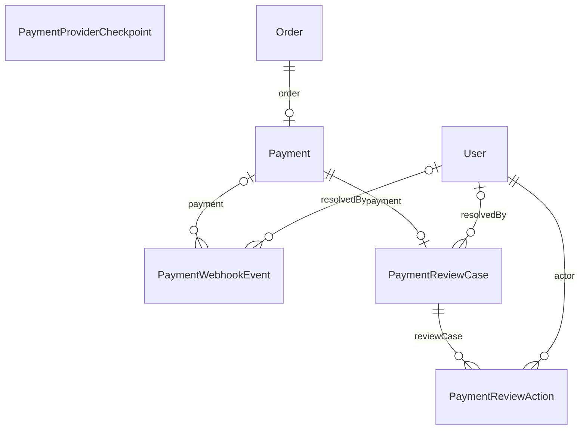

# Nhóm Payments

Tài liệu này trả lời: thanh toán chuyển khoản QR được lưu thế nào, giao dịch từ nhà cung cấp được ghi nhận ra sao và các ca cần admin xem xét nằm ở đâu.

> Đối chiếu code: main @ 0f1eab2 (2026-11-04)

Nhóm gồm 5 model: `Payment` (một thanh toán gắn với một đơn), `PaymentWebhookEvent` (mỗi giao dịch nhận từ nhà cung cấp), `PaymentProviderCheckpoint` (tiến độ đối soát), `PaymentReviewCase` và `PaymentReviewAction` (ca cần admin xem xét và các thao tác trên ca đó).

Chỉ đơn có `paymentMethod = BANK_TRANSFER` và tổng tiền lớn hơn 0 mới có dòng `Payment`; COD và đơn 0 đồng thì không. Trạng thái `Payment.status` (`PENDING`, `VERIFYING`, `SUCCEEDED`, `EXPIRED`, `CANCELLED`, `REVIEW_REQUIRED`, theo `PAYMENT_STATUS` trong `src/modules/payments/payment-status.ts`) là nguồn sự thật của thanh toán chuyển khoản; `Order.paymentStatus` chỉ là bản sao tiện lợi.

Một giao dịch có thể đến hai lần: từ webhook (`WEBHOOK`) và từ đối soát (`RECONCILIATION`). Hai khoá unique của `PaymentWebhookEvent` đảm bảo mỗi giao dịch chỉ ghi nhận một lần dù đến bằng đường nào.

## ERD

## Data dictionary

### `Payment` (`payments`)

- **Mục đích:** Thanh toán chuyển khoản của một đơn: số tiền, tài khoản nhận, mã chuyển khoản, các mốc thời gian hết hạn.
- **Nhãn:** nguồn sự thật cho trạng thái thanh toán chuyển khoản.
- **Ghi/đọc chính:** tạo cùng đơn bởi `placeOrder` trong `src/modules/orders/orders.service.ts`; trạng thái đổi bởi `src/modules/payments/payment-ingestion.service.ts` (nhận tiền) và `src/modules/payments/payment-maintenance.service.ts` (hết hạn, chuyển sang xem xét); đọc bởi `src/modules/payments/payments.service.ts`.
- **Bất biến:** mỗi đơn có tối đa một `Payment` (`orderId` duy nhất); `transferCode` duy nhất. Các mốc thời gian được tính lúc đặt đơn: `expiresAt = bây giờ + PAYMENT_TTL_MINUTES`, `cancelAfter = expiresAt + PAYMENT_GRACE_SECONDS`, `reviewAfter = expiresAt + PAYMENT_MAX_AUTO_HOLD_MINUTES`.
- **Trạng thái lưu bằng `VARCHAR`, không phải enum:** `status` ∈ {`PENDING`, `VERIFYING`, `SUCCEEDED`, `EXPIRED`, `CANCELLED`, `REVIEW_REQUIRED`}.

| Cột | Kiểu Prisma | Kiểu DB | Null | Mặc định | Khoá | Ý nghĩa | Ghi/đọc bởi |
| --- | --- | --- | --- | --- | --- | --- | --- |
| `id` | `String` | `CHAR(36)` | Không | `uuid()` | PK | Khoá chính. | Chung |
| `orderId` | `Int` | `INT` | Không | — | FK → Order, UQ | Đơn được thanh toán, duy nhất. | Chung |
| `provider` | `String` | `VARCHAR(20)` | Không | — | — | Nhà cung cấp thanh toán (`fake` hoặc `sepay`). | Chung |
| `providerMode` | `String?` | `VARCHAR(20)` | Có | — | — | Chế độ của nhà cung cấp (`test` hoặc `live`) tại lúc tạo, để không lẫn giao dịch sandbox với giao dịch thật. | Chung |
| `method` | `String` | `VARCHAR(30)` | Không | `BANK_TRANSFER` | — | Phương thức thanh toán; mặc định `BANK_TRANSFER`. | Chung |
| `status` | `String` | `VARCHAR(20)` | Không | `PENDING` | — | Trạng thái thanh toán (xem danh sách ở trên). Mặc định `PENDING`. | `src/modules/payments/payment-ingestion.service.ts`; `src/modules/payments/payment-maintenance.service.ts` |
| `amount` | `Int` | `INT` | Không | — | — | Số tiền cần thanh toán, bằng `Order.totalPrice` tại lúc đặt. | Chung |
| `currency` | `String` | `CHAR(3)` | Không | `VND` | — | Mã tiền tệ, mặc định `VND`. | Chung |
| `transferCode` | `String` | `VARCHAR(32)` | Không | — | UQ | Mã khách ghi trong nội dung chuyển khoản (`LS` + 12 ký tự chữ hoa hoặc số), dùng để khớp giao dịch với đơn, duy nhất. | `src/modules/payments/payment-reference.ts` |
| `bankCode` | `String` | `VARCHAR(30)` | Không | — | — | Mã ngân hàng của tài khoản nhận, chụp từ cấu hình lúc tạo. | Chung |
| `accountNumber` | `String` | `VARCHAR(64)` | Không | — | — | Số tài khoản nhận, chụp từ cấu hình lúc tạo; dùng kiểm tra giao dịch vào đúng tài khoản. | Chung |
| `accountName` | `String` | `VARCHAR(255)` | Không | — | — | Tên chủ tài khoản nhận, chụp từ cấu hình lúc tạo. | Chung |
| `expiresAt` | `DateTime` | `DATETIME(3)` | Không | — | — | Hạn thanh toán hiển thị cho khách; quá hạn thì không còn cho thanh toán. | Chung |
| `cancelAfter` | `DateTime` | `DATETIME(3)` | Không | — | — | Mốc sau `expiresAt` cộng thời gian ân hạn. Tiến trình bảo trì chỉ huỷ thanh toán đang `VERIFYING` khi checkpoint đối soát đã xác minh qua `cancelAfter` cộng `PAYMENT_RECONCILIATION_SETTLEMENT_SECONDS` ở hai lần chạy thành công liên tiếp, tức đã chắc không có tiền về. | `src/modules/payments/payment-maintenance.service.ts` |
| `reviewAfter` | `DateTime` | `DATETIME(3)` | Không | — | — | Mốc tối đa tự động giữ tồn kho; quá mốc này mà thanh toán vẫn `VERIFYING` thì chuyển `REVIEW_REQUIRED` và mở ca xem xét cho admin. | `src/modules/payments/payment-maintenance.service.ts` |
| `paidAt` | `DateTime?` | `DATETIME(3)` | Có | — | — | Thời điểm giao dịch tiền vào xảy ra (`occurredAt` của giao dịch khớp); rỗng khi chưa thanh toán. | `src/modules/payments/payment-ingestion.service.ts` |
| `cancelledAt` | `DateTime?` | `DATETIME(3)` | Có | — | — | Thời điểm thanh toán bị huỷ hoặc hết hạn; rỗng nếu chưa. | `src/modules/payments/payment-maintenance.service.ts`; `src/modules/orders/order-cancellation.service.ts` |
| `createdAt` | `DateTime` | `DATETIME(3)` | Không | `now()` | — | Thời điểm tạo dòng. | Chung |
| `updatedAt` | `DateTime` | `DATETIME(3)` | Không | `@updatedAt` | — | Thời điểm cập nhật dòng gần nhất (Prisma `@updatedAt`). | Chung |

**Quan hệ:**

- `order` → `Order` qua `orderId`, onDelete: Restrict (mặc định)
- Được tham chiếu bởi: `PaymentWebhookEvent`, `PaymentReviewCase`

**Khoá ghép và index:**

- Index: `status, cancelAfter`
- Index: `status, reviewAfter`

### `PaymentWebhookEvent` (`payment_webhook_events`)

- **Mục đích:** Mỗi giao dịch ngân hàng nhận được từ nhà cung cấp, qua webhook hoặc qua đối soát, kèm kết quả khớp với thanh toán.
- **Nhãn:** nguồn sự thật cho giao dịch đã nhận. Payload gốc chỉ giữ tạm thời ở dạng mã hoá.
- **Ghi/đọc chính:** ghi bởi `src/modules/payments/payment-ingestion.service.ts` (`ingestPaymentTransaction`), được gọi từ webhook (`src/modules/payments/payments.controller.ts`) và đối soát (`src/modules/payments/reconciliation.service.ts`); admin xử lý bởi `resolvePaymentEvent` trong `src/modules/payments/payments.service.ts`.
- **Bất biến:** mỗi giao dịch chỉ được ghi một lần theo `(provider, providerMode, providerEventId)` và theo `(provider, providerMode, providerTransactionKey)`. Giao dịch đến lần hai bằng đường khác được so khớp theo các trường chuẩn hoá (số tiền, tiền tệ, chiều, mã chuyển khoản), vì `payloadHash` của webhook và của đối soát khác nhau.
- **Giá trị `source`:** `WEBHOOK`, `RECONCILIATION`. **`direction`:** `IN` (tiền vào) hoặc `OUT`; chiều `OUT` luôn bị đưa vào xem xét với lý do `OUTBOUND`. **`status`:** `MATCHED`, `REVIEW_REQUIRED`, `RESOLVED` (`PAYMENT_EVENT_STATUS`).
- **Lý do `reviewReason`** (`PAYMENT_REVIEW_REASON`): `UNKNOWN_CODE`, `AMOUNT_MISMATCH`, `WRONG_ACCOUNT`, `OUTBOUND`, `LATE_PAYMENT`, `INVALID_PAYMENT_STATE`, `PROVIDER_MISMATCH`.
- **Dữ liệu nhạy cảm:** `rawPayload` được mã hoá (kèm `rawPayloadIv`, `rawPayloadTag`, `encryptionKeyId`) và `purgeEncryptedPaymentPayloads` đặt cả bốn cột về rỗng sau 90 ngày kể từ `receivedAt`. Các cột còn lại của dòng được giữ.

| Cột | Kiểu Prisma | Kiểu DB | Null | Mặc định | Khoá | Ý nghĩa | Ghi/đọc bởi |
| --- | --- | --- | --- | --- | --- | --- | --- |
| `id` | `String` | `CHAR(36)` | Không | `uuid()` | PK | Khoá chính. | Chung |
| `provider` | `String` | `VARCHAR(20)` | Không | — | — | Nhà cung cấp phát sinh giao dịch. | Chung |
| `providerMode` | `String?` | `VARCHAR(20)` | Có | — | — | Chế độ nhà cung cấp (`test` hoặc `live`). | Chung |
| `source` | `String` | `VARCHAR(20)` | Không | — | — | Đường nhận giao dịch: `WEBHOOK` hoặc `RECONCILIATION`. | Chung |
| `providerEventId` | `String` | `VARCHAR(150)` | Không | — | — | Mã sự kiện do nhà cung cấp gán; một phần của khoá chống ghi trùng. | Chung |
| `providerTransactionKey` | `String` | `VARCHAR(150)` | Không | — | — | Khoá giao dịch do nhà cung cấp gán, ổn định giữa webhook và đối soát; một phần của khoá chống ghi trùng. | Chung |
| `paymentId` | `String?` | `VARCHAR(191)` | Có | — | FK → Payment | Thanh toán mà giao dịch được khớp vào; rỗng khi không khớp được (ví dụ mã lạ). | Chung |
| `direction` | `String` | `VARCHAR(10)` | Không | — | — | Chiều giao dịch: `IN` hoặc `OUT`. | Chung |
| `amount` | `Int` | `INT` | Không | — | — | Số tiền của giao dịch. | Chung |
| `currency` | `String` | `CHAR(3)` | Không | `VND` | — | Mã tiền tệ, mặc định `VND`. | Chung |
| `transferCode` | `String?` | `VARCHAR(64)` | Có | — | — | Mã chuyển khoản trích từ nội dung giao dịch, để khớp với `Payment.transferCode`. | Chung |
| `accountNumber` | `String?` | `VARCHAR(64)` | Có | — | — | Số tài khoản nhận mà giao dịch ghi, để kiểm tra đúng tài khoản. | Chung |
| `occurredAt` | `DateTime?` | `DATETIME(3)` | Có | — | — | Thời điểm giao dịch phát sinh theo nhà cung cấp. | Chung |
| `status` | `String` | `VARCHAR(30)` | Không | `REVIEW_REQUIRED` | — | Kết quả xử lý: `MATCHED`, `REVIEW_REQUIRED`, `RESOLVED`. Mặc định `REVIEW_REQUIRED`. | `src/modules/payments/payment-ingestion.service.ts`; `src/modules/payments/payments.service.ts` |
| `reviewReason` | `String?` | `VARCHAR(40)` | Có | — | — | Lý do cần xem xét; rỗng khi khớp tự động. | `src/modules/payments/payment-ingestion.service.ts`; `src/modules/payments/payment-reconcile.ts` |
| `payloadHash` | `String` | `CHAR(64)` | Không | — | — | SHA-256 của payload nhận được. | Chung |
| `rawPayload` | `Bytes?` | `LONGBLOB` | Có | — | — | Payload gốc đã mã hoá, tối đa 90 ngày rồi bị đặt về rỗng. | `src/modules/payments/payment-ingestion.service.ts`; `src/modules/payments/reconciliation.service.ts` |
| `rawPayloadIv` | `Bytes?` | `VARBINARY(16)` | Có | — | — | Vector khởi tạo của lần mã hoá `rawPayload`. | `src/modules/payments/payment-ingestion.service.ts`; `src/modules/payments/payment-crypto.ts` |
| `rawPayloadTag` | `Bytes?` | `VARBINARY(16)` | Có | — | — | Thẻ xác thực của lần mã hoá `rawPayload`. | `src/modules/payments/payment-ingestion.service.ts`; `src/modules/payments/payment-crypto.ts` |
| `encryptionKeyId` | `String?` | `VARCHAR(32)` | Có | — | — | Mã định danh khoá đã dùng (cấu hình `PAYMENT_EVENT_KEY_ID`), để xoay khoá. | `src/modules/payments/payment-ingestion.service.ts`; `src/modules/payments/payment-crypto.ts` |
| `note` | `String?` | `VARCHAR(500)` | Có | — | — | Ghi chú của admin khi xử lý một sự kiện cần xem xét. | `src/modules/payments/payments.service.ts` |
| `receivedAt` | `DateTime` | `DATETIME(3)` | Không | `now()` | — | Thời điểm hệ thống nhận giao dịch; mốc tính 90 ngày xoá payload. | Chung |
| `resolvedAt` | `DateTime?` | `DATETIME(3)` | Có | — | — | Thời điểm sự kiện được xử lý xong (tự động hoặc bởi admin). | `src/modules/payments/payment-ingestion.service.ts`; `src/modules/payments/payments.service.ts` |
| `resolvedById` | `Int?` | `INT` | Có | — | FK → User | Admin xử lý sự kiện; rỗng khi tự động. `SetNull` khi xoá người dùng. | `src/modules/payments/payments.service.ts` |

**Quan hệ:**

- `payment` → `Payment` qua `paymentId`, onDelete: SetNull (mặc định)
- `resolvedBy` → `User` qua `resolvedById`, onDelete: SetNull

**Khoá ghép và index:**

- Unique ghép: `provider, providerMode, providerEventId`
- Unique ghép: `provider, providerMode, providerTransactionKey`
- Index: `status, receivedAt`
- Index: `paymentId`

### `PaymentProviderCheckpoint` (`payment_provider_checkpoints`)

- **Mục đích:** Tiến độ đối soát với từng nhà cung cấp và chế độ: đã xác minh đến đâu, lần chạy gần nhất ra sao, ai đang giữ quyền chạy.
- **Nhãn:** nguồn sự thật cho tiến độ đối soát.
- **Ghi/đọc chính:** ghi và đọc bởi `src/modules/payments/payment-checkpoint.service.ts`; kích hoạt bởi `src/modules/payments/reconciliation.service.ts`.
- **Bất biến:** mỗi cặp `(provider, mode)` đúng một dòng. Chỉ tiến trình giữ lease (`leaseOwner` còn hạn `leaseExpiresAt`) mới được chạy và cập nhật tiến độ, để hai worker không đối soát cùng lúc.

| Cột | Kiểu Prisma | Kiểu DB | Null | Mặc định | Khoá | Ý nghĩa | Ghi/đọc bởi |
| --- | --- | --- | --- | --- | --- | --- | --- |
| `id` | `Int` | `INT` | Không | `autoincrement()` | PK | Khoá chính. | Chung |
| `provider` | `String` | `VARCHAR(20)` | Không | — | — | Nhà cung cấp. | Chung |
| `mode` | `String` | `VARCHAR(20)` | Không | — | — | Chế độ (`test` hoặc `live`). | Chung |
| `cursor` | `String?` | `VARCHAR(150)` | Có | — | — | Con trỏ phân trang của API nhà cung cấp, để lần sau đọc tiếp. | Chung |
| `previousVerifiedThroughAt` | `DateTime?` | `DATETIME(3)` | Có | — | — | Mốc đã xác minh của lần chạy thành công trước đó. | Chung |
| `verifiedThroughAt` | `DateTime?` | `DATETIME(3)` | Có | — | — | Mốc thời gian mà mọi giao dịch trước đó đã được đối soát. | Chung |
| `leaseOwner` | `String?` | `CHAR(36)` | Có | — | — | Mã tiến trình đang giữ quyền đối soát; rỗng khi rảnh. | Chung |
| `leaseExpiresAt` | `DateTime?` | `DATETIME(3)` | Có | — | — | Thời điểm lease hết hạn; sau mốc này tiến trình khác được giành quyền. | Chung |
| `lastStartedAt` | `DateTime?` | `DATETIME(3)` | Có | — | — | Lần bắt đầu chạy gần nhất. | Chung |
| `lastSucceededAt` | `DateTime?` | `DATETIME(3)` | Có | — | — | Lần chạy thành công gần nhất. | Chung |
| `lastErrorAt` | `DateTime?` | `DATETIME(3)` | Có | — | — | Lần lỗi gần nhất. | Chung |
| `lastError` | `String?` | `VARCHAR(500)` | Có | — | — | Mô tả lỗi gần nhất, cắt còn 500 ký tự. | Chung |
| `lastDurationMs` | `Int?` | `INT` | Có | — | — | Thời gian chạy của lần gần nhất, tính bằng mili giây. | Chung |
| `lastProcessedCount` | `Int?` | `INT` | Có | — | — | Số giao dịch xử lý trong lần chạy gần nhất. | Chung |
| `consecutiveSuccesses` | `Int` | `INT` | Không | `0` | — | Số lần chạy thành công liên tiếp. | Chung |
| `consecutiveFailures` | `Int` | `INT` | Không | `0` | — | Số lần chạy lỗi liên tiếp. | Chung |
| `updatedAt` | `DateTime` | `DATETIME(3)` | Không | `@updatedAt` | — | Thời điểm cập nhật dòng gần nhất (Prisma `@updatedAt`). | Chung |

**Khoá ghép và index:**

- Unique ghép: `provider, mode`

### `PaymentReviewCase` (`payment_review_cases`)

- **Mục đích:** Ca cần admin quyết định khi một thanh toán không tự kết luận được: giữ thêm tồn kho hay nhả tồn kho.
- **Nhãn:** nguồn sự thật cho ca xem xét thanh toán.
- **Ghi/đọc chính:** mở bởi `src/modules/payments/payment-maintenance.service.ts` khi thanh toán `VERIFYING` quá `reviewAfter`; admin xử lý qua `src/modules/payments/payment-review.service.ts`.
- **Lệch schema và migration:** khoá ngoại `paymentId` hiển thị `Restrict` (mặc định của Prisma) nhưng migration tạo `ON DELETE CASCADE`; xem [relationships.md](../relationships.md#lệch-giữa-schema-và-migration).
- **Bất biến:** mỗi thanh toán có tối đa một ca (`paymentId` duy nhất). Mọi thay đổi dùng cập nhật có điều kiện theo `status = OPEN` và `version`; sai `version` trả lỗi xung đột.
- **Trạng thái lưu bằng `VARCHAR`, không phải enum:** `status` ∈ {`OPEN`, `RESOLVED`}. **`resolution`** nhận các giá trị ghi trong code, gồm `PAYMENT_CONFIRMED` (khi nhận đủ tiền) và `RELEASED_UNVERIFIED` (admin chọn nhả tồn kho).

| Cột | Kiểu Prisma | Kiểu DB | Null | Mặc định | Khoá | Ý nghĩa | Ghi/đọc bởi |
| --- | --- | --- | --- | --- | --- | --- | --- |
| `id` | `String` | `CHAR(36)` | Không | `uuid()` | PK | Khoá chính. | Chung |
| `paymentId` | `String` | `CHAR(36)` | Không | — | FK → Payment, UQ | Thanh toán đang được xem xét, duy nhất. | Chung |
| `reason` | `String` | `VARCHAR(50)` | Không | — | — | Lý do mở ca. Tiến trình bảo trì mở ca với `RECONCILIATION_INCONCLUSIVE` (hết thời gian giữ tự động mà đối soát chưa kết luận); giá trị này không thuộc `PAYMENT_REVIEW_REASON`, vốn là lý do của `PaymentWebhookEvent.reviewReason`. | `src/modules/payments/payment-maintenance.service.ts` |
| `status` | `String` | `VARCHAR(20)` | Không | `OPEN` | — | Trạng thái ca: `OPEN` hoặc `RESOLVED`. Mặc định `OPEN`. | `src/modules/payments/payment-review.service.ts`; `src/modules/payments/payment-ingestion.service.ts` |
| `version` | `Int` | `INT` | Không | `0` | — | Số phiên bản dùng cho khoá lạc quan; mỗi thay đổi thành công tăng 1. | `src/modules/payments/payment-review.service.ts` |
| `openedAt` | `DateTime` | `DATETIME(3)` | Không | `now()` | — | Thời điểm mở ca. | Chung |
| `nextReviewAt` | `DateTime?` | `DATETIME(3)` | Có | — | — | Thời điểm xem xét lại tiếp theo; admin kéo dài giữ bằng `EXTEND_HOLD`. | `src/modules/payments/payment-review.service.ts` |
| `resolvedAt` | `DateTime?` | `DATETIME(3)` | Có | — | — | Thời điểm ca được giải quyết. | `src/modules/payments/payment-review.service.ts`; `src/modules/payments/payment-ingestion.service.ts` |
| `resolvedById` | `Int?` | `INT` | Có | — | FK → User | Admin giải quyết ca; rỗng khi ca tự đóng vì nhận đủ tiền. `SetNull` khi xoá người dùng. | `src/modules/payments/payment-review.service.ts` |
| `resolution` | `String?` | `VARCHAR(50)` | Có | — | — | Kết quả giải quyết (xem ghi chú ở trên). | `src/modules/payments/payment-review.service.ts`; `src/modules/payments/payment-ingestion.service.ts` |

**Quan hệ:**

- `payment` → `Payment` qua `paymentId`, onDelete: Restrict (mặc định)
- `resolvedBy` → `User` qua `resolvedById`, onDelete: SetNull
- Được tham chiếu bởi: `PaymentReviewAction`

**Khoá ghép và index:**

- Index: `status, openedAt`

### `PaymentReviewAction` (`payment_review_actions`)

- **Mục đích:** Nhật ký thao tác của admin trên một ca xem xét, mỗi thao tác một dòng kèm ghi chú bắt buộc.
- **Nhãn:** nguồn sự thật cho lịch sử thao tác, chỉ thêm không sửa.
- **Ghi/đọc chính:** ghi bởi `src/modules/payments/payment-review.service.ts`.
- **Giá trị `action`** ghi trong code: `EXTEND_HOLD` (kéo dài thời gian giữ, kèm `holdUntil`) và `RELEASE_STOCK` (nhả tồn kho).

| Cột | Kiểu Prisma | Kiểu DB | Null | Mặc định | Khoá | Ý nghĩa | Ghi/đọc bởi |
| --- | --- | --- | --- | --- | --- | --- | --- |
| `id` | `String` | `CHAR(36)` | Không | `uuid()` | PK | Khoá chính. | Chung |
| `reviewCaseId` | `String` | `CHAR(36)` | Không | — | FK → PaymentReviewCase | Ca xem xét chứa thao tác; xoá ca thì xoá luôn các thao tác (`Cascade`). | Chung |
| `actorId` | `Int` | `INT` | Không | — | FK → User | Admin thực hiện thao tác. | Chung |
| `action` | `String` | `VARCHAR(30)` | Không | — | — | Loại thao tác (xem ghi chú ở trên). | Chung |
| `note` | `String` | `VARCHAR(500)` | Không | — | — | Ghi chú bắt buộc của admin, tối đa 500 ký tự. | Chung |
| `holdUntil` | `DateTime?` | `DATETIME(3)` | Có | — | — | Thời điểm giữ mới khi `action = EXTEND_HOLD`; rỗng với thao tác khác. | Chung |
| `createdAt` | `DateTime` | `DATETIME(3)` | Không | `now()` | — | Thời điểm tạo dòng. | Chung |

**Quan hệ:**

- `reviewCase` → `PaymentReviewCase` qua `reviewCaseId`, onDelete: Cascade
- `actor` → `User` qua `actorId`, onDelete: Restrict (mặc định)

**Khoá ghép và index:**

- Index: `reviewCaseId, createdAt`

## Nguồn

- [prisma/schema.prisma](../../../prisma/schema.prisma): `Payment`, `PaymentWebhookEvent`, `PaymentProviderCheckpoint`, `PaymentReviewCase`, `PaymentReviewAction`
- [src/modules/payments/payment-status.ts](../../../src/modules/payments/payment-status.ts): `PAYMENT_STATUS`, `PAYMENT_EVENT_STATUS`, `PAYMENT_REVIEW_REASON`
- [src/modules/payments/payment-ingestion.service.ts](../../../src/modules/payments/payment-ingestion.service.ts): `ingestPaymentTransaction`
- [src/modules/payments/payment-maintenance.service.ts](../../../src/modules/payments/payment-maintenance.service.ts)
- [src/modules/payments/payment-review.service.ts](../../../src/modules/payments/payment-review.service.ts)
- [src/modules/payments/payment-checkpoint.service.ts](../../../src/modules/payments/payment-checkpoint.service.ts)
- [src/modules/payments/reconciliation.service.ts](../../../src/modules/payments/reconciliation.service.ts): `purgeEncryptedPaymentPayloads`
- [src/modules/payments/payment-reference.ts](../../../src/modules/payments/payment-reference.ts): `createTransferCode`
- [src/modules/orders/orders.service.ts](../../../src/modules/orders/orders.service.ts): `placeOrder`
