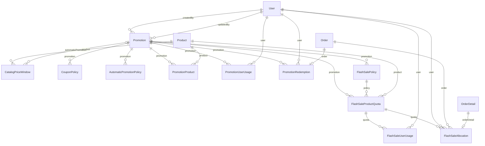

# Nhóm Promotions & Pricing

Tài liệu này trả lời: khuyến mãi (mã giảm giá, tự động, flash sale) và giá hiệu lực của sản phẩm được lưu thế nào, và bảng nào được cập nhật có điều kiện để chịu truy cập đồng thời.

> Đối chiếu code: main @ 0f1eab2 (2026-11-04)

Nhóm gồm 11 model. `Promotion` là bảng gốc; mỗi loại khuyến mãi có một bảng chính sách đi kèm một-một: `CouponPolicy` (mã giảm giá), `AutomaticPromotionPolicy` (tự động), `FlashSalePolicy` (flash sale). `PromotionProduct` gắn khuyến mãi với sản phẩm. Các bảng còn lại ghi nhận việc sử dụng: `PromotionUserUsage`, `PromotionRedemption` (mã giảm giá), `FlashSaleProductQuota`, `FlashSaleUserUsage`, `FlashSaleAllocation` (flash sale). `CatalogPriceWindow` là bảng giá hiệu lực đã tính sẵn.

Điểm cần nhớ khi đọc dữ liệu:

- `Promotion.kind` (enum `PromotionKind`: `COUPON`, `AUTOMATIC`, `FLASH_SALE`) quyết định bảng chính sách nào có dòng tương ứng. `state` (enum `PromotionState`: `DRAFT`, `ACTIVE`, `PAUSED`, `ENDED`) và khoảng `[startsAt, endsAt)` quyết định khuyến mãi có hiệu lực không.
- `Promotion.pricingVersion` tăng khi cấu hình ảnh hưởng giá đổi hoặc trạng thái đổi. Lúc checkout, flash sale kiểm tra phiên bản này; lệch thì từ chối với `PROMOTION_CHANGED`.
- Mọi khoá ngoại trong nhóm đều `Restrict`: không xoá được khuyến mãi hay sản phẩm khi còn dữ liệu sử dụng tham chiếu. Riêng `CatalogPriceWindow.productId` là `Cascade`.
- Các bộ đếm (`CouponPolicy.usedCount`, `PromotionUserUsage.usedCount`, `FlashSaleProductQuota.claimedUnits`, `FlashSaleUserUsage.claimedUnits`) được tăng bằng `UPDATE` có điều kiện chứa luôn mức trần, nên các checkout đồng thời chỉ thất bại khi hết suất chứ không ghi đè lẫn nhau.

## ERD

## Data dictionary

### `Promotion` (`promotions`)

- **Mục đích:** Gốc của mọi khuyến mãi: loại, trạng thái, thời gian hiệu lực và mức giảm.
- **Nhãn:** nguồn sự thật cho cấu hình khuyến mãi.
- **Ghi/đọc chính:** tạo và sửa bởi admin qua `src/modules/promotions/promotions.service.ts`; đọc bởi `src/modules/promotions/promotion-selection.ts`, `src/modules/promotions/promotion-pricing.ts` và `src/modules/promotions/promotion-resolver.ts`.
- **Bất biến:** mỗi khuyến mãi có đúng một dòng chính sách theo `kind`. Thay đổi cấu hình ảnh hưởng giá làm tăng `pricingVersion`, và cập nhật có điều kiện theo `pricingVersion` hiện tại để tránh ghi đè.
- **Mức giảm:** `discountKind` (enum `DiscountKind`: `PERCENT`, `FIXED`) và `discountValue` (phần trăm hoặc số tiền).

| Cột | Kiểu Prisma | Kiểu DB | Null | Mặc định | Khoá | Ý nghĩa | Ghi/đọc bởi |
| --- | --- | --- | --- | --- | --- | --- | --- |
| `id` | `Int` | `INT` | Không | `autoincrement()` | PK | Khoá chính. | Chung |
| `kind` | `PromotionKind` | `ENUM` | Không | — | — | Loại khuyến mãi: `COUPON`, `AUTOMATIC` hoặc `FLASH_SALE`. | `src/modules/promotions/promotions.service.ts` |
| `state` | `PromotionState` | `ENUM` | Không | `DRAFT` | — | Trạng thái: `DRAFT`, `ACTIVE`, `PAUSED`, `ENDED`. Mặc định `DRAFT`. | `src/modules/promotions/promotions.service.ts` |
| `name` | `String` | `VARCHAR(150)` | Không | — | — | Tên chương trình; được chụp sang đơn hàng khi áp dụng. | Chung |
| `description` | `String?` | `VARCHAR(500)` | Có | — | — | Mô tả (tuỳ chọn). | Chung |
| `discountKind` | `DiscountKind` | `ENUM` | Không | — | — | Cách tính mức giảm: `PERCENT` hoặc `FIXED`. | Chung |
| `discountValue` | `Int` | `INT` | Không | — | — | Mức giảm: phần trăm khi `PERCENT`, số tiền khi `FIXED`. | Chung |
| `pricingVersion` | `Int` | `INT` | Không | `1` | — | Phiên bản cấu hình giá, tăng khi sửa cấu hình ảnh hưởng giá và ở mỗi lần đổi trạng thái (kích hoạt, tạm dừng, tiếp tục, kết thúc); dùng để phát hiện cấu hình đổi giữa lúc khách xem và lúc đặt. | `src/modules/promotions/promotions.service.ts`; `src/modules/promotions/flash-sale-quota.ts` |
| `startsAt` | `DateTime` | `DATETIME(3)` | Không | — | — | Thời điểm bắt đầu hiệu lực (bao gồm). | Chung |
| `endsAt` | `DateTime` | `DATETIME(3)` | Không | — | — | Thời điểm kết thúc hiệu lực (loại trừ). | Chung |
| `activatedAt` | `DateTime?` | `DATETIME(3)` | Có | — | — | Thời điểm kích hoạt lần đầu; rỗng khi chưa từng `ACTIVE`. | `src/modules/promotions/promotions.service.ts` |
| `createdAt` | `DateTime` | `DATETIME(3)` | Không | `now()` | — | Thời điểm tạo dòng. | Chung |
| `updatedAt` | `DateTime` | `DATETIME(3)` | Không | `@updatedAt` | — | Thời điểm cập nhật dòng gần nhất (Prisma `@updatedAt`). | Chung |
| `createdById` | `Int` | `INT` | Không | — | FK → User | Admin tạo; `Restrict` khi xoá người dùng. | Chung |
| `updatedById` | `Int` | `INT` | Không | — | FK → User | Admin sửa gần nhất; `Restrict` khi xoá người dùng. | Chung |

**Quan hệ:**

- `createdBy` → `User` qua `createdById`, onDelete: Restrict
- `updatedBy` → `User` qua `updatedById`, onDelete: Restrict
- Được tham chiếu bởi: `CouponPolicy`, `AutomaticPromotionPolicy`, `FlashSalePolicy`, `PromotionProduct`, `PromotionRedemption`, `PromotionUserUsage`, `Order`, `OrderDetail`, `FlashSaleProductQuota`, `CatalogPriceWindow`

**Khoá ghép và index:**

- Index: `kind, state, startsAt, endsAt`

### `CatalogPriceWindow` (`catalog_price_windows`)

- **Mục đích:** Giá hiệu lực của sản phẩm theo từng khoảng thời gian, tính sẵn từ giá niêm yết và khuyến mãi tự động để truy vấn catalog nhanh.
- **Nhãn:** tổng hợp. Sinh từ `Product.price` và khuyến mãi tự động, có thể dựng lại bất cứ lúc nào.
- **Ghi/đọc chính:** ghi bởi `refreshCatalogPriceWindows` trong `src/modules/pricing/catalog-price-projection.repository.ts`, được gọi từ `src/modules/products/products.service.ts` và `src/modules/promotions/promotions.service.ts`; dựng lại bằng `pnpm run catalog-pricing:rebuild`, kiểm tra bằng `pnpm run catalog-pricing:audit`; đọc bởi `src/modules/products/products.catalog.repository.ts` và `src/modules/pricing/alert-price-resolver.ts`.
- **Bất biến:** mỗi sản phẩm có tối đa một cửa sổ cho mỗi `validFrom` (unique `productId, validFrom`). Cột `source` nhận `LIST_PRICE` (giá niêm yết) hoặc `AUTOMATIC` (có khuyến mãi tự động), theo `catalog-price-timeline.ts`.
- Nguồn sự thật khi lệch: `Product.price` và `Promotion`. Bảng này có thể xoá và dựng lại.

| Cột | Kiểu Prisma | Kiểu DB | Null | Mặc định | Khoá | Ý nghĩa | Ghi/đọc bởi |
| --- | --- | --- | --- | --- | --- | --- | --- |
| `id` | `BigInt` | `BIGINT` | Không | `autoincrement()` | PK | Khoá chính, `BIGINT`. | Chung |
| `productId` | `Int` | `INT` | Không | — | FK → Product | Sản phẩm; xoá sản phẩm thì xoá các cửa sổ (`Cascade`). | Chung |
| `validFrom` | `DateTime` | `DATETIME(3)` | Không | — | — | Bắt đầu hiệu lực của cửa sổ. | Chung |
| `validUntil` | `DateTime?` | `DATETIME(3)` | Có | — | — | Kết thúc hiệu lực; rỗng nghĩa là kéo dài không giới hạn. | Chung |
| `source` | `String` | `VARCHAR(20)` | Không | — | — | Nguồn của giá: `LIST_PRICE` hoặc `AUTOMATIC`. Lưu bằng `VARCHAR(20)`, không phải enum. | Chung |
| `listPrice` | `Int` | `INT` | Không | — | — | Giá niêm yết của sản phẩm tại thời điểm tính. | Chung |
| `effectiveCatalogPrice` | `Int` | `INT` | Không | — | — | Giá hiệu lực hiển thị trong catalog trong cửa sổ này. | Chung |
| `automaticPromotionId` | `Int?` | `INT` | Có | — | FK → Promotion | Khuyến mãi tự động tạo ra giá này; rỗng khi `source = LIST_PRICE`. `Restrict` khi xoá khuyến mãi. | Chung |
| `promotionPricingVersion` | `Int?` | `INT` | Có | — | — | `Promotion.pricingVersion` tại thời điểm tính, để phát hiện cửa sổ đã cũ. | Chung |
| `policyVersion` | `Int` | `INT` | Không | — | — | Phiên bản quy tắc tính giá (hằng `CATALOG_PRICE_POLICY_VERSION`). | `src/modules/pricing/catalog-price-timeline.ts` |
| `computedAt` | `DateTime` | `DATETIME(3)` | Không | `now()` | — | Thời điểm cửa sổ được tính. | Chung |

**Quan hệ:**

- `product` → `Product` qua `productId`, onDelete: Cascade
- `automaticPromotion` → `Promotion` qua `automaticPromotionId`, onDelete: Restrict

**Khoá ghép và index:**

- Unique ghép: `productId, validFrom`
- Index: `productId, validFrom, validUntil`
- Index: `automaticPromotionId`

### `CouponPolicy` (`coupon_policies`)

- **Mục đích:** Chính sách riêng của mã giảm giá: mã, phạm vi, điều kiện tối thiểu và giới hạn lượt dùng.
- **Nhãn:** nguồn sự thật cho chính sách mã; `usedCount` là bộ đếm tổng hợp.
- **Ghi/đọc chính:** ghi bởi `src/modules/promotions/promotions.service.ts`; `usedCount` tăng bởi `claimCouponUsage` trong `src/modules/promotions/promotion-usage.ts`.
- **Bất biến:** `code` duy nhất; `usedCount` không vượt `maxUses` khi `maxUses` có giá trị, được bảo đảm bởi `UPDATE ... WHERE usedCount < maxUses`.
- **Phạm vi:** enum `CouponScope` (`ORDER`: tính trên cả đơn; `PRODUCT`: chỉ tính trên các sản phẩm trong `PromotionProduct`).

| Cột | Kiểu Prisma | Kiểu DB | Null | Mặc định | Khoá | Ý nghĩa | Ghi/đọc bởi |
| --- | --- | --- | --- | --- | --- | --- | --- |
| `promotionId` | `Int` | `INT` | Không | — | PK, FK → Promotion | Khuyến mãi gốc; vừa là khoá chính vừa là khoá ngoại (quan hệ một-một). | Chung |
| `code` | `String` | `VARCHAR(50)` | Không | — | UQ | Mã khách nhập, duy nhất. | Chung |
| `scope` | `CouponScope` | `ENUM` | Không | — | — | Phạm vi áp dụng: `ORDER` hoặc `PRODUCT`. | Chung |
| `minOrderValue` | `Int` | `INT` | Không | `0` | — | Giá trị tối thiểu để áp mã; mặc định 0. | `src/modules/promotions/promotions.service.ts` (`assertCouponApplies`) |
| `maxDiscount` | `Int?` | `INT` | Có | — | — | Mức giảm tối đa, rỗng nghĩa là không giới hạn; dùng khi `PERCENT`. | `src/modules/promotions/promotion-pricing.ts` |
| `maxUses` | `Int?` | `INT` | Có | — | — | Tổng số lượt dùng tối đa, rỗng nghĩa là không giới hạn. | `src/modules/promotions/promotion-usage.ts` |
| `usedCount` | `Int` | `INT` | Không | `0` | — | Số lượt đã dùng (tổng hợp), tăng khi checkout. | `src/modules/promotions/promotion-usage.ts` |
| `maxUsesPerUser` | `Int` | `INT` | Không | `1` | — | Số lượt tối đa cho mỗi người dùng; mặc định 1. | `src/modules/promotions/promotion-usage.ts` |
| `isPublic` | `Boolean` | `BOOLEAN` | Không | `false` | — | Mã có được liệt kê công khai cho khách chọn hay không; mặc định không. | `src/modules/promotions/promotions.service.ts` |

**Quan hệ:**

- `promotion` → `Promotion` qua `promotionId`, onDelete: Restrict

**Khoá ghép và index:**

- Index: `isPublic`

### `AutomaticPromotionPolicy` (`automatic_promotion_policies`)

- **Mục đích:** Chính sách của khuyến mãi tự động: mức ưu tiên và khả năng dùng chung với mã giảm giá.
- **Nhãn:** nguồn sự thật cho chính sách khuyến mãi tự động.
- **Ghi/đọc chính:** ghi bởi `src/modules/promotions/promotions.service.ts`; đọc bởi `src/modules/promotions/promotion-selection.ts` và `src/modules/promotions/automatic-promotion-policy.ts`.
- **Chọn khuyến mãi:** khi một sản phẩm có nhiều khuyến mãi, `priority` lớn hơn được ưu tiên (xem `promotion-selection.ts`).

| Cột | Kiểu Prisma | Kiểu DB | Null | Mặc định | Khoá | Ý nghĩa | Ghi/đọc bởi |
| --- | --- | --- | --- | --- | --- | --- | --- |
| `promotionId` | `Int` | `INT` | Không | — | PK, FK → Promotion | Khuyến mãi gốc; vừa là khoá chính vừa là khoá ngoại (quan hệ một-một). | Chung |
| `priority` | `Int` | `INT` | Không | `0` | — | Mức ưu tiên, số lớn thắng. | `src/modules/promotions/promotion-selection.ts` |
| `stackableWithCoupon` | `Boolean` | `BOOLEAN` | Không | `false` | — | Cho phép cộng dồn với mã giảm giá hay không; mặc định không. | `src/modules/promotions/promotion-selection.ts` |

**Quan hệ:**

- `promotion` → `Promotion` qua `promotionId`, onDelete: Restrict

**Khoá ghép và index:**

- Index: `priority`

### `PromotionProduct` (`promotion_products`)

- **Mục đích:** Danh sách sản phẩm mà một khuyến mãi áp dụng.
- **Nhãn:** nguồn sự thật cho phạm vi sản phẩm của khuyến mãi.
- **Ghi/đọc chính:** ghi bởi `src/modules/promotions/promotions.service.ts`; đọc bởi `src/modules/promotions/promotion-resolver.ts` và `src/modules/promotions/promotion-pricing.ts`.
- **Bất biến:** khoá chính ghép `(promotionId, productId)`, mỗi sản phẩm xuất hiện một lần trong một khuyến mãi.

| Cột | Kiểu Prisma | Kiểu DB | Null | Mặc định | Khoá | Ý nghĩa | Ghi/đọc bởi |
| --- | --- | --- | --- | --- | --- | --- | --- |
| `promotionId` | `Int` | `INT` | Không | — | PK, FK → Promotion | Khuyến mãi. | Chung |
| `productId` | `Int` | `INT` | Không | — | PK, FK → Product | Sản phẩm được áp dụng. | Chung |

**Quan hệ:**

- `promotion` → `Promotion` qua `promotionId`, onDelete: Restrict
- `product` → `Product` qua `productId`, onDelete: Restrict

**Khoá ghép và index:**

- PK ghép: `promotionId, productId`
- Index: `productId, promotionId`

### `PromotionUserUsage` (`promotion_user_usages`)

- **Mục đích:** Số lượt một người dùng đã dùng một mã giảm giá.
- **Nhãn:** tổng hợp, dùng để kiểm tra giới hạn `maxUsesPerUser`.
- **Ghi/đọc chính:** ghi bởi `claimCouponUsage` trong `src/modules/promotions/promotion-usage.ts`.
- **Bất biến:** khoá chính ghép `(promotionId, userId)`; `usedCount` không vượt `CouponPolicy.maxUsesPerUser`, bảo đảm bởi `UPDATE ... WHERE usedCount < maxUsesPerUser`.

| Cột | Kiểu Prisma | Kiểu DB | Null | Mặc định | Khoá | Ý nghĩa | Ghi/đọc bởi |
| --- | --- | --- | --- | --- | --- | --- | --- |
| `promotionId` | `Int` | `INT` | Không | — | PK, FK → Promotion | Khuyến mãi (mã giảm giá). | Chung |
| `userId` | `Int` | `INT` | Không | — | PK, FK → User | Người dùng. | Chung |
| `usedCount` | `Int` | `INT` | Không | `0` | — | Số lượt đã dùng, mặc định 0. | Chung |

**Quan hệ:**

- `promotion` → `Promotion` qua `promotionId`, onDelete: Restrict
- `user` → `User` qua `userId`, onDelete: Restrict

**Khoá ghép và index:**

- PK ghép: `promotionId, userId`

### `PromotionRedemption` (`promotion_redemptions`)

- **Mục đích:** Mỗi lần mã giảm giá được áp vào một đơn hàng cụ thể.
- **Nhãn:** nguồn sự thật cho lịch sử sử dụng mã.
- **Ghi/đọc chính:** ghi bởi `recordCouponRedemption` và đảo bởi `reverseCouponRedemption` trong `src/modules/promotions/promotion-usage.ts`; `reverseCouponRedemption` được gọi khi huỷ đơn (`src/modules/orders/order-cancellation.service.ts`).
- **Bất biến:** mỗi đơn có tối đa một lần dùng mã (`orderId` duy nhất). Trạng thái enum `RedemptionStatus` (`APPLIED`, `REVERSED`); đơn bị huỷ thì chuyển `REVERSED` kèm `reversedAt` và `reverseReason`.

| Cột | Kiểu Prisma | Kiểu DB | Null | Mặc định | Khoá | Ý nghĩa | Ghi/đọc bởi |
| --- | --- | --- | --- | --- | --- | --- | --- |
| `id` | `Int` | `INT` | Không | `autoincrement()` | PK | Khoá chính. | Chung |
| `promotionId` | `Int` | `INT` | Không | — | FK → Promotion | Khuyến mãi (mã giảm giá) đã dùng. | Chung |
| `userId` | `Int` | `INT` | Không | — | FK → User | Người dùng đã dùng. | Chung |
| `orderId` | `Int` | `INT` | Không | — | FK → Order, UQ | Đơn áp dụng mã, duy nhất. | Chung |
| `discountAmount` | `Int` | `INT` | Không | — | — | Số tiền giảm của lần dùng này, bằng `Order.couponDiscountAmount`. | Chung |
| `status` | `RedemptionStatus` | `ENUM` | Không | `APPLIED` | — | `APPLIED` hoặc `REVERSED`. Mặc định `APPLIED`. | `src/modules/promotions/promotion-usage.ts` |
| `createdAt` | `DateTime` | `DATETIME(3)` | Không | `now()` | — | Thời điểm tạo dòng. | Chung |
| `reversedAt` | `DateTime?` | `DATETIME(3)` | Có | — | — | Thời điểm đảo (do huỷ đơn); rỗng khi còn `APPLIED`. | `src/modules/promotions/promotion-usage.ts` |
| `reverseReason` | `String?` | `VARCHAR(50)` | Có | — | — | Lý do đảo, tối đa 50 ký tự. | `src/modules/promotions/promotion-usage.ts` |

**Quan hệ:**

- `promotion` → `Promotion` qua `promotionId`, onDelete: Restrict
- `user` → `User` qua `userId`, onDelete: Restrict
- `order` → `Order` qua `orderId`, onDelete: Restrict

**Khoá ghép và index:**

- Index: `promotionId, status, createdAt`
- Index: `userId, promotionId, status`

### `FlashSalePolicy` (`flash_sale_policies`)

- **Mục đích:** Chính sách riêng của flash sale: ưu tiên, dùng chung với mã giảm giá và có hiển thị số suất còn lại hay không.
- **Nhãn:** nguồn sự thật cho chính sách flash sale.
- **Ghi/đọc chính:** ghi bởi `src/modules/promotions/promotions.service.ts`; đọc bởi `src/modules/promotions/promotion-selection.ts` và `src/modules/promotions/flash-sale-availability.ts`.

| Cột | Kiểu Prisma | Kiểu DB | Null | Mặc định | Khoá | Ý nghĩa | Ghi/đọc bởi |
| --- | --- | --- | --- | --- | --- | --- | --- |
| `promotionId` | `Int` | `INT` | Không | — | PK, FK → Promotion | Khuyến mãi gốc; vừa là khoá chính vừa là khoá ngoại (quan hệ một-một). | Chung |
| `priority` | `Int` | `INT` | Không | `0` | — | Mức ưu tiên, số lớn thắng. | `src/modules/promotions/promotion-selection.ts` |
| `stackableWithCoupon` | `Boolean` | `BOOLEAN` | Không | `false` | — | Cho phép cộng dồn với mã giảm giá hay không; mặc định không. | `src/modules/promotions/promotion-selection.ts` |
| `showRemainingQuota` | `Boolean` | `BOOLEAN` | Không | `true` | — | Có hiển thị số suất còn lại cho khách hay không; mặc định có. | `src/modules/promotions/flash-sale-availability.ts` |

**Quan hệ:**

- `promotion` → `Promotion` qua `promotionId`, onDelete: Restrict
- Được tham chiếu bởi: `FlashSaleProductQuota`

### `FlashSaleProductQuota` (`flash_sale_product_quotas`)

- **Mục đích:** Hạn mức bán của một sản phẩm trong một flash sale: tổng suất, số suất đã giữ và giới hạn mỗi người.
- **Nhãn:** tổng hợp cho `claimedUnits`, nguồn sự thật cho `totalQuota` và `maxUnitsPerUser`.
- **Ghi/đọc chính:** `claimedUnits` tăng bởi `claimFlashSaleQuotas` trong `src/modules/promotions/flash-sale-quota.ts`; kiểm tra bởi `pnpm run promotions:verify-flash-sale` (`src/scripts/verify-flash-sale.ts`).
- **Bất biến:** khoá chính ghép `(promotionId, productId)`; `claimedUnits ≤ totalQuota`, bảo đảm bởi `UPDATE ... WHERE claimedUnits <= totalQuota - quantity`. Khi `claimedUnits` của quota khớp với tổng `quantity` của `FlashSaleAllocation` ở trạng thái `CLAIMED` của cùng `(promotionId, productId)` thì dữ liệu nhất quán; script `verify-flash-sale` kiểm tra điều này.

| Cột | Kiểu Prisma | Kiểu DB | Null | Mặc định | Khoá | Ý nghĩa | Ghi/đọc bởi |
| --- | --- | --- | --- | --- | --- | --- | --- |
| `promotionId` | `Int` | `INT` | Không | — | PK, FK → Promotion | Flash sale. | Chung |
| `productId` | `Int` | `INT` | Không | — | PK, FK → Product | Sản phẩm có hạn mức. | Chung |
| `totalQuota` | `Int` | `INT` | Không | — | — | Tổng số suất của sản phẩm trong flash sale. | Chung |
| `claimedUnits` | `Int` | `INT` | Không | `0` | — | Số suất đã được giữ (tổng hợp), tăng khi checkout và giảm khi đơn bị huỷ. | `src/modules/promotions/flash-sale-quota.ts` |
| `maxUnitsPerUser` | `Int` | `INT` | Không | — | — | Số suất tối đa mỗi người dùng được mua. | `src/modules/promotions/flash-sale-quota.ts` |
| `createdAt` | `DateTime` | `DATETIME(3)` | Không | `now()` | — | Thời điểm tạo dòng. | Chung |
| `updatedAt` | `DateTime` | `DATETIME(3)` | Không | `@updatedAt` | — | Thời điểm cập nhật dòng gần nhất (Prisma `@updatedAt`). | Chung |

**Quan hệ:**

- `promotion` → `Promotion` qua `promotionId`, onDelete: Restrict
- `policy` → `FlashSalePolicy` qua `promotionId`, onDelete: Restrict
- `product` → `Product` qua `productId`, onDelete: Restrict
- Được tham chiếu bởi: `FlashSaleUserUsage`, `FlashSaleAllocation`

**Khoá ghép và index:**

- PK ghép: `promotionId, productId`
- Index: `productId, promotionId`

### `FlashSaleUserUsage` (`flash_sale_user_usages`)

- **Mục đích:** Số suất flash sale một người dùng đã giữ cho một sản phẩm.
- **Nhãn:** tổng hợp, dùng để kiểm tra giới hạn `maxUnitsPerUser`.
- **Ghi/đọc chính:** ghi bởi `claimFlashSaleQuotas` và `releaseFlashSaleAllocations` trong `src/modules/promotions/flash-sale-quota.ts`.
- **Bất biến:** khoá chính ghép `(promotionId, productId, userId)`; `claimedUnits ≤ FlashSaleProductQuota.maxUnitsPerUser`, bảo đảm bởi `UPDATE` có điều kiện.

| Cột | Kiểu Prisma | Kiểu DB | Null | Mặc định | Khoá | Ý nghĩa | Ghi/đọc bởi |
| --- | --- | --- | --- | --- | --- | --- | --- |
| `promotionId` | `Int` | `INT` | Không | — | PK, FK → FlashSaleProductQuota | Flash sale. | Chung |
| `productId` | `Int` | `INT` | Không | — | PK, FK → FlashSaleProductQuota | Sản phẩm. | Chung |
| `userId` | `Int` | `INT` | Không | — | PK, FK → User | Người dùng. | Chung |
| `claimedUnits` | `Int` | `INT` | Không | `0` | — | Số suất đã giữ, mặc định 0. | Chung |

**Quan hệ:**

- `quota` → `FlashSaleProductQuota` qua `promotionId, productId`, onDelete: Restrict
- `user` → `User` qua `userId`, onDelete: Restrict

**Khoá ghép và index:**

- PK ghép: `promotionId, productId, userId`
- Index: `userId, promotionId`

### `FlashSaleAllocation` (`flash_sale_allocations`)

- **Mục đích:** Mỗi lần giữ suất flash sale cho một dòng đơn hàng cụ thể.
- **Nhãn:** nguồn sự thật cho lịch sử giữ và nhả suất.
- **Ghi/đọc chính:** tạo bởi `claimFlashSaleQuotas` và nhả bởi `releaseFlashSaleAllocations` trong `src/modules/promotions/flash-sale-quota.ts`.
- **Bất biến:** mỗi dòng đơn có tối đa một lần giữ (`orderDetailId` duy nhất) và mỗi `(promotionId, productId, orderId)` một lần. Trạng thái enum `FlashSaleAllocationStatus` (`CLAIMED`, `RELEASED`); đơn bị huỷ thì chuyển `RELEASED` kèm `releasedAt`, `releaseReason`.

| Cột | Kiểu Prisma | Kiểu DB | Null | Mặc định | Khoá | Ý nghĩa | Ghi/đọc bởi |
| --- | --- | --- | --- | --- | --- | --- | --- |
| `id` | `Int` | `INT` | Không | `autoincrement()` | PK | Khoá chính. | Chung |
| `promotionId` | `Int` | `INT` | Không | — | FK → FlashSaleProductQuota | Flash sale. | Chung |
| `productId` | `Int` | `INT` | Không | — | FK → FlashSaleProductQuota | Sản phẩm. | Chung |
| `userId` | `Int` | `INT` | Không | — | FK → User | Người mua. | Chung |
| `orderId` | `Int` | `INT` | Không | — | FK → Order | Đơn chứa lần giữ. | Chung |
| `orderDetailId` | `Int` | `INT` | Không | — | FK → OrderDetail, UQ | Dòng đơn tương ứng, duy nhất. | Chung |
| `quantity` | `Int` | `INT` | Không | — | — | Số suất giữ. | Chung |
| `discountAmount` | `Int` | `INT` | Không | — | — | Số tiền giảm của dòng này nhờ flash sale. | Chung |
| `status` | `FlashSaleAllocationStatus` | `ENUM` | Không | `CLAIMED` | — | `CLAIMED` hoặc `RELEASED`. Mặc định `CLAIMED`. | `src/modules/promotions/flash-sale-quota.ts` |
| `createdAt` | `DateTime` | `DATETIME(3)` | Không | `now()` | — | Thời điểm tạo dòng. | Chung |
| `releasedAt` | `DateTime?` | `DATETIME(3)` | Có | — | — | Thời điểm nhả suất; rỗng khi còn `CLAIMED`. | `src/modules/promotions/flash-sale-quota.ts` |
| `releaseReason` | `String?` | `VARCHAR(50)` | Có | — | — | Lý do nhả suất, tối đa 50 ký tự. | `src/modules/promotions/flash-sale-quota.ts` |

**Quan hệ:**

- `quota` → `FlashSaleProductQuota` qua `promotionId, productId`, onDelete: Restrict
- `user` → `User` qua `userId`, onDelete: Restrict
- `order` → `Order` qua `orderId`, onDelete: Restrict
- `orderDetail` → `OrderDetail` qua `orderDetailId`, onDelete: Restrict

**Khoá ghép và index:**

- Unique ghép: `promotionId, productId, orderId`
- Index: `promotionId, productId, status`
- Index: `userId, promotionId, status`
- Index: `createdAt`

## Nguồn

- [prisma/schema.prisma](https://github.com/QuocDuy21-10/laptopshop-api/blob/main/prisma/schema.prisma): `Promotion`, `CatalogPriceWindow`, `CouponPolicy`, `AutomaticPromotionPolicy`, `PromotionProduct`, `PromotionUserUsage`, `PromotionRedemption`, `FlashSalePolicy`, `FlashSaleProductQuota`, `FlashSaleUserUsage`, `FlashSaleAllocation`
- [src/modules/promotions/promotions.service.ts](https://github.com/QuocDuy21-10/laptopshop-api/blob/main/src/modules/promotions/promotions.service.ts)
- [src/modules/promotions/promotion-usage.ts](https://github.com/QuocDuy21-10/laptopshop-api/blob/main/src/modules/promotions/promotion-usage.ts): `claimCouponUsage`, `recordCouponRedemption`, `reverseCouponRedemption`
- [src/modules/promotions/flash-sale-quota.ts](https://github.com/QuocDuy21-10/laptopshop-api/blob/main/src/modules/promotions/flash-sale-quota.ts): `claimFlashSaleQuotas`, `releaseFlashSaleAllocations`
- [src/modules/promotions/promotion-pricing.ts](https://github.com/QuocDuy21-10/laptopshop-api/blob/main/src/modules/promotions/promotion-pricing.ts): `calculatePromotionPricing`
- [src/modules/promotions/promotion-selection.ts](https://github.com/QuocDuy21-10/laptopshop-api/blob/main/src/modules/promotions/promotion-selection.ts)
- [src/modules/pricing/catalog-price-timeline.ts](https://github.com/QuocDuy21-10/laptopshop-api/blob/main/src/modules/pricing/catalog-price-timeline.ts)
- [src/modules/pricing/catalog-price-projection.repository.ts](https://github.com/QuocDuy21-10/laptopshop-api/blob/main/src/modules/pricing/catalog-price-projection.repository.ts): `refreshCatalogPriceWindows`
- [src/scripts/rebuild-catalog-price-windows.ts](https://github.com/QuocDuy21-10/laptopshop-api/blob/main/src/scripts/rebuild-catalog-price-windows.ts)
- [src/scripts/verify-flash-sale.ts](https://github.com/QuocDuy21-10/laptopshop-api/blob/main/src/scripts/verify-flash-sale.ts)
