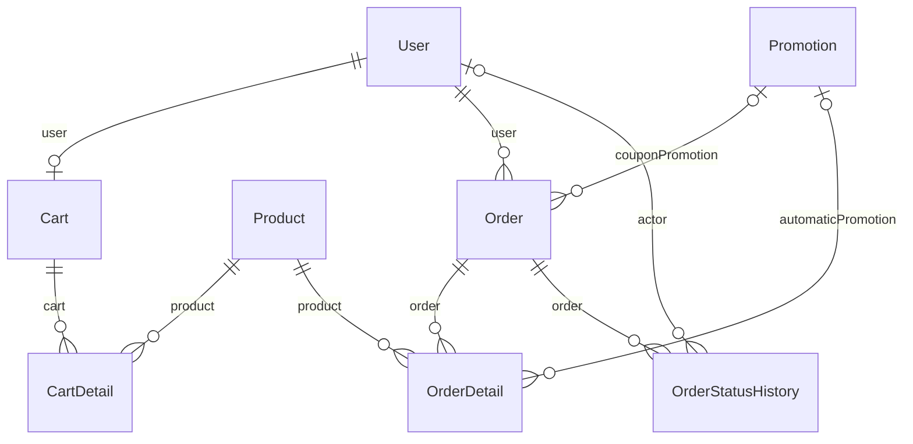

# Nhóm Shopping & Orders

Tài liệu này trả lời: giỏ hàng và đơn hàng được lưu thế nào, cột nào là snapshot tại lúc mua và trạng thái đơn được ghi lại ra sao.

> Đối chiếu code: main @ 0f1eab2 (2026-11-04)

Nhóm gồm 5 model: giỏ hàng (`Cart`, `CartDetail`) và đơn hàng (`Order`, `OrderDetail`, `OrderStatusHistory`). Giỏ hàng là dữ liệu tạm; đơn hàng là dữ liệu cần giữ nguyên sau khi tạo.

Điểm cần nhớ khi đọc dữ liệu:

- Giá, khuyến mãi, bảo hành của từng dòng được **chụp lại** vào `OrderDetail` lúc đặt hàng. Đổi giá hoặc chính sách của sản phẩm sau đó không làm đổi đơn cũ.
- Checkout xoá giỏ hàng trong cùng transaction với việc tạo đơn (`placeOrder` trong `src/modules/orders/orders.service.ts`). Vì vậy `Cart` và `CartDetail` không bao giờ còn dữ liệu của một đơn đã đặt.
- Trạng thái đơn đi theo `canTransition` trong `src/modules/orders/order-status.ts`: `PENDING` → `SHIPPING` hoặc `CANCELLED`; `SHIPPING` → `COMPLETED` hoặc `CANCELLED`; `COMPLETED` và `CANCELLED` là trạng thái cuối.

## ERD

## Data dictionary

### `Cart` (`cart`)

- **Mục đích:** Giỏ hàng của một người dùng; mỗi người dùng có tối đa một giỏ.
- **Nhãn:** nguồn sự thật cho giỏ hiện tại, dữ liệu tạm.
- **Ghi/đọc chính:** tạo bằng `upsert` và đọc bởi `src/modules/cart/cart.service.ts`; xoá bởi `placeOrder` trong `src/modules/orders/orders.service.ts` khi checkout.
- **Bất biến:** `userId` duy nhất, nên mỗi người dùng một giỏ. Mọi truy vấn giỏ phải scope theo người dùng hiện tại.

| Cột | Kiểu Prisma | Kiểu DB | Null | Mặc định | Khoá | Ý nghĩa | Ghi/đọc bởi |
| --- | --- | --- | --- | --- | --- | --- | --- |
| `id` | `Int` | `INT` | Không | `autoincrement()` | PK | Khoá chính. | Chung |
| `userId` | `Int` | `INT` | Không | — | FK → User, UQ | Chủ giỏ hàng, duy nhất. | Chung |

**Quan hệ:**

- `user` → `User` qua `userId`, onDelete: Restrict (mặc định)
- Được tham chiếu bởi: `CartDetail`

### `CartDetail` (`cart_detail`)

- **Mục đích:** Một dòng trong giỏ: số lượng của một sản phẩm.
- **Nhãn:** nguồn sự thật cho nội dung giỏ, dữ liệu tạm. Không lưu giá; giá được tính lại phía server khi checkout.
- **Ghi/đọc chính:** ghi bằng `upsert` và đọc bởi `src/modules/cart/cart.service.ts`; đọc và xoá bởi `placeOrder` trong `src/modules/orders/orders.service.ts`.
- **Bất biến:** mỗi sản phẩm chỉ có một dòng trong một giỏ (unique `cartId, productId`).

| Cột | Kiểu Prisma | Kiểu DB | Null | Mặc định | Khoá | Ý nghĩa | Ghi/đọc bởi |
| --- | --- | --- | --- | --- | --- | --- | --- |
| `id` | `Int` | `INT` | Không | `autoincrement()` | PK | Khoá chính. | Chung |
| `quantity` | `Int` | `INT` | Không | — | — | Số lượng sản phẩm trong giỏ. | Chung |
| `cartId` | `Int` | `INT` | Không | — | FK → Cart | Giỏ chứa dòng này. | Chung |
| `productId` | `Int` | `INT` | Không | — | FK → Product | Sản phẩm được thêm vào giỏ. | Chung |

**Quan hệ:**

- `cart` → `Cart` qua `cartId`, onDelete: Restrict (mặc định)
- `product` → `Product` qua `productId`, onDelete: Restrict (mặc định)

**Khoá ghép và index:**

- Unique ghép: `cartId, productId`

### `Order` (`orders`)

- **Mục đích:** Đơn hàng của khách: người nhận, tổng tiền, khuyến mãi áp dụng, phương thức và trạng thái thanh toán.
- **Nhãn:** nguồn sự thật cho đơn hàng. Các cột tiền và khuyến mãi là snapshot tại lúc đặt; `paymentStatus` là bản sao tiện lợi của trạng thái thanh toán (xem cột).
- **Ghi/đọc chính:** tạo bởi `placeOrder`, đổi trạng thái bởi `changeStatus` (cả hai trong `src/modules/orders/orders.service.ts`); `src/modules/payments/payment-ingestion.service.ts` đặt `paymentStatus` khi nhận tiền; `src/modules/orders/order-cancellation.service.ts` xử lý huỷ.
- **Bất biến:** `status` chỉ đổi theo `canTransition` và bằng cập nhật có điều kiện theo trạng thái đã đọc, nên hai thay đổi đồng thời không cùng thành công. `unique(userId, idempotencyKey)` chống tạo trùng đơn khi client gửi lại.
- **Tiền:** `totalPrice` là tổng giá sau giảm của các dòng (giá niêm yết × số lượng, trừ giảm giá sản phẩm và phần mã giảm giá được phân bổ), tính bởi `calculatePromotionPricing`. Đơn tổng bằng 0 được ghi `paymentMethod = FREE` và `paymentStatus = PAYMENT_SUCCESS`.
- **Trạng thái lưu bằng `VARCHAR`, không phải enum:** `status` ∈ {`PENDING`, `SHIPPING`, `COMPLETED`, `CANCELLED`} (`ORDER_STATUS`); `paymentStatus` ∈ {`PAYMENT_UNPAID`, `PAYMENT_SUCCESS`, `PAYMENT_FAILED`} (`PAYMENT_STATUS`).

| Cột | Kiểu Prisma | Kiểu DB | Null | Mặc định | Khoá | Ý nghĩa | Ghi/đọc bởi |
| --- | --- | --- | --- | --- | --- | --- | --- |
| `id` | `Int` | `INT` | Không | `autoincrement()` | PK | Khoá chính. | Chung |
| `totalPrice` | `Int` | `INT` | Không | — | — | Số tiền khách phải trả sau mọi giảm giá. | Chung |
| `subtotalPrice` | `Int` | `INT` | Không | — | — | Tổng giá niêm yết của các dòng (giá × số lượng) trước giảm giá. | `src/modules/promotions/promotion-pricing.ts` |
| `productDiscountAmount` | `Int` | `INT` | Không | `0` | — | Tổng giảm giá từ khuyến mãi tự động theo sản phẩm (gồm flash sale). | `src/modules/promotions/promotion-pricing.ts` |
| `couponEligibleSubtotal` | `Int` | `INT` | Không | `0` | — | Phần tạm tính đủ điều kiện áp mã giảm giá, dùng để tính `couponDiscountAmount`. | `src/modules/promotions/promotion-pricing.ts` |
| `couponDiscountAmount` | `Int` | `INT` | Không | `0` | — | Số tiền giảm bởi mã giảm giá; không vượt quá `couponEligibleSubtotal`. | `src/modules/promotions/promotion-pricing.ts` |
| `couponPromotionId` | `Int?` | `INT` | Có | — | FK → Promotion | Khuyến mãi (mã giảm giá) đã áp dụng; không xoá được khuyến mãi khi còn đơn tham chiếu (`Restrict`). | Chung |
| `couponCode` | `String?` | `VARCHAR(50)` | Có | — | — | Mã giảm giá khách đã nhập, chụp lại tại lúc đặt. | Chung |
| `couponName` | `String?` | `VARCHAR(150)` | Có | — | — | Tên chương trình mã giảm giá, chụp lại tại lúc đặt. | Chung |
| `requestHash` | `String?` | `CHAR(64)` | Có | — | — | SHA-256 nội dung request đặt hàng. Gửi lại cùng `idempotencyKey` mà khác nội dung thì bị từ chối (`IDEMPOTENCY_KEY_REUSED`). | `src/modules/orders/orders.service.ts` |
| `receiverAddress` | `String` | `VARCHAR(255)` | Không | — | — | Địa chỉ nhận hàng của lần đặt này. | Chung |
| `receiverName` | `String` | `VARCHAR(255)` | Không | — | — | Tên người nhận. | Chung |
| `receiverPhone` | `String` | `VARCHAR(255)` | Không | — | — | Số điện thoại người nhận. | Chung |
| `status` | `String` | `VARCHAR(191)` | Không | `PENDING` | — | Trạng thái đơn; xem ghi chú ở trên. Mặc định `PENDING`. | `src/modules/orders/orders.service.ts`; `src/modules/orders/order-cancellation.service.ts` |
| `paymentMethod` | `String` | `VARCHAR(191)` | Không | — | — | Phương thức thanh toán: `COD`, `BANK_TRANSFER`, hoặc `FREE` khi tổng tiền bằng 0. | `src/modules/orders/orders.service.ts` |
| `paymentStatus` | `String` | `VARCHAR(191)` | Không | — | — | Trạng thái thanh toán của đơn. Với chuyển khoản, được đặt `PAYMENT_SUCCESS` khi webhook ghi nhận đủ tiền; với COD, được đặt khi đơn chuyển sang `COMPLETED`. Nguồn sự thật chi tiết của chuyển khoản là `Payment.status` (xem [payments.md](payments.md)). | `src/modules/orders/orders.service.ts`; `src/modules/payments/payment-ingestion.service.ts`; `src/modules/after-sales/after-sales.repository.ts` |
| `paymentRef` | `String?` | `VARCHAR(191)` | Có | — | — | Suy luận: mã tham chiếu thanh toán cũ. Code vận hành hiện không ghi cột này (chỉ script demo seed), thông tin chuyển khoản nằm ở `Payment`. | `src/scripts/demo-seed/orders.ts` |
| `idempotencyKey` | `String?` | `VARCHAR(64)` | Có | — | — | Khoá chống lặp client gửi qua header `Idempotency-Key` (tối đa 64 ký tự), duy nhất theo từng người dùng. | `src/modules/orders/orders.service.ts` |
| `createdAt` | `DateTime` | `DATETIME(3)` | Không | `now()` | — | Thời điểm tạo dòng. | Chung |
| `completedAt` | `DateTime?` | `DATETIME(3)` | Có | — | — | Thời điểm đơn chuyển sang `COMPLETED`; mốc bắt đầu bảo hành của các dòng. | `src/modules/orders/orders.service.ts` |
| `userId` | `Int` | `INT` | Không | — | FK → User | Khách đặt hàng. | Chung |

**Quan hệ:**

- `user` → `User` qua `userId`, onDelete: Restrict (mặc định)
- `couponPromotion` → `Promotion` qua `couponPromotionId`, onDelete: Restrict
- Được tham chiếu bởi: `OrderDetail`, `OrderStatusHistory`, `StockMovement`, `Payment`, `PromotionRedemption`, `FlashSaleAllocation`

**Khoá ghép và index:**

- Unique ghép: `userId, idempotencyKey`
- Index: `status, createdAt`
- Index: `createdAt`

### `OrderDetail` (`order_detail`)

- **Mục đích:** Một dòng của đơn hàng: sản phẩm, số lượng, giá và khuyến mãi tại lúc đặt, cùng thông tin bảo hành.
- **Nhãn:** snapshot tại lúc mua. Giá và chính sách bảo hành không đổi khi sản phẩm đổi giá hoặc chính sách về sau.
- **Ghi/đọc chính:** tạo cùng `Order` bởi `placeOrder` trong `src/modules/orders/orders.service.ts`; `changeStatus` cập nhật `warrantyStartAt` và `warrantyEndAt` khi đơn hoàn tất; đọc bởi `src/modules/after-sales/after-sales.repository.ts` và `src/modules/reviews/reviews.service.ts`.
- **Bảo hành:** `warrantyMonthsSnapshot` được chụp lúc đặt (`warrantyPolicySource = CHECKOUT_SNAPSHOT`). `warrantyStartAt` và `warrantyEndAt` chỉ được đặt khi đơn hoàn tất, bằng ngày hoàn tất và ngày đó cộng số tháng (`warrantySnapshotForCompletion`, cắt về ngày cuối tháng nếu cần).

| Cột | Kiểu Prisma | Kiểu DB | Null | Mặc định | Khoá | Ý nghĩa | Ghi/đọc bởi |
| --- | --- | --- | --- | --- | --- | --- | --- |
| `id` | `Int` | `INT` | Không | `autoincrement()` | PK | Khoá chính. | Chung |
| `price` | `Int` | `INT` | Không | — | — | Đơn giá niêm yết của sản phẩm tại lúc đặt (`Product.price` khi đó). | `src/modules/orders/orders.service.ts` |
| `quantity` | `Int` | `INT` | Không | — | — | Số lượng đã đặt. | Chung |
| `productDiscountAmount` | `Int` | `INT` | Không | `0` | — | Giảm giá khuyến mãi tự động của riêng dòng này. | `src/modules/promotions/promotion-pricing.ts` |
| `couponDiscountAmount` | `Int` | `INT` | Không | `0` | — | Phần giảm giá mã giảm giá được phân bổ cho dòng này. | `src/modules/promotions/promotion-pricing.ts` |
| `automaticPromotionId` | `Int?` | `INT` | Có | — | FK → Promotion | Khuyến mãi tự động đã áp dụng cho dòng (nếu có); `Restrict` khi xoá khuyến mãi. | Chung |
| `automaticPromotionName` | `String?` | `VARCHAR(150)` | Có | — | — | Tên khuyến mãi tự động tại lúc đặt, giữ lại để hiển thị về sau. | Chung |
| `warrantyMonthsSnapshot` | `Int?` | `INT` | Có | — | — | Số tháng bảo hành tại lúc đặt, chụp từ `Product.warrantyMonths`. | `src/modules/orders/orders.service.ts` |
| `warrantyStartAt` | `DateTime?` | `DATETIME(3)` | Có | — | — | Ngày bắt đầu bảo hành; rỗng cho tới khi đơn hoàn tất hoặc khi không có bảo hành. | `src/modules/orders/orders.service.ts`; `src/modules/orders/order-warranty.ts` |
| `warrantyEndAt` | `DateTime?` | `DATETIME(3)` | Có | — | — | Ngày hết hạn bảo hành, tính từ `warrantyStartAt`. | `src/modules/orders/orders.service.ts`; `src/modules/orders/order-warranty.ts` |
| `warrantyPolicySource` | `WarrantyPolicySource` | `ENUM` | Không | `UNAVAILABLE` | — | Nguồn của thông tin bảo hành: enum `WarrantyPolicySource` (`CHECKOUT_SNAPSHOT`, `CURRENT_PRODUCT_POLICY_BACKFILL`, `UNAVAILABLE`). Dòng cũ trước khi có snapshot mang giá trị mặc định `UNAVAILABLE` hoặc được backfill. | `src/modules/orders/orders.service.ts` |
| `orderId` | `Int` | `INT` | Không | — | FK → Order | Đơn chứa dòng này. | Chung |
| `productId` | `Int` | `INT` | Không | — | FK → Product | Sản phẩm đã mua. | Chung |

**Quan hệ:**

- `order` → `Order` qua `orderId`, onDelete: Restrict (mặc định)
- `product` → `Product` qua `productId`, onDelete: Restrict (mặc định)
- `automaticPromotion` → `Promotion` qua `automaticPromotionId`, onDelete: Restrict
- Được tham chiếu bởi: `Review`, `ServiceRequestItem`, `WarrantyVerification`, `FlashSaleAllocation`

### `OrderStatusHistory` (`order_status_history`)

- **Mục đích:** Nhật ký đổi trạng thái đơn: mỗi lần đổi là một dòng.
- **Nhãn:** nguồn sự thật cho lịch sử trạng thái.
- **Ghi/đọc chính:** ghi bởi `placeOrder` (dòng đầu tiên, `PENDING`) và `changeStatus` trong `src/modules/orders/orders.service.ts`.
- **Bất biến:** dòng đầu tiên của mỗi đơn có `fromStatus` rỗng và `toStatus = PENDING`.

| Cột | Kiểu Prisma | Kiểu DB | Null | Mặc định | Khoá | Ý nghĩa | Ghi/đọc bởi |
| --- | --- | --- | --- | --- | --- | --- | --- |
| `id` | `Int` | `INT` | Không | `autoincrement()` | PK | Khoá chính. | Chung |
| `fromStatus` | `String?` | `VARCHAR(20)` | Có | — | — | Trạng thái trước khi đổi; rỗng ở dòng khởi tạo. | Chung |
| `toStatus` | `String` | `VARCHAR(20)` | Không | — | — | Trạng thái sau khi đổi. | Chung |
| `createdAt` | `DateTime` | `DATETIME(3)` | Không | `now()` | — | Thời điểm tạo dòng. | Chung |
| `orderId` | `Int` | `INT` | Không | — | FK → Order | Đơn bị đổi trạng thái. | Chung |
| `actorId` | `Int?` | `INT` | Có | — | FK → User | Người thực hiện thay đổi: khách (đặt hoặc huỷ) hoặc admin. `SetNull` khi xoá người dùng. | Chung |
| `reason` | `String?` | `VARCHAR(50)` | Có | — | — | Lý do ngắn (tối đa 50 ký tự), ví dụ lý do huỷ đơn (tuỳ chọn). | `src/modules/orders/orders.service.ts` |

**Quan hệ:**

- `order` → `Order` qua `orderId`, onDelete: Restrict (mặc định)
- `actor` → `User` qua `actorId`, onDelete: SetNull

**Khoá ghép và index:**

- Index: `orderId, createdAt`

## Nguồn

- [prisma/schema.prisma](../../../prisma/schema.prisma): `Cart`, `CartDetail`, `Order`, `OrderDetail`, `OrderStatusHistory`
- [src/modules/orders/orders.service.ts](../../../src/modules/orders/orders.service.ts): `placeOrder`, `changeStatus`
- [src/modules/orders/order-status.ts](../../../src/modules/orders/order-status.ts): `ORDER_STATUS`, `PAYMENT_STATUS`, `canTransition`
- [src/modules/orders/order-warranty.ts](../../../src/modules/orders/order-warranty.ts): `warrantySnapshotForCompletion`
- [src/modules/orders/order-cancellation.service.ts](../../../src/modules/orders/order-cancellation.service.ts)
- [src/modules/cart/cart.service.ts](../../../src/modules/cart/cart.service.ts)
- [src/modules/promotions/promotion-pricing.ts](../../../src/modules/promotions/promotion-pricing.ts): `calculatePromotionPricing`
