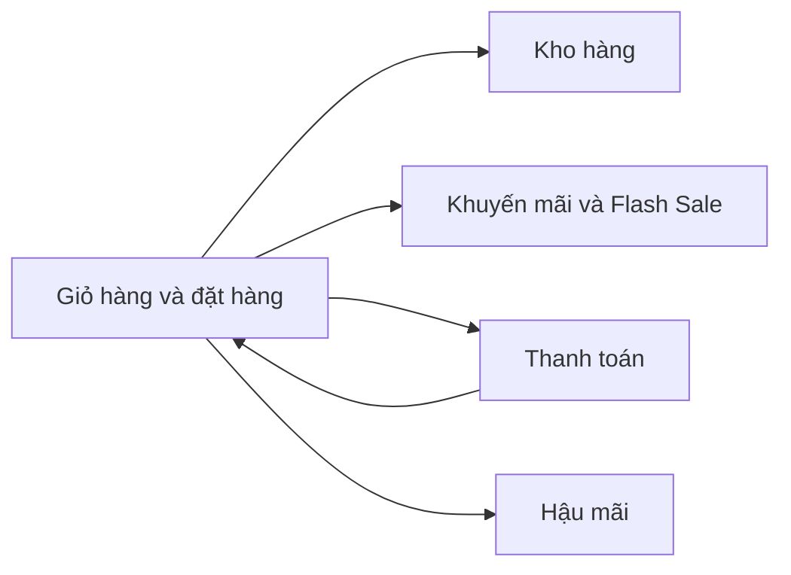

# Tài liệu nghiệp vụ (Business)

Tài liệu này trả lời: LaptopShop có những nghiệp vụ chính nào, mỗi quy tắc nghiệp vụ nằm ở đâu trong tài liệu, được thực thi bởi hàm nào và được test nào bao phủ.

> Đối chiếu code: main @ d3d4cb7 (2026-11-04)

## Bốn nghiệp vụ

| File | Nội dung | Số quy tắc | Tiền tố | Chưa có test |
| --- | --- | --- | --- | --- |
| [inventory.md](inventory.md) | Sổ kho, `moveStock`, điều chỉnh, phiếu nhập, đối soát | 20 | `INV-` | 1 |
| [checkout-and-payment.md](checkout-and-payment.md) | Giỏ hàng, báo giá, đặt hàng, vòng đời và huỷ đơn; thanh toán QR, webhook, đối soát, ca xem xét | 40 | `CHK-` (20), `PAY-` (20) | 3 |
| [promotions-and-flash-sale.md](promotions-and-flash-sale.md) | Mã giảm giá, khuyến mãi tự động, flash sale, giá hiệu lực | 24 | `PRM-` | 0 |
| [after-sales.md](after-sales.md) | Bảo hành và hỗ trợ kỹ thuật cho thiết bị đã mua | 27 | `ASV-` | 1 |

Số quy tắc và số quy tắc `chưa có test` đếm từ bảng truy vết của từng file tại commit ghi ở đầu trang. Ngoài các quy tắc "chưa có test", nhiều quy tắc chỉ được test gián tiếp qua route (đánh dấu `(gián tiếp)` trong bảng truy vết); xem từng file.

## Quan hệ giữa các nghiệp vụ

Mỗi cạnh dưới đây dựa trên một lời gọi hoặc một phụ thuộc dữ liệu đã đọc trong code và mô tả trong các file nghiệp vụ.

- Đặt hàng gọi `moveStock` để trừ kho; huỷ đơn gọi lại để hoàn kho (CHK-12, CHK-18, INV-01).
- Đặt hàng gọi bộ chọn khuyến mãi, tính giá và giữ lượt dùng mã giảm giá, suất flash sale; huỷ đơn nhả lại (CHK-10, PRM-13, PRM-17, PRM-18).
- Đơn chuyển khoản tạo `Payment` (PAY-01); khi tiền được xác nhận hoặc quá hạn, thanh toán đổi trạng thái đơn hoặc huỷ đơn (PAY-11, PAY-13).
- Khi đơn hoàn tất, mốc bảo hành của từng dòng được đặt (CHK-17); hậu mãi chỉ nhận thiết bị của đơn đã hoàn tất và đã thanh toán (ASV-01, ASV-06).

## Tác nhân dùng chung

Bốn tác nhân: Guest, Customer, Admin và System, định nghĩa ở [features-and-roles.md](../01-overview/features-and-roles.md). Mỗi file nghiệp vụ có bảng *Tác nhân và quyền* riêng; API contract chỉ nằm ở `src/docs/openapi.ts` (xem `/api-docs`).

## Mã quy tắc

| Tiền tố | Nghiệp vụ | File |
| --- | --- | --- |
| `CHK-` | Giỏ hàng và đặt hàng | [checkout-and-payment.md](checkout-and-payment.md) |
| `PAY-` | Thanh toán | [checkout-and-payment.md](checkout-and-payment.md) |
| `INV-` | Kho hàng | [inventory.md](inventory.md) |
| `PRM-` | Khuyến mãi và flash sale | [promotions-and-flash-sale.md](promotions-and-flash-sale.md) |
| `ASV-` | Hậu mãi | [after-sales.md](after-sales.md) |

Mã có dạng `XXX-NN` (hai chữ số), được đánh số cố định: quy tắc bị bỏ thì không dùng lại mã.

## Cách đọc một file nghiệp vụ

Mỗi file có cùng 11 mục: Tổng quan và phạm vi, Tác nhân và quyền, Use case, Dữ liệu liên quan, Quy tắc nghiệp vụ, Luồng chính, Luồng lỗi và ngoại lệ, Vòng đời trạng thái, Vận hành, Truy vết, Nguồn.

- **Bảng quy tắc** (4 cột: mã, quy tắc, điều kiện và hệ quả, mã lỗi) nói hệ thống làm gì và khi nào từ chối. Mã lỗi là giá trị `error.code` trong phản hồi.
- **Bảng truy vết** (3 cột: mã, hàm thực thi, test bao phủ) trỏ từ mỗi quy tắc tới hàm trong `src/` và file test trong `tests/`. `chưa có test` nghĩa là không có test nào nhắc tới hàm đó; `(gián tiếp)` nghĩa là test chạy qua route nên không nhắc tên hàm.
- **Bảng chuyển trạng thái** của đơn hàng và thiết bị hậu mãi được script so khớp với hằng trong code (`TRANSITIONS`, `commonTransitions`).
- Khối `> **Lưu ý:**` ghi chỗ code hoặc cấu hình mâu thuẫn với kỳ vọng; khối `> **Suy luận:**` ghi điều không xác nhận được từ code.

## Quyết định kiến trúc liên quan

- [ADR-0004 Transactional Outbox](../02-architecture/decisions/0004-transactional-outbox.md)
- [ADR-0005 Idempotency](../02-architecture/decisions/0005-idempotency.md)
- [ADR-0006 Sổ kho](../02-architecture/decisions/0006-stock-ledger.md)
- [ADR-0007 Pricing pipeline](../02-architecture/decisions/0007-pricing-pipeline.md)

## Nguồn

- [features-and-roles.md](../01-overview/features-and-roles.md): vai trò
- [src/docs/openapi.ts](https://github.com/QuocDuy21-10/laptopshop-api/blob/main/src/docs/openapi.ts): API contract
- [src/modules/orders/order-status.ts](https://github.com/QuocDuy21-10/laptopshop-api/blob/main/src/modules/orders/order-status.ts): `TRANSITIONS`
- [src/modules/after-sales/after-sales.status.ts](https://github.com/QuocDuy21-10/laptopshop-api/blob/main/src/modules/after-sales/after-sales.status.ts): `commonTransitions`
