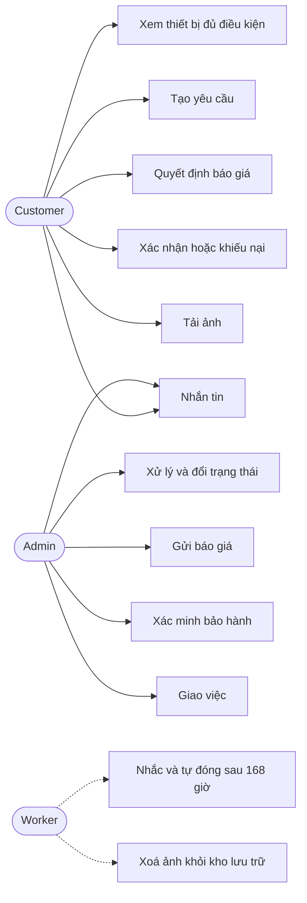
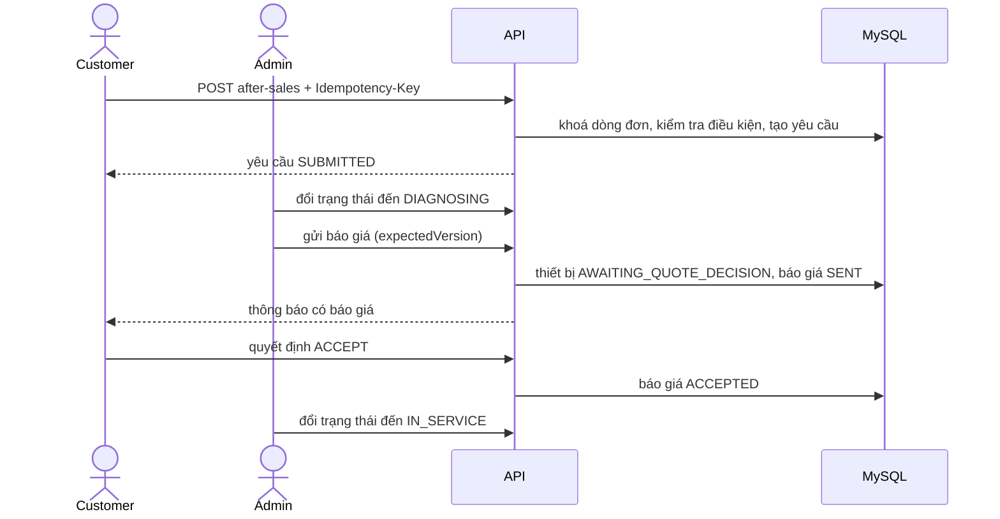
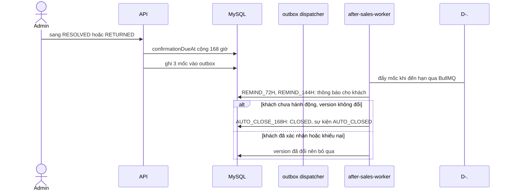
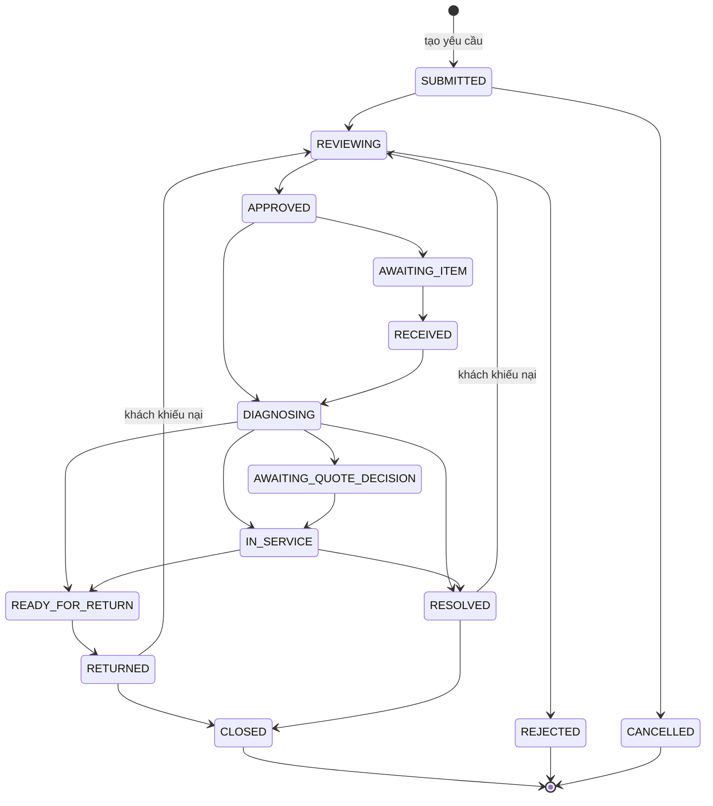

# Hậu mãi: bảo hành và hỗ trợ kỹ thuật (After-sales)

Tài liệu này trả lời: khách yêu cầu bảo hành hoặc hỗ trợ kỹ thuật cho thiết bị đã mua như thế nào, thiết bị đi qua những trạng thái nào, và những việc có hạn (báo giá, xác nhận hoàn tất, ảnh đính kèm) được vận hành ra sao.

> Đối chiếu code: main @ d3d4cb7 (2026-11-04)

## Tổng quan và phạm vi

Bài toán: sau khi đơn hoàn tất, khách có thể mở một yêu cầu hậu mãi cho một hoặc nhiều thiết bị (mỗi thiết bị là một dòng `OrderDetail`). Mỗi thiết bị có vòng đời riêng; yêu cầu (`ServiceRequest`) chỉ là bản tổng hợp trạng thái của các thiết bị. Có hai loại: `WARRANTY` (bảo hành, có xác minh phạm vi bảo hành) và `TECHNICAL_SUPPORT` (hỗ trợ kỹ thuật, có thể có báo giá).

Trong phạm vi: điều kiện đủ để mở yêu cầu, bảng chuyển trạng thái, báo giá, xác minh bảo hành, xác nhận hoàn tất và tự đóng, ảnh đính kèm, hội thoại, thông báo, giao việc.

Ngoài phạm vi: cách mốc bảo hành được đặt khi đơn hoàn tất (xem CHK-17 trong [checkout-and-payment.md](checkout-and-payment.md)); cơ chế gửi thông báo tới kênh khác ([background-jobs.md](../02-architecture/background-jobs.md)); tính năng khách hàng nói chung ([features-and-roles.md](../01-overview/features-and-roles.md)).

## Tác nhân và quyền

| Tác nhân | Làm được gì | Điều kiện |
| --- | --- | --- |
| Customer | Xem thiết bị đủ điều kiện, tạo yêu cầu, nhắn tin, huỷ thiết bị ở giai đoạn đầu, quyết định báo giá, xác nhận hoặc khiếu nại kết quả, tải và xoá ảnh của mình | Đăng nhập; chỉ thấy yêu cầu của mình |
| Admin | Xem mọi yêu cầu, giao việc, nhắn tin và ghi chú nội bộ, đổi trạng thái thiết bị, gửi báo giá, xác minh bảo hành, xem và xoá ảnh | Role `ADMIN`, router dưới `/api/v1/admin/after-sales` |
| System | Worker `after-sales-worker` xử lý mốc nhắc và tự đóng, xoá ảnh khỏi kho lưu trữ; script đối soát ảnh | Cần `AFTER_SALES_WORKER_ENABLED`, Redis và (với ảnh) kho lưu trữ S3 |

Danh sách route, request, response nằm ở `src/docs/openapi.ts` (xem `/api-docs`), không chép lại ở đây.

## Use case

## Dữ liệu liên quan

| Model | Vai trò trong nghiệp vụ | Nhãn | Chi tiết |
| --- | --- | --- | --- |
| `ServiceRequest` | Yêu cầu: loại, trạng thái tổng hợp, người được giao, `version`, khoá idempotency `(userId, idempotencyKey)` | nguồn sự thật | [after-sales.md](../03-database/contexts/after-sales.md) |
| `ServiceRequestItem` | Một thiết bị trong yêu cầu: trạng thái riêng, `version`, `confirmationDueAt`, độ phủ bảo hành lúc tạo | nguồn sự thật | [after-sales.md](../03-database/contexts/after-sales.md) |
| `ServiceRequestEvent` | Dòng thời gian: tin nhắn, đổi trạng thái, ghi chú nội bộ (`visibility` `PUBLIC` hoặc `INTERNAL`) | nhật ký | [after-sales.md](../03-database/contexts/after-sales.md) |
| `ServiceQuote`, `ServiceQuoteLine` | Báo giá theo phiên bản cho thiết bị hỗ trợ kỹ thuật | nguồn sự thật | [after-sales.md](../03-database/contexts/after-sales.md) |
| `WarrantyVerification` | Kết luận của admin về phạm vi bảo hành của một dòng đơn | nguồn sự thật | [after-sales.md](../03-database/contexts/after-sales.md) |
| `ServiceRequestAttachment` | Ảnh đính kèm (`PENDING`, `READY`, `DELETING`), khoá `uploadKey` và `uploadHash` | nguồn sự thật | [after-sales.md](../03-database/contexts/after-sales.md) |
| `OrderDetail` | Nguồn của thiết bị: số lượng và ảnh chụp bảo hành lúc đặt | dữ liệu dùng chung | [shopping-orders.md](../03-database/contexts/shopping-orders.md) |
| `OutboxEvent`, `Notification` | Việc nền (mốc nhắc, xoá ảnh) và thông báo cho khách và admin | hạ tầng | [messaging-ops.md](../03-database/contexts/messaging-ops.md) |

## Quy tắc nghiệp vụ

| Mã | Quy tắc | Điều kiện và hệ quả | Mã lỗi |
| --- | --- | --- | --- |
| ASV-01 | Chỉ thiết bị của đơn đã hoàn tất và đã thanh toán mới đủ điều kiện | Danh sách thiết bị lấy từ các dòng đơn của chính khách có đơn `COMPLETED` và `PAYMENT_SUCCESS`. `availableCount = quantity - activeCount`, với `activeCount` là số thiết bị chưa ở trạng thái cuối (`CLOSED`, `REJECTED`, `CANCELLED`) | — |
| ASV-02 | Phạm vi bảo hành do `effectiveCoverage` phân loại | Có `WarrantyVerification` mới nhất thì dùng nó (`IN_WARRANTY` mà quá `warrantyEndAt` thì thành `OUT_OF_WARRANTY`; `UNVERIFIABLE` thành `REQUIRES_VERIFICATION`). Nếu không, dùng ảnh chụp lúc đặt: nguồn chính sách là backfill hoặc không có thì `REQUIRES_VERIFICATION`; số tháng 0 là `NO_WARRANTY`; thiếu mốc là `REQUIRES_VERIFICATION`; còn lại so với `endAt` | — |
| ASV-03 | Loại yêu cầu được phép theo phạm vi | Còn thiết bị khả dụng và phạm vi `IN_WARRANTY` hoặc `REQUIRES_VERIFICATION` thì được cả `WARRANTY` và `TECHNICAL_SUPPORT`; ngược lại chỉ `TECHNICAL_SUPPORT`; hết thiết bị khả dụng thì không loại nào | `ACTIVE_DEVICE_LIMIT_REACHED`, `WARRANTY_EXPIRED` |
| ASV-04 | Giới hạn nội dung yêu cầu | 1 đến 50 thiết bị; `subject` tối đa 200 ký tự; mỗi thiết bị có `deviceLabel`, `issueDescription` (tối đa 5000 ký tự) và `serialNumber` tuỳ chọn; serial trong cùng yêu cầu không trùng nhau (không phân biệt hoa thường) | `VALIDATION_ERROR` |
| ASV-05 | Tạo yêu cầu là idempotent | Bắt buộc header `Idempotency-Key`. Khoá lưu cùng `requestHash` của toàn bộ nội dung; gửi lại cùng nội dung trả yêu cầu cũ (`created: false`), khác nội dung bị từ chối; hai yêu cầu cùng khoá chạy đua thì bên thua trả bản của bên thắng | `IDEMPOTENCY_KEY_REUSED` |
| ASV-06 | Mỗi thiết bị phải thuộc đơn đủ điều kiện của chính khách | Các dòng đơn được khoá theo `id` tăng dần; dòng không tồn tại, của người khác, hoặc đơn chưa `COMPLETED` và `PAYMENT_SUCCESS` đều bị từ chối | `ORDER_DETAIL_NOT_ELIGIBLE` |
| ASV-07 | Yêu cầu bảo hành chỉ khi còn bảo hành hoặc cần xác minh | Loại `WARRANTY` yêu cầu phạm vi `IN_WARRANTY` hoặc `REQUIRES_VERIFICATION`; hết hạn thì báo hết bảo hành, không bảo hành thì báo không có bảo hành | `WARRANTY_EXPIRED`, `WARRANTY_NOT_AVAILABLE` |
| ASV-08 | Không mở vượt số lượng đã mua và không trùng serial | Số thiết bị đang xử lý của dòng đơn cộng số thiết bị mới không vượt `quantity`; serial chuẩn hoá (cắt khoảng trắng, chữ thường) không trùng thiết bị đang xử lý khác của cùng dòng đơn | `ACTIVE_DEVICE_LIMIT_REACHED`, `DUPLICATE_ACTIVE_SERIAL` |
| ASV-09 | Yêu cầu tiếp nối chỉ trỏ tới yêu cầu đã đóng của chính khách | `previousRequestId` phải là yêu cầu `CLOSED` của cùng người dùng | `SERVICE_REQUEST_PREVIOUS_INVALID` |
| ASV-10 | Thiết bị chỉ đổi trạng thái theo bảng chuyển hợp lệ | Bảng ở mục *Vòng đời trạng thái* (hằng `commonTransitions`); mọi chuyển ngoài bảng bị từ chối | `INVALID_SERVICE_TRANSITION` |
| ASV-11 | Ngoại lệ theo loại yêu cầu | `WARRANTY`: không đi `APPROVED` sang `DIAGNOSING`, không có `AWAITING_QUOTE_DECISION`. `TECHNICAL_SUPPORT`: không có `AWAITING_ITEM`; từ `AWAITING_QUOTE_DECISION` chỉ sang `IN_SERVICE` khi báo giá mới nhất đã `ACCEPTED` | `INVALID_SERVICE_TRANSITION` |
| ASV-12 | Huỷ chỉ ở giai đoạn đầu | Sang `CANCELLED` chỉ từ `SUBMITTED`, `REVIEWING`, `APPROVED`, `AWAITING_ITEM`; khách tự huỷ thiết bị của mình hoặc admin huỷ; đóng với lý do `CUSTOMER_CANCELLED` khi khách huỷ | `INVALID_SERVICE_TRANSITION`, `SERVICE_REQUEST_NOT_FOUND` |
| ASV-13 | Trạng thái yêu cầu là tổng hợp, không đặt tay | Tính lại sau mỗi thay đổi thiết bị: mọi thiết bị ở trạng thái cuối thì `CLOSED`; một số ở cuối thì `PARTIALLY_COMPLETED`; tất cả `SUBMITTED` thì `SUBMITTED`; chỉ `SUBMITTED` hoặc `REVIEWING` (có ít nhất một `REVIEWING`) thì `REVIEWING`; tất cả đang chờ khách (`AWAITING_QUOTE_DECISION`, `RETURNED`, `RESOLVED`) thì `AWAITING_CUSTOMER`; còn lại `IN_PROGRESS`. Yêu cầu không có thiết bị là lỗi | `EMPTY_SERVICE_REQUEST` |
| ASV-14 | Khoá lạc quan `version` | Đổi trạng thái, gửi báo giá, xác minh bảo hành phải gửi `expectedVersion` của thiết bị; giao việc gửi `expectedVersion` của yêu cầu. Lệch thì từ chối và người dùng tải lại | `SERVICE_ITEM_VERSION_CONFLICT`, `SERVICE_REQUEST_VERSION_CONFLICT` |
| ASV-15 | Admin phải nêu lý do ở một số chuyển trạng thái | Sang `REJECTED` cần `note`; sang `RESOLVED` hoặc `READY_FOR_RETURN` cần `resolution`; đóng hành chính (`ADMINISTRATIVE`) cần `note` | `SERVICE_REJECTION_REASON_REQUIRED`, `SERVICE_RESOLUTION_REQUIRED`, `SERVICE_CLOSE_REASON_REQUIRED` |
| ASV-16 | Hoàn tất thì mở hạn 168 giờ cho khách | Khi thiết bị sang `RESOLVED` hoặc `RETURNED`: đặt `confirmationDueAt` sau 168 giờ và ghi vào outbox ba mốc `REMIND_72H`, `REMIND_144H`, `AUTO_CLOSE_168H` (khoá `dedupeKey` theo thiết bị, `version` và mốc) cho worker xử lý | — |
| ASV-17 | Khách xác nhận hoặc khiếu nại kết quả | `confirm` chuyển `RETURNED` hoặc `RESOLVED` sang `CLOSED` (lý do `CUSTOMER_CONFIRMED`). `dispute-completion` với lý do `DEVICE_NOT_RECEIVED` hoặc `ISSUE_PERSISTS` cùng ghi chú chuyển về `REVIEWING` và xoá hạn. Chỉ làm được trên thiết bị của mình | `INVALID_SERVICE_TRANSITION`, `SERVICE_REQUEST_NOT_FOUND` |
| ASV-18 | Đóng không có khách chỉ sau khi quá hạn | Đóng kiểu `TIMEOUT` hoặc `ADMINISTRATIVE` chỉ khi đang `RETURNED` hoặc `RESOLVED` và đã tới `confirmationDueAt`. Worker mốc `AUTO_CLOSE_168H` đóng thiết bị nếu `version` còn khớp mốc (khách đã hành động thì `version` đổi nên bỏ qua), ghi sự kiện `AUTO_CLOSED` và thông báo; mốc nhắc gửi thông báo "còn 4 ngày" và "còn 1 ngày" | `INVALID_SERVICE_TRANSITION` |
| ASV-19 | Báo giá chỉ cho hỗ trợ kỹ thuật và theo phiên bản | Gửi báo giá khi thiết bị `DIAGNOSING` hoặc `AWAITING_QUOTE_DECISION`, chuyển thiết bị sang `AWAITING_QUOTE_DECISION`. Số phiên bản tăng dần; báo giá `SENT` cũ thành `SUPERSEDED`; 1 đến 50 dòng, tổng không vượt `MAX_DB_INT`; hạn hiệu lực 1 đến 30 ngày (mặc định 7). Thiết bị bảo hành không có báo giá | `SERVICE_REQUEST_TYPE_MISMATCH`, `INVALID_SERVICE_TRANSITION` |
| ASV-20 | Khách quyết định báo giá | Chỉ chủ yêu cầu, báo giá phải `SENT` và thiết bị đang `AWAITING_QUOTE_DECISION`. Báo giá quá `validUntil` thì thành `EXPIRED` và từ chối. Lặp lại đúng quyết định đã chọn thì trả kết quả hiện tại; quyết định trái với trạng thái đã chốt thì xung đột | `QUOTE_NOT_FOUND`, `QUOTE_EXPIRED`, `QUOTE_VERSION_CONFLICT`, `INVALID_SERVICE_TRANSITION` |
| ASV-21 | Admin xác minh phạm vi bảo hành | Chỉ cho thiết bị loại `WARRANTY`. Quyết định `IN_WARRANTY` hoặc `OUT_OF_WARRANTY` bắt buộc có ngày bắt đầu và kết thúc (bắt đầu không sau kết thúc); `NO_WARRANTY` và `UNVERIFIABLE` không được có ngày. Ghi một dòng `WarrantyVerification` mới (dòng mới nhất quyết định, theo ASV-02) | `SERVICE_REQUEST_TYPE_MISMATCH`, `SERVICE_ITEM_VERSION_CONFLICT` |
| ASV-22 | Ảnh đính kèm có giới hạn và được xử lý | Mỗi lần tối đa 3 ảnh, mỗi ảnh tối đa 3 MB, chuyển về WebP cạnh dài tối đa 1600 px; tối đa 15 ảnh đang hoạt động trên một thiết bị. Cần header `Upload-Key` (hoặc `Idempotency-Key`) dạng `A-Z a-z 0-9 _ -` dài 1 đến 64. Không tải được khi thiết bị hoặc yêu cầu đã ở trạng thái cuối; chưa cấu hình kho lưu trữ thì từ chối. Ảnh riêng tư: trả URL ký có hạn 900 giây cho chủ yêu cầu và admin | `UPLOAD_KEY_INVALID`, `ATTACHMENT_LIMIT_REACHED`, `ATTACHMENT_STORAGE_UNAVAILABLE`, `INVALID_SERVICE_TRANSITION` |
| ASV-23 | Tải ảnh là idempotent theo `Upload-Key` | Dòng ảnh ghi `PENDING` trong transaction, đẩy lên kho lưu trữ rồi mới chuyển `READY`. Cùng khoá cùng nội dung (so bằng `uploadHash`) thì trả lại bộ ảnh cũ; cùng khoá khác nội dung hoặc đã bị gỡ thì xung đột. Đẩy lên kho thất bại thì xoá các object đã tải và báo lỗi | `ATTACHMENT_IDEMPOTENCY_CONFLICT`, `ATTACHMENT_STORAGE_UNAVAILABLE` |
| ASV-24 | Xoá ảnh là gỡ mềm rồi dọn bất đồng bộ | Cần lý do (header `Redaction-Reason`; khách không gửi thì dùng lời mặc định); ảnh chuyển `DELETING`, ghi sự kiện nội bộ và một sự kiện outbox để worker xoá object (lỗi "không có object" được coi là đã xoá). Ảnh `PENDING` quá `AFTER_SALES_ATTACHMENT_PENDING_TTL_MS` bị script đối soát chuyển sang `DELETING` rồi dọn | `ATTACHMENT_REDACTION_REASON_REQUIRED`, `ATTACHMENT_NOT_FOUND` |
| ASV-25 | Hội thoại công khai và ghi chú nội bộ | Tin nhắn công khai (khách hoặc admin) 1 đến 5000 ký tự, chỉ khi yêu cầu chưa `CLOSED` và thiết bị (nếu nêu) chưa ở trạng thái cuối. Ghi chú nội bộ chỉ admin, ẩn với khách | `MESSAGE_BODY_REQUIRED`, `MESSAGE_BODY_TOO_LONG`, `INVALID_SERVICE_TRANSITION` |
| ASV-26 | Ai nhận thông báo | Cập nhật từ admin (đổi trạng thái, báo giá, nhắc, tự đóng) gửi cho khách; việc của khách (tin nhắn, quyết định báo giá, xác nhận) gửi cho admin được giao nếu có; ghi chú nội bộ không gửi cho ai. Mỗi thông báo có `dedupeKey` để không gửi trùng | — |
| ASV-27 | Giao việc cho admin | Giao cho một người dùng có role `ADMIN` hoặc bỏ giao (`null`); không giao được yêu cầu đã `CLOSED`; theo `version` của yêu cầu; ghi sự kiện nội bộ | `INVALID_AFTER_SALES_ASSIGNEE`, `SERVICE_REQUEST_VERSION_CONFLICT`, `SERVICE_REQUEST_NOT_FOUND` |

> **Lưu ý:** `expireDueQuotes` trong `after-sales-maintenance.ts` (đổi báo giá `SENT` quá hạn sang `EXPIRED`) có test nhưng không có nơi nào gọi nó trong `src/` (worker chỉ xử lý mốc và xoá ảnh). Vì vậy báo giá chỉ chuyển `EXPIRED` khi chính khách thử quyết định (ASV-20); ở trạng thái lưu trữ nó vẫn là `SENT`, nhưng `effectiveQuoteStatus` suy ra `EXPIRED` khi hiển thị.
>
> **Lưu ý:** biến `AFTER_SALES_IMAGE_URL_TTL_SECONDS` (mặc định 900) được khai báo trong `src/config/env.ts` nhưng không được code nào đọc; thời hạn URL ký thực tế là hằng 900 giây trong `after-sales.attachments.ts`. Đổi biến này không có tác dụng.

## Luồng chính

Tạo yêu cầu, báo giá rồi khách chấp nhận:

Hoàn tất, nhắc và tự đóng sau 168 giờ:

## Luồng lỗi và ngoại lệ

| Tình huống | Hệ quả |
| --- | --- |
| Hai người cùng đổi một thiết bị | Người sau nhận `SERVICE_ITEM_VERSION_CONFLICT`, tải lại rồi làm lại |
| Báo giá quá hạn khi khách bấm quyết định | Báo giá thành `EXPIRED`, khách nhận `QUOTE_EXPIRED`; admin gửi báo giá mới (phiên bản kế tiếp) |
| Khách khiếu nại sau khi hoàn tất | Thiết bị về `REVIEWING`, xoá hạn 168 giờ; các mốc cũ bị bỏ qua vì `version` đã đổi |
| Tải ảnh trùng `Upload-Key` cùng nội dung | Trả lại bộ ảnh đã tải, không tạo thêm |
| Tải ảnh trùng `Upload-Key` khác nội dung | `ATTACHMENT_IDEMPOTENCY_CONFLICT` |
| Kho lưu trữ lỗi giữa chừng | Object đã tải bị xoá, `ATTACHMENT_STORAGE_UNAVAILABLE`; dòng `PENDING` còn lại do script đối soát dọn |
| Gửi lại cùng `Idempotency-Key` khi tạo yêu cầu | Trả yêu cầu cũ (`created: false`) |
| Mở quá số lượng đã mua | `ACTIVE_DEVICE_LIMIT_REACHED` |
| Worker tắt | Mốc không được đẩy; thiết bị không tự đóng cho đến khi worker chạy lại và nhận các sự kiện đã đến hạn |

## Vòng đời trạng thái

Thiết bị (`ServiceRequestItem.status`):

Sơ đồ chỉ vẽ cạnh chính; bảng đầy đủ nằm dưới đây và được script đối chiếu với hằng trong code. Hàm `canTransition` còn loại bỏ một số cạnh trong bảng theo loại yêu cầu và theo ngữ cảnh (ASV-11, ASV-12, ASV-18).

<!-- transitions: src/modules/after-sales/after-sales.status.ts#commonTransitions -->
| Từ | Sang (hợp lệ) |
| --- | --- |
| `SUBMITTED` | `REVIEWING`, `CANCELLED` |
| `REVIEWING` | `APPROVED`, `REJECTED`, `CANCELLED` |
| `APPROVED` | `AWAITING_ITEM`, `DIAGNOSING`, `CANCELLED` |
| `AWAITING_ITEM` | `RECEIVED`, `CANCELLED` |
| `RECEIVED` | `DIAGNOSING` |
| `DIAGNOSING` | `IN_SERVICE`, `RESOLVED`, `READY_FOR_RETURN` |
| `AWAITING_QUOTE_DECISION` | `DIAGNOSING`, `IN_SERVICE`, `AWAITING_ITEM` |
| `IN_SERVICE` | `RESOLVED`, `READY_FOR_RETURN` |
| `READY_FOR_RETURN` | `RETURNED` |
| `RETURNED` | `CLOSED`, `REVIEWING` |
| `RESOLVED` | `CLOSED`, `REVIEWING` |
| `CLOSED` | — |
| `REJECTED` | — |
| `CANCELLED` | — |

Các ngoại lệ đã đối chiếu bằng cách đọc `canTransition`:

- `WARRANTY`: bỏ cạnh `APPROVED` sang `DIAGNOSING` và `DIAGNOSING` sang `AWAITING_QUOTE_DECISION` (bảo hành không có báo giá).
- `TECHNICAL_SUPPORT`: bỏ mọi cạnh sang `AWAITING_ITEM`; từ `AWAITING_QUOTE_DECISION` sang `IN_SERVICE` cần báo giá mới nhất `ACCEPTED`.
- Sang `CANCELLED` chỉ từ `SUBMITTED`, `REVIEWING`, `APPROVED`, `AWAITING_ITEM`.
- Sang `CLOSED` luôn cần một `closeMode`: khách xác nhận, hoặc `TIMEOUT` và `ADMINISTRATIVE` chỉ sau `confirmationDueAt`.
- Cạnh `AWAITING_QUOTE_DECISION` sang `AWAITING_ITEM` có trong bảng nhưng không dùng được: `WARRANTY` không có trạng thái nguồn đó và `TECHNICAL_SUPPORT` bị loại cạnh sang `AWAITING_ITEM`.

Báo giá (`ServiceQuote.status`): `SENT` đi tới `ACCEPTED`, `DECLINED`, `EXPIRED` hoặc `SUPERSEDED`; các trạng thái sau không đi tiếp (xem `sendQuote`, `decideQuote`). Ảnh: `PENDING` sang `READY` (tải xong) hoặc `DELETING` (gỡ).

## Vận hành

- Biến môi trường (chỉ tên): `AFTER_SALES_WORKER_ENABLED`, `AFTER_SALES_QUEUE_PREFIX`, `AFTER_SALES_IMAGES_ENABLED`, `AFTER_SALES_IMAGE_S3_ENDPOINT`, `AFTER_SALES_IMAGE_S3_REGION`, `AFTER_SALES_IMAGE_S3_BUCKET`, `AFTER_SALES_IMAGE_S3_ACCESS_KEY_ID`, `AFTER_SALES_IMAGE_S3_SECRET_ACCESS_KEY`, `AFTER_SALES_IMAGE_S3_FORCE_PATH_STYLE`, `AFTER_SALES_IMAGE_URL_TTL_SECONDS` (không có tác dụng, xem *Lưu ý*), `AFTER_SALES_ATTACHMENT_PENDING_TTL_MS`, `AFTER_SALES_ATTACHMENT_CLEANUP_BATCH_SIZE`.
- Worker: `pnpm run worker:after-sales` (`src/workers/after-sales-worker.ts`) nhận việc từ hàng đợi BullMQ do `outbox-dispatcher` đẩy vào; xử lý mốc nhắc và tự đóng, và xoá object ảnh. Cần Redis. Tham chiếu: [background-jobs.md](../02-architecture/background-jobs.md).
- Script: `pnpm run after-sales:reconcile-attachments` chuyển ảnh `PENDING` quá hạn sang `DELETING` và dọn tối đa `AFTER_SALES_ATTACHMENT_CLEANUP_BATCH_SIZE` ảnh mỗi lần; in số ảnh đã xoá, số ảnh bị đánh dấu và số lỗi.
- Khi ảnh còn `DELETING` lâu: kiểm tra worker và kho lưu trữ, rồi chạy lại script đối soát.
- Khi kho lưu trữ chưa bật (`AFTER_SALES_IMAGES_ENABLED` tắt): các route ảnh không được gắn và worker bỏ qua việc xoá ảnh; các phần còn lại của hậu mãi vẫn chạy.

## Truy vết

| Mã | Hàm thực thi | Test bao phủ |
| --- | --- | --- |
| ASV-01 | `src/modules/after-sales/after-sales.repository.ts#listEligibleDeviceRows`; `src/modules/after-sales/after-sales.mapper.ts#toEligibleDeviceDto` | `tests/modules/after-sales/after-sales.service.test.ts`; `tests/modules/after-sales/after-sales.routes.test.ts` (gián tiếp) |
| ASV-02 | `src/modules/after-sales/after-sales.eligibility.ts#effectiveCoverage` | `tests/modules/after-sales/after-sales.eligibility.test.ts` |
| ASV-03 | `src/modules/after-sales/after-sales.eligibility.ts#allowedRequestTypesForCoverage` | `tests/modules/after-sales/after-sales.eligibility.test.ts` (gián tiếp) |
| ASV-04 | `src/modules/after-sales/after-sales.schema.ts#createServiceRequestBody` | `tests/modules/after-sales/after-sales.routes.test.ts` (gián tiếp) |
| ASV-05 | `src/modules/after-sales/after-sales.service.ts#createServiceRequest` | `tests/modules/after-sales/after-sales.service.test.ts` |
| ASV-06 | `src/modules/after-sales/after-sales.service.ts#createServiceRequest` | `tests/modules/after-sales/after-sales.service.test.ts` |
| ASV-07 | `src/modules/after-sales/after-sales.service.ts#createServiceRequest` | `tests/modules/after-sales/after-sales.service.test.ts` |
| ASV-08 | `src/modules/after-sales/after-sales.service.ts#createServiceRequest` | `tests/modules/after-sales/after-sales.service.test.ts` |
| ASV-09 | `src/modules/after-sales/after-sales.service.ts#createServiceRequest` | `tests/modules/after-sales/after-sales.service.test.ts` |
| ASV-10 | `src/modules/after-sales/after-sales.status.ts#canTransition`; `src/modules/after-sales/after-sales.status.ts#assertTransition` | `tests/modules/after-sales/after-sales.status.test.ts` |
| ASV-11 | `src/modules/after-sales/after-sales.status.ts#canTransition` | `tests/modules/after-sales/after-sales.status.test.ts` |
| ASV-12 | `src/modules/after-sales/after-sales.actions.ts#cancelMyItem` | `tests/modules/after-sales/after-sales.actions.test.ts` |
| ASV-13 | `src/modules/after-sales/after-sales.aggregate.ts#deriveRequestStatus` | `tests/modules/after-sales/after-sales.aggregate.test.ts` |
| ASV-14 | `src/modules/after-sales/after-sales.actions.ts#transitionItem` | `tests/modules/after-sales/after-sales.actions.test.ts` |
| ASV-15 | `src/modules/after-sales/after-sales.actions.ts#transitionItem` | `tests/modules/after-sales/after-sales.actions.test.ts` |
| ASV-16 | `src/modules/after-sales/after-sales-maintenance.ts#scheduleConfirmationMilestones` | `tests/modules/after-sales/after-sales-maintenance.test.ts` |
| ASV-17 | `src/modules/after-sales/after-sales.actions.ts#confirmMyItem`; `src/modules/after-sales/after-sales.actions.ts#disputeMyItem` | chưa có test |
| ASV-18 | `src/modules/after-sales/after-sales-maintenance.ts#processAfterSalesMilestone` | `tests/modules/after-sales/after-sales-maintenance.test.ts` |
| ASV-19 | `src/modules/after-sales/after-sales.quotes.ts#sendQuote` | `tests/modules/after-sales/after-sales.quotes.test.ts` |
| ASV-20 | `src/modules/after-sales/after-sales.quotes.ts#decideQuote` | `tests/modules/after-sales/after-sales.quotes.test.ts` |
| ASV-21 | `src/modules/after-sales/after-sales.warranty-verifications.ts#createWarrantyVerification` | `tests/modules/after-sales/after-sales.warranty-verifications.test.ts` |
| ASV-22 | `src/modules/after-sales/after-sales.attachments.ts#addServiceAttachments` | `tests/modules/after-sales/after-sales.attachments.test.ts` |
| ASV-23 | `src/modules/after-sales/after-sales.attachments.ts#addServiceAttachments` | `tests/modules/after-sales/after-sales.attachments.test.ts` |
| ASV-24 | `src/modules/after-sales/after-sales.attachments.ts#redactServiceAttachment`; `src/modules/after-sales/after-sales-attachment-cleanup.ts#cleanupServiceAttachment`; `src/modules/after-sales/after-sales-attachment-cleanup.ts#reconcileAfterSalesAttachments` | `tests/modules/after-sales/after-sales-attachment-cleanup.test.ts` |
| ASV-25 | `src/modules/after-sales/after-sales.events.ts#addPublicMessage`; `src/modules/after-sales/after-sales.events.ts#addInternalNote` | `tests/modules/after-sales/after-sales.events.test.ts` |
| ASV-26 | `src/modules/after-sales/after-sales.notifications.ts#recipientsFor` | `tests/modules/after-sales/after-sales.notifications.test.ts` |
| ASV-27 | `src/modules/after-sales/after-sales.service.ts#assignServiceRequest` | `tests/modules/after-sales/after-sales.routes.test.ts` (gián tiếp) |

## Nguồn

- [after-sales.service.ts](../../src/modules/after-sales/after-sales.service.ts): `createServiceRequest`, `assignServiceRequest`
- [after-sales.schema.ts](../../src/modules/after-sales/after-sales.schema.ts): `createServiceRequestBody`, `transitionItemBody`, `warrantyVerificationBody`, `sendQuoteBody`
- [after-sales.types.ts](../../src/modules/after-sales/after-sales.types.ts): `SERVICE_REQUEST_ITEM_STATUSES`, `TERMINAL_ITEM_STATUSES`
- [after-sales.status.ts](../../src/modules/after-sales/after-sales.status.ts): `commonTransitions`, `canTransition`, `assertTransition`
- [after-sales.aggregate.ts](../../src/modules/after-sales/after-sales.aggregate.ts): `deriveRequestStatus`
- [after-sales.eligibility.ts](../../src/modules/after-sales/after-sales.eligibility.ts): `effectiveCoverage`, `allowedRequestTypesForCoverage`
- [after-sales.repository.ts](../../src/modules/after-sales/after-sales.repository.ts): `listEligibleDeviceRows`, `lockOrderDetails`
- [after-sales.mapper.ts](../../src/modules/after-sales/after-sales.mapper.ts): `toEligibleDeviceDto`
- [after-sales.actions.ts](../../src/modules/after-sales/after-sales.actions.ts): `transitionItem`, `cancelMyItem`, `confirmMyItem`, `disputeMyItem`
- [after-sales.quotes.ts](../../src/modules/after-sales/after-sales.quotes.ts): `sendQuote`, `decideQuote`, `effectiveQuoteStatus`
- [after-sales.warranty-verifications.ts](../../src/modules/after-sales/after-sales.warranty-verifications.ts): `createWarrantyVerification`
- [after-sales.attachments.ts](../../src/modules/after-sales/after-sales.attachments.ts): `addServiceAttachments`, `listServiceAttachments`, `redactServiceAttachment`
- [after-sales-attachments.routes.ts](../../src/modules/after-sales/after-sales-attachments.routes.ts): `createAfterSalesAttachmentRoutes`
- [after-sales-attachment-cleanup.ts](../../src/modules/after-sales/after-sales-attachment-cleanup.ts): `cleanupServiceAttachment`, `reconcileAfterSalesAttachments`
- [after-sales-maintenance.ts](../../src/modules/after-sales/after-sales-maintenance.ts): `scheduleConfirmationMilestones`, `processAfterSalesMilestone`, `expireDueQuotes`
- [after-sales.events.ts](../../src/modules/after-sales/after-sales.events.ts): `addPublicMessage`, `addInternalNote`
- [after-sales.notifications.ts](../../src/modules/after-sales/after-sales.notifications.ts): `recipientsFor`, `createAfterSalesNotification`
- [after-sales-worker.ts](../../src/workers/after-sales-worker.ts): `processAfterSalesJob`
- [reconcile-after-sales-attachments.ts](../../src/scripts/reconcile-after-sales-attachments.ts): script đối soát ảnh
