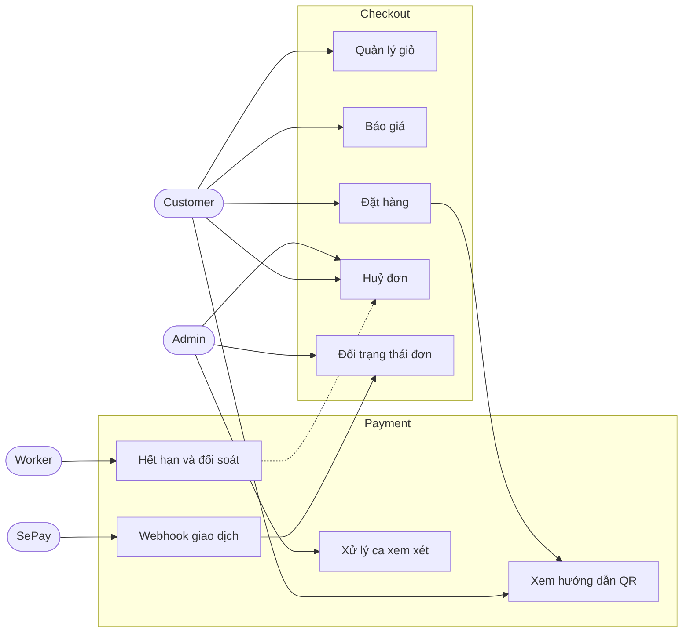
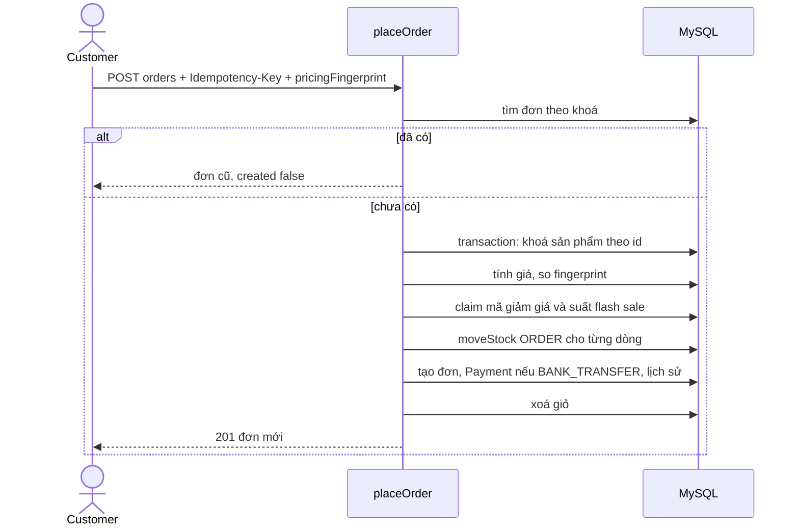
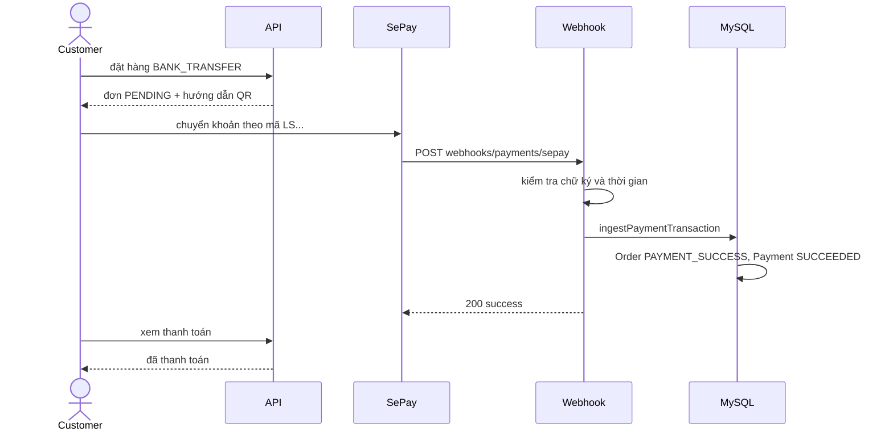
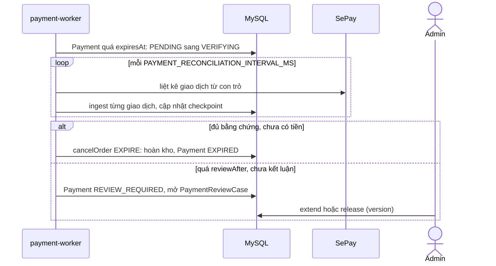
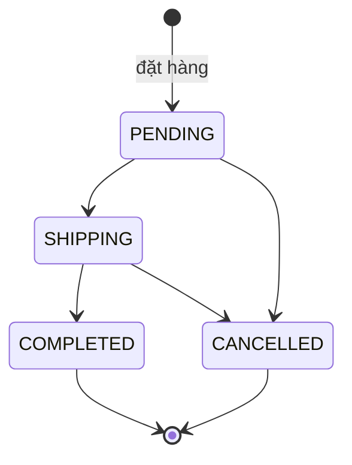
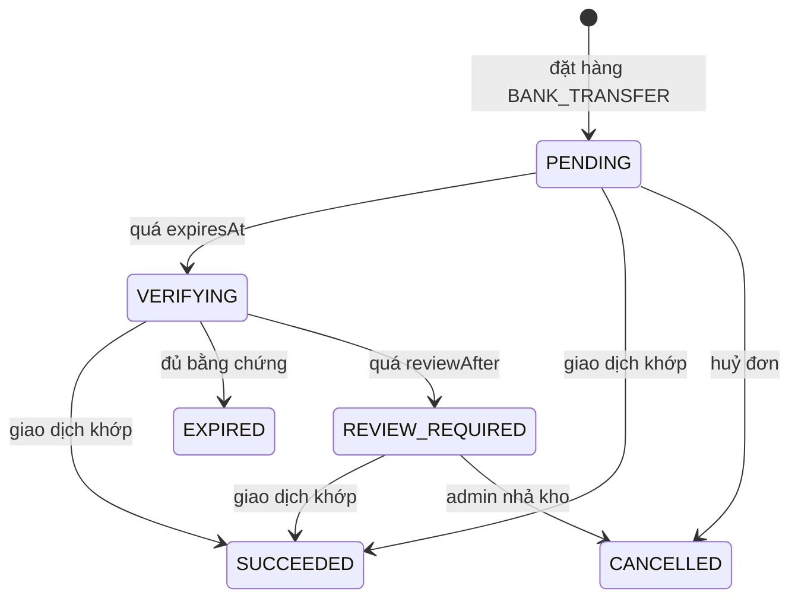

# Giỏ hàng, đặt hàng và thanh toán (Checkout & Payment)

Tài liệu này trả lời: từ lúc khách bỏ hàng vào giỏ đến lúc đơn được giao hoặc bị huỷ, hệ thống áp những quy tắc nào, và thanh toán chuyển khoản QR được xác nhận, hết hạn hay chuyển cho con người xem xét ra sao.

> Đối chiếu code: main @ d3d4cb7 (2026-11-04)

## Tổng quan và phạm vi

Bài toán: biến giỏ hàng thành đơn hàng đúng một lần dù client gửi lại, tính tiền hoàn toàn ở server, trừ kho nhất quán, và với chuyển khoản thì chỉ coi đơn đã trả khi có giao dịch khớp từ nhà cung cấp (SePay) mà không bao giờ nhả kho hoặc huỷ đơn khi chưa có đủ bằng chứng.

Trong phạm vi: giỏ hàng (`CHK-01` đến `CHK-05`), báo giá và đặt hàng (`CHK-06` đến `CHK-14`), vòng đời và huỷ đơn (`CHK-15` đến `CHK-20`), thanh toán chuyển khoản, webhook, đối soát và ca xem xét (`PAY-01` đến `PAY-20`).

Ngoài phạm vi: cách tính giá, mã giảm giá và flash sale ([promotions-and-flash-sale.md](promotions-and-flash-sale.md)); chi tiết ghi sổ kho ([inventory.md](inventory.md)); bảo hành sau khi hoàn tất ([after-sales.md](after-sales.md)).

Quyết định kiến trúc liên quan: [ADR-0005 Idempotency](../02-architecture/decisions/0005-idempotency.md), [ADR-0006 Sổ kho](../02-architecture/decisions/0006-stock-ledger.md), [ADR-0007 Pricing pipeline](../02-architecture/decisions/0007-pricing-pipeline.md).

## Tác nhân và quyền

| Tác nhân | Làm được gì | Điều kiện |
| --- | --- | --- |
| Customer | Quản lý giỏ, báo giá, đặt hàng, xem đơn và thanh toán của mình, huỷ đơn `PENDING` của mình | Đăng nhập; mọi truy vấn giỏ và đơn lọc theo `req.auth.id` |
| Admin | Xem và xuất CSV đơn, đổi trạng thái đơn, xem và xử lý sự kiện thanh toán, kéo dài giữ hoặc nhả tồn kho ở ca xem xét | Role `ADMIN`, router dưới `/api/v1/admin` |
| Nhà cung cấp thanh toán (SePay) | Gọi webhook báo giao dịch | Chữ ký HMAC hợp lệ, không cần đăng nhập |
| System | Worker `payment-worker` chuyển trạng thái thanh toán, đối soát, xoá payload cũ | Chạy cùng cấu hình môi trường của API |

Danh sách route, request, response nằm ở `src/docs/openapi.ts` (xem `/api-docs`), không chép lại ở đây.

## Use case

## Dữ liệu liên quan

| Model | Vai trò trong nghiệp vụ | Nhãn | Chi tiết |
| --- | --- | --- | --- |
| `Cart`, `CartDetail` | Giỏ của từng khách, xoá khi đặt hàng | dữ liệu tạm | [shopping-orders.md](../03-database/contexts/shopping-orders.md) |
| `Order`, `OrderDetail`, `OrderStatusHistory` | Đơn, ảnh chụp giá và bảo hành tại lúc đặt, lịch sử trạng thái; khoá idempotency `(userId, idempotencyKey)` và `requestHash` | nguồn sự thật | [shopping-orders.md](../03-database/contexts/shopping-orders.md) |
| `Payment` | Một giao dịch chuyển khoản của một đơn: mã chuyển khoản, số tiền, mốc `expiresAt`, `cancelAfter`, `reviewAfter` | nguồn sự thật | [payments.md](../03-database/contexts/payments.md) |
| `PaymentWebhookEvent` | Mỗi giao dịch nhận từ webhook hoặc đối soát, có payload mã hoá | nhật ký kiểm toán | [payments.md](../03-database/contexts/payments.md) |
| `PaymentProviderCheckpoint` | Con trỏ, lease và bằng chứng đối soát theo `(provider, mode)` | trạng thái vận hành | [payments.md](../03-database/contexts/payments.md) |
| `PaymentReviewCase`, `PaymentReviewAction` | Ca xem xét khi đối soát không kết luận được, và hành động của admin | nguồn sự thật | [payments.md](../03-database/contexts/payments.md) |
| `StockMovement` | Trừ kho khi đặt, hoàn kho khi huỷ | sổ kho | [inventory.md](../03-database/contexts/inventory.md) |

## Quy tắc nghiệp vụ

| Mã | Quy tắc | Điều kiện và hệ quả | Mã lỗi |
| --- | --- | --- | --- |
| CHK-01 | Mỗi khách có một giỏ, và chỉ thao tác trên giỏ của mình | Giỏ được tạo khi thêm sản phẩm đầu tiên (`upsert` theo `userId`); sửa hoặc xoá dòng giỏ lọc theo giỏ của người gọi, dòng của người khác coi như không tồn tại | `NOT_FOUND` |
| CHK-02 | Số lượng trong giỏ có giới hạn và không vượt tồn | Mỗi lần thêm hoặc sửa: 1 đến 100; thêm lại cùng sản phẩm thì cộng dồn; tổng số lượng của dòng lớn hơn `Product.quantity` thì huỷ thao tác | `OUT_OF_STOCK` |
| CHK-03 | Sản phẩm ẩn không vào giỏ và không sửa được | Thêm hoặc sửa số lượng sản phẩm `isActive = false` bị từ chối; sản phẩm không tồn tại báo không tìm thấy | `PRODUCT_UNAVAILABLE`, `NOT_FOUND` |
| CHK-04 | Giỏ hiển thị giá hiện hành, không lưu giá | Mỗi lần xem giỏ tính lại giá niêm yết và khuyến mãi (chế độ `EXACT`, tính cả hạn mức của riêng khách); tổng giỏ là tạm tính, không ràng buộc đơn | — |
| CHK-05 | Xoá dòng giỏ | Xoá đúng dòng của giỏ người gọi; không xoá được thì báo không tìm thấy | `NOT_FOUND` |
| CHK-06 | Báo giá trước khi đặt | `quoteOrder` tính giá giỏ hiện tại (kèm mã giảm giá nếu có) và trả `pricingFingerprint`; giỏ rỗng thì từ chối | `CART_EMPTY` |
| CHK-07 | Đặt hàng bắt buộc `Idempotency-Key` và `pricingFingerprint` | Header 1 đến 64 ký tự, `pricingFingerprint` 64 ký tự trong body; thiếu thì bị từ chối ở route. Giỏ rỗng thì không đặt được | `CART_EMPTY`, `VALIDATION_ERROR` |
| CHK-08 | Đặt hàng idempotent | Khoá lưu cùng `requestHash` của (người nhận, địa chỉ, SĐT, phương thức, mã giảm giá, fingerprint). Gửi lại cùng nội dung trả đơn cũ (200, `created: false`); cùng khoá khác nội dung bị từ chối; hai yêu cầu cùng khoá chạy đua thì yêu cầu thua trả đơn của yêu cầu thắng | `IDEMPOTENCY_KEY_REUSED` |
| CHK-09 | Giá luôn tính phía server từ dữ liệu đã khoá | Trong một transaction: khoá hàng sản phẩm theo `id` tăng dần (`FOR UPDATE`), đọc lại giá và trạng thái, rồi mới tính; client không gửi giá. Sản phẩm ẩn thì huỷ cả đơn | `PRODUCT_UNAVAILABLE` |
| CHK-10 | Giá đổi giữa lúc báo giá và lúc đặt thì phải báo lại | Có mã giảm giá hoặc khuyến mãi mà dấu vân tay tính lại khác `pricingFingerprint` của client thì huỷ trước khi claim hạn mức, trừ kho hay ghi đơn | `PROMOTION_CHANGED` |
| CHK-11 | Phương thức thanh toán | `COD` luôn dùng được; `BANK_TRANSFER` chỉ khi `BANK_TRANSFER_ENABLED` bật. Tổng tiền sau giảm bằng 0 thì đơn là `FREE` và `paymentStatus` là `PAYMENT_SUCCESS` ngay | `PAYMENT_METHOD_UNAVAILABLE` |
| CHK-12 | Đặt hàng là một transaction | Claim mã giảm giá, claim hạn mức flash sale, trừ kho (`ORDER`, `onlyActive`), tạo đơn cùng dòng và `Payment`, ghi lịch sử và gắn `orderId` vào sổ kho; lỗi ở bước nào cũng huỷ hết. Deadlock được thử lại tối đa 3 lần. Hết hàng thì không có đơn nào | `OUT_OF_STOCK` |
| CHK-13 | Giỏ chỉ được dùng một lần | Giỏ bị xoá trong cùng transaction; nếu lúc xoá không còn dòng nào (một lần đặt khác khoá đã dùng giỏ) thì huỷ | `CART_EMPTY` |
| CHK-14 | Đơn lưu ảnh chụp tại thời điểm đặt | `OrderDetail` giữ giá, giảm giá sản phẩm, giảm giá mã, khuyến mãi áp dụng và số tháng bảo hành; đơn giữ thông tin mã giảm giá; `OrderStatusHistory` có dòng đầu `null` sang `PENDING` | — |
| CHK-15 | Vòng đời đơn chỉ đi theo bảng chuyển hợp lệ | `PENDING` sang `SHIPPING` hoặc `CANCELLED`, `SHIPPING` sang `COMPLETED` hoặc `CANCELLED`, hai trạng thái cuối không đi tiếp. Đổi trạng thái là `updateMany` có điều kiện theo trạng thái đã đọc nên hai thao tác đồng thời không cùng thành công | `INVALID_STATUS_TRANSITION` |
| CHK-16 | Đơn chuyển khoản phải trả tiền trước khi giao | Đơn `BANK_TRANSFER` chỉ sang `SHIPPING` hoặc `COMPLETED` khi `paymentStatus` là `PAYMENT_SUCCESS` | `PAYMENT_REQUIRED` |
| CHK-17 | Hoàn tất đơn đặt mốc bảo hành và ghi nhận thanh toán COD | Sang `COMPLETED`: đặt `completedAt`; đơn không phải chuyển khoản thì `paymentStatus` thành `PAYMENT_SUCCESS`; mỗi `OrderDetail` có `warrantyStartAt` là lúc hoàn tất và `warrantyEndAt` cộng số tháng (kẹp cuối tháng), số tháng 0 hoặc rỗng thì không có mốc | — |
| CHK-18 | Huỷ đơn hoàn mọi thứ đã giữ | Khách chỉ huỷ khi `PENDING`; admin huỷ được `PENDING` và `SHIPPING`. Trong một transaction: đơn sang `CANCELLED`, hoàn kho từng dòng theo `productId` tăng dần (`ORDER_CANCEL`), đảo lượt dùng mã giảm giá, nhả suất flash sale, ghi lịch sử | `INVALID_STATUS_TRANSITION` |
| CHK-19 | Đơn chuyển khoản đã trả hoặc đang xác minh thì không huỷ tay | Đã `PAYMENT_SUCCESS` thì từ chối (cần xử lý hoàn tiền ngoài hệ thống); thanh toán đang `VERIFYING` hoặc `REVIEW_REQUIRED` thì huỷ thường bị từ chối, chỉ ca xem xét hoặc hết hạn có bằng chứng mới huỷ được | `PAID_ORDER_CANNOT_CANCEL`, `PAYMENT_VERIFICATION_IN_PROGRESS` |
| CHK-20 | Tra lại kết quả một lần đặt hàng | `checkout-attempt` tìm đơn của người gọi theo `Idempotency-Key`; không có thì 404 | `CHECKOUT_ATTEMPT_NOT_FOUND` |
| PAY-01 | Chỉ đơn `BANK_TRANSFER` có tổng lớn hơn 0 mới có `Payment` | `Payment` tạo cùng transaction với đơn, `status = PENDING`, tiền `VND`, `amount` bằng tổng tiền đơn; `provider` và `providerMode` lấy từ cấu hình lúc đặt (`fake` luôn là `test`) | — |
| PAY-02 | Mã chuyển khoản duy nhất | `LS` cộng 12 ký tự chữ hoa hoặc số, dùng để khớp giao dịch với `Payment` (cột unique) | — |
| PAY-03 | Ba mốc thời gian của một khoản thanh toán | `expiresAt = lúc đặt + PAYMENT_TTL_MINUTES`; `cancelAfter = expiresAt + PAYMENT_GRACE_SECONDS`; `reviewAfter = expiresAt + PAYMENT_MAX_AUTO_HOLD_MINUTES` | — |
| PAY-04 | Chỉ chủ đơn thấy hướng dẫn thanh toán, và chỉ khi còn hạn | Không có `Payment` của đơn thuộc người gọi thì 404; hướng dẫn QR chỉ trả khi `PENDING` và chưa quá `expiresAt`, ngược lại là rỗng | `PAYMENT_NOT_FOUND` |
| PAY-05 | Webhook phải đúng chữ ký | Đọc raw body (tối đa 100kb); HMAC-SHA256 của `timestamp.body` so bằng so sánh hằng thời gian; lệch quá 300 giây hoặc sai chữ ký thì từ chối trước khi ghi gì; payload sai hình thì từ chối | `INVALID_WEBHOOK_SIGNATURE`, `INVALID_WEBHOOK_PAYLOAD` |
| PAY-06 | Chỉ nhận webhook của nhà cung cấp đang cấu hình | Tham số `:provider` phải trùng `PAYMENT_PROVIDER`; `fake` bị từ chối khi `NODE_ENV = production` | `PAYMENT_PROVIDER_NOT_FOUND` |
| PAY-07 | Ghi nhận giao dịch là idempotent | Giao dịch trùng nếu cùng `(provider, mode)` và trùng `providerEventId` hoặc `providerTransactionKey`; trùng thì trả trạng thái đã lưu (`duplicate: true`), nếu số tiền, loại tiền, chiều hoặc mã khác thì chỉ ghi cảnh báo log. Hai khoá trỏ tới hai dòng khác nhau thì từ chối; đua nhau ghi (lỗi unique) thì đọc lại dòng thắng | `PAYMENT_EVENT_IDENTITY_CONFLICT` |
| PAY-08 | Phân loại giao dịch theo thứ tự cố định | Kiểm tra lần lượt: chiều `OUT`, mã không khớp, sai tài khoản, sai số tiền hoặc loại tiền, `occurredAt` sau `expiresAt` (trễ), `Payment` không còn `PENDING`, `VERIFYING` hay `REVIEW_REQUIRED`. Vi phạm đầu tiên thành lý do cần xem xét; không vi phạm thì `MATCHED` | — |
| PAY-09 | Khớp mã nhưng sai nhà cung cấp hoặc chế độ thì chuyển xem xét | `Payment` có `(provider, mode)` khác nguồn giao dịch (ví dụ `fake` với `sepay`, hoặc `test` với `live`) thì sự kiện `REVIEW_REQUIRED` lý do `PROVIDER_MISMATCH`, không đổi trạng thái đơn | — |
| PAY-10 | Giao dịch chiều `OUT` không bao giờ trả đơn | Ghi lại để kiểm toán với trạng thái `RESOLVED`, lý do `OUTBOUND` và ghi chú tự động, không vào hàng đợi xem xét | — |
| PAY-11 | Xác nhận tiền cập nhật đơn và thanh toán cùng nhau | Giao dịch `MATCHED`: `Order.paymentStatus` sang `PAYMENT_SUCCESS` (chỉ khi đơn còn `PENDING` và `PAYMENT_UNPAID`, nếu không thì sự kiện chuyển xem xét `INVALID_PAYMENT_STATE`), `Payment` sang `SUCCEEDED` kèm `paidAt`, ca xem xét đang mở được đóng với `PAYMENT_CONFIRMED`; tất cả trong một transaction. `Payment` đổi trạng thái giữa chừng thì huỷ | `PAYMENT_CONFIRMATION_RACE` |
| PAY-12 | Quá hạn thì chuyển sang chờ xác minh, chưa nhả kho | Worker chuyển `Payment` `PENDING` quá `expiresAt` sang `VERIFYING` (chỉ với đơn còn `PENDING`); đơn và tồn kho giữ nguyên | — |
| PAY-13 | Chỉ huỷ đơn khi đối soát có đủ bằng chứng | Điều kiện: `Payment` cùng `(provider, mode)` với cấu hình hiện tại; checkpoint có `consecutiveSuccesses >= 2` và cả `previousVerifiedThroughAt` lẫn `verifiedThroughAt` không sớm hơn `cancelAfter + PAYMENT_RECONCILIATION_SETTLEMENT_SECONDS`; được đọc lại dưới `FOR UPDATE` trước khi huỷ. Đủ thì đơn thành `CANCELLED`, `Payment` thành `EXPIRED`, hoàn kho; bằng chứng đổi giữa chừng thì bỏ qua lượt này | `PAYMENT_EVIDENCE_CHANGED` |
| PAY-14 | Quá `reviewAfter` mà vẫn chưa kết luận thì mở ca xem xét | `VERIFYING` sang `REVIEW_REQUIRED` và tạo hoặc mở lại `PaymentReviewCase` (lý do `RECONCILIATION_INCONCLUSIVE`) trong cùng transaction; không đụng tồn kho, đơn vẫn `PENDING` | — |
| PAY-15 | Admin kéo dài giữ kho cần ghi chú, hạn tương lai và đúng `version` | `holdUntil` phải là thời điểm tương lai hợp lệ; `note` 1 đến 500 ký tự; ca phải `OPEN` và `version` khớp (khoá lạc quan, sau đó tăng); ghi `PaymentReviewAction` `EXTEND_HOLD` | `PAYMENT_REVIEW_HOLD_INVALID`, `PAYMENT_REVIEW_CASE_VERSION_CONFLICT` |
| PAY-16 | Admin nhả tồn kho là hành động có xác nhận | Body phải có `confirmation = RELEASE_STOCK`, `note` và đúng `version`; ca thành `RESOLVED` với `RELEASED_UNVERIFIED`, đơn bị huỷ như CHK-18 (cho phép huỷ dù thanh toán đang `VERIFYING` hoặc `REVIEW_REQUIRED`), ghi `PaymentReviewAction` `RELEASE_STOCK`; deadlock thử lại tối đa 3 lần | `PAYMENT_REVIEW_CASE_VERSION_CONFLICT` |
| PAY-17 | Admin đánh dấu đã xử lý sự kiện cần xem xét | Chỉ sự kiện `REVIEW_REQUIRED` mới chuyển `RESOLVED`; cần `note`; ghi người xử lý và thời điểm | `PAYMENT_EVENT_NOT_REVIEWABLE` |
| PAY-18 | Đối soát chạy một nơi một lúc, có lease | Worker nhận lease trên checkpoint của `(provider, mode)` (hết hạn sau `PAYMENT_RECONCILIATION_LEASE_MS`) và trong tiến trình chỉ chạy một lượt cùng lúc; duyệt các trang giao dịch rồi cho từng giao dịch đi qua cùng đường ghi nhận như webhook (PAY-07 đến PAY-11). Con trỏ không tiến thì dừng; mất lease thì dừng; thành công tăng `consecutiveSuccesses`, thất bại đưa về 0. Provider `fake` bị bỏ qua | `PAYMENT_RECONCILIATION_CURSOR_STALLED`, `PAYMENT_RECONCILIATION_LEASE_LOST` |
| PAY-19 | Payload gốc được mã hoá và chỉ giữ 90 ngày | Có `PAYMENT_EVENT_ENCRYPTION_KEY` thì payload lưu bằng AES-256-GCM cùng IV, tag và `keyId`; mỗi ngày xoá payload của sự kiện nhận quá 90 ngày, giữ lại dòng sự kiện | — |
| PAY-20 | Phương thức thanh toán được công bố theo cấu hình | Danh sách gồm `COD` luôn bật và `BANK_TRANSFER` theo `BANK_TRANSFER_ENABLED`; ở production bật chuyển khoản thì bắt buộc `PAYMENT_PROVIDER=sepay`, `SEPAY_MODE=live` và đủ biến mã hoá, SePay | — |

> **Lưu ý:** `canCompleteBankTransferOrder` trong `src/modules/payments/payment-status.ts` có test nhưng không được code nghiệp vụ nào gọi (grep trong `src/` chỉ thấy chỗ định nghĩa). Luật thực sự chặn giao đơn chưa trả là `PAYMENT_REQUIRED` trong `changeStatus` (CHK-16), nên tài liệu không coi hàm này là quy tắc.
>
> **Lưu ý:** `paymentNotPayable` (mã `PAYMENT_NOT_PAYABLE`) được định nghĩa nhưng không nơi nào dùng; không đưa vào quy tắc.
>
> **Lưu ý:** `Payment` đi thẳng từ `PENDING` sang `EXPIRED` chưa bao giờ xảy ra trong luồng thật: worker luôn đi qua `VERIFYING` (PAY-12, PAY-13), dù `cancelOrder` với `EXPIRE` cho phép trạng thái nguồn `PENDING`.

## Luồng chính

Đặt hàng COD hoặc chuyển khoản:

Chuyển khoản được xác nhận bởi webhook:

## Luồng lỗi và ngoại lệ

Hết hạn rồi đối soát, và ca xem xét:

| Tình huống | Hệ quả |
| --- | --- |
| Gửi lại cùng `Idempotency-Key`, cùng nội dung | Trả đơn cũ, không trừ kho thêm (CHK-08) |
| Cùng khoá, khác nội dung | `IDEMPOTENCY_KEY_REUSED` |
| Hết hàng lúc đặt | `OUT_OF_STOCK`, không có đơn, không trừ hạn mức |
| Khuyến mãi hoặc mã giảm giá đổi giữa báo giá và đặt | `PROMOTION_CHANGED`, client báo giá lại |
| Giao dịch trễ (sau `expiresAt`) | Sự kiện `REVIEW_REQUIRED` lý do `LATE_PAYMENT`, đơn không tự thành đã trả |
| Sai số tiền, sai tài khoản, sai mã | Sự kiện `REVIEW_REQUIRED` với `AMOUNT_MISMATCH`, `WRONG_ACCOUNT`, `UNKNOWN_CODE` |
| Tiền về khi đơn đã bị huỷ | Đơn không còn `PENDING` nên sự kiện thành `INVALID_PAYMENT_STATE`, chờ admin xử lý |
| Webhook trùng | `duplicate: true`, trả trạng thái đã lưu (PAY-07) |
| Hai thao tác đổi trạng thái đồng thời | Thao tác thua nhận `INVALID_STATUS_TRANSITION` |
| Deadlock | Thử lại cả transaction tối đa 3 lần |
| Khách huỷ đơn chuyển khoản đã trả | `PAID_ORDER_CANNOT_CANCEL` |
| Chưa đủ bằng chứng đối soát | Không huỷ, thử lại ở lượt sau |
| Ca xem xét bị sửa bởi admin khác | `PAYMENT_REVIEW_CASE_VERSION_CONFLICT`, tải lại rồi thao tác lại |

## Vòng đời trạng thái

Đơn hàng:

<!-- transitions: src/modules/orders/order-status.ts#TRANSITIONS -->
| Từ | Sang (hợp lệ) |
| --- | --- |
| `PENDING` | `SHIPPING`, `CANCELLED` |
| `SHIPPING` | `COMPLETED`, `CANCELLED` |
| `COMPLETED` | — |
| `CANCELLED` | — |

Thanh toán (`Payment.status`, hằng `PAYMENT_STATUS` trong `payment-status.ts` chỉ liệt kê giá trị, không có bảng chuyển). Mỗi cạnh dưới đây đã đối chiếu trong code: `PENDING` sang `VERIFYING` và `VERIFYING` sang `REVIEW_REQUIRED` ở `runPaymentMaintenance`; sang `SUCCEEDED` ở `ingestPaymentTransaction` (từ ba trạng thái chưa kết thúc); sang `EXPIRED` và `CANCELLED` ở `cancelOrder`.

| Từ | Sang (hợp lệ) |
| --- | --- |
| `PENDING` | `VERIFYING`, `SUCCEEDED`, `CANCELLED` |
| `VERIFYING` | `SUCCEEDED`, `EXPIRED`, `REVIEW_REQUIRED` |
| `REVIEW_REQUIRED` | `SUCCEEDED`, `CANCELLED` |
| `SUCCEEDED` | — |
| `EXPIRED` | — |
| `CANCELLED` | — |

Ca xem xét (`PaymentReviewCase.status`): `OPEN` sang `RESOLVED` khi tiền về (`PAYMENT_CONFIRMED`) hoặc admin nhả kho (`RELEASED_UNVERIFIED`); `RESOLVED` không đi tiếp.

## Vận hành

- Biến môi trường (chỉ tên): `BANK_TRANSFER_ENABLED`, `PAYMENT_PROVIDER`, `SEPAY_MODE`, `PAYMENT_TTL_MINUTES`, `PAYMENT_GRACE_SECONDS`, `PAYMENT_MAX_AUTO_HOLD_MINUTES`, `PAYMENT_RECONCILIATION_INTERVAL_MS`, `PAYMENT_RECONCILIATION_SETTLEMENT_SECONDS`, `PAYMENT_RECONCILIATION_LEASE_MS`, `PAYMENT_EVENT_ENCRYPTION_KEY`, `PAYMENT_EVENT_KEY_ID`, `SEPAY_WEBHOOK_SECRET`, `SEPAY_API_TOKEN`, `SEPAY_BANK_CODE`, `SEPAY_ACCOUNT_NUMBER`, `SEPAY_ACCOUNT_NAME`, `SEPAY_API_TIMEOUT_MS`. Giá trị mặc định và ràng buộc nằm trong `src/config/env.ts`.
- Worker: `pnpm run worker:payment` chạy `src/workers/payment-worker.ts`, dùng `setInterval` (không qua BullMQ): bảo trì thanh toán mỗi 30 giây, đối soát mỗi `PAYMENT_RECONCILIATION_INTERVAL_MS`, xoá payload cũ mỗi 24 giờ; lúc khởi động chạy ngay một lượt cả ba. Xem [background-jobs.md](../02-architecture/background-jobs.md) và [integration-architecture.md](../02-architecture/integration-architecture.md).
- Khi tắt worker, thanh toán quá hạn đứng ở `PENDING` (kho vẫn bị giữ) cho đến khi worker chạy lại; webhook vẫn xác nhận tiền bình thường vì không phụ thuộc worker.
- Khi chưa có chuỗi checkpoint hợp lệ (đối soát lỗi, đổi nhà cung cấp hoặc chế độ), đơn quá hạn không bị huỷ tự động mà đi tới `reviewAfter` rồi vào hàng đợi xem xét; admin xử lý bằng `extend` hoặc `release`.
- Log: lỗi đối soát ghi `payment reconciliation failed`; sự kiện trùng khác nội dung ghi cảnh báo `payment event replayed with a different payload`.

## Truy vết

| Mã | Hàm thực thi | Test bao phủ |
| --- | --- | --- |
| CHK-01 | `src/modules/cart/cart.service.ts#addItem` | `tests/modules/cart/cart.routes.test.ts` (gián tiếp) |
| CHK-02 | `src/modules/cart/cart.service.ts#addItem`; `src/modules/cart/cart.schema.ts#addItemBody` | `tests/modules/cart/cart.routes.test.ts` (gián tiếp) |
| CHK-03 | `src/modules/cart/cart.service.ts#productUnavailable` | `tests/modules/cart/cart.routes.test.ts` (gián tiếp) |
| CHK-04 | `src/modules/cart/cart.service.ts#getCart` | `tests/modules/cart/cart.routes.test.ts` (gián tiếp) |
| CHK-05 | `src/modules/cart/cart.service.ts#removeItem` | `tests/modules/cart/cart.routes.test.ts` (gián tiếp) |
| CHK-06 | `src/modules/promotions/promotions.service.ts#quoteOrder` | `tests/modules/promotions/promotions.quote.test.ts` (gián tiếp) |
| CHK-07 | `src/modules/orders/orders.controller.ts#placeOrderHandler`; `src/modules/orders/orders.schema.ts#placeOrderBody` | `tests/modules/orders/orders.routes.test.ts` (gián tiếp) |
| CHK-08 | `src/modules/orders/orders.service.ts#placeOrder` | `tests/modules/orders/orders.routes.test.ts` (gián tiếp) |
| CHK-09 | `src/modules/orders/order-locks.ts#lockProductRows` | `tests/modules/orders/order-locks.test.ts` |
| CHK-10 | `src/modules/orders/orders.service.ts#placeOrder` | `tests/modules/orders/orders.routes.test.ts` (gián tiếp) |
| CHK-11 | `src/modules/orders/orders.service.ts#placeOrder` | `tests/modules/orders/orders.routes.test.ts` (gián tiếp) |
| CHK-12 | `src/modules/orders/orders.service.ts#placeOrder` | `tests/modules/orders/orders.routes.test.ts` (gián tiếp) |
| CHK-13 | `src/modules/orders/orders.service.ts#placeOrder` | `tests/modules/orders/orders.routes.test.ts` (gián tiếp) |
| CHK-14 | `src/modules/orders/orders.service.ts#placeOrder` | `tests/modules/orders/orders.routes.test.ts` (gián tiếp) |
| CHK-15 | `src/modules/orders/order-status.ts#canTransition`; `src/modules/orders/orders.service.ts#changeStatus` | `tests/modules/orders/order-status.test.ts` |
| CHK-16 | `src/modules/orders/orders.service.ts#changeStatus` | `tests/modules/orders/admin-orders.routes.test.ts` (gián tiếp) |
| CHK-17 | `src/modules/orders/order-warranty.ts#warrantySnapshotForCompletion` | `tests/modules/orders/order-warranty.test.ts` |
| CHK-18 | `src/modules/orders/order-cancellation.service.ts#cancelOrder`; `src/modules/orders/orders.service.ts#cancelMyOrder` | `tests/modules/orders/orders.routes.test.ts` (gián tiếp) |
| CHK-19 | `src/modules/orders/order-cancellation.service.ts#cancelOrder` | `tests/modules/orders/orders.routes.test.ts` (gián tiếp) |
| CHK-20 | `src/modules/payments/payments.controller.ts#checkoutAttemptHandler` | chưa có test |
| PAY-01 | `src/modules/orders/orders.service.ts#placeOrder` | `tests/modules/orders/orders.routes.test.ts` (gián tiếp) |
| PAY-02 | `src/modules/payments/payment-reference.ts#createTransferCode` | `tests/modules/payments/payment-reference.test.ts` |
| PAY-03 | `src/modules/orders/orders.service.ts#placeOrder` | chưa có test |
| PAY-04 | `src/modules/payments/payments.service.ts#getMyPayment` | `tests/modules/payments/payments.routes.test.ts` (gián tiếp) |
| PAY-05 | `src/modules/payments/providers/sepay-payment.provider.ts#verifyWebhook` | `tests/modules/payments/sepay-provider.test.ts` |
| PAY-06 | `src/modules/payments/payments.controller.ts#paymentWebhookHandler` | chưa có test |
| PAY-07 | `src/modules/payments/payment-ingestion.service.ts#ingestPaymentTransaction` | `tests/modules/payments/payment-ingestion.test.ts` |
| PAY-08 | `src/modules/payments/payment-reconcile.ts#classifyPaymentTransaction` | `tests/modules/payments/payment-reconcile.test.ts` |
| PAY-09 | `src/modules/payments/payment-authority.ts#samePaymentAuthority`; `src/modules/payments/payment-ingestion.service.ts#ingestPaymentTransaction` | `tests/modules/payments/payment-ingestion.test.ts` |
| PAY-10 | `src/modules/payments/payment-ingestion.service.ts#ingestPaymentTransaction` | `tests/modules/payments/payment-ingestion.test.ts` |
| PAY-11 | `src/modules/payments/payment-ingestion.service.ts#ingestPaymentTransaction` | `tests/modules/payments/payment-ingestion.test.ts` |
| PAY-12 | `src/modules/payments/payment-maintenance.service.ts#runPaymentMaintenance` | `tests/modules/payments/payment-maintenance.test.ts` |
| PAY-13 | `src/modules/payments/payment-maintenance.service.ts#runPaymentMaintenance` | `tests/modules/payments/payment-maintenance.test.ts` |
| PAY-14 | `src/modules/payments/payment-maintenance.service.ts#runPaymentMaintenance` | `tests/modules/payments/payment-maintenance.test.ts` |
| PAY-15 | `src/modules/payments/payment-review.service.ts#extendPaymentReviewCase` | `tests/modules/payments/admin-payment-review.routes.test.ts` (gián tiếp) |
| PAY-16 | `src/modules/payments/payment-review.service.ts#releasePaymentReviewCase` | `tests/modules/payments/admin-payment-review.routes.test.ts` (gián tiếp) |
| PAY-17 | `src/modules/payments/payments.service.ts#resolvePaymentEvent` | `tests/modules/payments/admin-payment-events.routes.test.ts` (gián tiếp) |
| PAY-18 | `src/modules/payments/reconciliation.service.ts#reconcilePayments`; `src/modules/payments/payment-checkpoint.service.ts#claimReconciliationLease` | `tests/modules/payments/reconciliation.service.test.ts`; `tests/modules/payments/payment-checkpoint.test.ts` |
| PAY-19 | `src/modules/payments/reconciliation.service.ts#purgeEncryptedPaymentPayloads`; `src/modules/payments/payment-crypto.ts#encryptPayload` | `tests/modules/payments/payment-crypto.test.ts` |
| PAY-20 | `src/modules/payments/payments.service.ts#listPaymentMethods` | `tests/modules/payments/payments.routes.test.ts` (gián tiếp) |

## Nguồn

- [cart.service.ts](../../src/modules/cart/cart.service.ts): `addItem`, `updateItem`, `removeItem`, `getCart`, `outOfStock`, `productUnavailable`
- [cart.schema.ts](../../src/modules/cart/cart.schema.ts): `addItemBody`
- [orders.service.ts](../../src/modules/orders/orders.service.ts): `placeOrder`, `changeStatus`, `cancelMyOrder`
- [orders.controller.ts](../../src/modules/orders/orders.controller.ts): `placeOrderHandler`
- [orders.schema.ts](../../src/modules/orders/orders.schema.ts): `placeOrderBody`
- [order-status.ts](../../src/modules/orders/order-status.ts): `ORDER_STATUS`, `TRANSITIONS`, `canTransition`
- [order-cancellation.service.ts](../../src/modules/orders/order-cancellation.service.ts): `cancelOrder`
- [order-locks.ts](../../src/modules/orders/order-locks.ts): `lockProductRows`
- [order-warranty.ts](../../src/modules/orders/order-warranty.ts): `warrantySnapshotForCompletion`
- [promotions.service.ts](../../src/modules/promotions/promotions.service.ts): `quoteOrder`
- [payments.service.ts](../../src/modules/payments/payments.service.ts): `getMyPayment`, `getCheckoutAttempt`, `listPaymentMethods`, `resolvePaymentEvent`
- [payments.controller.ts](../../src/modules/payments/payments.controller.ts): `paymentWebhookHandler`, `checkoutAttemptHandler`
- [payment-ingestion.service.ts](../../src/modules/payments/payment-ingestion.service.ts): `ingestPaymentTransaction`
- [payment-reconcile.ts](../../src/modules/payments/payment-reconcile.ts): `classifyPaymentTransaction`
- [payment-authority.ts](../../src/modules/payments/payment-authority.ts): `samePaymentAuthority`
- [payment-maintenance.service.ts](../../src/modules/payments/payment-maintenance.service.ts): `runPaymentMaintenance`
- [payment-checkpoint.service.ts](../../src/modules/payments/payment-checkpoint.service.ts): `claimReconciliationLease`, `completeReconciliationCycle`, `failReconciliationCycle`
- [reconciliation.service.ts](../../src/modules/payments/reconciliation.service.ts): `reconcilePayments`, `purgeEncryptedPaymentPayloads`, `startPaymentWorker`
- [payment-review.service.ts](../../src/modules/payments/payment-review.service.ts): `extendPaymentReviewCase`, `releasePaymentReviewCase`
- [payment-status.ts](../../src/modules/payments/payment-status.ts): `PAYMENT_STATUS`, `PAYMENT_REVIEW_REASON`
- [payment-reference.ts](../../src/modules/payments/payment-reference.ts): `createTransferCode`
- [payment-crypto.ts](../../src/modules/payments/payment-crypto.ts): `encryptPayload`
- [sepay-payment.provider.ts](../../src/modules/payments/providers/sepay-payment.provider.ts): `verifyWebhook`
- [payment-worker.ts](../../src/workers/payment-worker.ts): worker
- [env.ts](../../src/config/env.ts): biến môi trường thanh toán
