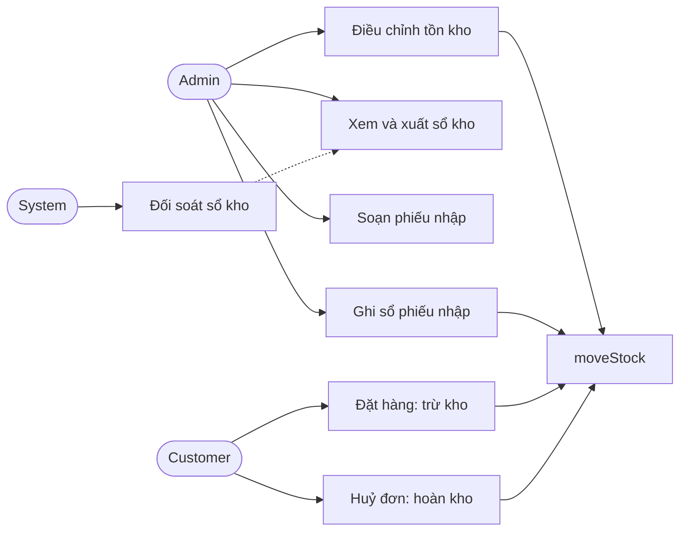
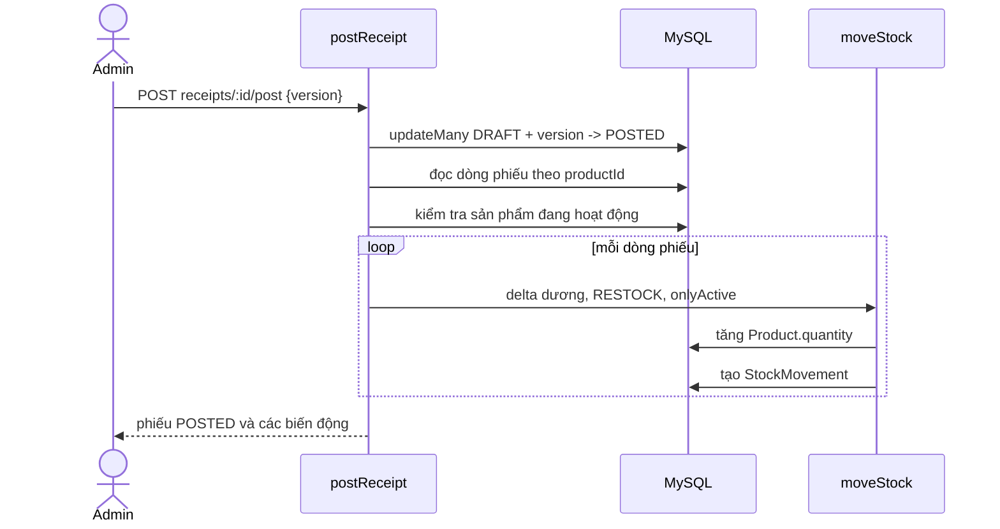
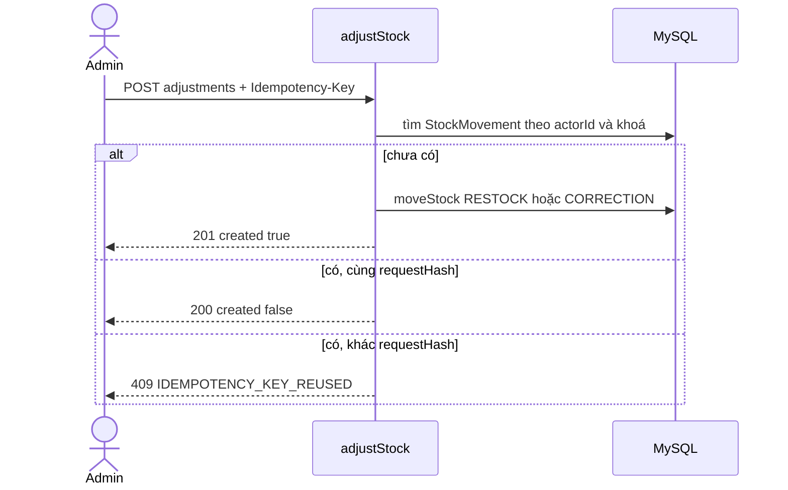
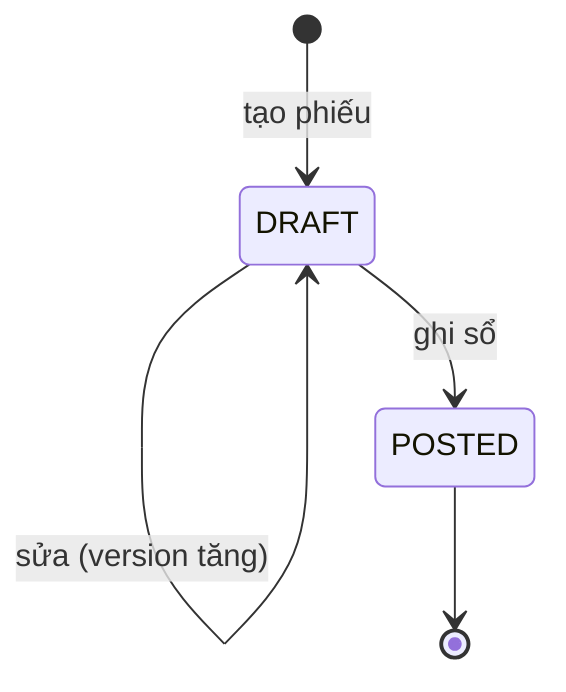

# Kho hàng (Inventory)

Tài liệu này trả lời: tồn kho thay đổi theo những quy tắc nào, ai được đổi, phiếu nhập hoạt động ra sao và cách kiểm tra số liệu kho còn khớp.

> Đối chiếu code: main @ d3d4cb7 (2026-11-04)

## Tổng quan và phạm vi

Bài toán: số lượng tồn kho của mỗi sản phẩm (`Product.quantity`) phải luôn giải thích được. Mọi thay đổi đi qua một hàm duy nhất, `moveStock`, và để lại một dòng `StockMovement` trong cùng transaction. Nhờ vậy `Product.quantity` luôn bằng tổng `delta` của sổ kho (xem [ADR-0006](../02-architecture/decisions/0006-stock-ledger.md)).

Trong phạm vi: ghi sổ kho, trừ kho khi đặt hàng và hoàn kho khi huỷ đơn (phần kho của hai luồng này), điều chỉnh tay của admin, phiếu nhập kho, đối soát sổ kho, điều kiện xoá sản phẩm liên quan đến lịch sử kho.

Ngoài phạm vi: giá và khuyến mãi ([promotions-and-flash-sale.md](promotions-and-flash-sale.md)); luồng đặt hàng, huỷ đơn và thanh toán ([checkout-and-payment.md](checkout-and-payment.md)); quản lý thông tin sản phẩm.

## Tác nhân và quyền

| Tác nhân | Làm được gì | Điều kiện |
| --- | --- | --- |
| Admin | Điều chỉnh tồn kho, xem và xuất CSV sổ kho, tạo, sửa, xem, ghi sổ phiếu nhập | Đăng nhập với role `ADMIN`; router `adminInventoryRoutes` được gắn dưới `/api/v1/admin` |
| Customer | Gián tiếp làm đổi tồn kho: đặt hàng trừ kho, huỷ đơn hoàn kho | Không có route kho riêng |
| System | Chạy script đối soát `pnpm run inventory:verify-ledger` | Chạy tay hoặc theo lịch của người vận hành |

Danh sách route và schema nằm ở `src/docs/openapi.ts` (xem `/api-docs`), không chép lại ở đây.

## Use case

## Dữ liệu liên quan

| Model | Vai trò trong nghiệp vụ | Nhãn | Chi tiết |
| --- | --- | --- | --- |
| `StockMovement` | Sổ kho, mỗi lần tồn đổi là một dòng (`delta`, `balanceBefore`, `balanceAfter`, `reason`) | nguồn sự thật lịch sử | [inventory.md](../03-database/contexts/inventory.md) |
| `StockReceipt` | Phiếu nhập: `DRAFT` rồi `POSTED`, có `version` | dữ liệu nghiệp vụ | [inventory.md](../03-database/contexts/inventory.md) |
| `StockReceiptItem` | Dòng phiếu: sản phẩm, số lượng, đơn giá nhập | dữ liệu nghiệp vụ | [inventory.md](../03-database/contexts/inventory.md) |
| `Product` | Giữ `quantity` (tồn hiện tại) và `sold` (đã bán) | dữ liệu dẫn xuất từ sổ | [catalog-reviews.md](../03-database/contexts/catalog-reviews.md) |

Lý do biến động (`STOCK_REASON`) và nơi ghi: `OPENING` (migration `stock_movements` và seed), `INITIAL` (tạo sản phẩm có `quantity` > 0), `ORDER` (đặt hàng), `ORDER_CANCEL` (huỷ đơn), `RESTOCK` (phiếu nhập hoặc điều chỉnh), `CORRECTION` (điều chỉnh).

## Quy tắc nghiệp vụ

| Mã | Quy tắc | Điều kiện và hệ quả | Mã lỗi |
| --- | --- | --- | --- |
| INV-01 | Mọi thay đổi tồn kho đi qua `moveStock` | `Product.quantity` và dòng `StockMovement` được ghi trong transaction của nơi gọi, nên cùng thành công hoặc cùng thất bại. Nơi gọi: tạo sản phẩm, đặt hàng, huỷ đơn, ghi sổ phiếu nhập, điều chỉnh | — |
| INV-02 | Trừ kho không được vượt tồn | `delta` âm chạy `updateMany` có điều kiện `quantity >= -delta`; không dòng nào được cập nhật thì báo hết hàng, không ghi sổ | `OUT_OF_STOCK` |
| INV-03 | Cờ `onlyActive`: sản phẩm ẩn không bán và không nhận hàng | Đặt hàng và ghi sổ phiếu nhập truyền `onlyActive`; sản phẩm tồn tại nhưng `isActive = false` thì báo không còn bán; sản phẩm không tồn tại thì báo không tìm thấy. Huỷ đơn không dùng cờ này nên vẫn hoàn kho cho sản phẩm đã ẩn | `PRODUCT_UNAVAILABLE`, `NOT_FOUND` |
| INV-04 | `sold` đi theo lý do `ORDER` và `ORDER_CANCEL` | `ORDER` tăng `sold` đúng bằng số lượng trừ; `ORDER_CANCEL` giảm `sold` đúng bằng số lượng hoàn; các lý do khác không đụng `sold` | — |
| INV-05 | Mỗi dòng sổ ghi tồn trước và tồn sau | `balanceAfter` lấy từ hàng sản phẩm sau khi cập nhật, `balanceBefore = balanceAfter - delta`; vì thế đối soát từng bước được | — |
| INV-06 | Điều chỉnh của admin chỉ nhận `RESTOCK` hoặc `CORRECTION` | `delta` nguyên, khác 0, trong khoảng ±10 000; `note` bắt buộc (1 đến 500 ký tự sau khi cắt khoảng trắng); `OPENING`, `INITIAL`, `ORDER`, `ORDER_CANCEL` không đặt tay được | `VALIDATION_ERROR` |
| INV-07 | `RESTOCK` phải cộng thêm | `RESTOCK` với `delta` âm bị từ chối; muốn giảm tồn thì dùng `CORRECTION` (vẫn không được làm tồn âm, xem INV-02) | `VALIDATION_ERROR` |
| INV-08 | Điều chỉnh là idempotent theo `Idempotency-Key` | Header bắt buộc (1 đến 64 ký tự). Khoá lưu cùng `requestHash` của (`productId`, `delta`, `reason`, `note`), unique theo (`actorId`, `idempotencyKey`). Gửi lại cùng nội dung trả kết quả cũ với `created: false`; cùng khoá khác nội dung bị từ chối | `IDEMPOTENCY_KEY_REUSED` |
| INV-09 | Hai yêu cầu cùng khoá chạy đua vẫn an toàn | Yêu cầu thua đua gặp lỗi unique, đọc lại dòng của yêu cầu thắng rồi trả bản phát lại hoặc báo xung đột như INV-08 | `IDEMPOTENCY_KEY_REUSED` |
| INV-10 | Phiếu nhập có hai trạng thái `DRAFT` và `POSTED`; chỉ `DRAFT` được sửa hoặc ghi sổ | Sửa và ghi sổ đều "giành" phiếu bằng `updateMany` với điều kiện `status = DRAFT` và `version` đúng, rồi tăng `version`. Phiếu đã `POSTED` mà sửa thì báo sai trạng thái | `INVALID_RECEIPT_STATUS` |
| INV-11 | Khoá lạc quan `version` cho phiếu nhập | Sửa hoặc ghi sổ phải gửi `version` mà client đã thấy; lệch thì báo bị sửa; phiếu không tồn tại thì báo không tìm thấy | `RECEIPT_VERSION_CONFLICT`, `NOT_FOUND` |
| INV-12 | Nội dung phiếu nhập có giới hạn | 1 đến 100 dòng, mỗi sản phẩm tối đa một dòng, `quantity` 1 đến 10 000, `unitCost` 0 đến 2 000 000 000 (tuỳ chọn); trường lạ bị từ chối (`strict`) | `VALIDATION_ERROR` |
| INV-13 | Phiếu chỉ chứa sản phẩm đang hoạt động | Kiểm tra khi tạo, khi sửa dòng và lại lúc ghi sổ; sản phẩm thiếu hoặc ẩn thì trả danh sách `productIds` | `PRODUCT_UNAVAILABLE` |
| INV-14 | Mã phiếu sinh tự động, không nhập tay | Dạng `PN-YYYYMMDD-XXXXXXXX` (ngày theo giờ cửa hàng, 8 ký tự đầu của UUID viết hoa). Trùng mã thì thử lại tối đa 3 lần, lỗi khác thì ném ngay | — |
| INV-15 | Phiếu rỗng không được ghi sổ | Đọc các dòng sau khi giành phiếu; không có dòng nào thì huỷ cả transaction (phiếu vẫn `DRAFT`) | `EMPTY_RECEIPT` |
| INV-16 | Ghi sổ phiếu tạo một biến động `RESTOCK` cho mỗi dòng | Chạy theo thứ tự `productId` tăng dần (tránh khoá chéo giữa các giao dịch), cùng transaction với việc chuyển phiếu sang `POSTED`; mỗi dòng sổ mang `receiptId` | — |
| INV-17 | Ghi sổ lặp lại trả kết quả cũ | Phiếu đã `POSTED` thì mọi lần ghi sổ sau trả lại phiếu và các biến động cũ với `created: false`, bất kể `version` client gửi, không ghi sổ thêm | — |
| INV-18 | Sổ kho phải khớp tồn kho | Với mỗi sản phẩm, `Product.quantity = SUM(StockMovement.delta)`. Script đối soát chỉ báo cáo (log lỗi, `exitCode = 1`), không tự sửa số liệu | — |
| INV-19 | Sản phẩm có lịch sử kho hoặc đơn hàng không xoá được | Có dòng `OrderDetail`, `StockMovement` hoặc `StockReceiptItem` thì từ chối xoá; nên ẩn sản phẩm | `PRODUCT_IN_USE` |
| INV-20 | Xuất CSV sổ kho có giới hạn số dòng | Quá `EXPORT_LIMIT` (10 000) dòng thì từ chối, người dùng thu hẹp bộ lọc | `EXPORT_TOO_LARGE` |

> **Lưu ý:** `adjustStock` còn nhánh "thiếu khoá thì chỉ ghi cảnh báo log" (`missing_idempotency_key`), nhưng `adjustStockHandler` luôn parse header bằng `idempotencyKeyHeader` nên thiếu khoá bị từ chối ở route và nhánh đó không bao giờ chạy qua API. Tài liệu coi `Idempotency-Key` là bắt buộc (INV-08). Tương tự, kiểm tra `note` trong `adjustStock` trùng với `adjustmentBody`.

## Luồng chính

Ghi sổ phiếu nhập:

Điều chỉnh idempotent:

## Luồng lỗi và ngoại lệ

| Tình huống | Hệ quả |
| --- | --- |
| Trừ kho vượt tồn (đặt hàng hoặc `CORRECTION` âm) | `OUT_OF_STOCK`, transaction huỷ, không dòng sổ nào được ghi |
| Cùng `Idempotency-Key` khác nội dung | `IDEMPOTENCY_KEY_REUSED` (409) |
| Hai yêu cầu cùng khoá chạy đua | Yêu cầu thua đọc lại dòng thắng rồi phát lại hoặc báo xung đột (INV-09) |
| Sửa hoặc ghi sổ phiếu với `version` cũ | `RECEIPT_VERSION_CONFLICT` (409); client tải lại phiếu rồi thử lại |
| Sửa phiếu đã `POSTED` | `INVALID_RECEIPT_STATUS` (409) |
| Ghi sổ phiếu rỗng | `EMPTY_RECEIPT` (400), phiếu giữ `DRAFT` |
| Sản phẩm trong phiếu bị ẩn trước lúc ghi sổ | `PRODUCT_UNAVAILABLE` (409), không dòng sổ nào được ghi |
| Ghi sổ lặp lại sau khi đã thành công | Trả kết quả cũ, `created: false`, không ghi sổ thêm |

Xung đột khoá hoặc deadlock khi ghi sổ phiếu được thử lại bởi `withPrismaTransactionRetry` (`src/lib/prisma-retry.ts`).

## Vòng đời trạng thái

Mỗi cạnh được xác nhận trong code: tạo phiếu đặt `DRAFT` (`createReceiptAttempt`), sửa chỉ khi `status = DRAFT` (`updateReceipt`), ghi sổ chuyển `DRAFT` sang `POSTED` (`postReceipt`); không có đoạn code nào chuyển từ `POSTED` sang trạng thái khác.

| Từ | Sang (hợp lệ) |
| --- | --- |
| `DRAFT` | `POSTED` |
| `POSTED` | — |

## Vận hành

- Biến môi trường: không có biến riêng cho kho.
- Script: `pnpm run inventory:verify-ledger` chạy `src/scripts/verify-stock-ledger.ts`; in `ledger_verified` nếu khớp, log `ledger_mismatch` kèm danh sách `productId`, `quantity`, `ledgerQuantity` và thoát mã 1 nếu lệch.
- Khi lệch dữ liệu: script không sửa. Người vận hành tìm nguyên nhân từ các dòng `StockMovement` của sản phẩm lệch, rồi tạo một điều chỉnh `CORRECTION` (có ghi chú) để cân lại, thay vì sửa trực tiếp `Product.quantity`.
- Log: điều chỉnh ghi các `category` `created`, `replayed`, `conflict`, `missing_idempotency_key`; phiếu nhập ghi `receiptId`, `actorId`, số dòng, thời gian xử lý, không ghi `note` hay `unitCost`.
- Không có worker riêng; các việc nền chung xem [background-jobs.md](../02-architecture/background-jobs.md).

## Truy vết

| Mã | Hàm thực thi | Test bao phủ |
| --- | --- | --- |
| INV-01 | `src/modules/inventory/inventory.service.ts#moveStock` | `tests/modules/inventory/move-stock.test.ts` |
| INV-02 | `src/modules/inventory/inventory.service.ts#moveStock` | `tests/modules/inventory/move-stock.test.ts` |
| INV-03 | `src/modules/inventory/inventory.service.ts#moveStock` | `tests/modules/inventory/move-stock.test.ts` |
| INV-04 | `src/modules/inventory/inventory.service.ts#moveStock` | `tests/modules/inventory/move-stock.test.ts` |
| INV-05 | `src/modules/inventory/inventory.service.ts#moveStock` | `tests/modules/inventory/move-stock.test.ts` |
| INV-06 | `src/modules/inventory/inventory.schema.ts#adjustmentBody` | `tests/modules/inventory/inventory.routes.test.ts` (gián tiếp) |
| INV-07 | `src/modules/inventory/inventory.service.ts#adjustStock` | `tests/modules/inventory/inventory.routes.test.ts` (gián tiếp) |
| INV-08 | `src/modules/inventory/inventory.service.ts#adjustStock` | `tests/modules/inventory/inventory.routes.test.ts` (gián tiếp) |
| INV-09 | `src/modules/inventory/inventory.service.ts#adjustStock` | chưa có test |
| INV-10 | `src/modules/inventory/inventory-receipts.service.ts#claimFailure` | `tests/modules/inventory/inventory-receipts.routes.test.ts` (gián tiếp) |
| INV-11 | `src/modules/inventory/inventory-receipts.service.ts#claimFailure` | `tests/modules/inventory/inventory-receipts.routes.test.ts` (gián tiếp) |
| INV-12 | `src/modules/inventory/inventory-receipts.schema.ts#createReceiptBody` | `tests/modules/inventory/inventory-receipts.schema.test.ts` |
| INV-13 | `src/modules/inventory/inventory-receipts.service.ts#assertProductsAvailable` | `tests/modules/inventory/inventory-receipts.routes.test.ts` (gián tiếp) |
| INV-14 | `src/modules/inventory/inventory-receipts.schema.ts#generateReceiptCode`; `src/modules/inventory/inventory-receipts.service.ts#createReceipt` | `tests/modules/inventory/inventory-receipts.schema.test.ts`; `tests/modules/inventory/inventory-receipts.routes.test.ts` (gián tiếp) |
| INV-15 | `src/modules/inventory/inventory-receipts.service.ts#postReceipt` | `tests/modules/inventory/inventory-receipts.routes.test.ts` (gián tiếp) |
| INV-16 | `src/modules/inventory/inventory-receipts.service.ts#postReceipt` | `tests/modules/inventory/inventory-receipts.routes.test.ts` (gián tiếp) |
| INV-17 | `src/modules/inventory/inventory-receipts.service.ts#postReceipt` | `tests/modules/inventory/inventory-receipts.routes.test.ts` (gián tiếp) |
| INV-18 | `src/modules/inventory/inventory.reconciliation.ts#findLedgerMismatches` | `tests/modules/inventory/inventory.reconciliation.test.ts` |
| INV-19 | `src/modules/products/products.service.ts#deleteProduct` | `tests/modules/products/admin-products.routes.test.ts` (gián tiếp) |
| INV-20 | `src/lib/csv.ts#assertExportSize` | `tests/lib/csv.test.ts` |

## Nguồn

- [inventory.service.ts](../../src/modules/inventory/inventory.service.ts): `moveStock`, `adjustStock`, `exportMovements`
- [inventory.schema.ts](../../src/modules/inventory/inventory.schema.ts): `STOCK_REASON`, `adjustmentBody`
- [inventory.controller.ts](../../src/modules/inventory/inventory.controller.ts): `adjustStockHandler`
- [inventory.routes.ts](../../src/modules/inventory/inventory.routes.ts): `adminInventoryRoutes`
- [inventory-receipts.service.ts](../../src/modules/inventory/inventory-receipts.service.ts): `createReceipt`, `updateReceipt`, `postReceipt`, `claimFailure`, `assertProductsAvailable`
- [inventory-receipts.schema.ts](../../src/modules/inventory/inventory-receipts.schema.ts): `RECEIPT_STATUS`, `createReceiptBody`, `generateReceiptCode`
- [inventory.reconciliation.ts](../../src/modules/inventory/inventory.reconciliation.ts): `findLedgerMismatches`
- [verify-stock-ledger.ts](../../src/scripts/verify-stock-ledger.ts): script đối soát
- [products.service.ts](../../src/modules/products/products.service.ts): `createProduct`, `deleteProduct`
- [csv.ts](../../src/lib/csv.ts): `assertExportSize`, `EXPORT_LIMIT`
- [orders.service.ts](../../src/modules/orders/orders.service.ts): `placeOrder` (trừ kho)
- [order-cancellation.service.ts](../../src/modules/orders/order-cancellation.service.ts): hoàn kho khi huỷ đơn
