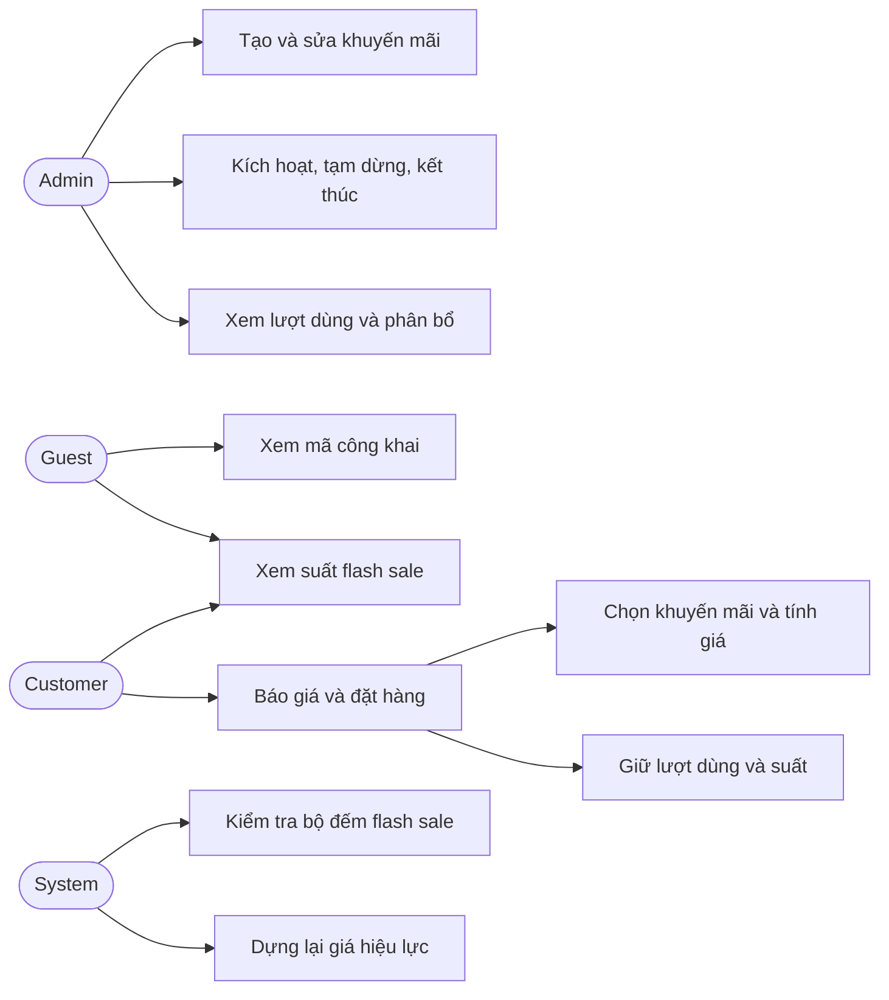
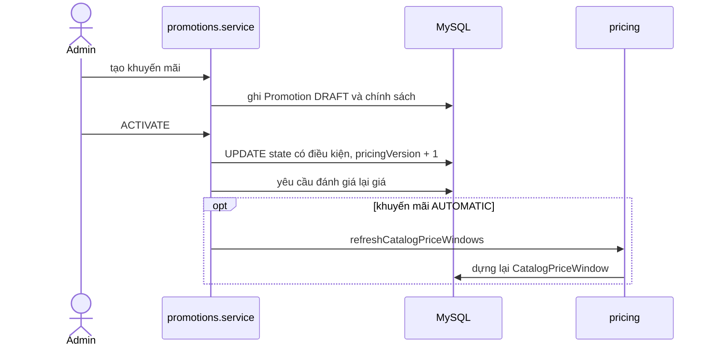
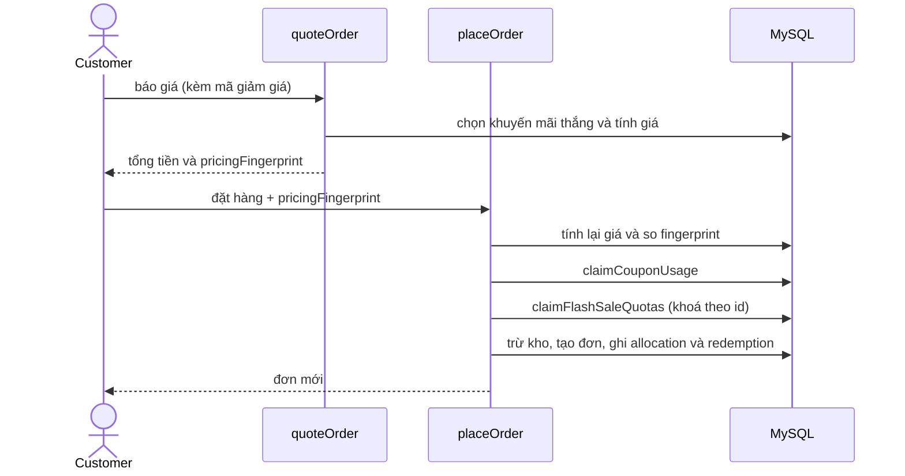
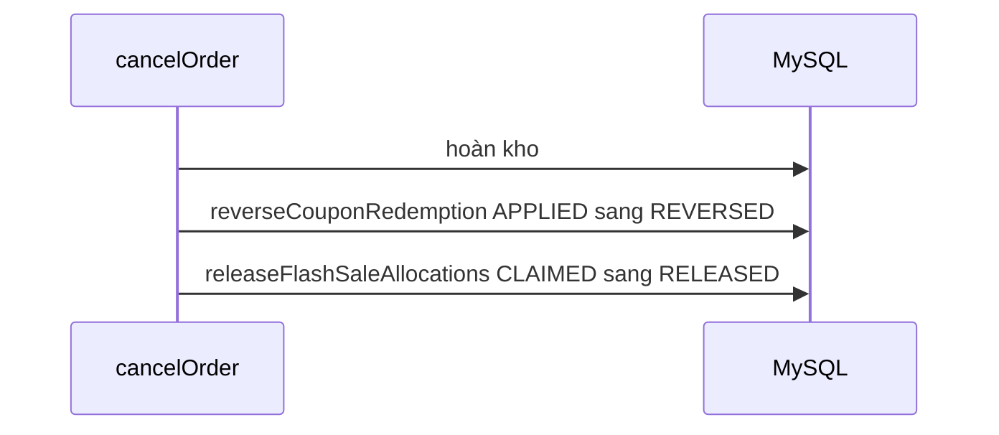
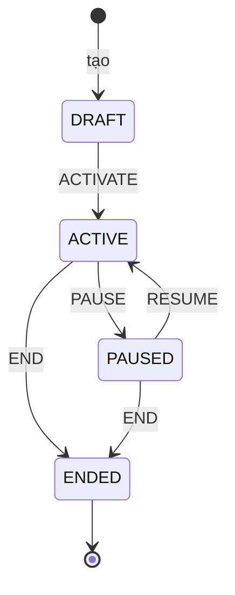

# Khuyến mãi, mã giảm giá và Flash Sale

Tài liệu này trả lời: có những loại khuyến mãi nào, admin cấu hình và vận hành chúng ra sao, giá cuối cùng của một dòng hàng được chọn và tính theo thứ tự nào, và hạn mức của mã giảm giá và flash sale được giữ đúng thế nào khi nhiều người mua cùng lúc.

> Đối chiếu code: main @ d3d4cb7 (2026-11-04)

## Tổng quan và phạm vi

Bài toán: giảm giá phải đúng từng đồng, không bán quá suất khuyến mãi dù nhiều khách tranh nhau, và giá khách thấy lúc báo giá phải trùng giá lúc đặt hàng (hoặc khách được báo giá đã đổi).

Trong phạm vi: ba loại khuyến mãi (`COUPON`, `AUTOMATIC`, `FLASH_SALE`), cấu hình và vòng đời, cách chọn khuyến mãi thắng và tính giá, hạn mức dùng, dấu vân tay giá, giá hiệu lực tính sẵn cho catalog (`CatalogPriceWindow`) và các script kiểm tra. Lý do thiết kế xem [ADR-0007](../02-architecture/decisions/0007-pricing-pipeline.md).

Ngoài phạm vi: luồng đặt hàng và huỷ đơn chứa các bước gọi vào đây ([checkout-and-payment.md](checkout-and-payment.md)); thông báo giảm giá cho khách theo dõi sản phẩm (module `price-alerts`, chỉ được nhắc ở chỗ nhận sự kiện đánh giá lại giá).

## Tác nhân và quyền

| Tác nhân | Làm được gì | Điều kiện |
| --- | --- | --- |
| Admin | Tạo, sửa, nhân bản, kích hoạt, tạm dừng, kết thúc khuyến mãi; xem lượt dùng, tổng hợp và phân bổ flash sale | Role `ADMIN`, router `adminPromotionRoutes` dưới `/api/v1/admin` |
| Guest | Xem mã công khai đang chạy; xem tình trạng suất flash sale | Không cần đăng nhập |
| Customer | Như Guest, và thêm: thấy hạn mức còn lại của riêng mình, báo giá và đặt hàng có áp dụng khuyến mãi | `optionalAuthenticate` cho tình trạng flash sale; đặt hàng cần đăng nhập |
| System | Chạy script dựng lại, kiểm tra giá hiệu lực và bộ đếm flash sale | Chạy tay hoặc theo lịch |

Danh sách route, request, response nằm ở `src/docs/openapi.ts` (xem `/api-docs`), không chép lại ở đây.

## Use case

## Dữ liệu liên quan

| Model | Vai trò trong nghiệp vụ | Nhãn | Chi tiết |
| --- | --- | --- | --- |
| `Promotion` | Khuyến mãi: loại, trạng thái, mức giảm, khoảng thời gian, `pricingVersion`, `activatedAt` | nguồn sự thật | [promotions-pricing.md](../03-database/contexts/promotions-pricing.md) |
| `CouponPolicy`, `AutomaticPromotionPolicy`, `FlashSalePolicy` | Chính sách riêng của từng loại | nguồn sự thật | [promotions-pricing.md](../03-database/contexts/promotions-pricing.md) |
| `PromotionProduct` | Sản phẩm mục tiêu của mã giảm giá theo sản phẩm và khuyến mãi tự động | nguồn sự thật | [promotions-pricing.md](../03-database/contexts/promotions-pricing.md) |
| `FlashSaleProductQuota`, `FlashSaleUserUsage` | Hạn mức tổng và hạn mức mỗi người, kèm bộ đếm `claimedUnits` | bộ đếm dẫn xuất | [promotions-pricing.md](../03-database/contexts/promotions-pricing.md) |
| `FlashSaleAllocation` | Suất đã giữ cho từng dòng đơn (`CLAIMED`, `RELEASED`) | nguồn sự thật cho bộ đếm | [promotions-pricing.md](../03-database/contexts/promotions-pricing.md) |
| `PromotionUserUsage`, `PromotionRedemption` | Số lần dùng mã của mỗi người; lượt dùng gắn với đơn (`APPLIED`, `REVERSED`) | bộ đếm và nhật ký | [promotions-pricing.md](../03-database/contexts/promotions-pricing.md) |
| `CatalogPriceWindow` | Giá hiệu lực tính sẵn theo khoảng thời gian cho từng sản phẩm | bảng dẫn xuất (projection) | [promotions-pricing.md](../03-database/contexts/promotions-pricing.md) |

## Quy tắc nghiệp vụ

| Mã | Quy tắc | Điều kiện và hệ quả | Mã lỗi |
| --- | --- | --- | --- |
| PRM-01 | Ba loại khuyến mãi, mỗi loại đúng một chính sách | `COUPON` cần `coupon`; `AUTOMATIC` cần `automatic` có ít nhất một sản phẩm; `FLASH_SALE` cần `flashSale`; không trộn chính sách. `endsAt` sau `startsAt`; `discountKind` là `PERCENT` (tối đa 100) hoặc `FIXED`; `discountValue` nguyên dương | `VALIDATION_ERROR` |
| PRM-02 | Cấu hình mã giảm giá | Mã viết hoa `A-Z 0-9 _ -`, 3 đến 50 ký tự, duy nhất; phạm vi `ORDER` thì không có sản phẩm mục tiêu, `PRODUCT` thì phải có (tối đa 500); `FIXED` không dùng `maxDiscount`; `maxUsesPerUser` mặc định 1; `isPublic` mặc định ẩn | `COUPON_CODE_TAKEN`, `VALIDATION_ERROR` |
| PRM-03 | Cấu hình flash sale | 1 đến 500 sản phẩm, mỗi sản phẩm một dòng với `totalQuota` và `maxUnitsPerUser`; `maxUnitsPerUser` không vượt `totalQuota`; `priority` và `stackableWithCoupon` như khuyến mãi tự động | `VALIDATION_ERROR` |
| PRM-04 | Khuyến mãi mới luôn là bản nháp và chỉ nhắm sản phẩm có thật | Tạo xong ở trạng thái `DRAFT`; sản phẩm mục tiêu hoặc sản phẩm trong flash sale không tồn tại thì từ chối trước khi ghi | `PRODUCT_NOT_FOUND` |
| PRM-05 | Chuyển trạng thái bằng hành động có điều kiện | `ACTIVATE` chỉ từ `DRAFT` (flash sale phải có dòng hạn mức); `PAUSE` chỉ từ `ACTIVE`; `RESUME` chỉ từ `PAUSED` và chưa quá `endsAt`; `END` từ `ACTIVE` hoặc `PAUSED`. Điều kiện trạng thái nằm trong câu `UPDATE` nên hai yêu cầu đồng thời chỉ một cái thắng. Trạng thái hiển thị `SCHEDULED`, `RUNNING`, `EXPIRED` được suy ra từ thời gian khi `state = ACTIVE`, không lưu | `PROMOTION_INVALID_TRANSITION` |
| PRM-06 | `pricingVersion` tăng mỗi khi giá có thể đổi | Mỗi chuyển trạng thái tăng 1; sửa trường ảnh hưởng giá cũng tăng 1 (nháp: giảm giá, thời gian, chính sách; đã kích hoạt: chỉ khi gia hạn `endsAt`). Mỗi lần đổi phát yêu cầu đánh giá lại giá cho các sản phẩm liên quan | — |
| PRM-07 | Khuyến mãi đã kích hoạt thì khoá trường thương mại | Sau khi có `activatedAt`: không đổi `discountKind`, `discountValue`, `startsAt`; không đổi mã, phạm vi, mục tiêu, `minOrderValue`, `maxDiscount`, `maxUsesPerUser` của mã giảm giá; không đổi `priority`, `stackableWithCoupon`, mục tiêu của khuyến mãi tự động và flash sale | `PROMOTION_FIELD_LOCKED` |
| PRM-08 | Phần còn sửa được khi đã kích hoạt chỉ theo hướng nới | Gia hạn `endsAt` (chỉ lùi sau); mã giảm giá đổi `isPublic` và tăng `maxUses`; flash sale tăng `totalQuota` (không dưới `claimedUnits`, giữ nguyên `maxUnitsPerUser` và danh sách sản phẩm) và đổi `showRemainingQuota`. Các thay đổi này (trừ gia hạn) không tăng `pricingVersion` | `PROMOTION_FIELD_LOCKED` |
| PRM-09 | Sửa khuyến mãi được kiểm tra lại như tạo mới và có bảo vệ lạc quan | Trạng thái sau khi gộp phải qua đúng luật tạo mới (PRM-01 đến PRM-03). Cập nhật chỉ thành công nếu `pricingVersion` và `activatedAt` còn như lúc đọc; ngược lại người dùng tải lại rồi thử lại | `PROMOTION_CONFLICT` |
| PRM-10 | Nhân bản tạo bản nháp mới sạch lượt dùng | Bản sao có tên thêm "(copy)", mã giảm giá mới dạng `CLONE-<id>-<mã thời gian>`, `usedCount` bằng 0, giữ mục tiêu và hạn mức cấu hình; không sao chép lượt dùng hay phân bổ | — |
| PRM-11 | Tra cứu mã giảm giá khi báo giá và đặt hàng | Mã không tồn tại; mã không ở `ACTIVE` hoặc ngoài khoảng thời gian; mã hết `maxUses`; người dùng đã dùng đủ `maxUsesPerUser` đều bị từ chối (kiểm tra sớm, kiểm tra thật nằm ở PRM-13) | `PROMOTION_NOT_FOUND`, `PROMOTION_NOT_ACTIVE`, `PROMOTION_USAGE_LIMIT`, `PROMOTION_USER_LIMIT` |
| PRM-12 | Điều kiện và cách tính mã giảm giá | Đủ `minOrderValue` (phạm vi `ORDER`: tổng sau giảm sản phẩm; `PRODUCT`: phần của các dòng đủ điều kiện) mới được giảm. `PERCENT` làm tròn xuống trên phần đủ điều kiện, `FIXED` là số cố định; giới hạn bởi `maxDiscount` và không vượt phần đủ điều kiện. Mã không giảm được đồng nào thì từ chối. Số giảm chia cho từng dòng theo tỉ lệ, phần dư dồn cho dòng có số dư lớn nhất rồi `productId` nhỏ | `MIN_ORDER_NOT_MET`, `COUPON_NOT_APPLICABLE` |
| PRM-13 | Lượt dùng mã được giữ nguyên tử khi đặt hàng và hoàn khi huỷ | Trần `maxUses` và `maxUsesPerUser` nằm trong chính câu `UPDATE` tăng bộ đếm nên không vượt dù đặt đồng thời. Đặt xong ghi `PromotionRedemption` `APPLIED`; huỷ đơn chuyển sang `REVERSED` và giảm lại hai bộ đếm | `PROMOTION_USAGE_LIMIT`, `PROMOTION_USER_LIMIT` |
| PRM-14 | Chọn khuyến mãi thắng cho một sản phẩm | Trong các khuyến mãi tự động và flash sale đang chạy: `priority` cao hơn thắng, hoà thì mức giảm trên mỗi đơn vị lớn hơn, hoà nữa thì `id` nhỏ hơn. Mức giảm mỗi đơn vị: `PERCENT` làm tròn xuống, `FIXED` giữ nguyên, không vượt giá niêm yết | — |
| PRM-15 | Giảm giá sản phẩm áp trước, mã giảm giá áp sau và có thể bị loại | Giá cuối của dòng = giá niêm yết trừ giảm sản phẩm trừ phần mã. Dòng có khuyến mãi chỉ được mã giảm giá khi khuyến mãi đó `stackableWithCoupon`; mã `PRODUCT` chỉ áp cho sản phẩm mục tiêu | — |
| PRM-16 | Flash sale chỉ thắng khi còn đủ suất, nếu không thì rơi về khuyến mãi kế tiếp | Cần cả suất tổng còn lại và (với người dùng đã đăng nhập, chế độ `EXACT`) suất của riêng người đó đủ cho số lượng mua. Thiếu suất thì bỏ qua flash sale, dùng khuyến mãi tự động hoặc giá niêm yết và trả `promotionFallback` nêu lý do (`GLOBAL_QUOTA`, `USER_QUOTA`, `GLOBAL_AND_USER_QUOTA`) | — |
| PRM-17 | Giữ suất flash sale khi đặt hàng | Gộp và sắp xếp yêu cầu theo (`promotionId`, `productId`), khoá các `Promotion` theo `id` tăng dần (`FOR UPDATE`) để tránh deadlock; khuyến mãi phải còn `ACTIVE`, trong thời gian và đúng `pricingVersion` đã tính giá. Tăng bộ đếm tổng và bộ đếm người dùng bằng `UPDATE` có điều kiện; hết suất tổng hoặc vượt giới hạn mỗi người thì huỷ cả đơn | `PROMOTION_CHANGED`, `FLASH_SALE_QUOTA_EXCEEDED`, `FLASH_SALE_USER_LIMIT` |
| PRM-18 | Nhả suất flash sale khi huỷ đơn | Mỗi `FlashSaleAllocation` `CLAIMED` của đơn chuyển `RELEASED` và trừ lại hai bộ đếm đúng số lượng; bộ đếm không đủ để trừ nghĩa là dữ liệu lệch và việc huỷ bị chặn | `FLASH_SALE_COUNTER_MISMATCH` |
| PRM-19 | Dấu vân tay giá | `createPricingFingerprint` băm SHA-256 từ các dòng (đã sắp theo `productId`: số lượng, giá niêm yết, khuyến mãi thắng và phiên bản), mã giảm giá và các tổng tiền. Báo giá trả giá trị này; đặt hàng tính lại và so (xem CHK-10 trong [checkout-and-payment.md](checkout-and-payment.md)). `requestHash` của đơn cũng băm từ fingerprint | `PROMOTION_CHANGED` |
| PRM-20 | Giá hiệu lực của catalog được tính sẵn | Chỉ khuyến mãi `AUTOMATIC` tạo `CatalogPriceWindow` (flash sale và mã giảm giá không vào). Mỗi sản phẩm có các cửa sổ liền nhau cắt ở mọi `startsAt` và `endsAt` tương lai; cửa sổ liền kề cùng giá được gộp. Cửa sổ được dựng lại trong cùng transaction khi tạo, sửa, chuyển trạng thái khuyến mãi tự động | — |
| PRM-21 | Cửa sổ giá có script dựng lại và kiểm tra | `pnpm run catalog-pricing:rebuild` mặc định chỉ đếm, thêm `--apply` mới ghi; `pnpm run catalog-pricing:audit` báo `MISSING`, `OVERLAP`, `STALE_POLICY`, `LIST_PRICE_MISMATCH` | — |
| PRM-22 | Bộ đếm flash sale phải khớp phân bổ | `claimedUnits` của mỗi hạn mức bằng tổng `quantity` các phân bổ `CLAIMED`, và tương tự cho từng người; `pnpm run promotions:verify-flash-sale` chỉ báo lệch, không tự sửa | — |
| PRM-23 | Phần công khai | Danh sách mã công khai chỉ gồm mã `isPublic`, đang trong thời gian, còn lượt; tình trạng suất flash sale nhận 1 đến 20 `productIds` khác nhau, không nhận `userId` từ query (người dùng lấy từ phiên đăng nhập) | — |
| PRM-24 | Admin quan sát hiệu quả | Xem lượt dùng, tổng hợp (mã: số lượt và tổng giảm; flash sale: suất, đã giữ, đã nhả, đã hoàn tất) và phân bổ flash sale; xem phân bổ của khuyến mãi không phải flash sale thì từ chối | `PROMOTION_KIND_MISMATCH` |

> **Lưu ý:** các mã lỗi `PROMOTION_NOT_FOUND`, `PROMOTION_NOT_ACTIVE`, `MIN_ORDER_NOT_MET` và `PROMOTION_KIND_MISMATCH` không xuất hiện trong bất kỳ file test nào (grep trong `tests/`); `PRM-11`, `PRM-12`, `PRM-24` chỉ được test cho các nhánh còn lại. `rebuildCatalogPriceWindows` (PRM-21) cũng chưa có test, chỉ `auditCatalogPriceProjection` có.

## Luồng chính

Tạo và kích hoạt khuyến mãi:

Khách báo giá rồi đặt hàng có flash sale:

Huỷ đơn nhả suất và lượt dùng:

## Luồng lỗi và ngoại lệ

| Tình huống | Hệ quả |
| --- | --- |
| Hết suất flash sale lúc xem giỏ hoặc báo giá | Dòng rơi về giá khác, kèm `promotionFallback` (PRM-16); không phải lỗi |
| Hết suất flash sale ngay lúc đặt (người khác nhanh hơn) | `FLASH_SALE_QUOTA_EXCEEDED`, không có đơn, không trừ kho |
| Vượt giới hạn mỗi người | `FLASH_SALE_USER_LIMIT` |
| Admin tạm dừng, kết thúc hoặc đổi cấu hình giữa lúc khách báo giá và đặt | `PROMOTION_CHANGED` (hoặc fingerprint lệch), khách báo giá lại |
| Mã giảm giá hết lượt giữa lúc báo giá và đặt | `PROMOTION_USAGE_LIMIT` hoặc `PROMOTION_USER_LIMIT` khi claim |
| Hai admin sửa cùng khuyến mãi | `PROMOTION_CONFLICT` cho người sau |
| Sửa trường thương mại sau khi kích hoạt | `PROMOTION_FIELD_LOCKED`; muốn đổi thì nhân bản làm bản nháp mới |
| Bộ đếm flash sale lệch lúc huỷ đơn | `FLASH_SALE_COUNTER_MISMATCH`, việc huỷ bị chặn để không làm lệch thêm; chạy script kiểm tra để xem chi tiết |
| Cửa sổ giá cũ hoặc thiếu | Chạy `catalog-pricing:audit`, sửa bằng `catalog-pricing:rebuild --apply` |

## Vòng đời trạng thái

Khuyến mãi (`Promotion.state`). Hằng `PROMOTION_STATES` trong `promotions.schema.ts` chỉ liệt kê giá trị; các cạnh nằm ở `transitionPromotion` và được xác nhận bằng cách đọc hàm đó.

| Từ | Sang (hợp lệ) |
| --- | --- |
| `DRAFT` | `ACTIVE` |
| `ACTIVE` | `PAUSED`, `ENDED` |
| `PAUSED` | `ACTIVE`, `ENDED` |
| `ENDED` | — |

Hai vòng đời phụ, không có hằng chuyển trạng thái: `FlashSaleAllocation` đi `CLAIMED` sang `RELEASED` (`releaseFlashSaleAllocations`, PRM-18) và `PromotionRedemption` đi `APPLIED` sang `REVERSED` (`reverseCouponRedemption`, PRM-13); cả hai không quay lại.

## Vận hành

- Biến môi trường: không có biến riêng cho khuyến mãi.
- Script (chỉ báo cáo hoặc dựng lại projection, không đổi số liệu nghiệp vụ): `pnpm run promotions:verify-flash-sale` (`src/scripts/verify-flash-sale.ts`), `pnpm run catalog-pricing:audit` (`src/scripts/audit-catalog-price-windows.ts`), `pnpm run catalog-pricing:rebuild` (`src/scripts/rebuild-catalog-price-windows.ts`, thêm `--apply` để ghi).
- Khi bộ đếm flash sale lệch: script liệt kê hạn mức và người dùng lệch (giá trị lưu so với tổng phân bổ `CLAIMED`); nguồn sự thật là bảng phân bổ, nên cần xác định nguyên nhân rồi sửa bộ đếm có kiểm soát thay vì sửa phân bổ.
- Khi cửa sổ giá thiếu hoặc cũ: chạy audit để biết sản phẩm nào, rồi rebuild với `--apply`.
- Sự kiện đánh giá lại giá (`requestPricingReevaluation`) được xử lý bởi nhóm cảnh báo giá, xem [background-jobs.md](../02-architecture/background-jobs.md).

## Truy vết

| Mã | Hàm thực thi | Test bao phủ |
| --- | --- | --- |
| PRM-01 | `src/modules/promotions/promotions.schema.ts#createPromotionBody` | `tests/modules/promotions/promotions.schema.test.ts` |
| PRM-02 | `src/modules/promotions/promotions.schema.ts#createPromotionBody`; `src/modules/promotions/promotions.service.ts#createPromotion` | `tests/modules/promotions/promotions.schema.test.ts`; `tests/modules/promotions/admin-promotions.routes.test.ts` (gián tiếp) |
| PRM-03 | `src/modules/promotions/promotions.schema.ts#createPromotionBody` | `tests/modules/promotions/promotions.schema.test.ts` |
| PRM-04 | `src/modules/promotions/promotions.service.ts#createPromotion` | `tests/modules/promotions/admin-promotions.routes.test.ts` (gián tiếp) |
| PRM-05 | `src/modules/promotions/promotions.service.ts#transitionPromotion`; `src/modules/promotions/promotions.mapper.ts#effectivePromotionState` | `tests/modules/promotions/admin-promotions.routes.test.ts` (gián tiếp) |
| PRM-06 | `src/modules/promotions/promotions.service.ts#updatePromotion` | `tests/modules/promotions/admin-promotions.routes.test.ts` (gián tiếp) |
| PRM-07 | `src/modules/promotions/promotions.service.ts#updatePromotion` | `tests/modules/promotions/admin-promotions.routes.test.ts` (gián tiếp) |
| PRM-08 | `src/modules/promotions/promotions.service.ts#updatePromotion` | `tests/modules/promotions/admin-promotions.routes.test.ts` (gián tiếp) |
| PRM-09 | `src/modules/promotions/promotions.service.ts#updatePromotion` | `tests/modules/promotions/admin-promotions.routes.test.ts` (gián tiếp) |
| PRM-10 | `src/modules/promotions/promotions.service.ts#clonePromotion` | `tests/modules/promotions/admin-promotions.routes.test.ts` (gián tiếp) |
| PRM-11 | `src/modules/promotions/promotions.service.ts#resolveCoupon` | `tests/modules/promotions/promotions.quote.test.ts` (gián tiếp) |
| PRM-12 | `src/modules/promotions/promotions.service.ts#assertCouponApplies`; `src/modules/promotions/promotion-pricing.ts#calculatePromotionPricing` | `tests/modules/promotions/promotion-pricing.test.ts` |
| PRM-13 | `src/modules/promotions/promotion-usage.ts#claimCouponUsage`; `src/modules/promotions/promotion-usage.ts#reverseCouponRedemption` | `tests/modules/promotions/promotion-usage.test.ts` |
| PRM-14 | `src/modules/promotions/promotion-selection.ts#comparePromotionCandidates`; `src/modules/promotions/promotion-discount.ts#automaticDiscountPerUnit` | `tests/modules/promotions/promotion-selection.test.ts`; `tests/modules/promotions/automatic-promotion-policy.test.ts` |
| PRM-15 | `src/modules/promotions/promotion-pricing.ts#calculatePromotionPricing` | `tests/modules/promotions/promotion-pricing.test.ts` |
| PRM-16 | `src/modules/promotions/promotion-selection.ts#selectProductPromotion` | `tests/modules/promotions/promotion-selection.test.ts` |
| PRM-17 | `src/modules/promotions/flash-sale-quota.ts#claimFlashSaleQuotas` | `tests/modules/promotions/flash-sale-quota.test.ts` |
| PRM-18 | `src/modules/promotions/flash-sale-quota.ts#releaseFlashSaleAllocations` | `tests/modules/promotions/flash-sale-quota.test.ts` |
| PRM-19 | `src/modules/promotions/promotion-fingerprint.ts#createPricingFingerprint` | `tests/modules/promotions/promotion-fingerprint.test.ts` |
| PRM-20 | `src/modules/pricing/catalog-price-timeline.ts#buildCatalogPriceTimeline`; `src/modules/pricing/catalog-price-projection.repository.ts#refreshCatalogPriceWindows` | `tests/modules/pricing/catalog-price-timeline.test.ts`; `tests/modules/pricing/catalog-price-projection.test.ts` |
| PRM-21 | `src/modules/pricing/catalog-price-projection.audit.ts#auditCatalogPriceProjection`; `src/scripts/rebuild-catalog-price-windows.ts#rebuildCatalogPriceWindows` | `tests/modules/pricing/catalog-price-projection.audit.test.ts` |
| PRM-22 | `src/modules/promotions/flash-sale-verifier.ts#verifyFlashSaleCounters` | `tests/modules/promotions/flash-sale-verifier.test.ts` |
| PRM-23 | `src/modules/promotions/promotions.service.ts#listAvailablePromotions`; `src/modules/promotions/flash-sale-availability.ts#getFlashSaleAvailability` | `tests/modules/promotions/public-promotions.routes.test.ts` (gián tiếp); `tests/modules/promotions/flash-sale-availability.test.ts` |
| PRM-24 | `src/modules/promotions/promotions.service.ts#listFlashSaleAllocations` | `tests/modules/promotions/flash-sale-allocations.routes.test.ts` (gián tiếp) |

## Nguồn

- [promotions.schema.ts](../../src/modules/promotions/promotions.schema.ts): `createPromotionBody`, `PROMOTION_STATES`
- [promotions.service.ts](../../src/modules/promotions/promotions.service.ts): `createPromotion`, `updatePromotion`, `transitionPromotion`, `clonePromotion`, `resolveCoupon`, `assertCouponApplies`, `quoteOrder`, `listAvailablePromotions`, `listFlashSaleAllocations`
- [promotions.mapper.ts](../../src/modules/promotions/promotions.mapper.ts): `effectivePromotionState`
- [promotions.routes.ts](../../src/modules/promotions/promotions.routes.ts): `promotionRoutes`, `adminPromotionRoutes`
- [promotion-pricing.ts](../../src/modules/promotions/promotion-pricing.ts): `calculatePromotionPricing`
- [promotion-selection.ts](../../src/modules/promotions/promotion-selection.ts): `comparePromotionCandidates`, `selectProductPromotion`
- [promotion-discount.ts](../../src/modules/promotions/promotion-discount.ts): `automaticDiscountPerUnit`
- [promotion-usage.ts](../../src/modules/promotions/promotion-usage.ts): `claimCouponUsage`, `reverseCouponRedemption`
- [flash-sale-quota.ts](../../src/modules/promotions/flash-sale-quota.ts): `claimFlashSaleQuotas`, `releaseFlashSaleAllocations`
- [flash-sale-availability.ts](../../src/modules/promotions/flash-sale-availability.ts): `getFlashSaleAvailability`
- [flash-sale-verifier.ts](../../src/modules/promotions/flash-sale-verifier.ts): `verifyFlashSaleCounters`
- [promotion-fingerprint.ts](../../src/modules/promotions/promotion-fingerprint.ts): `createPricingFingerprint`, `createCheckoutRequestHash`
- [catalog-price-timeline.ts](../../src/modules/pricing/catalog-price-timeline.ts): `buildCatalogPriceTimeline`
- [catalog-price-projection.repository.ts](../../src/modules/pricing/catalog-price-projection.repository.ts): `refreshCatalogPriceWindows`
- [catalog-price-projection.audit.ts](../../src/modules/pricing/catalog-price-projection.audit.ts): `auditCatalogPriceProjection`
- [rebuild-catalog-price-windows.ts](../../src/scripts/rebuild-catalog-price-windows.ts): `rebuildCatalogPriceWindows`
- [verify-flash-sale.ts](../../src/scripts/verify-flash-sale.ts): script kiểm tra bộ đếm
